# Chapter 1 — C# fundamentals and OOP

> **Days:** 1–3 · **Status:** Notes ready, quiz pending
>
> **Interview target:** Explain each concept with a small code example and spot common mistakes.

## Topics in this chapter

1. Types, variables, casting and type conversions
2. var vs dynamic vs object
3. Value types vs reference types (stack, heap, copying)
4. Strings, string immutability and StringBuilder
5. Nullable value types and nullable reference types
6. Methods and parameters: optional, named, ref, out, in, params
7. static, const and readonly
8. Classes, structs, records and enums
9. Constructors, properties and access modifiers
10. Encapsulation, inheritance, abstraction and polymorphism
11. Interfaces vs abstract classes
12. Overloading vs overriding vs method hiding (virtual, override, abstract, sealed, new)
13. Composition vs inheritance
14. SOLID principles in practice
15. Equality vs reference identity: Equals, ==, GetHashCode
16. IEquatable<T> and IComparable<T>
17. Shallow copy vs deep copy
18. Boxing and unboxing

---

## Before you start: a few words you will see everywhere

| Word | Plain meaning |
|---|---|
| **Program / code** | Instructions you write for the computer. |
| **Compiler** | A tool that reads your C# code and turns it into something the computer can run. It also checks for mistakes **before** the program runs. |
| **Compile time** | The moment the compiler checks and translates your code. Errors found here are called **compile errors**. The program will not even start until you fix them. |
| **Runtime** | The moment the program is actually running. Errors here are called **runtime errors** or **exceptions**. They crash the program unless you handle them. |
| **Variable** | A named box that holds a value, e.g. `int age = 30;`. |
| **Type** | What kind of value a variable can hold: a number, text, true/false, etc. |
| **Method** | A named block of code that does a job, e.g. `Console.WriteLine(...)` prints text. |
| **Class** | A blueprint for creating objects. |
| **Object / instance** | A real thing made from a class blueprint. |
| **Memory** | Where the program stores its data while it runs. |
| **.NET** | The platform that runs C# programs. It includes the runtime (which executes code) and a huge library of ready-made code. |

## How to run the code for this chapter

All code in this chapter is also in a runnable project: `chapters/01-csharp-fundamentals-oop/code/Chapter01/`.

```bash
cd chapters/01-csharp-fundamentals-oop/code/Chapter01
dotnet run          # runs all 18 topics
dotnet run -- 3     # runs only topic 3
```

The project file (`Chapter01.csproj`). It tells .NET what kind of program this is:

```xml
<Project Sdk="Microsoft.NET.Sdk">

  <PropertyGroup>
    <OutputType>Exe</OutputType>                 <!-- a runnable program (not a library) -->
    <TargetFramework>net10.0</TargetFramework>   <!-- uses .NET 10 -->
    <ImplicitUsings>enable</ImplicitUsings>      <!-- common 'using' lines are added automatically -->
    <Nullable>enable</Nullable>                  <!-- turns on null-safety warnings (topic 5) -->
    <RootNamespace>Chapter01</RootNamespace>
  </PropertyGroup>

</Project>
```

`Program.cs` is the entry point: the first code that runs. It just calls each topic's `Run()` method:

```csharp
// Run one topic:   dotnet run -- 3
// Run all topics:  dotnet run
using Chapter01.Topics;

var demos = new Dictionary<int, (string Title, Action Run)>
{
    [1] = ("Types, variables, casting and type conversions", T01_TypesAndConversions.Run),
    [2] = ("var vs dynamic vs object", T02_VarDynamicObject.Run),
    [3] = ("Value types vs reference types", T03_ValueVsReference.Run),
    [4] = ("Strings, immutability and StringBuilder", T04_Strings.Run),
    [5] = ("Nullable value types and nullable reference types", T05_Nullable.Run),
    [6] = ("Method parameters: optional, named, ref, out, in, params", T06_MethodParameters.Run),
    [7] = ("static, const and readonly", T07_StaticConstReadonly.Run),
    [8] = ("Classes, structs, records and enums", T08_ClassStructRecordEnum.Run),
    [9] = ("Constructors, properties and access modifiers", T09_ConstructorsPropertiesAccess.Run),
    [10] = ("Encapsulation, inheritance, abstraction and polymorphism", T10_OopPillars.Run),
    [11] = ("Interfaces vs abstract classes", T11_InterfacesVsAbstract.Run),
    [12] = ("Overloading vs overriding vs method hiding", T12_OverrideVsHiding.Run),
    [13] = ("Composition vs inheritance", T13_CompositionVsInheritance.Run),
    [14] = ("SOLID principles", T14_Solid.Run),
    [15] = ("Equality vs reference identity", T15_Equality.Run),
    [16] = ("IEquatable<T> and IComparable<T>", T16_EquatableComparable.Run),
    [17] = ("Shallow copy vs deep copy", T17_ShallowVsDeepCopy.Run),
    [18] = ("Boxing and unboxing", T18_BoxingUnboxing.Run),
};

if (args.Length > 0 && int.TryParse(args[0], out var topic) && demos.TryGetValue(topic, out var demo))
{
    Print(topic, demo);
}
else
{
    foreach (var (number, d) in demos)
        Print(number, d);
}

static void Print(int number, (string Title, Action Run) demo)
{
    Console.WriteLine($"===== Topic {number}: {demo.Title} =====");
    demo.Run();
    Console.WriteLine();
}
```

Don't worry if `Dictionary`, `Action` or the `(string Title, Action Run)` syntax are new. They're covered in Chapters 2 and 3. For now, all you need to know is that this file runs the topics.

> **Two syntax bits used everywhere below:**
> - `$"Hello {name}"` is **string interpolation**: anything inside `{ }` is replaced with its value.
> - `int Square(int x) => x * x;` is an **expression-bodied member**: a short way to write a method whose body is a single expression. It is the same as `int Square(int x) { return x * x; }`.

---

## 1.1 Types, variables, casting and type conversions

### What it is

A **variable** is a named box that stores a value. Every variable in C# has a **type** that decides what can go in the box and how much memory it uses.

```csharp
int age = 30;   // type = int, name = age, value = 30
```

C# is **strongly typed** (also called **statically typed**). Once a variable is declared as `int`, it can only ever hold whole numbers. The compiler checks this before the program runs.

The most common built-in types:

| Type | Holds | Size | Example | Notes |
|---|---|---|---|---|
| `int` | Whole numbers, about ±2.1 billion | 4 bytes | `30` | The default for whole numbers |
| `long` | Very large whole numbers | 8 bytes | `8_000_000_000L` | `L` suffix |
| `double` | Decimal-point numbers (approximate) | 8 bytes | `36.6` | Fast; used for science/measurements |
| `decimal` | Decimal-point numbers (exact) | 16 bytes | `50000.75m` | `m` suffix; **use for money** |
| `float` | Smaller, less precise `double` | 4 bytes | `1.5f` | `f` suffix; rarely used in backend code |
| `bool` | `true` or `false` | 1 byte | `true` | |
| `char` | A single character | 2 bytes | `'A'` | Single quotes |
| `string` | Text | varies | `"Pune"` | Double quotes |
| `byte` | 0 to 255 | 1 byte | `255` | Used for raw binary data |

> `int` is just a short alias for the .NET type `System.Int32`, `string` is an alias for `System.String`, and so on. They are exactly the same thing.

**Type conversion** means turning a value of one type into another type. There are two kinds:

- **Implicit conversion**: happens automatically because no data can be lost. Example: `int` → `long` (a big box can always hold what a small box held).
- **Explicit conversion (a "cast")**: you must write `(type)` in front, because data **might** be lost. Example: `double` → `int` loses the decimal part.

The arrows below show the **implicit** (automatic, safe) conversions between number types. Going against an arrow needs an explicit cast.

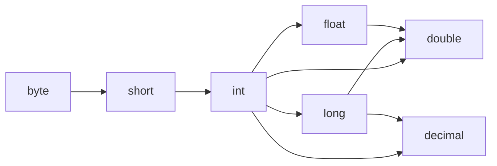

### Why it matters

- Choosing the wrong type causes real bugs: money calculated with `double` can be off by a fraction of a paisa, and `int` overflow can turn a big positive number negative.
- Converting user input (which always arrives as text) into numbers safely is something every backend does all day.

### How it works

- **Implicit:** `small → bigger` is always safe: `int → long → double`.
- **Explicit cast `(int)9.99`:** the decimal part is **cut off (truncated)**, not rounded. The result is `9`, not `10`.
- **Overflow:** if a number is too big for its type, C# by default **wraps around** silently (like a car odometer rolling over). Wrap it in `checked(...)` to get an `OverflowException` instead.
- **Text → number:**
  - `int.Parse("42")` converts, but **throws an exception** if the text is not a valid number.
  - `int.TryParse("abc", out int result)` **never throws**. It returns `true`/`false`, and puts the number in `result` (or 0 if it failed). **Prefer this for user input.**
  - `Convert.ToInt32(x)` works on many input types and turns `null` into `0`.
- **double vs decimal:** `double` stores numbers in binary, and many decimal fractions (like 0.1) can't be stored exactly in binary, just like 1/3 can't be written exactly in decimal (0.3333…). `decimal` stores numbers in base 10, so 0.1 is exact.

### Code

```csharp
namespace Chapter01.Topics;

public static class T01_TypesAndConversions
{
    public static void Run()
    {
        // --- 1. Common built-in types ---
        int age = 30;                       // whole number, 4 bytes
        long population = 8_000_000_000L;   // big whole number, 8 bytes (underscores are only for readability)
        double temperature = 36.6;          // decimal-point number: fast but approximate
        decimal salary = 50000.75m;         // exact decimal number: use for money (note the 'm')
        bool isActive = true;               // true or false
        char grade = 'A';                   // a single character, in single quotes
        string city = "Pune";               // text, in double quotes

        Console.WriteLine($"int={age}, long={population}, double={temperature}, decimal={salary}");
        Console.WriteLine($"bool={isActive}, char={grade}, string={city}");
        Console.WriteLine($"Sizes in bytes: int={sizeof(int)}, long={sizeof(long)}, double={sizeof(double)}, decimal={sizeof(decimal)}");

        // --- 2. Implicit conversion: small type -> bigger type. No data can be lost, so no cast needed ---
        int small = 100;
        long bigger = small;
        double asDouble = small;
        Console.WriteLine($"Implicit: int {small} -> long {bigger} -> double {asDouble}");

        // --- 3. Explicit conversion (cast): you force it, and data CAN be lost ---
        double price = 9.99;
        int whole = (int)price;             // the decimal part is CUT OFF, not rounded
        Console.WriteLine($"(int)9.99 = {whole}");

        long tooBig = 3_000_000_000L;
        int squeezed = (int)tooBig;         // does not fit in an int -> wraps around silently
        Console.WriteLine($"(int)3,000,000,000 = {squeezed}");

        // --- 4. checked: throw an error instead of silently wrapping ---
        try
        {
            int safe = checked((int)tooBig);
            Console.WriteLine(safe);
        }
        catch (OverflowException)
        {
            Console.WriteLine("checked((int)3,000,000,000) threw OverflowException");
        }

        // --- 5. Converting text to numbers ---
        int parsed = int.Parse("42");                              // throws if the text is not a number
        bool success = int.TryParse("abc", out int tryResult);      // never throws, returns true/false
        Console.WriteLine($"int.Parse(\"42\") = {parsed}");
        Console.WriteLine($"int.TryParse(\"abc\") -> success={success}, value={tryResult}");

        string? missing = null;
        Console.WriteLine($"Convert.ToInt32(null) = {Convert.ToInt32(missing)}");   // null becomes 0
        try
        {
            int.Parse(missing!);
        }
        catch (ArgumentNullException)
        {
            Console.WriteLine("int.Parse(null) threw ArgumentNullException");
        }

        // --- 6. Rounding surprises ---
        Console.WriteLine($"Convert.ToInt32(2.5) = {Convert.ToInt32(2.5)}, Convert.ToInt32(3.5) = {Convert.ToInt32(3.5)}");
        Console.WriteLine($"Math.Round(2.5) = {Math.Round(2.5)}, Math.Round(2.5, AwayFromZero) = {Math.Round(2.5, MidpointRounding.AwayFromZero)}");

        // --- 7. double is approximate, decimal is exact ---
        Console.WriteLine($"double:  0.1 + 0.2 = {0.1 + 0.2}");
        Console.WriteLine($"decimal: 0.1 + 0.2 = {0.1m + 0.2m}");
        Console.WriteLine($"0.1 + 0.2 == 0.3 with double? {0.1 + 0.2 == 0.3}");
    }
}
```

> `try { ... } catch (SomeException) { ... }` means: "try to run this code; if this kind of error happens, run the catch block instead of crashing". Exceptions are covered fully in Chapter 2.

**Output:**

```
int=30, long=8000000000, double=36.6, decimal=50000.75
bool=True, char=A, string=Pune
Sizes in bytes: int=4, long=8, double=8, decimal=16
Implicit: int 100 -> long 100 -> double 100
(int)9.99 = 9
(int)3,000,000,000 = -1294967296
checked((int)3,000,000,000) threw OverflowException
int.Parse("42") = 42
int.TryParse("abc") -> success=False, value=0
Convert.ToInt32(null) = 0
int.Parse(null) threw ArgumentNullException
Convert.ToInt32(2.5) = 2, Convert.ToInt32(3.5) = 4
Math.Round(2.5) = 2, Math.Round(2.5, AwayFromZero) = 3
double:  0.1 + 0.2 = 0.30000000000000004
decimal: 0.1 + 0.2 = 0.3
0.1 + 0.2 == 0.3 with double? False
```

### Common mistakes / gotchas

- **Using `double` for money.** Always use `decimal` for prices, salaries and balances.
- **Expecting a cast to round.** `(int)9.99` is `9`. Use `Math.Round` if you want rounding.
- **Silent overflow.** `(int)3_000_000_000` gives `-1294967296` with no error.
- **Integer division.** `5 / 2` is `2`, not `2.5`, because both sides are `int`. Write `5 / 2.0` or `5m / 2` to get the decimal result.
- **Using `int.Parse` on user input.** It crashes on bad input. Use `TryParse`.
- **Comparing doubles with `==`.** `0.1 + 0.2 == 0.3` is `false`. Compare with a tolerance: `Math.Abs(a - b) < 0.0001`.

### 5-YOE depth

- **Banker's rounding.** `Math.Round` and `Convert.ToInt32` use `MidpointRounding.ToEven` by default: a .5 value rounds to the nearest **even** number (2.5 → 2, 3.5 → 4). This reduces bias across millions of rounding operations. Financial rules often require `MidpointRounding.AwayFromZero`, so always specify it explicitly for money.
- **Culture-aware parsing.** `double.Parse("1,5")` gives a different result depending on the server's culture settings (in Germany the comma is the decimal separator). On servers, parse machine data with `CultureInfo.InvariantCulture`, e.g. `double.Parse(text, CultureInfo.InvariantCulture)`.
- **Project-wide overflow checking.** `<CheckForOverflowUnderflow>true</CheckForOverflowUnderflow>` in the `.csproj` makes all arithmetic checked. It costs a little performance, which is why it's off by default.
- **`decimal` is slower** than `double` (it's done in software, not directly by the CPU) and has a smaller range. That's fine for money, but bad for heavy scientific math.
- **Every type in C# belongs to the Common Type System (CTS)**, which is why `int` and `System.Int32` are identical and other .NET languages can share the same types.

### Interview questions

1. **What is the difference between implicit and explicit conversion?**
   Implicit conversion happens automatically when no data can be lost (`int` → `long`). Explicit conversion needs a cast `(int)x` because data might be lost (`double` → `int` cuts the decimal part).
2. **Why use `decimal` instead of `double` for money?**
   `double` is binary floating point, so values like 0.1 can't be stored exactly (0.1 + 0.2 = 0.30000000000000004). `decimal` is base-10, so it's exact for money. The trade-off is that it's slower and uses more memory.
3. **`int.Parse` vs `int.TryParse` vs `Convert.ToInt32`?**
   `Parse` throws on invalid or null input. `TryParse` returns `bool` and never throws, so it's best for user input. `Convert.ToInt32` returns 0 for `null` and accepts many input types.
4. **What happens when an `int` overflows?**
   By default it silently wraps around (`int.MaxValue + 1` = `int.MinValue`). Inside `checked` it throws `OverflowException`.
5. **What does `Math.Round(2.5)` return and why?**
   `2`, because the default is banker's rounding (round half to even). Pass `MidpointRounding.AwayFromZero` to get 3.

---

## 1.2 var vs dynamic vs object

### What it is

These are three ways of declaring variables that often confuse people because all three can hold "anything" at first glance. They are completely different:

| | `var` | `object` | `dynamic` |
|---|---|---|---|
| Who decides the type? | The **compiler**, from the value on the right | You: it's literally the type `object` | Nobody until **runtime** |
| Is the type fixed? | Yes, forever | The variable can point to anything | It can be anything, anytime |
| Type checking | Compile time | Compile time (you must cast to use the value) | Runtime only |
| If you make a mistake | Compile error (safe) | Compile error or cast exception | **Runtime crash** |

- **`var`** is just a shortcut. `var count = 10;` is **exactly** the same as `int count = 10;`. The compiler looks at the right side, sees an `int`, and fixes the type as `int`.
- **`object`** is the base type of every type in .NET. Every value can be stored in an `object` variable, but to *use* the value as its real type you must cast it back.
- **`dynamic`** switches off compile-time checking. The compiler trusts you completely and the checks happen when the line runs.

### Why it matters

- `var` makes code shorter without losing safety. It's used everywhere in modern C#.
- `object` shows up in older APIs and in boxing (topic 18).
- `dynamic` is rare and risky. Interviewers ask about it to see if you understand compile-time vs runtime checking.

### How it works

- `var` requires a value on the right: `var x;` is a compile error, because the compiler has nothing to infer from.
- With `object`, the compiler only knows "this is an object", so it only lets you use what every object has (`ToString()`, `Equals()`, `GetType()`).
- With `dynamic`, the compiler writes code that, **at runtime**, inspects the real object and looks up the member you asked for. If the member doesn't exist, you get a `RuntimeBinderException`.

### Code

```csharp
using Microsoft.CSharp.RuntimeBinder;

namespace Chapter01.Topics;

public static class T02_VarDynamicObject
{
    public static void Run()
    {
        // --- var: the COMPILER works out the type from the right-hand side. Still strongly typed. ---
        var count = 10;          // count is an int, forever
        var message = "hello";   // message is a string, forever
        // count = "ten";        // COMPILE ERROR: cannot convert string to int
        Console.WriteLine($"var count -> {count.GetType().Name}, var message -> {message.GetType().Name}");

        // --- object: the base type of everything. Can hold anything, but you must cast to use it. ---
        object box = 10;
        // int sum = box + 5;    // COMPILE ERROR: operator '+' cannot be applied to 'object' and 'int'
        int sum = (int)box + 5;  // cast back to int first
        Console.WriteLine($"object box holds {box.GetType().Name}; (int)box + 5 = {sum}");
        box = "now I am a string";   // allowed: object can hold anything
        Console.WriteLine($"object box now holds {box.GetType().Name}");

        // --- dynamic: type checks are skipped at compile time and done at RUNTIME ---
        dynamic anything = 10;
        anything = anything + 5;     // works: at runtime it sees int + int
        Console.WriteLine($"dynamic: {anything} ({anything.GetType().Name})");
        anything = "text";
        Console.WriteLine($"dynamic now: {anything} (Length = {anything.Length})");

        try
        {
            anything.ThisMethodDoesNotExist();   // compiles fine! It only fails when it runs
        }
        catch (RuntimeBinderException ex)
        {
            Console.WriteLine($"Runtime error: {ex.Message}");
        }
    }
}
```

**Output:**

```
var count -> Int32, var message -> String
object box holds Int32; (int)box + 5 = 15
object box now holds String
dynamic: 15 (Int32)
dynamic now: text (Length = 4)
Runtime error: 'string' does not contain a definition for 'ThisMethodDoesNotExist'
```

### Common mistakes / gotchas

- **Thinking `var` is like JavaScript's `var`** (loosely typed). It's not. C#'s `var` is fully strongly typed.
- **Using `var` when the type isn't obvious.** `var result = Process();` hides what `result` is. Many teams use `var` only when the type is clear from the right side (`var list = new List<int>();`).
- **Using `dynamic` to "avoid" casting.** You lose IntelliSense (editor autocomplete), compile-time safety and performance.

### 5-YOE depth

- `var` is **required** for **anonymous types**, e.g. `var x = new { Name = "A", Age = 3 };`, because the type has no name you could write. LINQ projections (Chapter 3) use this a lot.
- `dynamic` is implemented by the **Dynamic Language Runtime (DLR)**. The first call at each place in the code is slow (it has to work out what to call). After that it caches the result for that call site, but it's still slower than normal calls.
- Legitimate uses of `dynamic`: COM interop (e.g. automating Excel), talking to dynamic languages, and some reflection-heavy code. In modern backends, prefer strongly-typed models or `JsonElement`/`JsonNode` for unknown JSON.
- Storing a value type (like `int`) in an `object` **boxes** it (topic 18), which allocates memory.

### Interview questions

1. **Is `var` dynamically typed?**
   No. `var` is resolved at compile time and the variable is strongly typed. Only `dynamic` is resolved at runtime.
2. **Difference between `object` and `dynamic`?**
   Both can hold anything. With `object`, the compiler only allows `object` members and you must cast to use the real type, so errors are caught at compile time. With `dynamic`, the compiler allows any member, and mistakes show up as runtime exceptions.
3. **When must you use `var`?**
   With anonymous types, because they have no name you can write.
4. **When would you use `dynamic`?**
   Rarely: COM interop or interop with dynamic languages. Avoid it in normal backend code because it gives up type safety and performance.

---

## 1.3 Value types vs reference types (stack, heap, copying)

### What it is

Every type in C# is either a **value type** or a **reference type**. This is one of the most important ideas in C#.

- **Value type:** the variable **holds the data itself**.
  Examples: `int`, `double`, `decimal`, `bool`, `char`, `DateTime`, `enum`, and any `struct` you write.
- **Reference type:** the variable holds an **address (a reference)** that points to the data somewhere else in memory.
  Examples: `string`, arrays, `List<T>`, and any `class` you write.

**Real-world example (used in the code below):**
- A **delivery location** (latitude, longitude) is a small value, so it's a `struct`. If the customer moves their pin on the map, the warehouse location must not move too. Copies must be independent.
- A **shopping cart** is a `class`. The cart in the user's session and the cart the checkout page reads must be **the same cart**. If the user adds an item, checkout must see it.

**Analogy:**
- A value type is like a **photocopy of a document**. If you give someone a copy and they scribble on it, your original is untouched.
- A reference type is like a **Google Docs link**. If you share the link and someone edits the document, you see the change too, because there's only one document.

### Why it matters

This decides what happens when you assign a variable to another variable or pass it to a method. Misunderstanding it causes "why did my data change?!" bugs.

### How it works

Memory has two main areas you need to know about:

| | **Stack** | **Heap** |
|---|---|---|
| What it is | A small, fast, organized area for the method currently running | A large area for objects that may live for a long time |
| How it's cleaned | Automatically, the moment a method finishes | By the **Garbage Collector (GC)**, which periodically finds and frees objects no longer used |
| Typically holds | Local variables of value types, and references (addresses) | Objects created with `new` from classes, arrays, strings |

This is what memory looks like after `var customer = warehouse;` (a struct copy) and `var cartInSession = cart;` (a class copy):

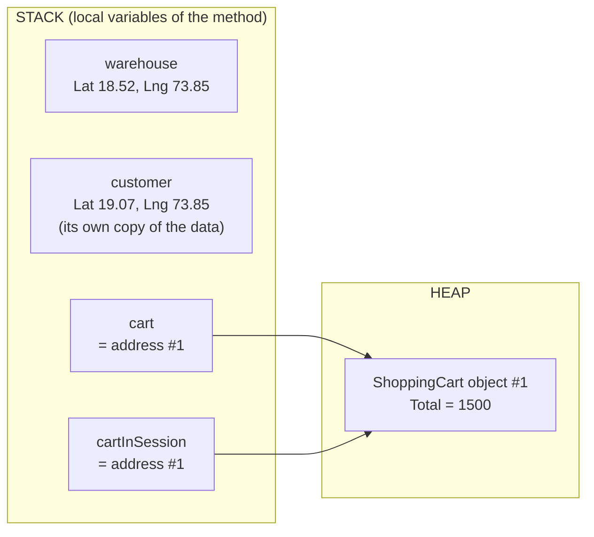

The two structs each hold their own data. The two cart variables hold the **same address**, so there is only **one** cart.

**Copying:**
- `var s2 = s1;` with a **struct** copies all the data, so you get two independent values.
- `var c2 = c1;` with a **class** copies only the address, so both variables point to **the same object**.

**Passing to a method** works the same way, because C# passes arguments **by value** by default: the method receives a **copy of the variable**.
- For a struct, the copy is a copy of the data, so the caller's data can't be changed.
- For a class, the copy is a copy of the *address*. The method can change the object it points to (the caller sees it), but if the method points its copy at a **new** object, the caller's variable is unaffected.

### Code

```csharp
namespace Chapter01.Topics;

public static class T03_ValueVsReference
{
    // A struct is a VALUE type: the variable holds the data itself.
    private struct DeliveryLocation
    {
        public double Latitude;
        public double Longitude;
    }

    // A class is a REFERENCE type: the variable holds an address that points to the data.
    private class ShoppingCart
    {
        public decimal Total;
    }

    public static void Run()
    {
        // --- Copying a value type copies the DATA ---
        var warehouse = new DeliveryLocation { Latitude = 18.52, Longitude = 73.85 };
        var customer = warehouse;          // full, independent copy
        customer.Latitude = 19.07;         // move the customer's pin
        Console.WriteLine($"struct: warehouse.Latitude = {warehouse.Latitude}, customer.Latitude = {customer.Latitude}   (independent copies)");

        // --- Copying a reference type copies the ADDRESS ---
        var cart = new ShoppingCart { Total = 1000 };
        var cartInSession = cart;          // both variables point to the SAME cart
        cartInSession.Total += 500;        // the user adds an item through the session
        Console.WriteLine($"class:  cart.Total = {cart.Total}, cartInSession.Total = {cartInSession.Total}  (same object)");
        Console.WriteLine($"cart and cartInSession are the same object? {ReferenceEquals(cart, cartInSession)}");

        // --- Passing to a method works the same way ---
        var pin = new DeliveryLocation { Latitude = 18.52, Longitude = 73.85 };
        SnapToNearestRoad(pin);
        Console.WriteLine($"After SnapToNearestRoad: pin.Latitude = {pin.Latitude}   (the method changed a copy)");

        var cart2 = new ShoppingCart { Total = 1000 };
        ApplyFlatDiscount(cart2);
        Console.WriteLine($"After ApplyFlatDiscount: cart2.Total = {cart2.Total}  (the method changed the real cart)");

        // --- Replacing the reference inside a method does NOT affect the caller ---
        var cart3 = new ShoppingCart { Total = 1000 };
        ResetCart(cart3);
        Console.WriteLine($"After ResetCart: cart3.Total = {cart3.Total}   (the method only replaced its own copy of the address)");

        // --- Default values ---
        DeliveryLocation noLocation = default;
        ShoppingCart? noCart = default;
        Console.WriteLine($"default struct Latitude = {noLocation.Latitude}, default class is null? {noCart is null}");
    }

    private static void SnapToNearestRoad(DeliveryLocation location) => location.Latitude = 18.53;
    private static void ApplyFlatDiscount(ShoppingCart cart) => cart.Total -= 200;
    private static void ResetCart(ShoppingCart cart) => cart = new ShoppingCart { Total = 0 };
}
```

> `private` means "only visible inside this class" (topic 9). `ReferenceEquals(a, b)` returns true only if both point to the exact same object. `default` gives the default value of a type: `0` for numbers, `null` for references.

**Output:**

```
struct: warehouse.Latitude = 18.52, customer.Latitude = 19.07   (independent copies)
class:  cart.Total = 1500, cartInSession.Total = 1500  (same object)
cart and cartInSession are the same object? True
After SnapToNearestRoad: pin.Latitude = 18.52   (the method changed a copy)
After ApplyFlatDiscount: cart2.Total = 800  (the method changed the real cart)
After ResetCart: cart3.Total = 1000   (the method only replaced its own copy of the address)
default struct Latitude = 0, default class is null? True
```

Notice the bug hiding in `SnapToNearestRoad`: it *looks* like it corrects the pin, but it only changed its own copy. With structs, a method must **return** the new value (`pin = SnapToNearestRoad(pin);`) or take a `ref` parameter.

### Common mistakes / gotchas

- **Thinking "reference types are passed by reference".** They aren't. The *reference* is passed **by value** (a copy of the address). That's why `ResetCart` didn't affect the caller. To truly pass by reference, use `ref` (topic 6).
- **Mutable structs.** Changing a struct that was copied changes only the copy. This is why structs should usually be **immutable** (can't be changed after creation).
- **`string` is a reference type**, but it *behaves* like a value type because it's immutable (topic 4).

### 5-YOE depth

- **"Value types live on the stack" is a myth, or at best half true.** Value types live *wherever they are declared*:
  - a local `int` in a method → stack (or just a CPU register)
  - an `int` field inside a class → **heap** (inside that object)
  - a value type inside an array → heap (arrays are objects)
  - a local captured by a lambda or used across `await` → heap (the compiler moves it into a hidden object)

  The real difference is **copy semantics**: value types are copied by value, reference types by reference. That's the answer interviewers want.
- **When to make a struct** (Microsoft's guidance): it represents a single small value (like a point or money), it's under about 16 bytes, it's immutable, and it won't be boxed often. Otherwise use a class.
- Large structs are expensive to copy every time they are passed around. That's why `in` parameters (topic 6) and `readonly struct` exist.
- `stops[0].Latitude = 19.0` with `List<DeliveryLocation>` is a **compile error**: the indexer returns a *copy*, and changing a temporary copy would be pointless. With arrays (`stopsArray[0].Latitude = 19.0`) it works, because arrays give direct access to the element.

### Interview questions

1. **What's the difference between value types and reference types?**
   A value-type variable holds the data itself, and assignment copies the data. A reference-type variable holds a reference to an object on the heap, and assignment copies the reference, so both variables point to the same object.
2. **Are value types always on the stack?**
   No. They're stored where they're declared: locals usually on the stack, but fields of classes, array elements, and captured or async locals are on the heap. The defining difference is copy semantics, not location.
3. **Is a class passed by reference to a method?**
   No. The reference is passed by value. The method can modify the object, but reassigning the parameter doesn't affect the caller. Use `ref` to pass the variable itself.
4. **When would you choose a struct over a class?**
   For small (≤16 bytes), immutable, value-like data that's created often, e.g. coordinates or money, to avoid heap allocations. Otherwise use a class.
5. **Is `string` a value type?**
   No, it's a reference type, but it's immutable and `==` compares contents, so it behaves like a value.

---

## 1.4 Strings, string immutability and StringBuilder

### What it is

A `string` is a sequence of characters (text). In C#, strings are **immutable**: once a string object is created, it can **never change**. Every operation that seems to change a string (`ToUpper`, `Replace`, `+=`) actually creates a **brand-new string**.

`StringBuilder` is a separate class designed for building text step by step. It keeps a growing internal buffer that it **can** change, so it doesn't create a new string on every step.

### Why it matters

- Building a large string with `+=` in a loop creates thousands of throw-away strings. That's slow and puts pressure on the garbage collector.
- String comparison mistakes (case, culture) cause real bugs in login systems, lookups and sorting.

### How it works

- `a += " there"` creates a new string `"hi there"` and points `a` at it. Any other variable that pointed to the old `"hi"` still sees `"hi"`:

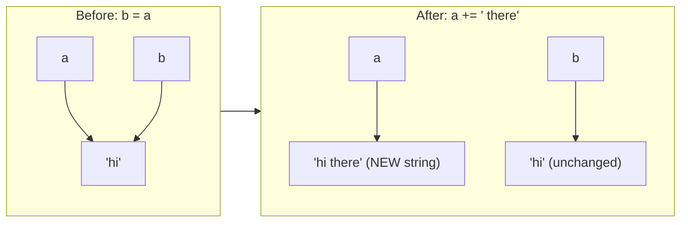

In a loop that runs 20,000 times, `+=` creates 20,000 strings like this and throws 19,999 of them away. `StringBuilder` keeps one buffer and grows it.
- **`==` on strings compares the text**, even though `string` is a reference type. C# defines `==` for strings specially.
- **String interning:** the compiler stores identical string *literals* (text written directly in code) only once, so two variables holding `"interned"` actually point to the same object. Strings built at runtime are not interned automatically.
- **Comparing without caring about case:** use `string.Equals(a, b, StringComparison.OrdinalIgnoreCase)`, not `a.ToLower() == b.ToLower()`. The `ToLower` version creates two extra strings.
- **Literal styles:**
  - Normal: `"C:\\temp"`, where backslash starts escape sequences like `\n` (new line), so a real backslash needs `\\`
  - Verbatim: `@"C:\temp"`, where backslashes are literal
  - Raw string literals (C# 11): `"""..."""`, where everything is literal, including quotes. Great for JSON and SQL.

### Code

```csharp
using System.Diagnostics;
using System.Text;

namespace Chapter01.Topics;

public static class T04_Strings
{
    public static void Run()
    {
        // --- Strings are immutable: methods return a NEW string, the original never changes ---
        string original = "hello";
        string upper = original.ToUpper();
        Console.WriteLine($"original = {original}, upper = {upper}");

        string a = "hi";
        string b = a;       // b points to the same string as a
        a += " there";      // creates a NEW string; a now points to it, b still points to the old one
        Console.WriteLine($"a = \"{a}\", b = \"{b}\"");

        // --- == compares the TEXT for strings (not the address) ---
        string x = "dotnet";
        string y = new string("dotnet".ToCharArray());   // a different object with the same text
        Console.WriteLine($"x == y: {x == y}, same object: {ReferenceEquals(x, y)}");

        // --- String interning: identical literals in code share one object ---
        string lit1 = "interned";
        string lit2 = "interned";
        Console.WriteLine($"Two identical literals are the same object: {ReferenceEquals(lit1, lit2)}");

        // --- Comparing safely ---
        Console.WriteLine($"\"ABC\" == \"abc\": {"ABC" == "abc"}");
        Console.WriteLine($"string.Equals(\"ABC\", \"abc\", OrdinalIgnoreCase): {string.Equals("ABC", "abc", StringComparison.OrdinalIgnoreCase)}");

        // --- Null / empty / whitespace checks ---
        string spaces = "   ";
        Console.WriteLine($"IsNullOrEmpty(\"   \") = {string.IsNullOrEmpty(spaces)}, IsNullOrWhiteSpace(\"   \") = {string.IsNullOrWhiteSpace(spaces)}");

        // --- Concatenation in a loop vs StringBuilder ---
        const int n = 20_000;
        var sw = Stopwatch.StartNew();
        string slow = "";
        for (int i = 0; i < n; i++) slow += "x";     // creates 20,000 temporary strings
        sw.Stop();
        long concatMs = sw.ElapsedMilliseconds;

        sw.Restart();
        var sb = new StringBuilder();
        for (int i = 0; i < n; i++) sb.Append('x');   // edits one growing buffer
        string fast = sb.ToString();
        sw.Stop();
        Console.WriteLine($"+= in loop: {concatMs} ms, StringBuilder: {sw.ElapsedMilliseconds} ms (lengths {slow.Length}, {fast.Length})");

        // --- Literal styles ---
        string path = @"C:\temp\new";                 // verbatim string: backslashes are not escape characters
        string json = """
            { "name": "Asha", "age": 30 }
            """;                                       // raw string literal (C# 11): quotes need no escaping
        Console.WriteLine($"verbatim: {path}");
        Console.WriteLine($"raw: {json}");
    }
}
```

> `Stopwatch` measures elapsed time. `for (int i = 0; i < n; i++)` is a loop that runs `n` times.

**Output** (the timings will differ on your machine, but `+=` is always far slower):

```
original = hello, upper = HELLO
a = "hi there", b = "hi"
x == y: True, same object: False
Two identical literals are the same object: True
"ABC" == "abc": False
string.Equals("ABC", "abc", OrdinalIgnoreCase): True
IsNullOrEmpty("   ") = False, IsNullOrWhiteSpace("   ") = True
+= in loop: 110 ms, StringBuilder: 0 ms (lengths 20000, 20000)
verbatim: C:\temp\new
raw: { "name": "Asha", "age": 30 }
```

### Common mistakes / gotchas

- **Calling `s.Trim()` and expecting `s` to change.** It returns a new string. You must write `s = s.Trim();`.
- **`+=` inside big loops.** Use `StringBuilder` or `string.Join`.
- **Using `StringBuilder` for 2–3 pieces.** It's overkill. `a + b + c` compiles into a single efficient `string.Concat` call.
- **Case-insensitive comparison via `ToLower()`/`ToUpper()`.** It wastes memory and is culture-sensitive. Use `StringComparison.OrdinalIgnoreCase`.
- **Checking only `IsNullOrEmpty` for user input.** `"   "` passes that check. Use `IsNullOrWhiteSpace`.

### 5-YOE depth

- **Why are strings immutable?** Thread safety (many threads can read the same string safely), safe use as dictionary keys (a key can't change after it's inserted), security (a validated file path can't be changed afterwards), and interning (sharing is only safe because nobody can modify them).
- **Ordinal vs culture comparison.** `Ordinal` compares the raw character codes: fast and predictable. **Use it for identifiers, keys, file paths and protocol values.** Culture-aware comparison follows language rules. Use it only for text shown to and sorted for humans. The classic bug: in Turkish culture, `"i".ToUpper()` is `"İ"`, not `"I"`, so `ToUpper()` comparisons break.
- For dictionaries with case-insensitive keys, use `new Dictionary<string, int>(StringComparer.OrdinalIgnoreCase)`.
- **`StringBuilder` capacity.** If you know the final size, pass it in: `new StringBuilder(capacity: 20_000)`. This avoids repeatedly growing the buffer.
- **Interpolated strings** (`$"..."`) were optimized in .NET 6 with *interpolated string handlers*. They no longer box value types or allocate intermediate strings in most cases.
- For extreme performance there's `string.Create` and `Span<char>` (Chapter 4), which build strings without extra allocations.

### Interview questions

1. **Why are strings immutable in .NET?**
   For thread safety, safe dictionary keys, security, and to allow interning. Every "change" creates a new string.
2. **When should you use `StringBuilder`?**
   When building a string in a loop or from many pieces. For a few concatenations, `+` or interpolation is fine and just as fast.
3. **Does `==` compare references for strings?**
   No. `string` overloads `==` to compare contents. Use `ReferenceEquals` to compare references.
4. **What is string interning?**
   The runtime keeps one shared copy of each identical string literal. `string.Intern` can intern runtime strings manually, but that's rarely needed.
5. **How should you compare strings case-insensitively?**
   `string.Equals(a, b, StringComparison.OrdinalIgnoreCase)` for identifiers; `CurrentCultureIgnoreCase` only for user-facing text.

---

## 1.5 Nullable value types and nullable reference types

### What it is

**`null`** means "no value / nothing here".

- **Nullable value types:** normally a value type like `int` **cannot** be null; it always has a number (0 by default). Adding `?` (`int?`) makes it able to hold either a number **or** null. Useful for "optional" data such as a discount that may not exist, or a database column that allows NULL.
- **Nullable reference types (NRT, C# 8+):** reference types like `string` **could always** be null, which caused the famous `NullReferenceException` crash. With NRT turned on (`<Nullable>enable</Nullable>`), the compiler treats `string` as "should never be null" and `string?` as "might be null", and **warns** you when you might use a null by mistake.

### Why it matters

`NullReferenceException` ("Object reference not set to an instance of an object") is the most common runtime error in .NET. These features help you find null bugs **at compile time** instead of in production.

### How it works

**Operators you must know:**

| Operator | Name | Meaning | Example |
|---|---|---|---|
| `?.` | Null-conditional | "If it's null, stop and give null; otherwise continue" | `name?.Length` |
| `??` | Null-coalescing | "If the left side is null, use the right side" | `discount ?? 5` |
| `??=` | Null-coalescing assignment | "Assign only if currently null" | `discount ??= 10` |
| `!` | Null-forgiving | "Compiler, trust me: this isn't null" (no runtime check!) | `GetName()!` |
| `is null` / `is not null` | Null check pattern | Safest way to test for null | `if (x is not null)` |

**`int?` members:** `.HasValue` (true or false), `.Value` (the number, but **throws** if null), `.GetValueOrDefault()` (the number, or 0 if null).

**Important:** nullable *reference* types are **only compiler warnings**. They don't change how the program runs: a `string` can still be null at runtime if, for example, it comes from JSON or old code.

### Code

```csharp
namespace Chapter01.Topics;

public static class T05_Nullable
{
    public static void Run()
    {
        // --- Nullable VALUE types: int? can hold a number OR null ---
        int? discount = null;
        Console.WriteLine($"discount.HasValue = {discount.HasValue}");
        Console.WriteLine($"discount.GetValueOrDefault() = {discount.GetValueOrDefault()}");
        Console.WriteLine($"discount ?? 5 = {discount ?? 5}");

        try
        {
            int value = discount.Value;   // throws, because there is no value (the compiler even warns: CS8629)
            Console.WriteLine(value);
        }
        catch (InvalidOperationException ex)
        {
            Console.WriteLine($"discount.Value threw: {ex.Message}");
        }

        discount ??= 10;   // assign only if it is currently null
        Console.WriteLine($"after discount ??= 10: {discount}");

        // Arithmetic with null gives null
        int? nothing = null;
        int? total = discount + nothing;
        Console.WriteLine($"10 + null = {total?.ToString() ?? "null"}");

        // --- Nullable REFERENCE types: the compiler warns you, nothing changes at runtime ---
        string? maybeName = GetNameOrNull(useNull: true);
        // Console.WriteLine(maybeName.Length);   // WARNING CS8602: dereference of a possibly null reference
        Console.WriteLine($"maybeName?.Length = {maybeName?.Length.ToString() ?? "null"}");
        Console.WriteLine($"maybeName?.Length ?? 0 = {maybeName?.Length ?? 0}");

        string definitelyName = GetNameOrNull(useNull: false)!;   // ! = "trust me, it's not null" (no runtime check)
        Console.WriteLine($"definitelyName = {definitelyName}");

        // Pattern-matching null checks
        if (maybeName is not null)
            Console.WriteLine("maybeName has a value");
        else
            Console.WriteLine("maybeName is null");
    }

    private static string? GetNameOrNull(bool useNull) => useNull ? null : "Ravi";
}
```

> `condition ? a : b` is the **ternary operator**: "if condition is true use `a`, otherwise `b`".

**Output:**

```
discount.HasValue = False
discount.GetValueOrDefault() = 0
discount ?? 5 = 5
discount.Value threw: Nullable object must have a value.
after discount ??= 10: 10
10 + null = null
maybeName?.Length = null
maybeName?.Length ?? 0 = 0
definitelyName = Ravi
maybeName is null
```

### Common mistakes / gotchas

- **Calling `.Value` without checking `.HasValue`.** It throws `InvalidOperationException`.
- **Sprinkling `!` everywhere to silence warnings.** You just hide the bug. Use `!` only when you truly know something the compiler can't.
- **Thinking NRT protects you at runtime.** It doesn't. Public API inputs (controller parameters, library methods) still need validation, e.g. `ArgumentNullException.ThrowIfNull(input);`.
- **Writing `== null` on types that overload `==`.** That runs custom code; `is null` always does a pure null check.

### 5-YOE depth

- `int?` is shorthand for the struct **`Nullable<int>`**, which holds two things: a `bool hasValue` and the `int value`. It's still a value type.
- Boxing a null `int?` produces a real `null` reference, not a box containing "no value". Boxing a non-null `int?` boxes the plain `int`.
- **Nullable attributes** help the compiler understand your intent: `[NotNullWhen(true)]` on a `TryGet` method's out parameter, `[MaybeNull]`, `[NotNull]`, `[MemberNotNull]`. They're used heavily in .NET's own code.
- In real projects, many teams make null warnings errors: `<WarningsAsErrors>nullable</WarningsAsErrors>`.
- **EF Core (Chapter 11) uses NRT** to decide whether a database column is `NULL` or `NOT NULL`: `string Name` → NOT NULL, `string? Name` → NULL. Turning NRT on in an existing project can therefore change your migrations.
- **ASP.NET Core model validation** treats non-nullable reference properties as `[Required]` automatically when NRT is enabled.

### Interview questions

1. **What's the difference between `int?` and `int`?**
   `int?` is `Nullable<int>`, which can hold a number or null. `int` always holds a number (0 by default).
2. **What do `?.`, `??` and `??=` do?**
   `?.` safely accesses a member and returns null if the object is null. `??` gives a fallback when the left side is null. `??=` assigns only if the variable is null.
3. **Do nullable reference types prevent `NullReferenceException` at runtime?**
   No. They're compile-time warnings only. You still validate inputs at public boundaries.
4. **What does the `!` operator do?**
   It's the null-forgiving operator. It suppresses the compiler's nullable warning without any runtime check.
5. **How does NRT affect EF Core?**
   Non-nullable reference properties become `NOT NULL` columns; `string?` becomes a nullable column.

---

## 1.6 Methods and parameters: optional, named, ref, out, in, params

### What it is

A **method** is a named, reusable block of code. **Parameters** are the inputs it accepts. C# gives you several ways to pass inputs:

| Keyword | Meaning | Must caller initialise it? | Can the method change it? |
|---|---|---|---|
| *(none)* | Pass a **copy** (by value). The default. | Yes | Only its own copy |
| `ref` | Pass the **variable itself** | **Yes** | Yes, and the caller sees the change |
| `out` | The method **gives back** an extra value through it | No | **Must** assign it |
| `in` | Pass by reference, but **read-only** | Yes | No |
| `params` | Accept **any number** of arguments as an array | n/a | n/a |

Also:
- **Optional parameters** have a default value: `void SendOtp(string phone, string channel = "SMS")`. The caller can leave them out.
- **Named arguments** let the caller write the parameter name: `SendOtp(expiryMinutes: 10, phone: "...")`, which makes calls clearer and allows any order.

### Why it matters

- The `TryXxx(input, out result)` pattern (like `int.TryParse`) is used everywhere in .NET.
- Understanding `ref` explains *why* normal parameters can't replace the caller's object (topic 3).
- `in` is a performance tool for large structs.

### How it works

- **By value (default):** the method gets a copy of the variable. For value types that's a copy of the data; for reference types it's a copy of the address.
- **`ref`:** the method gets an **alias** for the caller's variable. Changing it, or even replacing it with a new object, changes the caller's variable.
- **`out`:** like `ref`, but meant for *output only*. The compiler forces the method to assign it on every path before returning. The caller can declare it inline: `TryGetCouponDiscount("FESTIVE20", out int percent)`.
- **`_` (discard):** `out _` means "I don't care about this value".
- **`in`:** passes by reference (no copy, which helps for big structs) but the method can't modify it.
- **`params decimal[] lineAmounts`:** the caller can write `OrderTotal(499m, 1299m, 99m)` or `OrderTotal()`, and the compiler builds the array for you. It must be the **last** parameter.

### Code

```csharp
namespace Chapter01.Topics;

public static class T06_MethodParameters
{
    public static void Run()
    {
        // --- Optional and named parameters ---
        SendOtp("+91-9000000001");                                // uses the default channel and expiry
        SendOtp("+91-9000000002", channel: "WhatsApp");           // named argument
        SendOtp(expiryMinutes: 10, phone: "+91-9000000003");      // named arguments can be in any order

        // --- ref: pass the variable itself. It must be assigned before the call ---
        int loyaltyPoints = 120;
        AddLoyaltyPoints(ref loyaltyPoints, orderAmount: 2500m);
        Console.WriteLine($"After AddLoyaltyPoints(ref loyaltyPoints): {loyaltyPoints}");

        // --- out: the method MUST assign it. The caller does not need to initialise it ---
        if (TryGetCouponDiscount("FESTIVE20", out int percent))
            Console.WriteLine($"Coupon FESTIVE20 gives {percent}% off");
        if (!TryGetCouponDiscount("EXPIRED10", out _))           // _ is a "discard": I don't need this value
            Console.WriteLine("Coupon EXPIRED10 is not valid");

        // --- in: pass by reference but READ-ONLY (useful for large structs) ---
        var deliveryZone = new BoundingBox(18.40, 73.70, 18.65, 74.00);
        Console.WriteLine($"Is (18.52, 73.85) inside the Pune delivery zone? {IsInside(in deliveryZone, 18.52, 73.85)}");

        // --- params: pass any number of arguments ---
        Console.WriteLine($"OrderTotal(499, 1299, 99) = {OrderTotal(499m, 1299m, 99m)}");
        Console.WriteLine($"OrderTotal() = {OrderTotal()}");

        // --- ref with a reference type: lets the method REPLACE the caller's object ---
        var cartItems = new List<string> { "Mouse" };
        ReplaceWithSavedCart(cartItems);
        Console.WriteLine($"After ReplaceWithSavedCart(cartItems):          count = {cartItems.Count}");
        ReplaceWithSavedCartByRef(ref cartItems);
        Console.WriteLine($"After ReplaceWithSavedCartByRef(ref cartItems): count = {cartItems.Count}");
    }

    private static void SendOtp(string phone, string channel = "SMS", int expiryMinutes = 5)
        => Console.WriteLine($"OTP sent to {phone} via {channel}, valid for {expiryMinutes} min");

    // 1 point for every 100 rupees spent
    private static void AddLoyaltyPoints(ref int points, decimal orderAmount) => points += (int)(orderAmount / 100);

    private static bool TryGetCouponDiscount(string couponCode, out int percent)
    {
        if (couponCode == "FESTIVE20")
        {
            percent = 20;
            return true;
        }
        percent = 0;         // out parameters must be assigned on every path
        return false;
    }

    // A 32-byte struct: copying it on every call would be wasteful
    private readonly struct BoundingBox
    {
        public readonly double MinLatitude;
        public readonly double MinLongitude;
        public readonly double MaxLatitude;
        public readonly double MaxLongitude;

        public BoundingBox(double minLat, double minLng, double maxLat, double maxLng)
        {
            MinLatitude = minLat;
            MinLongitude = minLng;
            MaxLatitude = maxLat;
            MaxLongitude = maxLng;
        }
    }

    private static bool IsInside(in BoundingBox zone, double lat, double lng)
    {
        // zone = new BoundingBox(0, 0, 0, 0);   // COMPILE ERROR: cannot assign to an 'in' parameter
        return lat >= zone.MinLatitude && lat <= zone.MaxLatitude
            && lng >= zone.MinLongitude && lng <= zone.MaxLongitude;
    }

    private static decimal OrderTotal(params decimal[] lineAmounts) => lineAmounts.Sum();

    private static void ReplaceWithSavedCart(List<string> items) => items = new List<string> { "Laptop", "Bag", "Charger" };
    private static void ReplaceWithSavedCartByRef(ref List<string> items) => items = new List<string> { "Laptop", "Bag", "Charger" };
}
```

> `List<string>` is a growable list (Chapter 2). `lineAmounts.Sum()` adds them up (LINQ, Chapter 3). `static` means the method belongs to the class itself, not to an object (topic 7). `&&` means "and".

**Output:**

```
OTP sent to +91-9000000001 via SMS, valid for 5 min
OTP sent to +91-9000000002 via WhatsApp, valid for 5 min
OTP sent to +91-9000000003 via SMS, valid for 10 min
After AddLoyaltyPoints(ref loyaltyPoints): 145
Coupon FESTIVE20 gives 20% off
Coupon EXPIRED10 is not valid
Is (18.52, 73.85) inside the Pune delivery zone? True
OrderTotal(499, 1299, 99) = 1897
OrderTotal() = 0
After ReplaceWithSavedCart(cartItems):          count = 1
After ReplaceWithSavedCartByRef(ref cartItems): count = 3
```

This diagram shows the difference between a normal parameter and a `ref` parameter when the method assigns a new list:

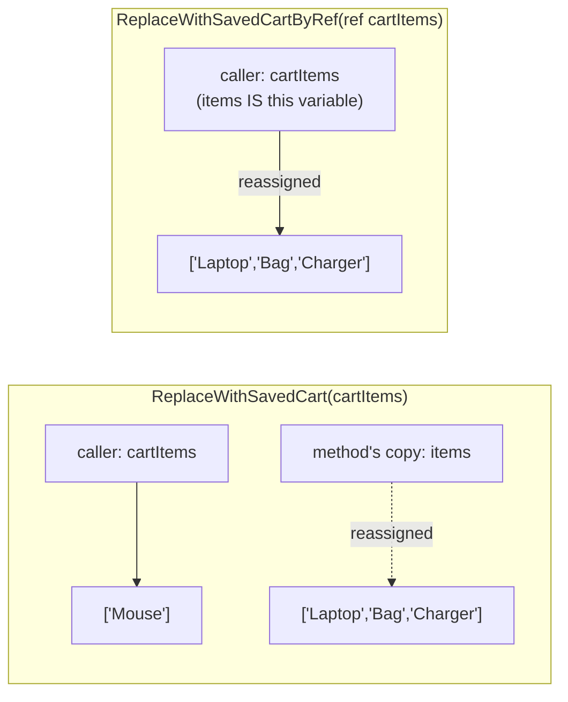

### Common mistakes / gotchas

- **Too many `out` parameters.** If a method returns 3 things through `out`, return a small `record` or a tuple instead (Chapter 3).
- **Using `ref` just to "make it faster" for classes.** Classes are already passed cheaply (only an address is copied). `ref` changes the meaning; it's not an optimization.
- **Optional parameter defaults must be compile-time constants.** You can't write `DateTime now = DateTime.Now`; use `DateTime? now = null` and set it inside.
- **Overloads plus optional parameters** can make calls ambiguous and confusing. Keep it simple.

### 5-YOE depth

- **Default values are baked into the caller.** When code calls `SendOtp(phone)`, the compiler writes `SendOtp(phone, "SMS", 5)` into the *calling* code. If a library later changes the default expiry to 3 minutes (say, for a security audit), old callers still pass 5 until they're recompiled. This is a versioning trap for public libraries, and it's the same problem as `const` (topic 7).
- **`async` methods can't have `ref`, `out` or `in` parameters**, because the method may pause and resume later, when the caller's variable might not exist any more. That's one reason the `TryXxx` pattern returns a tuple in async code.
- **`in` with a non-`readonly` struct** can be *slower*: when the method calls a member on it, the compiler makes a hidden **defensive copy** to guarantee nothing changes. Use `in` with `readonly struct` only.
- **`params` allocates an array on every call.** C# 13 (.NET 9) allows **params collections** such as `params ReadOnlySpan<int>`, which can avoid that allocation (Chapter 3).
- C# also supports **`ref` returns and `ref` locals** (returning a reference into an array, for example), used in high-performance code.

### Interview questions

1. **Difference between `ref` and `out`?**
   Both pass by reference. `ref` requires the variable to be initialised before the call and the method may read it. `out` doesn't require initialisation, but the method must assign it before returning. `out` is for outputs.
2. **What is `in` for?**
   Passing large structs by reference without copying them, while preventing modification. Best used with `readonly struct`.
3. **Why can't async methods have `ref`/`out` parameters?**
   An async method can pause, return to the caller, and resume later. By then the caller's stack variable may be gone, so a reference to it can't be held safely.
4. **What's the versioning issue with optional parameters?**
   Default values are compiled into the caller. Changing them in a library doesn't affect existing callers until they're recompiled.
5. **What does `params` do?**
   It lets a caller pass a variable number of arguments, which the compiler packs into an array. It must be the last parameter.

---

## 1.7 static, const and readonly

### What it is

| Keyword | Meaning | When the value is set | Can it change later? |
|---|---|---|---|
| `const` | A fixed value known when you write the code | At **compile time** | Never |
| `readonly` | A field that can only be set once | When the object is **created** (declaration or constructor) | No (but see the gotcha below) |
| `static readonly` | One shared read-only value for the whole program | Once, at **runtime**, before first use | No |
| `static` | Belongs to the **class itself**, not to any individual object | n/a | Yes (unless also readonly) |

- A **static member** is shared. If `InstancesCreated` is static, there's **one** counter for the whole program, no matter how many objects exist.
- A **static class** can't be instantiated (no `new`) and can only contain static members. Good for helper methods like `Math.Max`.
- A **static constructor** runs **once**, automatically, just before the class is first used.

### Why it matters

- Choosing `const` vs `static readonly` wrongly causes subtle versioning bugs.
- Static state in a web server is **shared by every request and every user**, so it's a common source of concurrency bugs and memory leaks.

### How it works

- `const` values are **copied into every place that uses them** at compile time. That's why reading a `const` doesn't even "touch" the class: in the output below, the static constructor didn't run when we read `TaxRate`.
- `readonly` on a **reference-type** field only protects the **reference** (you can't point it at a new list), but the **object itself can still be changed** (you can `Add` to the list).
- The static constructor ran exactly once, right before the first `new AppSettings(...)`.

Static members belong to the **class** (one copy); instance members belong to **each object**:

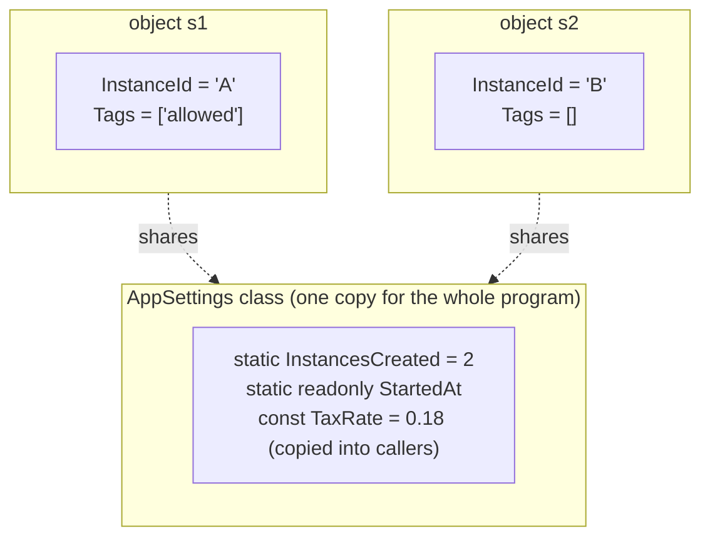

### Code

```csharp
namespace Chapter01.Topics;

public static class T07_StaticConstReadonly
{
    private class AppSettings
    {
        public const double TaxRate = 0.18;                  // compile-time constant: baked into the code that uses it
        public static readonly DateTime StartedAt;           // set once at runtime, shared by all objects
        public readonly string InstanceId;                   // set once per object (in the constructor)
        public readonly List<string> Tags = new();           // the REFERENCE is read-only; the list itself is not

        public static int InstancesCreated;                  // one copy shared by all objects

        static AppSettings()                                 // static constructor: runs ONCE, just before first use
        {
            StartedAt = DateTime.UtcNow;
            Console.WriteLine("  [static constructor ran]");
        }

        public AppSettings(string id)
        {
            InstanceId = id;      // readonly fields can be set in the constructor
            InstancesCreated++;
        }

        public void TryChange()
        {
            // InstanceId = "new";    // COMPILE ERROR: readonly field can only be set in a constructor
            Tags.Add("allowed");      // fine: we change the list's contents, not the reference
            // Tags = new();          // COMPILE ERROR: cannot replace a readonly reference
        }
    }

    private static class MathHelper   // static class: no instances, only static members
    {
        public static int Square(int x) => x * x;
    }

    public static void Run()
    {
        Console.WriteLine($"TaxRate (const) = {AppSettings.TaxRate}   <- reading a const does not touch the class");
        Console.WriteLine("Creating first object...");
        var s1 = new AppSettings("A");
        var s2 = new AppSettings("B");
        s1.TryChange();

        Console.WriteLine($"InstancesCreated (static, shared) = {AppSettings.InstancesCreated}");
        Console.WriteLine($"s1.InstanceId = {s1.InstanceId}, s2.InstanceId = {s2.InstanceId}");
        Console.WriteLine($"s1.Tags = [{string.Join(", ", s1.Tags)}], s2.Tags = [{string.Join(", ", s2.Tags)}]");
        Console.WriteLine($"MathHelper.Square(7) = {MathHelper.Square(7)}");
        // var helper = new MathHelper();   // COMPILE ERROR: cannot create an instance of a static class
    }
}
```

> A **constructor** is a special method that runs when an object is created with `new` (topic 9). `string.Join(", ", list)` glues list items together with `", "` between them.

**Output:**

```
TaxRate (const) = 0.18   <- reading a const does not touch the class
Creating first object...
  [static constructor ran]
InstancesCreated (static, shared) = 2
s1.InstanceId = A, s2.InstanceId = B
s1.Tags = [allowed], s2.Tags = []
MathHelper.Square(7) = 49
```

### Common mistakes / gotchas

- **`readonly` doesn't make an object immutable.** A `readonly List<T>` can still be modified. Expose it as `IReadOnlyList<T>` (Chapter 2) if callers shouldn't change it.
- **Public `const` for values that may change** (tax rates, limits, URLs). Use `static readonly` or configuration instead (Chapter 6).
- **Static mutable state in web apps.** A `static List<Order>` is shared by all users and requests at the same time. It's not thread-safe and it never gets garbage-collected, so it's a memory leak waiting to happen.
- `const` only works with built-in types (numbers, `bool`, `char`, `string`, enums) and `null`.

### 5-YOE depth

- **The `const` versioning problem.** If library A has `public const int MaxItems = 10;` and app B uses it, B's compiled code contains the literal `10`. Shipping a new A with `MaxItems = 20` changes nothing in B until B is recompiled. `static readonly` is read at runtime, so it always gets the current value. **Rule:** `const` only for values that will truly never change (e.g. `Math.PI`, days in a week).
- **Static constructors are thread-safe**: the runtime guarantees they run exactly once even if many threads hit the class at once. This is why a `static readonly` field is the simplest thread-safe singleton (Chapter 22).
- **If a static constructor throws**, you get a `TypeInitializationException`, and **the class is broken for the rest of the process's life**: every future use throws again. Keep static constructors simple.
- **`beforefieldinit`:** if a class has static field initializers but **no** explicit static constructor, the runtime may initialise statics *earlier* than first use (which is slightly faster). Adding an explicit static constructor guarantees lazy, exact timing.
- In DI-based apps (Chapter 6), prefer **singleton services** over static classes for shared state. They can be replaced in tests and configured properly.

### Interview questions

1. **`const` vs `readonly`?**
   `const` is a compile-time constant, implicitly static, limited to primitive types, and baked into callers. `readonly` is set at runtime (in the declaration or constructor), can be any type, and can differ per object.
2. **`readonly` vs `static readonly`?**
   `readonly` gives one value per object; `static readonly` gives one value shared by the whole program, set once.
3. **Why prefer `static readonly` over `public const` in a library?**
   Consts are copied into consuming assemblies at compile time, so changing them requires recompiling consumers. `static readonly` is read at runtime.
4. **When does a static constructor run, and is it thread-safe?**
   Once, automatically, before the class is first used. The runtime guarantees it runs only once, even with multiple threads.
5. **Does `readonly List<int>` make the list immutable?**
   No. Only the reference can't be reassigned; items can still be added or removed.
6. **Why is static mutable state dangerous in ASP.NET Core?**
   It's shared across all concurrent requests, which causes race conditions, and it's never collected, which causes memory growth.

---

## 1.8 Classes, structs, records and enums

### What it is

These are the four main kinds of types you create yourself:

| | `class` | `struct` | `record` (`record class`) | `record struct` | `enum` |
|---|---|---|---|---|---|
| Kind | Reference type | Value type | Reference type | Value type | Value type |
| Default equality | Same object? | Same field values | **Same data** | Same data | Same number |
| Typical use | Services, entities, most objects | Small values (points, money) | DTOs, immutable data, messages | Small immutable values | A fixed set of named options |
| Inheritance | Yes | No | Yes (from other records) | No | No |

- A **`record`** (C# 9) is a class designed for **holding data**. The compiler automatically writes the boring code for you: value-based equality, `ToString()`, a copy-with-changes feature (`with`), and deconstruction.
- An **`enum`** is a set of named numbers: `enum OrderStatus { Pending, Shipped, Delivered }`. Under the hood `Pending = 0`, `Shipped = 1`, and so on.
- A **`[Flags]` enum** lets you combine values (permissions such as Read + Write).

### Why it matters

- Records are now the standard way to write **DTOs** (Data Transfer Objects: simple objects that carry data in and out of APIs). That's Chapter 7.
- Enums are everywhere in business code (order status, payment type), and they have well-known traps.

### How it works

- **Positional record:** `record PersonRecord(string Name, int Age);` generates a constructor, two `init`-only properties, `Equals`, `GetHashCode`, `==`, `!=`, `ToString` and `Deconstruct`.
- **`with` expression:** `r1 with { Age = 31 }` creates a **new** record, copying every value from `r1` except the ones you change. The original is untouched.
- **Deconstruction:** `var (name, age) = r1;` pulls the values out into separate variables.
- **Enums:** stored as `int` by default. You can cast to and from `int`, parse from text (`Enum.Parse`), and check validity (`Enum.IsDefined`).
- **Flags:** give values powers of two (1, 2, 4, 8…) so each one is a separate bit, then combine them with `|` and test them with `HasFlag`.

### Code

```csharp
namespace Chapter01.Topics;

public static class T08_ClassStructRecordEnum
{
    private class PersonClass
    {
        public string Name { get; set; } = "";
        public int Age { get; set; }
    }

    private struct Coordinate
    {
        public double Lat { get; init; }
        public double Lng { get; init; }
    }

    // Positional record: the compiler generates the constructor, properties,
    // Equals, GetHashCode, ToString, == / != and Deconstruct for you.
    private record PersonRecord(string Name, int Age);

    // A value-type record (C# 10)
    private record struct Temperature(double Celsius);

    private enum OrderStatus { Pending, Shipped, Delivered, Cancelled = 10 }

    [Flags]
    private enum Permissions { None = 0, Read = 1, Write = 2, Delete = 4, All = Read | Write | Delete }

    public static void Run()
    {
        // --- Class: Equals means "same object" by default ---
        var c1 = new PersonClass { Name = "Asha", Age = 30 };
        var c2 = new PersonClass { Name = "Asha", Age = 30 };
        Console.WriteLine($"class equal?  {c1.Equals(c2)}   ToString: {c1}");

        // --- Record: Equals means "same data" ---
        var r1 = new PersonRecord("Asha", 30);
        var r2 = new PersonRecord("Asha", 30);
        Console.WriteLine($"record equal? {r1 == r2}    ToString: {r1}");

        // 'with' creates a modified COPY. Positional records are immutable.
        var older = r1 with { Age = 31 };
        Console.WriteLine($"r1 = {r1}, older = {older}");

        var (name, age) = r1;   // deconstruction
        Console.WriteLine($"Deconstructed: {name}, {age}");

        // --- Struct: value type, Equals compares the fields ---
        var p1 = new Coordinate { Lat = 18.52, Lng = 73.85 };
        var p2 = new Coordinate { Lat = 18.52, Lng = 73.85 };
        Console.WriteLine($"struct equal? {p1.Equals(p2)}");
        var t = new Temperature(25.5);
        Console.WriteLine($"record struct: {t}");

        // --- Enums ---
        var status = OrderStatus.Shipped;
        Console.WriteLine($"status = {status}, as int = {(int)status}, Cancelled as int = {(int)OrderStatus.Cancelled}");
        var parsed = Enum.Parse<OrderStatus>("Delivered");
        Console.WriteLine($"Enum.Parse(\"Delivered\") = {parsed}");
        Console.WriteLine($"Enum.TryParse(\"Lost\") = {Enum.TryParse<OrderStatus>("Lost", out _)}");

        var weird = (OrderStatus)99;   // GOTCHA: any int can be cast to an enum, even undefined ones
        Console.WriteLine($"(OrderStatus)99 = {weird}, Enum.IsDefined? {Enum.IsDefined(weird)}");

        // Flags enum: combine values with |
        var perms = Permissions.Read | Permissions.Write;
        Console.WriteLine($"perms = {perms}, can write? {perms.HasFlag(Permissions.Write)}, can delete? {perms.HasFlag(Permissions.Delete)}");
        Console.WriteLine($"Permissions.All = {Permissions.All}, as int = {(int)Permissions.All}");
    }
}
```

> `{ get; set; }` declares a **property** (topic 9). `{ get; init; }` means it can only be set while creating the object. `new PersonClass { Name = "Asha" }` is an **object initializer**: create the object, then set those properties.

**Output:**

```
class equal?  False   ToString: Chapter01.Topics.T08_ClassStructRecordEnum+PersonClass
record equal? True    ToString: PersonRecord { Name = Asha, Age = 30 }
r1 = PersonRecord { Name = Asha, Age = 30 }, older = PersonRecord { Name = Asha, Age = 31 }
Deconstructed: Asha, 30
struct equal? True
record struct: Temperature { Celsius = 25.5 }
status = Shipped, as int = 1, Cancelled as int = 10
Enum.Parse("Delivered") = Delivered
Enum.TryParse("Lost") = False
(OrderStatus)99 = 99, Enum.IsDefined? False
perms = Read, Write, can write? True, can delete? False
Permissions.All = All, as int = 7
```

Notice that a normal class's `ToString()` just prints its type name, while the record prints its data. That alone makes records great for logging.

### Common mistakes / gotchas

- **Trusting enum values from outside.** `(OrderStatus)99` is legal. Always validate enums that come from API requests or databases (`Enum.IsDefined`, or validation attributes).
- **Inserting a new enum member in the middle.** It renumbers everything after it, and values already saved in the database now mean something else. **Always assign explicit numbers** to enums that are stored or sent over the network.
- **Flags enum without powers of two.** `Read = 1, Write = 2, Delete = 3` breaks combining, because 3 = 1 | 2.
- **Assuming `with` deep-copies.** It's a shallow copy (topic 17).
- **Records as EF Core entities.** Entities are tracked by identity and are mutable; value-based equality confuses change tracking. Use classes for entities and records for DTOs.

### 5-YOE depth

- **Record equality compares every field**, including a hidden `EqualityContract` property (the record's type), so a `Student` record is never equal to a `Person` record with the same values. For collection fields, it compares **references**, not contents: two records with different `List` objects holding the same items are **not** equal.
- A `record` with `{ get; set; }` properties (non-positional) is allowed and **mutable**. Records aren't automatically immutable; positional records just generate `init`-only properties.
- `record struct` properties are **mutable** by default (`get; set;`). Use `readonly record struct` for an immutable one.
- **Struct parameterless constructors:** since C# 10 you can write your own. But `default(MyStruct)` and arrays of structs still skip it and produce all-zero values.
- **Enum underlying type** can be changed: `enum Small : byte { ... }` saves space in large arrays.
- **JSON and enums:** System.Text.Json serializes enums as **numbers** by default. Use `JsonStringEnumConverter` so APIs send `"Shipped"` instead of `1`; it's more readable and it survives renumbering.
- `Enum.HasFlag` used to box (be slow). Since .NET Core 2.1 the JIT optimizes it, so it's fine to use now.

### Interview questions

1. **Class vs struct?**
   A class is a reference type: heap-allocated, supports inheritance, and has reference equality by default. A struct is a value type: copied on assignment, no inheritance, field-based equality. Use structs for small immutable values.
2. **What is a record and when would you use it?**
   A reference type with compiler-generated value equality, `ToString`, `with` and deconstruction. Ideal for DTOs, API contracts, messages and other immutable data.
3. **Record vs class: what does `==` do?**
   For records, `==` compares all field values. For classes, it compares references unless it's overloaded.
4. **Is `with` a deep copy?**
   No, it's shallow. Reference-type fields are shared between the original and the copy.
5. **What are the dangers of enums?**
   Any integer can be cast to an enum, so validate input. Reordering or inserting members changes stored values, so assign explicit values. They serialize as numbers by default.
6. **What is a `[Flags]` enum?**
   An enum whose values are powers of two, so they can be combined with `|` and tested with `HasFlag` or `&`.

---

## 1.9 Constructors, properties and access modifiers

### What it is

- A **constructor** is a special method that runs automatically when you create an object with `new`. Its job is to put the object into a valid starting state. It has the same name as the class and no return type.
- A **property** looks like a field from the outside (`p.Price`) but is really a pair of small methods: a **getter** (runs when you read) and a **setter** (runs when you write). This lets you add rules, such as "price can't be negative".
- **Access modifiers** control **who can see** a class or member.

**Access modifiers:**

| Modifier | Who can access it |
|---|---|
| `public` | Everyone |
| `private` | Only code inside the same class (**the default for class members**) |
| `protected` | The same class and its child classes |
| `internal` | Any code in the same project/assembly (**the default for top-level classes**) |
| `protected internal` | The same assembly **OR** child classes anywhere |
| `private protected` | Child classes, **AND** only within the same assembly |
| `file` (C# 11) | Only within the same source file (for types) |

> An **assembly** is the compiled output of one project, usually a `.dll` file.

**Property styles:**

| Syntax | Meaning |
|---|---|
| `public int Id { get; set; }` | Read and write from anywhere (auto-property: the compiler creates the hidden storage) |
| `public int Id { get; init; }` | Can only be set during object creation |
| `public required string Name { get; set; }` | **Must** be set during object creation (C# 11) |
| `public int Stock { get; private set; }` | Anyone can read, only this class can write |
| `public bool InStock => Stock > 0;` | Computed, read-only; recalculated every time it's read |
| `get => field; set => field = ...;` | The `field` keyword (**C# 14 / .NET 10**) gives access to the auto-generated storage, so you can add logic without declaring a private field yourself |

### Why it matters

- Encapsulation (topic 10) is built from private fields, public properties and constructors.
- **Constructor execution order** is a classic senior-level interview question.
- `required` and `init` are how modern C# models objects that must be complete and can't change.

### How it works

**Constructor chaining:**
- `: this(...)` calls **another constructor of the same class** first (to avoid duplicating code).
- `: base(...)` calls the **parent class's constructor** first.

**Real-world setup used in the code:** every repository in an app inherits from a `RepositoryBase` that holds shared things like the connection string. `OrderRepository : RepositoryBase`.

**The order when you create an `OrderRepository` for the first time:**

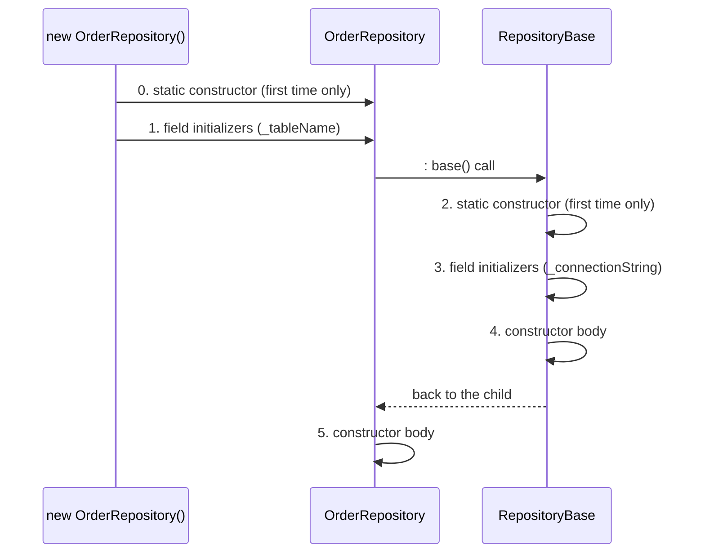

Field initializers run **child-first**, but constructor bodies run **parent-first**. Static constructors run once only, which is why the second object skips steps 0 and 2.

### Code

```csharp
namespace Chapter01.Topics;

public static class T09_ConstructorsPropertiesAccess
{
    private static string Say(string message)
    {
        Console.WriteLine($"  {message}");
        return message;
    }

    // --- Order in which constructors and initializers run ---
    // A base repository that every repository in the app inherits from
    private class RepositoryBase
    {
        private readonly string _connectionString = Say("3. RepositoryBase field initializer (connection string)");

        static RepositoryBase() => Say("2. RepositoryBase static constructor (only the first time)");

        public RepositoryBase() => Say("4. RepositoryBase constructor (opens connection settings)");
    }

    private class OrderRepository : RepositoryBase
    {
        private readonly string _tableName = Say("1. OrderRepository field initializer (table name)");

        static OrderRepository() => Say("0. OrderRepository static constructor (only the first time)");

        public OrderRepository() : base() => Say("5. OrderRepository constructor");
    }

    // --- Constructor chaining with this(...) ---
    private class Customer
    {
        public string Name { get; }
        public string Country { get; }

        public Customer(string name) : this(name, "India") { }   // calls the other constructor first

        public Customer(string name, string country)
        {
            Name = name;
            Country = country;
        }
    }

    // --- Property styles ---
    private class Product
    {
        public int Id { get; init; }                  // can only be set while the object is being created
        public required string Name { get; set; }     // MUST be set when creating the object (C# 11)

        public decimal Price                          // 'field' = the compiler-made backing field (C# 14)
        {
            get => field;
            set => field = value >= 0 ? value : throw new ArgumentException("Price cannot be negative");
        }

        public int Stock { get; private set; }        // anyone can read, only this class can change it
        public bool InStock => Stock > 0;             // computed, read-only property

        public void Restock(int quantity) => Stock += quantity;
    }

    // --- Access modifiers on a payment gateway client ---
    public class PaymentGatewayClient
    {
        public string ProviderName = "CardPay";             // anyone
        private string _apiKey = "sk_live_123";             // only this class (secrets!)
        protected int TimeoutSeconds = 30;                  // this class + child classes (e.g. a RetryingGatewayClient)
        internal string BaseUrl = "https://api.cardpay";    // anything in the same project (assembly)
        protected internal int MaxRetries = 3;              // same project OR child classes anywhere
        private protected string _signingSecret = "whsec";  // child classes, but only in the same project

        public string Describe() =>
            $"{ProviderName} at {BaseUrl}, timeout {TimeoutSeconds}s, retries {MaxRetries}, key ends with {_apiKey[^3..]}, secret length {_signingSecret.Length}";
    }

    public static void Run()
    {
        Console.WriteLine("Creating the first OrderRepository:");
        _ = new OrderRepository();
        Console.WriteLine("Creating the second OrderRepository:");
        _ = new OrderRepository();

        var customer = new Customer("Asha");
        Console.WriteLine($"Customer: {customer.Name}, {customer.Country}");

        var p = new Product { Id = 1, Name = "Keyboard", Price = 1500m };
        // p.Id = 2;                            // COMPILE ERROR: init-only property
        // var bad = new Product { Id = 2 };    // COMPILE ERROR: required member 'Name' must be set
        // p.Stock = 100;                       // COMPILE ERROR: the setter is private
        p.Restock(5);
        Console.WriteLine($"Product: Id={p.Id}, Name={p.Name}, Price={p.Price}, Stock={p.Stock}, InStock={p.InStock}");

        try
        {
            p.Price = -1;
        }
        catch (ArgumentException ex)
        {
            Console.WriteLine($"Setting a negative price: {ex.Message}");
        }

        var gateway = new PaymentGatewayClient();
        // gateway._apiKey                       // COMPILE ERROR: private
        // gateway.TimeoutSeconds                // COMPILE ERROR: protected
        Console.WriteLine($"From outside: ProviderName = {gateway.ProviderName}, BaseUrl (internal, same project) = {gateway.BaseUrl}");
        Console.WriteLine($"From inside:  {gateway.Describe()}");
    }
}
```

> `class OrderRepository : RepositoryBase` means OrderRepository **inherits** from RepositoryBase (topic 10). `throw new ArgumentException(...)` raises an error on purpose. `_ = new OrderRepository();` creates an object and deliberately ignores it. `_apiKey[^3..]` takes the last 3 characters of the string.

**Output:**

```
Creating the first OrderRepository:
  0. OrderRepository static constructor (only the first time)
  1. OrderRepository field initializer (table name)
  2. RepositoryBase static constructor (only the first time)
  3. RepositoryBase field initializer (connection string)
  4. RepositoryBase constructor (opens connection settings)
  5. OrderRepository constructor
Creating the second OrderRepository:
  1. OrderRepository field initializer (table name)
  3. RepositoryBase field initializer (connection string)
  4. RepositoryBase constructor (opens connection settings)
  5. OrderRepository constructor
Customer: Asha, India
Product: Id=1, Name=Keyboard, Price=1500, Stock=5, InStock=True
Setting a negative price: Price cannot be negative
From outside: ProviderName = CardPay, BaseUrl (internal, same project) = https://api.cardpay
From inside:  CardPay at https://api.cardpay, timeout 30s, retries 3, key ends with 123, secret length 5
```

The access modifiers in the gateway client match real decisions: the **API key is private** (it must never leak), the **timeout is protected** (a `RetryingGatewayClient` subclass may need it), and the **base URL is internal** (other classes in the same project, like a health check, may read it).

### Common mistakes / gotchas

- **Public fields instead of properties.** Fields can't have validation, and switching from a field to a property later is a *breaking change* for compiled callers. Always expose properties.
- **Doing heavy work in constructors** (database calls, HTTP calls). Constructors can't be `async`, and failures there are hard to handle. Keep them fast and simple.
- **Forgetting that the default for members is `private`.** If you write no modifier, nobody outside can use it.
- **Making everything `public`.** Start with the most restrictive modifier and open up only when needed.

### 5-YOE depth

- **Never call a virtual method from a base constructor.** The base constructor body runs **before** the derived constructor body. If the base calls a method that the derived class overrides, the override runs while the derived object is only half set up: its constructor-assigned fields are still null or 0. Real example: `RepositoryBase()` calls a virtual `GetTableName()`, `OrderRepository` overrides it to return a `_tableName` set in its own constructor, and the base receives `null` and builds broken SQL. This is a classic production bug and interview question.
- **Properties compile into methods.** `Price` becomes `get_Price()` and `set_Price(decimal)`. The JIT usually inlines simple ones, so there's no speed cost.
- **`init` vs `readonly` field:** both prevent changes after construction, but `init` works with object initializers (`new P { Id = 1 }`), so it's friendlier for DTOs.
- **`required` and constructors:** if a constructor sets all required members, mark it with `[SetsRequiredMembers]` so callers using that constructor aren't forced to set them again.
- **`InternalsVisibleTo`:** an assembly attribute that lets a test project see `internal` members. Commonly used to test internal classes.
- **The `field` keyword** is new in C# 14 (.NET 10). On .NET 8 you'd declare `private decimal _price;` and use it in the getter and setter. Expect older codebases to do it that way.

### Interview questions

1. **What is the order of constructor execution in inheritance?**
   On first use: derived static constructor, derived field initializers, base static constructor, base field initializers, base constructor body, derived constructor body. Static constructors run only once. (Example: `OrderRepository : RepositoryBase`.)
2. **Why shouldn't you call virtual methods in a constructor?**
   The base constructor runs before the derived constructor, so an override would run on a partially initialised object.
3. **Field vs property?**
   A field is raw storage. A property wraps it with get/set methods, which allows validation, computed values, different access levels, and binary-compatible changes later.
4. **`init` vs `required`?**
   `init` means the property can only be set during creation. `required` means it **must** be set during creation. They're often used together.
5. **What's the default access modifier for a class? For a class member?**
   `internal` for top-level classes, `private` for members.
6. **`protected internal` vs `private protected`?**
   `protected internal` is accessible from the same assembly **or** from derived classes anywhere. `private protected` is accessible only from derived classes **that are also in** the same assembly.

---

## 1.10 Encapsulation, inheritance, abstraction and polymorphism

### What it is

These are the **four pillars of Object-Oriented Programming (OOP)**. OOP means organising code around **objects** that combine data with the behaviour that works on that data.

| Pillar | One-line meaning | Backend example (used in the code) |
|---|---|---|
| **Encapsulation** | Hide the internal data; expose only safe operations | A `BankAccount` whose balance can only change through `Deposit`/`Withdraw`, which enforce the rules |
| **Inheritance** | A new class reuses and extends an existing one ("IS-A") | `ExpressShipping` **is a** `ShippingMethod`: it reuses the quote logic and adds "delivers tomorrow" |
| **Abstraction** | Show *what* something does, hide *how* | Checkout calls `Cost(weight)` without knowing each courier's pricing formula |
| **Polymorphism** | "Many forms": the same call behaves differently depending on the real object | The same `option.Quote(2)` call gives a different price for Standard and Express |

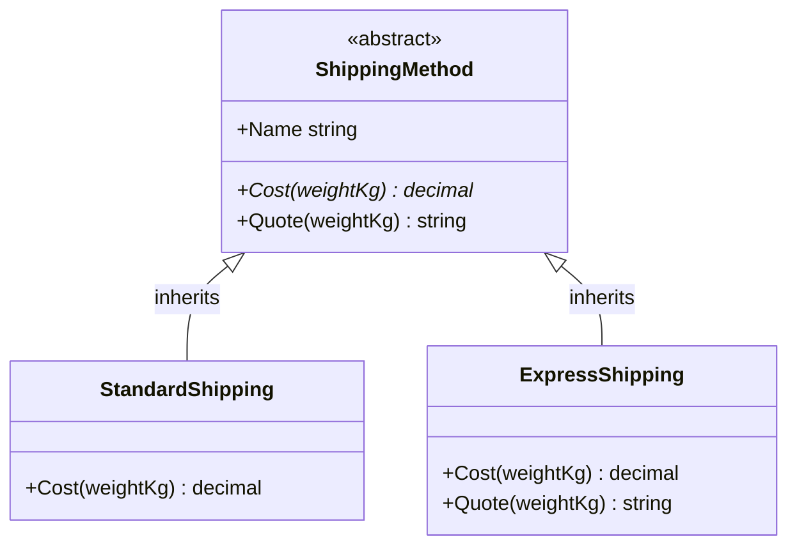

The diagram shows the shipping example: `Cost` is **abstract** (marked `*`), so each child must provide it. `ExpressShipping` also **overrides** `Quote`.

### Why it matters

Every C# interview asks about these, usually as "explain with an example from your project". The goal of all four is code that's **safer to change**.

### How it works

- **Encapsulation:** keep fields `private` and expose methods or properties that **enforce rules**. In `BankAccount` below, nobody can set the balance to a random number; they can only `Deposit` or `Withdraw`, and those methods check the rules.
- **Inheritance:** `class ExpressShipping : ShippingMethod` gives ExpressShipping everything that ShippingMethod has. C# supports **single inheritance** of classes (one parent only), but a class can implement many interfaces (topic 11).
- **Abstraction:** an `abstract` class can't be created directly. An `abstract` method has **no body**; it says "every shipping method must have a `Cost()`" and leaves the *how* to each child.
- **Polymorphism comes in two forms:**
  - **Compile-time (static) polymorphism** = **method overloading**: the same method name with different parameters. The compiler picks which one to call.
  - **Runtime (dynamic) polymorphism** = **method overriding**: a child replaces a `virtual` or `abstract` method. The **real object type** decides which version runs, while the program is running.

### Code

```csharp
namespace Chapter01.Topics;

public static class T10_OopPillars
{
    // ===== ENCAPSULATION: hide the data, expose safe operations =====
    private class BankAccount
    {
        private decimal _balance;                 // nobody outside can touch this directly

        public decimal Balance => _balance;       // read-only view

        public void Deposit(decimal amount)
        {
            if (amount <= 0) throw new ArgumentException("Deposit must be positive");
            _balance += amount;
        }

        public bool Withdraw(decimal amount)
        {
            if (amount > _balance) return false;  // the rule is enforced in ONE place
            _balance -= amount;
            return true;
        }
    }

    // ===== ABSTRACTION + INHERITANCE: shipping methods at checkout =====
    private abstract class ShippingMethod
    {
        public string Name { get; }

        protected ShippingMethod(string name) => Name = name;

        public abstract decimal Cost(decimal weightKg);   // WHAT every shipping method must do, not HOW

        public virtual string Quote(decimal weightKg) => $"{Name}: Rs {Cost(weightKg)} for {weightKg} kg";
    }

    private class StandardShipping : ShippingMethod    // StandardShipping IS-A ShippingMethod
    {
        public StandardShipping() : base("Standard") { }

        public override decimal Cost(decimal weightKg) => 50 + 10 * weightKg;
    }

    private class ExpressShipping : ShippingMethod
    {
        public ExpressShipping() : base("Express") { }

        public override decimal Cost(decimal weightKg) => 120 + 25 * weightKg;

        public override string Quote(decimal weightKg) => base.Quote(weightKg) + " (delivers tomorrow)";
    }

    // ===== Compile-time polymorphism: overloading =====
    private static class GstCalculator
    {
        public static decimal Tax(decimal amount) => amount * 0.18m;                                // default 18%
        public static decimal Tax(decimal amount, decimal rate) => amount * rate;                    // custom rate
        public static decimal Tax(int quantity, decimal unitPrice) => quantity * unitPrice * 0.18m;  // per line item
    }

    public static void Run()
    {
        // Encapsulation
        var account = new BankAccount();
        account.Deposit(1000);
        Console.WriteLine($"Withdraw 300: {account.Withdraw(300)}, Withdraw 5000: {account.Withdraw(5000)}, Balance: {account.Balance}");
        // account._balance = 1_000_000;   // COMPILE ERROR: _balance is private

        // Runtime polymorphism: the checkout page loops over options without knowing the concrete types
        var options = new List<ShippingMethod> { new StandardShipping(), new ExpressShipping() };
        foreach (var option in options)
            Console.WriteLine(option.Quote(2m));

        // var s = new ShippingMethod("x");   // COMPILE ERROR: cannot create an instance of an abstract class

        // Compile-time polymorphism
        Console.WriteLine($"Tax(1000) = {GstCalculator.Tax(1000m)}, Tax(1000, 0.05) = {GstCalculator.Tax(1000m, 0.05m)}, Tax(3 items x 200) = {GstCalculator.Tax(3, 200m)}");
    }
}
```

> `foreach (var option in options)` runs the loop body once for each item in the list. `base.Quote(...)` calls the parent's version of the method.

**Output:**

```
Withdraw 300: True, Withdraw 5000: False, Balance: 700
Standard: Rs 70 for 2 kg
Express: Rs 170 for 2 kg (delivers tomorrow)
Tax(1000) = 180.00, Tax(1000, 0.05) = 50.00, Tax(3 items x 200) = 108.00
```

Notice that the checkout loop only knows it has `ShippingMethod` objects, yet each one prices itself correctly. That's polymorphism: when the business adds `SameDayShipping` next quarter, you add one class and the checkout code doesn't change.

### Common mistakes / gotchas

- **Thinking encapsulation means "private field + public getter/setter for everything".** A public setter with no rules isn't encapsulation. The point is to **protect invariants** (rules that must always be true, like "balance is never negative").
- **Deep inheritance chains** (`A : B : C : D : E`). They're hard to understand and fragile. Prefer composition (topic 13).
- **Using inheritance just to reuse code** when there's no real "IS-A" relationship.
- **Confusing abstraction with abstract classes.** Abstraction is the *idea* (hide the details); abstract classes and interfaces are the *tools*.

### 5-YOE depth

- **How runtime polymorphism works:** each class has a hidden **virtual method table (vtable)**, a list of addresses of its virtual methods. A virtual call looks up the right address in the real object's table at runtime. That costs a tiny bit more than a direct call and usually prevents **inlining** (the JIT copying a small method's body into the caller). `sealed` classes and methods let the JIT skip this (**devirtualization**).
- **Anemic domain model:** classes with only public getters/setters and all the logic in separate "service" classes. It's common in CRUD apps and fine for simple cases, but it breaks encapsulation. A **rich domain model** puts the rules inside the entity (`order.AddItem(...)` checks stock limits). Senior interviews may ask which one you used and why.
- **Tell, don't ask:** instead of `if (account.Balance >= x) account.Balance -= x;` (asking for data, then deciding outside), call `account.Withdraw(x)` (telling the object what to do).

### Interview questions

1. **Explain the four pillars of OOP with examples.**
   Encapsulation: `BankAccount` hides its balance and exposes `Deposit`/`Withdraw` with rules. Inheritance: `ExpressShipping : ShippingMethod`. Abstraction: `ShippingMethod.Cost()` is abstract, so checkout doesn't care how each courier prices. Polymorphism: checkout loops over `List<ShippingMethod>` calling `Quote()`, and each type gives its own price; adding a new method needs no change to checkout.
2. **Compile-time vs runtime polymorphism?**
   Compile-time is overloading: the compiler picks the method by its parameters. Runtime is overriding: virtual dispatch uses the actual object type.
3. **Does C# support multiple inheritance?**
   Not for classes (only one base class), but a class can implement multiple interfaces.
4. **Is a class with public getters and setters for every field encapsulated?**
   Not really. Encapsulation means protecting invariants, so you expose behaviour rather than raw data.
5. **What does `sealed` give you besides preventing inheritance?**
   The JIT can devirtualize and inline calls, which is a small performance benefit. It also makes the design intent clear.

---

## 1.11 Interfaces vs abstract classes

### What it is

- An **interface** is a **contract**: a list of members a class promises to provide. It says **what** a class *can do*, not how. By convention names start with `I` (`IPaymentMethod`, `IDisposable`).
- An **abstract class** is a **partially built class**: it can hold real code and data (fields) that children share, plus abstract members that children *must* fill in.

**Analogy:**
- An interface is like a **job description** ("must be able to drive, must speak English"). Anyone who meets it can apply, whatever their background.
- An abstract class is like a **half-built house from a builder**: the foundation and walls are done (shared code), and you finish the interior (abstract methods). You can only buy one house.

| | Interface | Abstract class |
|---|---|---|
| How many can a class use? | **Many** | **Only one** (single inheritance) |
| Fields (instance data) | Not allowed | Allowed |
| Constructors | No | Yes |
| Method bodies | Only default interface methods (C# 8+) | Yes, normal methods |
| Access modifiers on members | Public by default | Any |
| Relationship | "**CAN-DO**" (capability) | "**IS-A**" (identity) |
| Works with structs | Yes | No |

The code below models a payments and notifications module. A class can sign **many contracts** (interfaces) but has only **one parent** (abstract class):

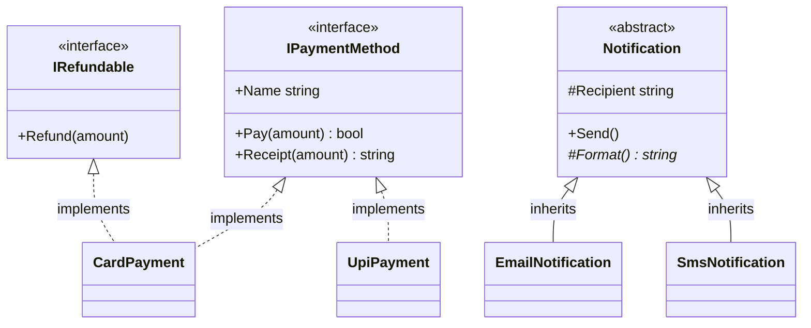

Dotted arrows mean "implements an interface"; solid arrows mean "inherits a class". `CardPayment` implements two interfaces, which would be impossible with two base classes.

### Why it matters

- **Interfaces are the backbone of dependency injection** (Chapter 6) and unit testing with mocks (Chapter 17). In ASP.NET Core almost every service is registered through an interface.
- "Interface or abstract class?" is one of the most common interview questions.

### How it works

- A class implements an interface with `:`, like `class CardPayment : IPaymentMethod, IRefundable`, and must provide every member that has no default body.
- **Default interface methods (C# 8):** an interface member *can* have a body. Classes get it for free but can replace it. It's mainly used to **add a new method to an existing interface without breaking** every class that already implements it.
- Default methods are **only callable through the interface type**: `((IPaymentMethod)card).Receipt(10)`.
- **Explicit interface implementation:** writing `string IPrinter.Output()` hides the method from the class's normal surface. You can only call it through the interface. That's useful when two interfaces have members with the same name.
- An abstract class can provide a **template**: `Send()` contains the shared steps, and calls the abstract `Format()` that each child provides. This is called the **Template Method pattern**.

### Code

```csharp
namespace Chapter01.Topics;

public static class T11_InterfacesVsAbstract
{
    // ===== Interface: a CONTRACT ("can do"), no state =====
    private interface IPaymentMethod
    {
        string Name { get; }
        bool Pay(decimal amount);

        // Default interface method (C# 8): a body inside the interface
        string Receipt(decimal amount) => $"Paid {amount} using {Name}";
    }

    private interface IRefundable
    {
        void Refund(decimal amount);
    }

    // A class can implement MANY interfaces
    private class CardPayment : IPaymentMethod, IRefundable
    {
        public string Name => "Card";
        public bool Pay(decimal amount) => amount <= 10_000;
        public void Refund(decimal amount) => Console.WriteLine($"  Refunded {amount} to card");
    }

    private class UpiPayment : IPaymentMethod
    {
        public string Name => "UPI";
        public bool Pay(decimal amount) => amount <= 100_000;
        public string Receipt(decimal amount) => $"UPI receipt for {amount}";   // replaces the default
    }

    // ===== Abstract class: shared STATE and CODE + methods children must fill in. Only ONE base class allowed =====
    private abstract class Notification
    {
        private static int _sent;

        protected string Recipient { get; }

        protected Notification(string recipient) => Recipient = recipient;

        public void Send()                        // same steps for every notification
        {
            Console.WriteLine($"  [{GetType().Name}] {Format()}");
            _sent++;
        }

        protected abstract string Format();       // each child decides this part

        public static int TotalSent => _sent;
    }

    private class EmailNotification : Notification
    {
        public EmailNotification(string email) : base(email) { }
        protected override string Format() => $"To: {Recipient} | Subject: Your order shipped";
    }

    private class SmsNotification : Notification
    {
        public SmsNotification(string phone) : base(phone) { }
        protected override string Format() => $"SMS to {Recipient}: Order shipped";
    }

    // ===== Explicit interface implementation: two interfaces with the same method name =====
    private interface IPrinter { string Output(); }
    private interface IScanner { string Output(); }

    private class MultiFunctionDevice : IPrinter, IScanner
    {
        string IPrinter.Output() => "Printed a document";
        string IScanner.Output() => "Scanned an image";
    }

    public static void Run()
    {
        var methods = new List<IPaymentMethod> { new CardPayment(), new UpiPayment() };
        foreach (var method in methods)
            Console.WriteLine($"{method.Name}: Pay(20000) = {method.Pay(20000)}; {method.Receipt(20000)}");

        var card = new CardPayment();
        // card.Receipt(10);   // COMPILE ERROR: default interface methods are only visible through the interface
        Console.WriteLine(((IPaymentMethod)card).Receipt(10));
        if (card is IRefundable refundable)
            refundable.Refund(500);

        new EmailNotification("asha@example.com").Send();
        new SmsNotification("+91-9000000000").Send();
        Console.WriteLine($"Total notifications sent: {Notification.TotalSent}");

        var device = new MultiFunctionDevice();
        Console.WriteLine($"As IPrinter: {((IPrinter)device).Output()}");
        Console.WriteLine($"As IScanner: {((IScanner)device).Output()}");
        // device.Output();   // COMPILE ERROR: explicit implementations are only reachable through the interface
    }
}
```

> `card is IRefundable refundable` is a **type pattern**: "if `card` is an `IRefundable`, put it in a new variable `refundable`, typed as that interface".

**Output:**

```
Card: Pay(20000) = False; Paid 20000 using Card
UPI: Pay(20000) = True; UPI receipt for 20000
Paid 10 using Card
  Refunded 500 to card
  [EmailNotification] To: asha@example.com | Subject: Your order shipped
  [SmsNotification] SMS to +91-9000000000: Order shipped
Total notifications sent: 2
As IPrinter: Printed a document
As IScanner: Scanned an image
```

### Common mistakes / gotchas

- **"Fat" interfaces** with 20 members. Every implementer must write all of them. Split them (Interface Segregation, topic 14).
- **An interface for every class "just because".** If there's only one implementation and no need to mock it, an interface adds noise. Use interfaces at **boundaries**: database, HTTP, email, clock, file system.
- **Using an abstract class when classes only share a capability, not an identity.** That forces a single inheritance chain on them.
- **Expecting default interface methods to behave like base-class methods.** They aren't visible on the class type, and they can't access instance fields (interfaces have none).

### 5-YOE depth

- **When to choose which:**
  - Use an **interface** for a capability many unrelated types might have, for DI/mocking boundaries, and when structs need to participate.
  - Use an **abstract class** when related types share real code or state, and you want to control construction or provide a template. Framework examples: `ControllerBase`, `BackgroundService`, `DbContext`, `Stream`.
  - **Common senior answer:** "Expose an interface, and optionally provide an abstract base class that implements it to share code." Example: `IHostedService` and `BackgroundService`.
- **Versioning:** adding a member to a public interface used to break every implementer. Default interface methods solved this. Adding a non-abstract method to an abstract class was always safe.
- **Static abstract members in interfaces (C# 11):** an interface can require a *static* member, e.g. `static abstract T Parse(string s);`. This powers **generic math** in .NET 7+ (`INumber<T>`), so you can write `T Sum<T>(T[] items) where T : INumber<T>`.
- **Casting a struct to an interface boxes it** (topic 18). Generic constraints (`where T : IComparable<T>`) avoid that.
- Interfaces can also declare `static` members, constants and (from C# 8) private and static helper methods.

### Interview questions

1. **Interface vs abstract class: when do you use each?**
   An interface is for a "can-do" contract that many unrelated types (including structs) can implement, a class can implement many of them, and they're ideal for DI and mocking. An abstract class is for an "is-a" relationship with shared code or state, constructors and protected members, and you only get one.
2. **Can interfaces have method implementations?**
   Yes, since C# 8 (default interface methods). They're mainly for evolving interfaces without breaking implementers, and they're only accessible via the interface type.
3. **Can an abstract class have a constructor?**
   Yes. It's called by derived classes through `base(...)`, usually `protected`.
4. **What is explicit interface implementation and why use it?**
   You implement a member as `IFoo.Method()`, so it's only callable through the interface. It resolves name clashes between interfaces and hides members you don't want on the class's public surface.
5. **Can you create an instance of an interface or an abstract class?**
   No, neither. You can only create concrete classes that implement or inherit them.

---

## 1.12 Overloading vs overriding vs method hiding (virtual, override, abstract, sealed, new)

### What it is

Three things that sound similar but work completely differently:

| | **Overloading** | **Overriding** | **Hiding** |
|---|---|---|---|
| What | Same name, **different parameters**, usually in the same class | A child **replaces** a parent's `virtual`/`abstract` method | A child declares a method with the **same name**, without overriding |
| Keyword | none | `virtual` in parent, `override` in child | `new` in child |
| Decided | At **compile time**, by the argument types | At **runtime**, by the **real object type** | At **compile time**, by the **variable type** |
| Polymorphism? | Compile-time | **Runtime** (true polymorphism) | **No** |

The related keywords:

| Keyword | Meaning |
|---|---|
| `virtual` | "Children **may** override this." |
| `override` | "I am replacing my parent's virtual/abstract method." |
| `abstract` | "No body here; children **must** override this." (Only inside abstract classes.) |
| `sealed` | On an override: "nobody below me may override this again." On a class: "nobody may inherit from me." |
| `new` | "I am **hiding** the parent's member on purpose, not overriding it." |
| `base.Method()` | Call the parent's version from inside the child. |

### Why it matters

The difference between overriding and hiding is a **guaranteed interview question**, usually as "what does this code print?".

### How it works

**Real-world setup used in the code:** a reporting module has a `ReportExporter` base class and a `PdfExporter` child. The code that saves files, `SaveReport(ReportExporter exporter, ...)`, only knows about the base type.

Look at this: `ReportExporter exporterRef = new PdfExporter();`. The **variable type** is `ReportExporter`, and the **real object type** is `PdfExporter`.

- `exporterRef.Export(...)`: `Export` is `virtual` and `PdfExporter` **overrides** it, so the runtime looks at the **real object** and calls **the PDF version**.
- `exporterRef.FileExtension()`: `FileExtension` is **not virtual**, and PdfExporter **hides** it with `new`. The compiler picks the method from the **variable's type**, so it calls **the base version** and returns `".txt"`.

**The production bug this causes:** `SaveReport` receives a PDF exporter, creates PDF content, and then saves it as **`sales-report.txt`**, because it asked for the file extension through the base type. The fix is to make `FileExtension` `virtual` and `override` it. This is exactly why the compiler warns you when you hide a member.

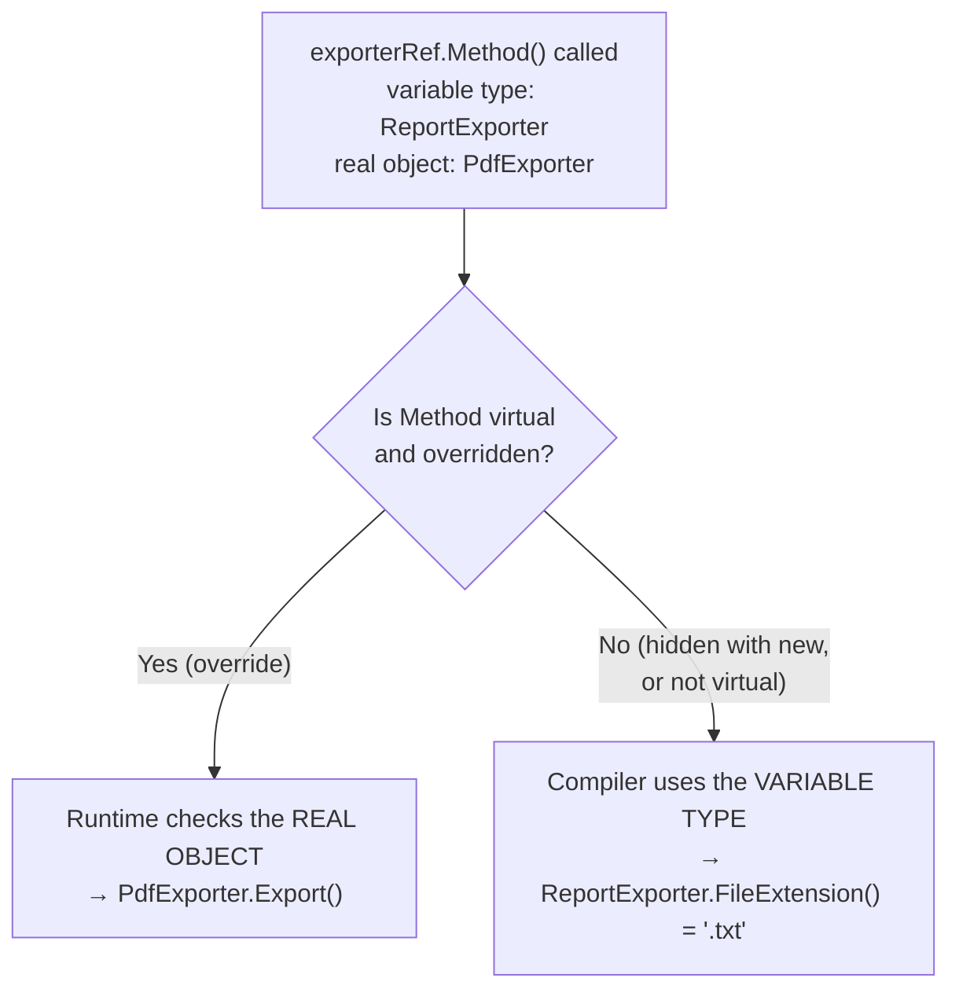

Memory trick: **override follows the object; hiding follows the variable.**

### Code

```csharp
namespace Chapter01.Topics;

public static class T12_OverrideVsHiding
{
    // A reporting module that exports sales reports in different formats
    private class ReportExporter
    {
        public virtual string Export(string report) => $"Plain-text export of '{report}'";   // virtual: child classes MAY override
        public string FileExtension() => ".txt";                                              // NOT virtual
        public virtual string Footer() => "Generated by ReportExporter";
    }

    private class PdfExporter : ReportExporter
    {
        public override string Export(string report) => $"PDF export of '{report}'";   // OVERRIDE: used even through a ReportExporter variable
        public new string FileExtension() => ".pdf";                                   // HIDE: only used when the variable's type is PdfExporter
        public sealed override string Footer() => $"PDF footer (base said: {base.Footer()})";   // sealed: no further overriding
    }

    private class SignedPdfExporter : PdfExporter
    {
        public override string Export(string report) => $"Digitally signed PDF export of '{report}'";
        // public override string Footer() => "...";    // COMPILE ERROR: Footer is sealed in PdfExporter
    }

    // The code that saves the file only knows about the base type
    private static string SaveReport(ReportExporter exporter, string report) =>
        $"Saved 'sales-report{exporter.FileExtension()}' containing: {exporter.Export(report)}";

    // ===== Overloading: same name, different parameters =====
    private static string FindPayment(int orderId) => $"int overload (order id): {orderId}";
    private static string FindPayment(long transactionId) => $"long overload (transaction id): {transactionId}";
    private static string FindPayment(object key) => $"object overload (any key): {key}";

    public static void Run()
    {
        PdfExporter pdf = new PdfExporter();
        ReportExporter exporterRef = pdf;   // the SAME object, seen through a ReportExporter variable

        Console.WriteLine($"pdf.Export()              = {pdf.Export("Q3 sales")}");
        Console.WriteLine($"exporterRef.Export()      = {exporterRef.Export("Q3 sales")}   <- override: the REAL object type decides");
        Console.WriteLine($"pdf.FileExtension()       = {pdf.FileExtension()}");
        Console.WriteLine($"exporterRef.FileExtension() = {exporterRef.FileExtension()}   <- hiding: the VARIABLE type decides");
        Console.WriteLine($"exporterRef.Footer()      = {exporterRef.Footer()}");

        // The real-world bug that hiding causes:
        Console.WriteLine($"BUG: {SaveReport(pdf, "Q3 sales")}");

        ReportExporter signed = new SignedPdfExporter();
        Console.WriteLine($"signed.Export()           = {signed.Export("Q3 sales")}");
        Console.WriteLine($"signed.Footer()           = {signed.Footer()}");

        // Overloading is decided at COMPILE time using the declared argument types
        Console.WriteLine(FindPayment(1042));
        Console.WriteLine(FindPayment(9_876_543_210L));
        Console.WriteLine(FindPayment("ORD-1042"));
        object key = 1042;
        Console.WriteLine($"{FindPayment(key)}   <- variable type is object, so the object overload wins");
    }
}
```

**Output:**

```
pdf.Export()              = PDF export of 'Q3 sales'
exporterRef.Export()      = PDF export of 'Q3 sales'   <- override: the REAL object type decides
pdf.FileExtension()       = .pdf
exporterRef.FileExtension() = .txt   <- hiding: the VARIABLE type decides
exporterRef.Footer()      = PDF footer (base said: Generated by ReportExporter)
BUG: Saved 'sales-report.txt' containing: PDF export of 'Q3 sales'
signed.Export()           = Digitally signed PDF export of 'Q3 sales'
signed.Footer()           = PDF footer (base said: Generated by ReportExporter)
int overload (order id): 1042
long overload (transaction id): 9876543210
object overload (any key): ORD-1042
object overload (any key): 1042   <- variable type is object, so the object overload wins
```

**Interview story you can tell:** "We had a bug where PDF reports were downloaded as `.txt` files. The `PdfExporter` hid `FileExtension()` with `new` instead of overriding it, and the save logic called it through the base `ReportExporter` type. Making the base method `virtual` and overriding it fixed it, and since then we treat warning CS0108 as an error."

### Common mistakes / gotchas

- **Forgetting `virtual` in the parent.** Then the child *can't* override; it can only hide. The compiler gives warning **CS0108** ("hides inherited member, use the new keyword if hiding was intended"). **Never ignore this warning**; it usually means you meant to override.
- **Using `new` to "fix" the warning** when you actually wanted polymorphism.
- **Overloads that differ only by return type.** That's not allowed: overloads must differ in their parameters.
- **Overload resolution surprises.** The overload is chosen by the **declared** type of the argument, not its runtime type (the `object boxed = 5` example).

### 5-YOE depth

- **Overload resolution picks the "most specific" match.** `FindPayment(1042)` picks `int` over `long` and `object`, because `int` needs no conversion. Mixing overloads with optional parameters, `params` or `null` arguments can produce ambiguity errors.
- **Why not make every method virtual?** Virtual methods are slightly slower (vtable lookup, no inlining), and every virtual method is a promise you must keep stable for subclasses. C# methods are **non-virtual by default** (unlike Java), by design.
- **`sealed` on classes:** many teams seal classes by default (`public sealed class OrderService`) unless inheritance is intended. It's clearer and allows JIT devirtualization. Since .NET 6 several analyzers suggest it.
- **Covariant return types (C# 9):** an override can return a *more specific* type, e.g. `public override PdfDocument Render()` when the base returns `Document`.
- **Mocking frameworks** (Moq, NSubstitute, Chapter 17) can only intercept **virtual** members or interface members. This is another reason services are consumed through interfaces.

### Interview questions

1. **Difference between overriding and hiding?**
   Overriding (`virtual`/`override`) is runtime polymorphism: the call goes to the actual object's implementation even through a base reference. Hiding (`new`) is resolved by the variable's compile-time type, so a base reference calls the base method.
2. **What does this print?** `ReportExporter e = new PdfExporter(); e.FileExtension();`, where `FileExtension` is hidden with `new` in PdfExporter.
   `".txt"`, the base version, because hiding uses the variable type. This is a real bug pattern: files get saved with the wrong extension.
3. **What is `sealed override`?**
   It overrides the method and prevents further overriding in derived classes.
4. **Overloading vs overriding?**
   Overloading is the same name with different parameters, resolved at compile time. Overriding replaces a virtual method in a derived class with the same signature, resolved at runtime.
5. **Are C# methods virtual by default?**
   No. You must mark them `virtual`. (In Java they are virtual by default.)
6. **What's the difference between `abstract` and `virtual`?**
   `abstract` has no body and **must** be overridden (only in abstract classes). `virtual` has a default body and **may** be overridden.

---

## 1.13 Composition vs inheritance

### What it is

Two ways to reuse behaviour:

- **Inheritance ("IS-A"):** `class GiftCardPayment : Payment`. A gift card payment **is a** payment and automatically gets everything a Payment has, **including behaviour it may not want**.
- **Composition ("HAS-A"):** `class OrderService { private readonly IOrderRepository _repository; }`. An OrderService **has a** repository. It *uses* the repository by holding a reference to it, and passes work to it.

The famous design rule (from the classic "Design Patterns" book): **"Favour composition over inheritance."**

**Analogy:** inheritance is like **DNA**: you get all of it, the good and the bad, and you can't change it later. Composition is like **LEGO**: you snap in the pieces you need, and you can swap a piece any time.

### Why it matters

- Inheritance hierarchies become rigid: a change in a parent class can break every child (the **fragile base class problem**).
- Almost all modern .NET backend code is built by composition: services receive other services through their constructor (dependency injection, Chapter 6).

### How it works

- **The inheritance trap:** "a gift card payment IS-A payment" sounds right, so `GiftCardPayment : Payment`. But `Payment` has `Refund()` (refund to the original source), and gift cards can't be refunded to source, so `GiftCardPayment` has to throw an exception. The nightly refund job, which loops over all payments of cancelled orders, now **crashes halfway**. (This breaks the **Liskov Substitution Principle**, topic 14. Textbooks tell the same story as "Penguin : Bird with Fly()".)
- **Composition fix:** extract the varying behaviour into a small interface (`IRefundPolicy`), and give each payment the policy it needs: `RefundToSource` for cards, `RefundAsStoreCredit` for gift cards. A new policy (`RefundToBankAccount`) can be added without touching existing classes.
- **Another backend example:** `OrderService` **has an** `IOrderRepository`. It doesn't inherit from a repository; it receives one through its constructor. In tests you can pass a fake repository.

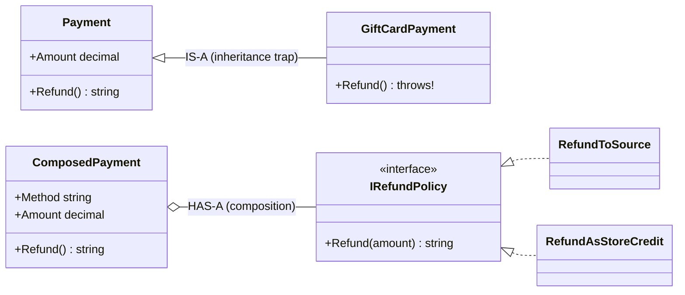

On the left, the child is stuck with a method it can't honour. On the right, each payment is **given** the refund behaviour that fits it.

### Code

```csharp
namespace Chapter01.Topics;

public static class T13_CompositionVsInheritance
{
    // ===== The inheritance trap =====
    private class Payment
    {
        public decimal Amount { get; init; }
        public virtual string Refund() => $"Refunded {Amount} to the original payment method";
    }

    private class CardPayment : Payment { }

    private class GiftCardPayment : Payment   // "a gift card payment IS-A payment"... but it can't be refunded to source
    {
        public override string Refund() => throw new NotSupportedException("Gift card payments cannot be refunded to source");
    }

    // ===== Composition: the refund behaviour is a separate, swappable part =====
    private interface IRefundPolicy { string Refund(decimal amount); }
    private class RefundToSource : IRefundPolicy { public string Refund(decimal amount) => $"Refunded {amount} to the original payment method"; }
    private class RefundAsStoreCredit : IRefundPolicy { public string Refund(decimal amount) => $"Issued {amount} as store credit"; }

    private class ComposedPayment
    {
        private readonly IRefundPolicy _refundPolicy;     // a payment HAS-A refund policy

        public string Method { get; }
        public decimal Amount { get; }

        public ComposedPayment(string method, decimal amount, IRefundPolicy refundPolicy)
        {
            Method = method;
            Amount = amount;
            _refundPolicy = refundPolicy;
        }

        public string Refund() => $"{Method}: {_refundPolicy.Refund(Amount)}";
    }

    // ===== Real backend example: a service HAS a repository =====
    private interface IOrderRepository { void Save(string order); }

    private class InMemoryOrderRepository : IOrderRepository
    {
        public List<string> Saved { get; } = new();
        public void Save(string order) => Saved.Add(order);
    }

    private class OrderService
    {
        private readonly IOrderRepository _repository;

        public OrderService(IOrderRepository repository) => _repository = repository;

        public void PlaceOrder(string item)
        {
            _repository.Save(item);
            Console.WriteLine($"  Order placed: {item}");
        }
    }

    public static void Run()
    {
        // The refund job processes all payments of a cancelled order
        var payments = new List<Payment> { new CardPayment { Amount = 800 }, new GiftCardPayment { Amount = 200 } };
        foreach (var payment in payments)
        {
            try
            {
                Console.WriteLine(payment.Refund());
            }
            catch (NotSupportedException ex)
            {
                Console.WriteLine($"Inheritance problem, the refund job crashed: {ex.Message}");
            }
        }

        var composed = new List<ComposedPayment>
        {
            new("Card", 800, new RefundToSource()),
            new("Gift card", 200, new RefundAsStoreCredit()),
        };
        foreach (var payment in composed)
            Console.WriteLine(payment.Refund());

        var repository = new InMemoryOrderRepository();
        var service = new OrderService(repository);
        service.PlaceOrder("Laptop");
        Console.WriteLine($"Repository now has {repository.Saved.Count} order(s)");
    }
}
```

**Output:**

```
Refunded 800 to the original payment method
Inheritance problem, the refund job crashed: Gift card payments cannot be refunded to source
Card: Refunded 800 to the original payment method
Gift card: Issued 200 as store credit
  Order placed: Laptop
Repository now has 1 order(s)
```

### Common mistakes / gotchas

- **Inheriting to reuse a helper method** (`class OrderService : BaseService` just to get logging). Inject an `ILogger` instead.
- **"God" base classes** (`BaseController` with 30 helpers) that every class depends on. Changing one breaks many.
- **Going too far the other way.** Wrapping everything in tiny interfaces with one implementation each adds complexity. Use composition where behaviour actually varies or must be testable.

### 5-YOE depth

- **When inheritance IS the right tool:** a true, stable "is-a" relationship, or when a **framework expects it**: `ControllerBase`, `DbContext`, `BackgroundService`, `Exception`, `DelegatingHandler`. These are designed as extension points.
- **Composition enables the Decorator pattern:** wrap an `IOrderRepository` inside a `CachedOrderRepository : IOrderRepository` that adds caching and then calls the inner one. It adds behaviour without inheritance. ASP.NET Core middleware and `HttpClient` `DelegatingHandler`s are built on this idea (Chapters 6 and 22).
- **The Strategy pattern** is what the `IRefundPolicy` example is: swap an algorithm at runtime by giving the object a different implementation. In a real app, the policy would be chosen by a factory based on the payment type, or injected through DI.
- **Fragile base class problem:** the base class author can't know every way subclasses depend on its internal behaviour. A "harmless" change, like calling one virtual method from another, can break a subclass that overrides one of them.

### Interview questions

1. **What does "favour composition over inheritance" mean?**
   Build behaviour by combining objects (has-a) instead of extending classes (is-a). It's more flexible, easier to test, avoids fragile hierarchies, and the behaviour can change at runtime.
2. **Give an example where inheritance went wrong.**
   `GiftCardPayment : Payment`, where `Refund()` had to throw because gift cards can't be refunded to source. The refund job that loops over all payments crashed, which violates Liskov substitution. The fix is to compose an `IRefundPolicy` (refund to source or store credit) into each payment. (The textbook version is `Penguin : Bird` with `Fly()`.)
3. **When is inheritance appropriate?**
   For a true is-a relationship that's stable, or when a framework provides a base class designed for extension (`ControllerBase`, `BackgroundService`).
4. **How does dependency injection relate to composition?**
   DI is composition: a class declares the dependencies it needs (usually as interfaces) in its constructor, and the container supplies them.

---

## 1.14 SOLID principles in practice

### What it is

SOLID is five design principles that make code easier to change and test:

| Letter | Principle | Plain meaning |
|---|---|---|
| **S** | **Single Responsibility** | A class should have **one reason to change**: one job. |
| **O** | **Open/Closed** | Open for **extension**, closed for **modification**: add new behaviour by adding new code, not by editing working code. |
| **L** | **Liskov Substitution** | A child class must work **anywhere** its parent is expected, without surprises. |
| **I** | **Interface Segregation** | Many small, focused interfaces are better than one big one. Don't force classes to implement things they don't use. |
| **D** | **Dependency Inversion** | High-level code should depend on **abstractions** (interfaces), not on concrete classes. |

### Why it matters

Interviewers ask "explain SOLID with examples from your work". They want **practical** examples, not textbook definitions, and also **when not to over-apply** them.

### How it works: bad vs good

**S: Single Responsibility.** *Bad:* one `InvoiceService` that calculates tax, formats a PDF, sends email and saves to the database. A change to email rules means editing the same class as tax rules.

```csharp
// BAD: four reasons to change
class InvoiceService
{
    public void Process(Invoice i) { /* calculate tax, build PDF, send email, save to DB */ }
}
```

*Good:* `InvoiceCalculator`, `InvoicePrinter`, `EmailSender`, `InvoiceRepository`, with a small coordinator calling them.

**O: Open/Closed.** *Bad:* a `switch` that must be edited every time a new discount type is added.

```csharp
// BAD: every new discount means editing this method
decimal Apply(string type, decimal amount) => type switch
{
    "festival" => amount * 0.9m,
    "loyalty"  => amount - 100,
    _          => amount
};
```

*Good:* an `IDiscount` interface. A new discount is a **new class**; nothing existing changes.

**L: Liskov Substitution.** *Bad:* the app stores uploaded invoices through an `IFileStorage` interface. Someone adds an `ArchiveStorage : IFileStorage` for compliance, where files are write-once, so its `Delete()` throws `NotSupportedException`. The cleanup job that deletes temporary uploads works with local and blob storage but crashes on archive storage. The child broke the promise the interface made.

```csharp
// BAD: implements the interface but can't keep its promise
class ArchiveStorage : IFileStorage
{
    public string Save(string fileName) => $"Archived {fileName}";
    public void Delete(string fileName) => throw new NotSupportedException("Archive is write-once");
}
```

*Good:* every implementation (`LocalDiskStorage`, `BlobStorage`) fully honours the interface, so `UploadInvoice(IFileStorage storage)` works with any of them without checking which one it got. Archive storage should implement a **separate** interface without `Delete` (which is also Interface Segregation). The two famous textbook violations are `Square : Rectangle` (setting the width of a square also changes its height, which breaks code that expects a rectangle) and the gift-card refund from topic 13. **If a child throws `NotSupportedException` for an inherited method, that's usually an LSP smell.**

**I: Interface Segregation.** *Bad:* `IRepository<T>` with `Get`, `Add`, `Update`, `Delete`, `BulkImport`, `Export`, forced on a read-only reporting class. *Good:* `IReadRepository<T>` and `IWriteRepository<T>`, so a reporting service depends only on reading.

**D: Dependency Inversion.** *Bad:* `SignupService` creates `new EmailSender()` inside itself, so it's welded to email and can't be tested without sending real emails. *Good:* `SignupService` asks for an `IMessageSender` in its constructor, and the caller (or the DI container) decides which one.

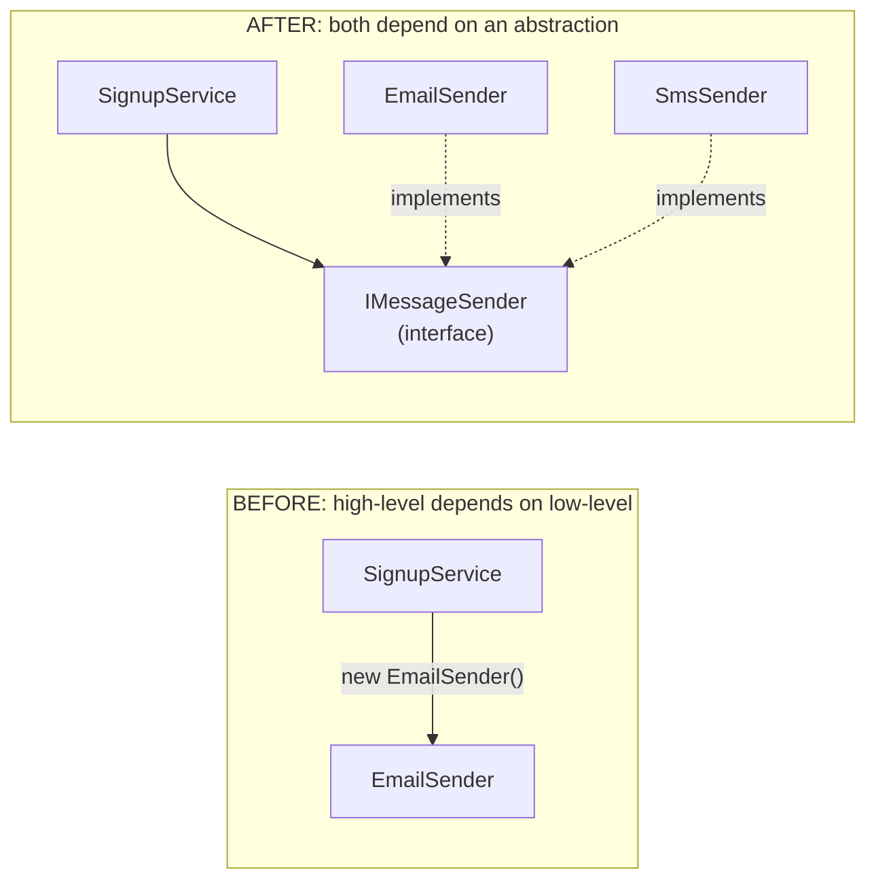

After the change, `SignupService` doesn't know or care which sender it gets. Switching from email to SMS, or to a fake sender in tests, needs no change to `SignupService`.

### Code (the "good" versions, runnable)

```csharp
namespace Chapter01.Topics;

public static class T14_Solid
{
    // ===== S: Single Responsibility — one class, one reason to change =====
    private record Invoice(int Id, decimal Amount);

    private class InvoiceCalculator
    {
        public decimal Tax(Invoice invoice) => invoice.Amount * 0.18m;
    }

    private class InvoicePrinter
    {
        public string Print(Invoice invoice, decimal tax) => $"Invoice {invoice.Id}: amount {invoice.Amount}, tax {tax}";
    }

    // ===== O: Open/Closed — add new behaviour by ADDING classes, not EDITING old ones =====
    private interface IDiscount { decimal Apply(decimal amount); }
    private class NoDiscount : IDiscount { public decimal Apply(decimal amount) => amount; }
    private class FestivalDiscount : IDiscount { public decimal Apply(decimal amount) => amount * 0.9m; }
    private class LoyaltyDiscount : IDiscount { public decimal Apply(decimal amount) => amount - 100; }   // added later; nothing else changed

    // ===== L: Liskov Substitution — any implementation must work anywhere the abstraction is expected =====
    private interface IFileStorage { string Save(string fileName); }
    private class LocalDiskStorage : IFileStorage { public string Save(string fileName) => $"Saved {fileName} to D:\\uploads"; }
    private class BlobStorage : IFileStorage { public string Save(string fileName) => $"Saved {fileName} to blob container 'uploads'"; }

    // This code works with ANY storage and never needs to check which one it got
    private static string UploadInvoice(IFileStorage storage) => storage.Save("invoice-1001.pdf");

    // ===== I: Interface Segregation — small, focused interfaces =====
    private interface IReadRepository<T> { T? Get(int index); }
    private interface IWriteRepository<T> { void Add(T item); }

    private class ProductCatalog : IReadRepository<string>, IWriteRepository<string>
    {
        private readonly List<string> _items = new() { "Pen", "Book" };
        public string? Get(int index) => index < _items.Count ? _items[index] : null;
        public void Add(string item) => _items.Add(item);
    }

    // ===== D: Dependency Inversion — depend on abstractions, not concrete classes =====
    private interface IMessageSender { string Send(string to, string message); }
    private class EmailSender : IMessageSender { public string Send(string to, string message) => $"Email to {to}: {message}"; }
    private class SmsSender : IMessageSender { public string Send(string to, string message) => $"SMS to {to}: {message}"; }

    private class SignupService
    {
        private readonly IMessageSender _sender;
        public SignupService(IMessageSender sender) => _sender = sender;   // given from outside, not created inside
        public string Register(string user) => _sender.Send(user, "Welcome!");
    }

    public static void Run()
    {
        var invoice = new Invoice(1, 1000m);
        var tax = new InvoiceCalculator().Tax(invoice);
        Console.WriteLine($"S: {new InvoicePrinter().Print(invoice, tax)}");

        IDiscount[] discounts = { new NoDiscount(), new FestivalDiscount(), new LoyaltyDiscount() };
        foreach (var discount in discounts)
            Console.WriteLine($"O: {discount.GetType().Name} on 1000 -> {discount.Apply(1000m)}");

        IFileStorage[] storages = { new LocalDiskStorage(), new BlobStorage() };
        foreach (var storage in storages)
            Console.WriteLine($"L: {UploadInvoice(storage)}");

        IReadRepository<string> reader = new ProductCatalog();   // this code only needs to READ
        Console.WriteLine($"I: reader.Get(1) = {reader.Get(1)}");

        Console.WriteLine($"D: {new SignupService(new EmailSender()).Register("asha@example.com")}");
        Console.WriteLine($"D: {new SignupService(new SmsSender()).Register("+91-9000000000")}");
    }
}
```

> `<T>` makes an interface **generic**: `T` is a placeholder type filled in later (`IReadRepository<string>`). Generics are covered in Chapter 2.

**Output:**

```
S: Invoice 1: amount 1000, tax 180.00
O: NoDiscount on 1000 -> 1000
O: FestivalDiscount on 1000 -> 900.0
O: LoyaltyDiscount on 1000 -> 900
L: Saved invoice-1001.pdf to D:\uploads
L: Saved invoice-1001.pdf to blob container 'uploads'
I: reader.Get(1) = Book
D: Email to asha@example.com: Welcome!
D: SMS to +91-9000000000: Welcome!
```

> Notice `180.00` and `900.0`: `decimal` remembers how many decimal places came from the calculation (`0.18m` has 2, `0.9m` has 1). The values are still exactly equal to 180 and 900.

### Common mistakes / gotchas

- **Over-engineering.** Creating an interface, a factory and five classes for a rule that will never change. SOLID is a tool, not a goal. **YAGNI** ("You Aren't Gonna Need It"): add abstraction when a second case actually appears, or when you need it for testing.
- **Misreading SRP as "one method per class".** It means one *reason to change*, i.e. one actor or stakeholder whose requests drive changes.
- **Confusing Dependency *Inversion* with Dependency *Injection*** (see below).

### 5-YOE depth

- **DIP vs DI vs IoC (a classic senior question):**
  - **Dependency Inversion Principle** is a *design principle*: depend on abstractions, and let the high-level module own the interface.
  - **Dependency Injection** is a *technique*: pass dependencies in (usually through the constructor) instead of creating them inside.
  - **Inversion of Control** is the *broad idea* that a framework or container controls object creation and the program flow, not your code. A DI container (ASP.NET Core's `IServiceCollection`) is an IoC container.
- **The "inversion" in DIP:** normally high-level code (`SignupService`) depends on low-level code (`EmailSender`). With DIP, *both* depend on an interface that belongs to the high-level side, so the dependency arrow points "upward". That's why in Clean Architecture (Chapter 22) interfaces live in the core/application layer and implementations live in infrastructure.
- **OCP in .NET practice:** register multiple implementations in DI and inject `IEnumerable<IDiscount>`, or use keyed services (.NET 8, Chapter 6), to add behaviour without editing existing code.
- **LSP also covers contracts:** a subclass must not strengthen preconditions (accept less), weaken postconditions (promise less), or throw new unexpected exceptions.

### Interview questions

1. **Explain SOLID with a real example.**
   Give one example per letter from backend work: split tax, printing and email (S); add discounts as new classes (O); an archive storage whose `Delete()` throws breaks the cleanup job that uses `IFileStorage` (L); split read and write repositories (I); inject `IEmailSender` instead of `new EmailSender()` (D).
2. **What's the difference between Dependency Inversion and Dependency Injection?**
   DIP is the principle (depend on abstractions). DI is a technique for supplying dependencies from outside. DI is one common way to achieve DIP.
3. **Give an example of an LSP violation.**
   A write-once `ArchiveStorage` implementing `IFileStorage` whose `Delete()` throws, which crashes any code that relies on the interface. Generally, any subclass throwing `NotSupportedException` for an inherited member (like a read-only collection's `Add`). The textbook example is `Square : Rectangle`.
4. **Can SOLID be overused?**
   Yes. Too many abstractions make code harder to follow. Apply it where change is likely or where testing needs it (YAGNI).
5. **How does ASP.NET Core support SOLID?**
   Through its built-in DI container (D), middleware and filters as extension points (O), and the options pattern for focused configuration objects (I/S).

---

## 1.15 Equality vs reference identity: Equals, ==, GetHashCode

### What it is

"Are these two things equal?" has two possible meanings:

- **Reference equality (identity):** are they **the same object** in memory?
- **Value equality:** do they **contain the same data**, even if they're two different objects?

C# gives you several tools:

| Tool | Default behaviour for classes | Default for structs | Notes |
|---|---|---|---|
| `ReferenceEquals(a, b)` | Same object? | Always `false` (it boxes) | Can't be overridden; always checks identity |
| `a.Equals(b)` | Same object? | Same field values | **Virtual**, so you override it for value equality |
| `a == b` | Same object? | Not available unless you define it | An **operator** that can be overloaded (`string` and records do) |
| `GetHashCode()` | Based on object identity | Based on fields | Must agree with `Equals` |

**`GetHashCode()`** returns a number used by **hash-based collections** (`Dictionary`, `HashSet`) to find items quickly. Think of it as the **shelf number** in a library: the collection first goes to the shelf, then checks books on that shelf one by one with `Equals`.

### Why it matters

If you override `Equals` but forget `GetHashCode`, `HashSet.Contains` and `Dictionary` lookups **silently fail**: the collection searches the wrong shelf. It's one of the most common senior-level questions.

### How it works

**The Equals/GetHashCode contract (the rules you must follow):**

1. If `a.Equals(b)` is true, then `a.GetHashCode() == b.GetHashCode()` **must** be true.
2. Two objects with the **same** hash code are **not** necessarily equal (different books can share a shelf: a "collision").
3. `Equals` must be **reflexive** (`a.Equals(a)`), **symmetric** (`a.Equals(b)` ⇔ `b.Equals(a)`), **transitive**, and **consistent** (the same answer every time if nothing changes).
4. `a.Equals(null)` must return `false` (and not throw).
5. The hash code must not change while the object is inside a hash collection, so **don't base it on mutable fields**.

**Doing it properly:** override `Equals(object?)`, override `GetHashCode()` using `HashCode.Combine(...)` with **the same fields** that `Equals` compares, and optionally overload `==` and `!=` so they behave consistently.

In the example below, `BrokenUser` overrides only `Equals`. The two objects are "equal", but they have different identity-based hash codes, so the `HashSet` searches the wrong shelf and says it doesn't contain the item.

This is how `HashSet.Contains(lookup)` works, and why the broken version fails:

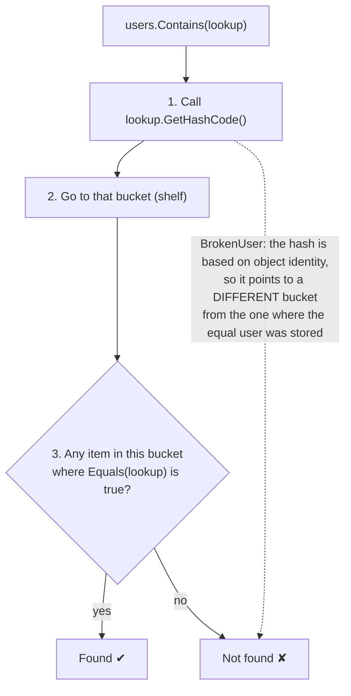

**Real-world impact:** a service caches "users already notified today" in a `HashSet<User>` to avoid duplicate emails. With the broken `GetHashCode`, every lookup misses and every user gets the same email again.

### Code

```csharp
namespace Chapter01.Topics;

public static class T15_Equality
{
    // A normal class: no equality code written
    private class UserNoEquals
    {
        public int Id { get; init; }
        public string Email { get; init; } = "";
    }

    // A class with value equality done properly
    private class User
    {
        public int Id { get; init; }
        public string Email { get; init; } = "";

        public override bool Equals(object? obj) =>
            obj is User other && Id == other.Id && Email == other.Email;

        // RULE: if two objects are Equal, they MUST return the same hash code
        public override int GetHashCode() => HashCode.Combine(Id, Email);

        public static bool operator ==(User? left, User? right) => left is null ? right is null : left.Equals(right);
        public static bool operator !=(User? left, User? right) => !(left == right);
    }

#pragma warning disable CS0659 // the compiler warns: Equals overridden without GetHashCode. That is the bug we want to show.
    private class BrokenUser
    {
        public int Id { get; init; }
        public override bool Equals(object? obj) => obj is BrokenUser other && Id == other.Id;
    }
#pragma warning restore CS0659

    public static void Run()
    {
        var a = new UserNoEquals { Id = 1, Email = "a@x.com" };
        var b = new UserNoEquals { Id = 1, Email = "a@x.com" };
        Console.WriteLine($"No override:   a == b: {a == b}, a.Equals(b): {a.Equals(b)}");

        var u1 = new User { Id = 1, Email = "a@x.com" };
        var u2 = new User { Id = 1, Email = "a@x.com" };
        Console.WriteLine($"With override: u1 == u2: {u1 == u2}, u1.Equals(u2): {u1.Equals(u2)}, ReferenceEquals: {ReferenceEquals(u1, u2)}");
        Console.WriteLine($"Same hash code: {u1.GetHashCode() == u2.GetHashCode()}");

        var users = new HashSet<User> { u1 };
        Console.WriteLine($"HashSet<User> contains u2? {users.Contains(u2)}");

        var broken = new HashSet<BrokenUser> { new BrokenUser { Id = 1 } };
        var lookup = new BrokenUser { Id = 1 };
        Console.WriteLine($"BrokenUser Equals: {lookup.Equals(new BrokenUser { Id = 1 })}, but HashSet contains it? {broken.Contains(lookup)}  <- GetHashCode not overridden");

        // Value types: Equals compares contents
        int x = 5, y = 5;
        Console.WriteLine($"int: x == y: {x == y}, x.Equals(y): {x.Equals(y)}");
    }
}
```

> `HashSet<T>` is a collection of unique items with very fast `Contains` (Chapter 2). `#pragma warning disable` turns off one compiler warning for a few lines; here we *want* the buggy code for the demo.

**Output:**

```
No override:   a == b: False, a.Equals(b): False
With override: u1 == u2: True, u1.Equals(u2): True, ReferenceEquals: False
Same hash code: True
HashSet<User> contains u2? True
BrokenUser Equals: True, but HashSet contains it? False  <- GetHashCode not overridden
int: x == y: True, x.Equals(y): True
```

### Common mistakes / gotchas

- **Overriding `Equals` without `GetHashCode`** (or using different fields in each). Hash collections break silently.
- **Mutable fields in `GetHashCode`.** Add a `User` to a `HashSet`, change its `Email`, and now `Contains` can't find it, because it's sitting on the old shelf.
- **Overloading `==` but not `Equals`** (or the reverse), so they give different answers. Keep all of them consistent.
- **Using `==` inside your own `operator ==`** on the same type, which causes infinite recursion. Use `is null` or `ReferenceEquals` for the null checks.

### 5-YOE depth

- **Default `ValueType.Equals` for structs** compares fields using **reflection** if the struct contains any reference-type fields. That's slow, and calling it via `object` also **boxes**. Always implement `IEquatable<T>` on structs (topic 16).
- **Records generate all of this correctly for you**, which is a main reason to use records for value-like data.
- **In generic code, `a == b` doesn't compile** for an unconstrained `T`. Use `EqualityComparer<T>.Default.Equals(a, b)`, which automatically uses `IEquatable<T>` when it's available.
- **`IEqualityComparer<T>`** lets you define equality **outside** the class, e.g. `StringComparer.OrdinalIgnoreCase` for dictionary keys, or "users are equal if their emails match, ignoring case". You pass it to the `Dictionary`/`HashSet` constructor.
- **Entities vs value objects (DDD):** an **entity** (Order, Customer) has identity, so two orders are equal if their **Id** matches, even when other fields differ. A **value object** (Money, Address) has no identity, so it's equal when **all fields** match. Many codebases implement `Equals` on entities by Id only. **Never** override `GetHashCode` with a database-generated Id that changes from 0 to a real value after saving.
- **Hash code quality:** a bad hash (e.g. always returning `1`) still works but makes every lookup scan everything, turning O(1) into O(n). `HashCode.Combine` gives a well-distributed hash.

### Interview questions

1. **Difference between `==` and `Equals`?**
   `Equals` is a virtual method; `==` is a static operator resolved at compile time. For classes both default to reference equality. `string` and records override both to compare values. `==` on two `object` variables holding equal strings compares references.
2. **Why must you override `GetHashCode` when you override `Equals`?**
   Hash-based collections first use the hash code to find the bucket, then `Equals` within it. Equal objects with different hash codes land in different buckets, so lookups fail.
3. **Can two unequal objects have the same hash code?**
   Yes. That's a collision, and it's allowed. Equal objects, however, must have equal hash codes.
4. **What happens if you modify an object used as a Dictionary key?**
   If the change affects its hash code, the dictionary can no longer find it. Keys should be immutable.
5. **How do you compare two objects of a generic type `T`?**
   `EqualityComparer<T>.Default.Equals(a, b)`.

---

## 1.16 IEquatable<T> and IComparable<T>

### What it is

Two standard interfaces that tell .NET how to **compare** your type:

- **`IEquatable<T>`**: "here is a fast, strongly typed `Equals(T other)`." It answers **are they equal?**
- **`IComparable<T>`**: "here is `CompareTo(T other)`." It answers **which comes first?**, which is needed for **sorting**.
  - It returns a **negative** number if `this` comes before `other`, **0** if they're equal in order, and a **positive** number if `this` comes after.

Related helpers:
- **`IComparer<T>`**: a **separate** class that compares two objects. Use it when you need **several different sort orders** (by salary, by age) or can't change the class.
- **`IEqualityComparer<T>`**: the same idea, for equality.

### Why it matters

- `List<T>.Sort()`, `OrderBy`, `SortedDictionary` and `Min`/`Max` all depend on comparison.
- `List.Contains`, `Dictionary` and `HashSet` use `IEquatable<T>` when it's available. For structs that **avoids boxing** (topic 18) and is much faster.

### How it works

- `Money` implements both interfaces. `wallet.Sort()` then calls `CompareTo` automatically to order the amounts.
- `CompareTo` can enforce rules too: comparing INR with USD makes no sense, so it throws.
- Operator overloads (`==`, `!=`, `<`, `>`) are added so code reads naturally: `if (price < budget)`. C# requires them **in pairs** (`==` with `!=`, `<` with `>`).
- `team.Sort(new BySalaryDescending())` uses an `IComparer<T>`, and `team.Sort((x, y) => x.Age.CompareTo(y.Age))` uses a quick inline comparison (a **lambda**, Chapter 3).

### Code

```csharp
namespace Chapter01.Topics;

public static class T16_EquatableComparable
{
    private readonly struct Money : IEquatable<Money>, IComparable<Money>
    {
        public decimal Amount { get; }
        public string Currency { get; }

        public Money(decimal amount, string currency)
        {
            Amount = amount;
            Currency = currency;
        }

        // IEquatable<Money>: strongly-typed Equals, no boxing
        public bool Equals(Money other) => Amount == other.Amount && Currency == other.Currency;
        public override bool Equals(object? obj) => obj is Money other && Equals(other);
        public override int GetHashCode() => HashCode.Combine(Amount, Currency);

        // IComparable<Money>: negative = this comes first, 0 = same, positive = this comes after
        public int CompareTo(Money other)
        {
            if (Currency != other.Currency)
                throw new InvalidOperationException("Cannot compare different currencies");
            return Amount.CompareTo(other.Amount);
        }

        public static bool operator ==(Money left, Money right) => left.Equals(right);
        public static bool operator !=(Money left, Money right) => !left.Equals(right);
        public static bool operator <(Money left, Money right) => left.CompareTo(right) < 0;
        public static bool operator >(Money left, Money right) => left.CompareTo(right) > 0;

        public override string ToString() => $"{Amount} {Currency}";
    }

    private record Employee(string Name, int Age, decimal Salary);

    // IComparer<T>: a SEPARATE class that decides the order (use it when you need several sort orders)
    private class BySalaryDescending : IComparer<Employee>
    {
        public int Compare(Employee? x, Employee? y) => (y?.Salary ?? 0).CompareTo(x?.Salary ?? 0);
    }

    public static void Run()
    {
        var a = new Money(100, "INR");
        var b = new Money(100, "INR");
        var c = new Money(250, "INR");
        Console.WriteLine($"a == b: {a == b}, a < c: {a < c}, a.CompareTo(c): {a.CompareTo(c)}");

        var wallet = new List<Money> { c, a, new Money(50, "INR") };
        wallet.Sort();   // uses IComparable<Money>.CompareTo
        Console.WriteLine($"Sorted wallet: {string.Join(", ", wallet)}");

        var team = new List<Employee>
        {
            new("Asha", 30, 90000),
            new("Ravi", 25, 120000),
            new("Meera", 35, 75000),
        };

        team.Sort(new BySalaryDescending());
        Console.WriteLine($"By salary (desc): {string.Join(", ", team.Select(e => $"{e.Name}({e.Salary})"))}");

        team.Sort((x, y) => x.Age.CompareTo(y.Age));   // a quick one-off comparison
        Console.WriteLine($"By age:           {string.Join(", ", team.Select(e => $"{e.Name}({e.Age})"))}");

        try
        {
            _ = a.CompareTo(new Money(1, "USD"));
        }
        catch (InvalidOperationException ex)
        {
            Console.WriteLine($"Compare INR with USD: {ex.Message}");
        }
    }
}
```

> `new("Asha", 30, 90000)` is **target-typed `new`**: the compiler knows the list holds `Employee`, so you don't have to repeat the type name. `team.Select(e => ...)` transforms each employee into text (LINQ, Chapter 3).

**Output:**

```
a == b: True, a < c: True, a.CompareTo(c): -1
Sorted wallet: 50 INR, 100 INR, 250 INR
By salary (desc): Ravi(120000), Asha(90000), Meera(75000)
By age:           Ravi(25), Asha(30), Meera(35)
Compare INR with USD: Cannot compare different currencies
```

### Common mistakes / gotchas

- **Implementing `IEquatable<T>` but not overriding `Equals(object)` and `GetHashCode`.** Then different APIs give different answers. Always do all three together.
- **`return this.Value - other.Value;` in `CompareTo`.** It looks clever but **overflows** for large values (e.g. `int.MinValue - 1`). Use `Value.CompareTo(other.Value)`.
- **Inconsistent ordering**, where `a < b` and `b < a` are both true. `Sort` can then behave unpredictably or throw.
- **Calling `Sort()` on a list of a type with no `IComparable`.** It throws `InvalidOperationException` at runtime.

### 5-YOE depth

- **Why `IEquatable<T>` matters for structs:** without it, `List<Money>.Contains` calls `Equals(object)`, which **boxes** every element it compares. `EqualityComparer<T>.Default` detects `IEquatable<T>` and calls the typed version directly, with no boxing.
- **Non-generic `IComparable`** (taking `object`) exists from before generics. Implement the generic one, and the non-generic one only if old APIs need it.
- **`Comparer<T>.Create((a, b) => ...)`** builds an `IComparer<T>` from a lambda without writing a class.
- **`List<T>.Sort` is not stable.** Equal elements may change their relative order. LINQ's `OrderBy` **is** stable. That matters when you sort by one key and then expect a previous order to survive.
- **Consistency with Equals:** ideally `CompareTo` returns 0 exactly when `Equals` is true. `SortedSet<T>` treats `CompareTo == 0` as a **duplicate** and won't add the item, even if `Equals` says the items differ.

### Interview questions

1. **Why implement `IEquatable<T>`?**
   A type-safe `Equals(T)` that collections use through `EqualityComparer<T>.Default`. For structs it avoids boxing and reflection-based equality.
2. **What does `CompareTo` return?**
   A negative number if this precedes the other, 0 if they're equal in sort order, and a positive number if this follows.
3. **`IComparable<T>` vs `IComparer<T>`?**
   `IComparable<T>` is implemented by the type itself (its one "natural" order). `IComparer<T>` is a separate comparer, for multiple or alternative orders or for types you can't modify.
4. **Why is `return a - b;` a bad `CompareTo`?**
   Integer overflow can flip the sign and give the wrong order. Use `a.CompareTo(b)`.
5. **Is `List<T>.Sort` stable?**
   No. `OrderBy` in LINQ is stable.

---

## 1.17 Shallow copy vs deep copy

### What it is

When you copy an object that contains other objects:

- **Shallow copy:** copies the outer object's fields **as they are**. Value-type fields are copied. Reference-type fields copy only the **address**, so the copy and the original **share** the inner objects.
- **Deep copy:** copies the outer object **and creates new copies of every inner object**, all the way down. Nothing is shared.

**Analogy:** you share a folder of documents.
- Shallow copy = a new folder containing **shortcuts** to the same files. Edit a file through either folder and both see the change.
- Deep copy = a new folder with **duplicates** of every file. The two are fully independent.

### Why it matters

Accidental sharing causes bugs like "I edited the copy, why did the original change?". This happens with caches, DTO mapping, and especially records with `with` (which is shallow).

### How it works

- **`MemberwiseClone()`** is a built-in `protected` method on every object. It produces a **shallow** copy.
- **Deep copy options:**
  1. **Manual:** write a method that creates new inner objects (fast, explicit, but you must maintain it).
  2. **Serialize and deserialize** (e.g. with JSON): simple, but slower, and it only copies what the serializer handles (public properties).
  3. **Copy constructors:** `public Person(Person other) { ... }`.
- **Strings** inside a shallow copy are fine: they're immutable, so sharing them is harmless.

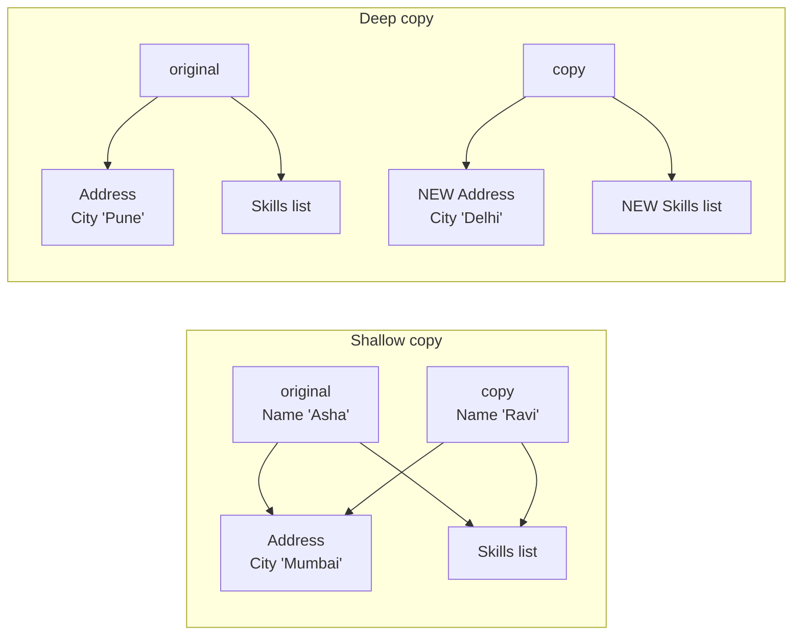

In the shallow copy, both objects point at the **same** Address and Skills, so editing one edits "both". In the deep copy, each has its own.

**Real-world impact:** an employee-profile API loads a profile, makes a shallow "draft" copy for an edit screen, and the user's unsaved changes to the address leak into the live profile that other requests are reading.

### Code

```csharp
using System.Text.Json;

namespace Chapter01.Topics;

public static class T17_ShallowVsDeepCopy
{
    private class Address
    {
        public string City { get; set; } = "";
    }

    private class Person
    {
        public string Name { get; set; } = "";
        public Address Address { get; set; } = new();
        public List<string> Skills { get; set; } = new();

        // Shallow: copies each field as-is. Reference fields still point to the SAME objects.
        public Person ShallowCopy() => (Person)MemberwiseClone();

        // Deep: creates NEW copies of everything inside
        public Person DeepCopy() => new()
        {
            Name = Name,
            Address = new Address { City = Address.City },
            Skills = new List<string>(Skills),
        };

        public override string ToString() => $"{Name}, {Address.City}, [{string.Join(", ", Skills)}]";
    }

    private record Order(string Id, List<string> Items);

    private static Person CreateAsha() => new()
    {
        Name = "Asha",
        Address = new Address { City = "Pune" },
        Skills = { "C#" },
    };

    public static void Run()
    {
        // --- Shallow copy ---
        var original = CreateAsha();
        var shallow = original.ShallowCopy();
        shallow.Name = "Ravi";              // string variable reassigned -> independent
        shallow.Address.City = "Mumbai";    // SAME Address object -> the original changes too!
        shallow.Skills.Add("SQL");          // SAME list -> the original changes too!
        Console.WriteLine($"Shallow: original = {original}");
        Console.WriteLine($"         copy     = {shallow}");

        // --- Deep copy ---
        original = CreateAsha();
        var deep = original.DeepCopy();
        deep.Address.City = "Delhi";
        deep.Skills.Add("Azure");
        Console.WriteLine($"Deep:    original = {original}");
        Console.WriteLine($"         copy     = {deep}");

        // --- Deep copy using JSON (simple but slow) ---
        var jsonCopy = JsonSerializer.Deserialize<Person>(JsonSerializer.Serialize(original))!;
        jsonCopy.Address.City = "Chennai";
        Console.WriteLine($"JSON:    original city = {original.Address.City}, copy city = {jsonCopy.Address.City}");

        // --- Records: 'with' is a SHALLOW copy ---
        var order = new Order("O1", new List<string> { "Pen" });
        var copy = order with { Id = "O2" };
        copy.Items.Add("Book");
        Console.WriteLine($"Record 'with': order.Items = [{string.Join(", ", order.Items)}]  <- the list is shared!");
    }
}
```

> `JsonSerializer.Serialize` turns an object into JSON text; `Deserialize<Person>` builds a new object from that text. Since a brand-new object is built, nothing is shared.

**Output:**

```
Shallow: original = Asha, Mumbai, [C#, SQL]
         copy     = Ravi, Mumbai, [C#, SQL]
Deep:    original = Asha, Pune, [C#]
         copy     = Asha, Delhi, [C#, Azure]
JSON:    original city = Pune, copy city = Chennai
Record 'with': order.Items = [Pen, Book]  <- the list is shared!
```

### Common mistakes / gotchas

- **Assuming `with` or `MemberwiseClone` deep-copies.** Neither does.
- **Returning internal lists directly from a class.** The caller can modify your object's internals. Return a copy or `IReadOnlyList<T>`.
- **JSON deep copy on objects with circular references** (A → B → A). It throws unless you configure `ReferenceHandler.Preserve`. It also skips private fields and can't handle every type.

### 5-YOE depth

- **`ICloneable` is discouraged** by Microsoft's own design guidelines: its `Clone()` doesn't say whether it's shallow or deep, and it returns `object`. Prefer explicit `ShallowCopy`/`DeepCopy` methods or copy constructors.
- **The best fix is often immutability.** If `Address` and `Skills` can't be changed (immutable records plus `ImmutableList<T>` or `IReadOnlyList<T>`), sharing them is perfectly safe and you don't need deep copies at all. This is why immutable DTOs and records are popular.
- **Caching danger:** if `IMemoryCache` (Chapter 18) returns the same object to every request and one request modifies it, every other user sees the change. Cache immutable objects, or copy them on read.
- **Deep copying is expensive** for large object graphs (many allocations). Be deliberate about when you do it.

### Interview questions

1. **Shallow vs deep copy?**
   A shallow copy duplicates the top-level object, but reference fields still point to the same inner objects. A deep copy recursively duplicates all inner objects, so nothing is shared.
2. **Is a record's `with` expression a deep copy?**
   No, it's shallow. Reference-type properties are shared.
3. **How do you deep copy an object in C#?**
   Manual copy methods or copy constructors (fast and explicit), or serialization round-trips (simple but slower, with limits). Better still, design immutable types so copying isn't needed.
4. **Why is `ICloneable` discouraged?**
   It doesn't specify shallow vs deep and returns `object`, so callers can't rely on its behaviour.

---

## 1.18 Boxing and unboxing

### What it is

- **Boxing:** converting a **value type** (like `int`) into an **`object`** (or an interface type). .NET creates a small object on the **heap** (the "box") and **copies** the value into it.
- **Unboxing:** extracting the value type back out of the box with a cast: `(int)boxed`.

**Analogy:** boxing is like putting a loose item into a cardboard box so that it can be stored on a shelf meant for boxes (`object`). The box costs money (memory), and what's inside is a **copy**: changing the original item doesn't change the boxed one.

### Why it matters

- Every box is a **heap allocation** that the garbage collector must clean up later. In hot code paths (inside loops, per request), hidden boxing hurts performance.
- Unboxing to the wrong type crashes with `InvalidCastException`.
- It explains *why* generics (`List<int>`) replaced old collections (`ArrayList`).

### How it works

- `object boxed = 42;` allocates a heap object containing a copy of 42. On 64-bit .NET, a boxed `int` takes **24 bytes** (an object header plus a type pointer plus the 4-byte value plus padding), compared to 4 bytes unboxed.
- **Unboxing must use the exact type that was boxed.** A boxed `int` can only be unboxed as `int` (or `int?`). To get a `long`, unbox to `int` first, then convert: `(long)(int)boxed`.
- **Casting a struct to an interface boxes it.** In the example, `IStockLevel asInterface = stock;` creates a boxed **copy**, so a reservation made through the interface **doesn't change the original stock**. In an inventory system, that means units look reserved in one place and available in another.

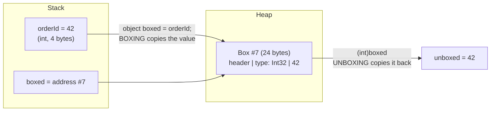
- **Non-generic collections** (`ArrayList`, `Hashtable`) store `object`, so every value type is boxed on the way in and unboxed on the way out. **Generic collections** (`List<int>`) store `int` directly, with no boxing.

### Code

```csharp
using System.Collections;

namespace Chapter01.Topics;

public static class T18_BoxingUnboxing
{
    private interface IStockLevel
    {
        int Quantity { get; }
        void Reserve();
    }

    // A small struct tracking how many units of a product are left
    private struct StockLevel : IStockLevel
    {
        public int Quantity { get; private set; }
        public StockLevel(int quantity) => Quantity = quantity;
        public void Reserve() => Quantity--;
    }

    public static void Run()
    {
        // --- Boxing and unboxing ---
        int orderId = 42;
        object boxed = orderId;     // BOXING: the value is copied into a new object on the heap
        int unboxed = (int)boxed;   // UNBOXING: the value is copied back out
        Console.WriteLine($"boxed = {boxed}, unboxed = {unboxed}");

        orderId = 100;
        Console.WriteLine($"After orderId = 100, boxed is still {boxed}   (the box holds its own copy)");

        // --- You must unbox to the EXACT type ---
        try
        {
            long wrong = (long)boxed;
            Console.WriteLine(wrong);
        }
        catch (InvalidCastException)
        {
            Console.WriteLine("(long)boxed threw InvalidCastException: a boxed int must be unboxed as int");
        }
        long right = (int)boxed;    // unbox to int first, then convert int -> long
        Console.WriteLine($"(long)(int)boxed = {right}");

        // --- Casting a struct to an interface boxes it: you get a separate copy ---
        var stock = new StockLevel(10);
        IStockLevel asInterface = stock;   // boxing
        asInterface.Reserve();             // reserves a unit on the BOXED COPY only
        Console.WriteLine($"stock.Quantity = {stock.Quantity}, asInterface.Quantity = {asInterface.Quantity}   <- the reservation was lost on the original!");

        // --- Old non-generic collections box every value; generic ones don't ---
        var arrayList = new ArrayList { 499, 1299, 99 };   // each int is boxed
        var list = new List<int> { 499, 1299, 99 };        // no boxing
        int sum = 0;
        foreach (object item in arrayList) sum += (int)item;   // unboxing on every read
        Console.WriteLine($"ArrayList sum = {sum}, List<int> sum = {list.Sum()}");

        // --- Boxing costs memory: each box is a small heap object ---
        object holder = 0;
        long before = GC.GetAllocatedBytesForCurrentThread();
        for (int i = 0; i < 1000; i++) holder = i;   // 1000 boxes
        long after = GC.GetAllocatedBytesForCurrentThread();
        GC.KeepAlive(holder);
        Console.WriteLine($"Boxing 1000 ints allocated {after - before} bytes");
    }
}
```

> `GC.GetAllocatedBytesForCurrentThread()` reports how much memory this thread has allocated so far, so subtracting before and after measures the cost of the loop. `GC.KeepAlive` just makes sure the compiler doesn't optimise the loop away.

**Output:**

```
boxed = 42, unboxed = 42
After orderId = 100, boxed is still 42   (the box holds its own copy)
(long)boxed threw InvalidCastException: a boxed int must be unboxed as int
(long)(int)boxed = 42
stock.Quantity = 10, asInterface.Quantity = 9   <- the reservation was lost on the original!
ArrayList sum = 1897, List<int> sum = 1897
Boxing 1000 ints allocated 24000 bytes
```

1000 boxes × 24 bytes = 24,000 bytes, for numbers that would take 4,000 bytes unboxed.

### Common mistakes / gotchas

- **Using `ArrayList`/`Hashtable` in new code.** Always use `List<T>`/`Dictionary<TKey, TValue>`.
- **Unboxing to a "compatible" type** (`(long)boxedInt`). It must be the exact type.
- **Mutating a struct through an interface** and expecting the original to change.
- **Methods that take `object` parameters with value-type arguments**, e.g. old `string.Format("{0}", 5)` or logging APIs with `params object[]`, box every argument.

### 5-YOE depth

- **Hidden boxing sources to look for in hot code:**
  - value types passed as `object` or `params object[]` (e.g. `logger.LogInformation("Id {Id}", id)`, where structured logging boxes `id`; the high-performance alternative is `LoggerMessage` source generators, Chapter 8)
  - calling `Equals(object)` or `GetHashCode` on structs without `IEquatable<T>`/overrides
  - casting structs to interfaces (including `IEnumerable<T>` on a struct enumerator)
  - capturing a value type in a closure doesn't box it, but it does move it to a heap object (Chapter 3)
- **Generic constraints avoid boxing:** `void ReserveUnit<T>(ref T item) where T : IStockLevel` calls `item.Reserve()` **without** boxing, because the JIT generates specialised code for each value type (a "constrained call"). Passing as `IStockLevel` directly would box.
- **What no longer boxes in modern .NET:** string interpolation (`$"{id}"`) uses interpolated string handlers (.NET 6+), and `Enum.HasFlag` is optimised by the JIT (.NET Core 2.1+).
- **How to find boxing:** look for `box` instructions in the IL (with ILSpy or SharpLab.io), or use memory profilers and `dotnet-counters` (allocation rate) in Chapter 4.

### Interview questions

1. **What is boxing and unboxing?**
   Boxing wraps a value type in a heap-allocated object (a copy); unboxing extracts it with an explicit cast to the exact type.
2. **Why is boxing bad for performance?**
   Each box is a heap allocation (24 bytes for an `int` on 64-bit) plus a copy, which creates GC pressure in hot paths.
3. **What happens with `(long)boxedInt`?**
   An `InvalidCastException`. Unbox to `int` first, then convert.
4. **How did generics reduce boxing?**
   `List<int>` stores ints directly; `ArrayList` stored `object` and boxed every value.
5. **Does calling an interface method on a struct box it?**
   Yes, if the struct is cast to the interface type. With generic constraints (`where T : IFoo`) the JIT makes a constrained call without boxing.

---

## Quick revision

**Types and conversions**
- Use `decimal` for money, never `double` (0.1 + 0.2 ≠ 0.3 in `double`).
- `(int)9.99` = 9 (truncates). The default rounding is banker's (2.5 → 2); use `MidpointRounding.AwayFromZero` for money.
- Overflow wraps silently; `checked` throws. Use `TryParse` for user input.

**var / object / dynamic**
- `var`: compiler-inferred, strongly typed. `object`: holds anything, cast to use. `dynamic`: runtime-checked, so runtime crashes.

**Value vs reference**
- Value types copy the data; reference types copy the address. "Value types live on the stack" is a myth; the real difference is **copy semantics**.
- References are passed **by value** by default; use `ref` to replace the caller's object.

**Strings**
- Immutable: every change makes a new string. Use `StringBuilder` in loops. `==` compares text.
- Use `StringComparison.Ordinal(IgnoreCase)` for identifiers; never `ToLower()` to compare.

**Nullable**
- `int?` = `Nullable<int>`. Know `?.`, `??`, `??=`, `!`, `is null`.
- NRT gives compile-time warnings only. Still validate public inputs. EF Core uses NRT to set NULL/NOT NULL.

**Parameters**
- `ref`: initialised first, read and write. `out`: must be assigned by the method. `in`: read-only by reference. `params`: variable count.
- Default parameter values and `const` are baked into callers (a versioning trap). Async methods can't take `ref`/`out`.

**static / const / readonly**
- `const` is compile-time and copied into callers; `static readonly` is runtime and shared; `readonly` is per object and protects only the reference.
- Static constructors run once and are thread-safe; if one throws you get `TypeInitializationException` forever. Static mutable state in web apps is dangerous.

**Class / struct / record / enum**
- Records: value equality, `with` (shallow!), `ToString`, deconstruction. Use them for DTOs, not EF entities.
- Enums: any int can be cast in, so validate. Assign explicit values. `[Flags]` uses powers of two. JSON serializes enums as numbers unless configured.

**Constructors / properties / access**
- Order: derived field initializers → base field initializers → base constructor → derived constructor (static constructors first, once each).
- Never call virtual methods from a constructor. Expose properties, not public fields.
- Defaults: classes are `internal`, members are `private`. `init` = set only at creation; `required` = must be set at creation; `field` keyword = C# 14.

**OOP pillars**
- Encapsulation protects invariants; inheritance is is-a; abstraction is what, not how; polymorphism means the real object decides (overriding) or the compiler decides (overloading).

**Interface vs abstract class**
- Interface: can-do, many per class, no state, default methods since C# 8, the basis of DI and mocking.
- Abstract class: is-a, one only, shared state and code, constructors. Often both are combined: interface plus an optional base class.

**Override vs hide**
- Override (`virtual`/`override`) follows the **object**. Hide (`new`) follows the **variable**. Methods are non-virtual by default. `sealed` stops overriding and enables devirtualization.

**Composition**
- Favour has-a over is-a. DI is composition. Inheritance is fine for true is-a and framework base classes.

**SOLID**
- S: one reason to change. O: extend by adding classes. L: every implementation must honour the contract (archive storage whose `Delete` throws; textbook: Square/Rectangle). I: small interfaces. D: depend on abstractions.
- DIP (principle) ≠ DI (technique) ≠ IoC (broad idea). Don't over-engineer (YAGNI).

**Equality**
- Override `Equals` **and** `GetHashCode` with the same fields. Equal ⇒ same hash; same hash ⇏ equal.
- Don't use mutable fields in hash codes. In generics use `EqualityComparer<T>.Default`.

**IEquatable / IComparable**
- `IEquatable<T>` gives a typed `Equals` with no boxing. `CompareTo` returns negative/0/positive; never `a - b`.
- `IComparer<T>` is for alternative orders. `List.Sort` is unstable; `OrderBy` is stable.

**Copies**
- Shallow shares inner objects (`MemberwiseClone`, `with`); deep duplicates everything. Prefer immutability. Avoid `ICloneable`.

**Boxing**
- A value type → `object`/interface means a heap allocation (24 bytes for an `int`). Unbox to the exact type.
- Avoid it with generics, `IEquatable<T>` and generic constraints.

