# Chapter 2 — Collections, generics and exceptions

> **Days:** 4–6 · **Status:** Notes, code, quiz and exercises ready · learner has not taken the quiz yet
>
> **Interview target:** Choose the right collection, explain the hash-code contract, and handle errors and resources safely.

## Topics in this chapter

1. Arrays and List<T>
2. Dictionary<TKey,TValue> and HashSet<T>: how hashing works, collisions
3. Queue<T>, Stack<T>, LinkedList<T> and SortedDictionary<TKey,TValue>
4. Collection interfaces: IEnumerable<T>, ICollection<T>, IList<T>, IReadOnlyList<T>, IReadOnlyCollection<T>
5. Choosing a collection: lookup and insertion costs (Big-O) and memory trade-offs
6. Generics: classes, methods and constraints
7. Covariance and contravariance (in / out)
8. Concurrent collections: ConcurrentDictionary, ConcurrentQueue, BlockingCollection
9. Exception hierarchy and try / catch / finally
10. Custom exceptions and exception filters (when)
11. throw vs throw ex, and stack traces
12. Expected errors vs exceptional failures (Result pattern vs exceptions)
13. IDisposable, using statements and unmanaged resources
14. Logging exceptions without swallowing or duplicating them

---

## Before you start: a few words you will see everywhere

| Word | Plain meaning |
|---|---|
| **Collection** | An object that holds many items, e.g. a list of orders. Arrays, lists, dictionaries and sets are all collections. |
| **Element / item** | One thing stored in a collection. |
| **Index** | The position of an item, counted **from 0**. The first item is at index 0. |
| **Key / value** | In a dictionary, you store a **value** (e.g. a product) under a **key** (e.g. its SKU) and later find the value by giving the key. |
| **Generic** | A class or method with a **type placeholder** like `<T>`, filled in when you use it: `List<Order>`, `List<int>`. |
| **Big-O** | A rough way to say how the cost of an operation grows as the collection gets bigger. O(1) = "about the same no matter the size". O(n) = "twice the items, about twice the work". (Topic 5.) |
| **Exception** | An object that represents an error. When code **throws** one, normal execution stops and .NET looks for code that **catches** it. |
| **Stack trace** | The list of method calls that were active when an exception was thrown. It tells you *where* the error happened. |
| **Thread** | One independent path of execution. A web server handles many requests at once on many threads. |
| **Thread-safe** | Safe to use from several threads at the same time without corrupting data. |
| **Resource** | Something outside .NET's memory that must be given back: an open file, a database connection, a network socket. |

## How to run the code for this chapter

All code in this chapter is also in a runnable project: `chapters/02-collections-generics-exceptions/code/Chapter02/`.

```bash
cd chapters/02-collections-generics-exceptions/code/Chapter02
dotnet run          # runs all topics (1 to 14)
dotnet run -- 8     # runs only topic 8
```

The project file (`Chapter02.csproj`). It references one NuGet package (`Microsoft.Extensions.Logging`, the standard .NET logging library), used in topic 14:

```xml
<Project Sdk="Microsoft.NET.Sdk">

  <PropertyGroup>
    <OutputType>Exe</OutputType>
    <TargetFramework>net10.0</TargetFramework>
    <ImplicitUsings>enable</ImplicitUsings>
    <Nullable>enable</Nullable>
    <RootNamespace>Chapter02</RootNamespace>
  </PropertyGroup>

  <ItemGroup>
    <!-- ILogger and LoggerFactory, used in topic 14 -->
    <PackageReference Include="Microsoft.Extensions.Logging" Version="10.0.13" />
  </ItemGroup>

</Project>
```

`Program.cs` runs each topic's `Run()` method:

```csharp
// Run one topic:   dotnet run -- 3
// Run all topics:  dotnet run
using Chapter02.Topics;

var demos = new Dictionary<int, (string Title, Action Run)>
{
    [1] = ("Arrays and List<T>", T01_ArraysAndLists.Run),
    [2] = ("Dictionary and HashSet: hashing and collisions", T02_DictionaryAndHashSet.Run),
    [3] = ("Queue, Stack, LinkedList, SortedDictionary (+ PriorityQueue)", T03_QueueStackLinkedListSorted.Run),
    [4] = ("Collection interfaces", T04_CollectionInterfaces.Run),
    [5] = ("Choosing a collection: Big-O and memory", T05_ChoosingACollection.Run),
    [6] = ("Generics: classes, methods and constraints", T06_Generics.Run),
    [7] = ("Covariance and contravariance (in / out)", T07_Variance.Run),
    [8] = ("Concurrent collections", T08_ConcurrentCollections.Run),
    [9] = ("Exception hierarchy and try / catch / finally", T09_ExceptionBasics.Run),
    [10] = ("Custom exceptions and exception filters", T10_CustomExceptionsAndFilters.Run),
    [11] = ("throw vs throw ex, and stack traces", T11_ThrowVsThrowEx.Run),
    [12] = ("Expected errors vs exceptional failures (Result pattern)", T12_ResultPattern.Run),
    [13] = ("IDisposable, using and unmanaged resources", T13_Disposable.Run),
    [14] = ("Logging exceptions without swallowing or duplicating", T14_LoggingExceptions.Run),
};

if (args.Length > 0)
{
    if (int.TryParse(args[0], out var topic) && demos.TryGetValue(topic, out var demo))
        Print(topic, demo);
    else
        Console.WriteLine($"Unknown topic '{args[0]}'. Valid topics: {string.Join(", ", demos.Keys)}");
    return;
}

foreach (var (number, d) in demos)
    Print(number, d);

static void Print(int number, (string Title, Action Run) demo)
{
    Console.WriteLine($"===== Topic {number}: {demo.Title} =====");
    demo.Run();
    Console.WriteLine();
}
```

> **About the outputs:** every output block below was captured by running this project on .NET 10 (10.0.10 runtime), 64-bit Windows, in the Debug build that `dotnet run` uses. The machine uses Indian number formatting, so large numbers print as `1,00,000` instead of `100,000`. Timings and byte counts are **measurements from that one machine**: your numbers will be different, but the *relationships* (which is faster, which uses more memory) should hold.

## How to read these notes: rule vs behaviour vs advice

| Kind | Meaning | Example from this chapter |
|---|---|---|
| **Language rule** | Guaranteed by the C# specification. | A `catch (ArgumentException)` placed before `catch (ArgumentNullException)` is a compile error. |
| **Runtime behaviour** | What .NET does today. True in practice, but can change between versions. | `List<T>` capacity doubles: 4 → 8 → 16. |
| **Design guidance** | Good advice that has exceptions. | Don't use exceptions for expected business failures. |

---

## 2.1 Arrays and List<T>

### What it is

An **array** is a fixed-size row of boxes, all of the same type, numbered from 0. You choose the size when you create it, and it can never grow or shrink.

```csharp
decimal[] monthlyRevenue = new decimal[12];   // 12 boxes, each starts at 0
monthlyRevenue[0] = 125_000m;                  // January
```

A **`List<T>`** is a list that **grows automatically** as you add items. The `<T>` means "list of some type T": `List<Order>`, `List<int>`, `List<string>`.

**Analogy:** an array is an egg tray: 12 slots, no more, no less. A `List<T>` is a stack of egg trays where a helper silently fetches a bigger tray and moves all the eggs whenever the current one is full.

### Why it matters

These two are the most-used collections in every .NET codebase. Interviewers use them to check whether you know:

- what happens **inside** a list when it grows (and why pre-sizing helps),
- why removing items inside `foreach` crashes,
- when an array is still the better choice.

### How it works

**Inside a `List<T>` there is an array.** The list keeps two numbers:

- **`Count`**: how many items you have actually added.
- **`Capacity`**: how many items the inner array can hold before it must grow.

When you `Add` and `Count == Capacity`, the list:

1. creates a **new, bigger array** (in .NET today, double the size, starting at 4: *runtime behaviour*),
2. **copies** every existing item into it,
3. lets the old array become garbage.

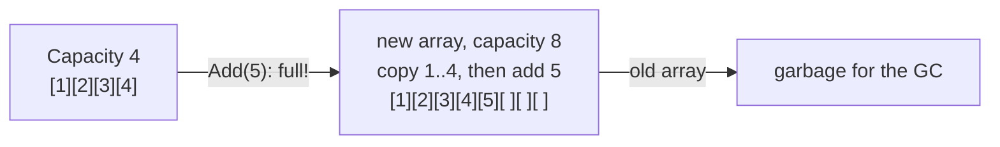

The diagram shows one "grow" step: a new array is allocated, items are copied, and the old array is thrown away.

Most `Add` calls are cheap (just write into the next free slot). Only occasionally is there a big copy. Averaged over many adds, `Add` is **O(1) "amortized"**: amortized means "averaged out over many operations".

| Operation | `T[]` (array) | `List<T>` |
|---|---|---|
| Read/write by index `x[i]` | O(1) | O(1) |
| Add at the end | not possible (fixed size) | O(1) amortized |
| Insert/remove in the middle | not possible | O(n): everything after it shifts |
| `Contains` / `IndexOf` | O(n) | O(n): checks items one by one |
| Size | fixed | grows |

**Arrays and lists are reference types.** `decimal[] sameArray = monthlyRevenue;` doesn't copy the data. Both variables point to the same array (Chapter 1, topic 3).

### Code

```csharp
namespace Chapter02.Topics;

public static class T01_ArraysAndLists
{
    private record Order(int Id, string Status, decimal Total);

    public static void Run()
    {
        // ---- Arrays: fixed size, chosen at creation ----
        decimal[] monthlyRevenue = new decimal[12];   // 12 slots, all start at 0
        monthlyRevenue[0] = 125_000m;                  // January (index 0)
        monthlyRevenue[11] = 310_500m;                 // December (index 11)
        Console.WriteLine($"Months: {monthlyRevenue.Length}, Jan: {monthlyRevenue[0]}, Feb: {monthlyRevenue[1]}, Dec: {monthlyRevenue[11]}");

        try
        {
            monthlyRevenue[12] = 1m;                   // there is no 13th month
        }
        catch (IndexOutOfRangeException ex)
        {
            Console.WriteLine($"Array index 12: {ex.GetType().Name}");
        }

        // Arrays are reference types: assignment copies the reference, not the data
        decimal[] sameArray = monthlyRevenue;
        sameArray[1] = 99m;
        Console.WriteLine($"After changing sameArray[1], monthlyRevenue[1] = {monthlyRevenue[1]}");

        // ---- List<T>: grows automatically ----
        var orderIds = new List<int>();
        var capacities = new List<int> { orderIds.Capacity };
        for (int i = 1; i <= 17; i++)
        {
            orderIds.Add(i);
            if (orderIds.Capacity != capacities[^1]) capacities.Add(orderIds.Capacity);
        }
        Console.WriteLine($"Count: {orderIds.Count}, capacity changes: {string.Join(" -> ", capacities)}");

        // If you know the size, set the capacity up front: one allocation, no copying
        var preSized = new List<int>(capacity: 10_000);
        Console.WriteLine($"Pre-sized list: Count {preSized.Count}, Capacity {preSized.Capacity}");

        // ---- Common bug: removing items inside foreach ----
        var orders = new List<Order>
        {
            new(1, "Paid", 500m),
            new(2, "Cancelled", 120m),
            new(3, "Paid", 75m),
            new(4, "Cancelled", 60m),
        };

        try
        {
            foreach (var order in orders)
                if (order.Status == "Cancelled")
                    orders.Remove(order);              // changes the list while foreach is reading it
        }
        catch (InvalidOperationException ex)
        {
            Console.WriteLine($"Remove inside foreach: {ex.GetType().Name}: {ex.Message}");
        }

        // Fix 1: RemoveAll (one pass, no exception)
        orders.Add(new(5, "Cancelled", 10m));
        int removed = orders.RemoveAll(o => o.Status == "Cancelled");
        Console.WriteLine($"RemoveAll removed {removed}; left: {string.Join(", ", orders.Select(o => o.Id))}");

        // Fix 2: loop backwards with an index (removing does not shift the items you have not visited yet)
        var invoiceIds = new List<int> { 10, 11, 12, 13, 14 };
        for (int i = invoiceIds.Count - 1; i >= 0; i--)
            if (invoiceIds[i] % 2 == 0) invoiceIds.RemoveAt(i);
        Console.WriteLine($"Odd invoice ids left: {string.Join(", ", invoiceIds)}");

        // ---- Useful List<T> members ----
        var prices = new List<decimal> { 499m, 99m, 1299m, 99m };
        Console.WriteLine($"IndexOf(99): {prices.IndexOf(99m)}, Contains(1299): {prices.Contains(1299m)}, Find(>1000): {prices.Find(p => p > 1000m)}");
        prices.Sort();
        Console.WriteLine($"Sorted: {string.Join(", ", prices)}, BinarySearch(499): index {prices.BinarySearch(499m)}");

        // Collection expressions (C# 12): one syntax for arrays and lists
        int[] warehouseIds = [101, 102, 103];
        List<string> currencies = ["INR", "USD", "EUR"];
        Console.WriteLine($"Warehouses: {warehouseIds.Length}, currencies: {string.Join("/", currencies)}");

        // Empty list vs null: return an empty list, not null, so callers can just loop
        List<Order> noOrders = [];
        Console.WriteLine($"Empty list count: {noOrders.Count}");
    }
}
```

> `capacities[^1]` means "the last item" (`^1` = 1 from the end, C# 8). `o => o.Status == "Cancelled"` is a **lambda**: a small inline function (Chapter 3). `[101, 102, 103]` is a **collection expression** (C# 12, .NET 8): one syntax that builds arrays, lists and other collections.

**Output:**

```text
Months: 12, Jan: 125000, Feb: 0, Dec: 310500
Array index 12: IndexOutOfRangeException
After changing sameArray[1], monthlyRevenue[1] = 99
Count: 17, capacity changes: 0 -> 4 -> 8 -> 16 -> 32
Pre-sized list: Count 0, Capacity 10000
Remove inside foreach: InvalidOperationException: Collection was modified; enumeration operation may not execute.
RemoveAll removed 2; left: 1, 3
Odd invoice ids left: 11, 13
IndexOf(99): 1, Contains(1299): True, Find(>1000): 1299
Sorted: 99, 99, 499, 1299, BinarySearch(499): index 2
Warehouses: 3, currencies: INR/USD/EUR
Empty list count: 0
```

Notice the capacity jumping `0 -> 4 -> 8 -> 16 -> 32`. Adding 17 items allocated four arrays and copied items three times.

### Common mistakes / gotchas

- **Changing a list inside `foreach` over that same list** throws `InvalidOperationException: Collection was modified`. **Real bug:** a nightly job that removed cancelled orders inside `foreach` crashed on the first cancelled order, and no orders were cleaned up. Use `RemoveAll`, loop backwards with an index, or build a new list.
- **Off-by-one indexes.** The last item is at `Length - 1` (or `Count - 1`). Index `Length` throws `IndexOutOfRangeException` for arrays and `ArgumentOutOfRangeException` for lists.
- **`Remove` in a loop is O(n) each time**, so removing many items one by one is O(n²). `RemoveAll` does it in one pass.
- **Returning `null` instead of an empty list.** Callers then need null checks everywhere. Return `[]` or `Array.Empty<T>()`.
- **Assuming `readonly List<T>` is read-only.** `readonly` only stops you replacing the list. Anyone can still `Add`/`Remove` (see topic 4).

### 5-YOE depth

- **Pre-size when you know the count.** `new List<OrderDto>(orders.Count)` when mapping entities to DTOs: one allocation instead of ~log₂(n) allocations and copies. Topic 5 measures it: a growing `List<int>` of 100,000 items allocated about **2.6×** the memory of a pre-sized one.
- **Large arrays go on the Large Object Heap (LOH).** An array of 85,000 bytes or more (*runtime behaviour*) is allocated on the LOH, which is collected less often and isn't compacted by default. Repeatedly growing huge lists creates LOH garbage. Chapter 4 covers this; Chapter 21 covers `ArrayPool<T>` for reusing big buffers.
- **`List<T>` of structs:** `orders[0].Status = "Paid"` doesn't compile when `T` is a struct, because the indexer returns a **copy**. With an array it works, because array indexing gives direct access to the element. That's one reason structs in collections should be immutable.
- **`List<T>` isn't thread-safe.** Two threads calling `Add` at the same time can lose items or corrupt the inner array. See topic 8.
- **`Span<T>` and `ReadOnlySpan<T>`** let you work with a slice of an array without copying (e.g. parsing a CSV line). Covered in Chapter 4 and Chapter 21. Know the name for now.
- **`List<T>.Sort` is unstable** (equal items may change order); LINQ `OrderBy` is stable (Chapter 1, topic 16).

### Interview questions

1. **Difference between an array and a `List<T>`?**
   An array has a fixed size set at creation. `List<T>` wraps an array and grows automatically by allocating a bigger array and copying when it's full. Both give O(1) access by index. Use arrays for fixed-size data or performance-critical buffers, and `List<T>` for everything else.
2. **What's the difference between `Count` and `Capacity`?**
   `Count` is the number of items added. `Capacity` is the size of the inner array. When `Count` reaches `Capacity`, the list allocates a bigger array (double, in .NET today) and copies.
3. **Why does removing an item inside `foreach` throw?**
   The list keeps a version number that changes on every modification. The enumerator checks it on each step, and if it changed, it throws `InvalidOperationException`. This prevents skipping or repeating items. Use `RemoveAll`, a backwards `for` loop, or LINQ `Where(...).ToList()`.
4. **What's the complexity of `List<T>.Insert(0, x)`?**
   O(n). Every existing item must shift one place to the right. If you need to add at the front often, use `LinkedList<T>` or a `Queue<T>`/deque design.
5. **When would you pre-size a list?**
   When you know (or can estimate) the final count, e.g. mapping 10,000 rows to DTOs. It avoids repeated allocations and copies and reduces GC pressure.

---

## 2.2 Dictionary<TKey,TValue> and HashSet<T>: how hashing works, collisions

### What it is

A **`Dictionary<TKey,TValue>`** stores **key → value** pairs and finds a value by its key very quickly, usually without looking at the other items. Example: SKU → Product, OrderId → Order, couponCode → discount.

A **`HashSet<T>`** stores **unique items** (no duplicates) and answers "is this item in the set?" very quickly. Example: payment IDs already processed.

Both use **hashing**.

**Analogy:** a library with numbered shelves. To store a book, you compute a shelf number from its title, e.g. with a formula. To find it later, you compute the same shelf number and look **only on that shelf**, not in the whole library. The shelf number is the **hash code**. Two different books can end up on the same shelf: that's a **collision**, and you then check the few books on that shelf one by one.

### Why it matters

- Looking up by key is **O(1) on average**, compared with O(n) for searching a list. With 1 million items, that's the difference between one check and up to a million checks.
- The hash-code contract (Chapter 1, topic 15) is a favourite senior question: "what happens if you change a key after inserting it?", "what if `GetHashCode` returns a constant?".

### How it works

Inside a `Dictionary` there are two arrays (*runtime behaviour* of today's .NET implementation):

- **buckets**: an array of "shelves". Each bucket points to the first entry stored on that shelf.
- **entries**: an array of the actual items: `hashCode`, `key`, `value`, and `next` (the index of the next entry on the same shelf).

**Adding `dict[key] = value`:**

1. Call `key.GetHashCode()`, which returns an `int`, e.g. `1,234,567`.
2. Turn it into a bucket number: `bucket = hashCode % buckets.Length` (the remainder after division, e.g. `1,234,567 % 7 = 4`).
3. Walk the entries on that bucket. For each one, compare the stored hash code first (cheap), then call `Equals` (possibly expensive). If an equal key is found, overwrite its value.
4. Otherwise add a new entry and link it into that bucket's chain.

**Looking up `dict[key]`:** the same steps 1–3; return the value when `Equals` is true, or throw `KeyNotFoundException` if the chain ends.

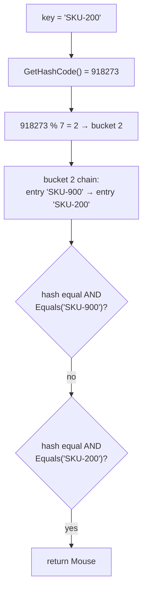

The diagram shows a lookup: compute the hash, jump to one bucket, then compare only the few keys on that bucket.

**Collisions** happen when two different keys land in the same bucket. They are normal and allowed. The chain on that bucket just gets longer. If **many** keys collide (a bad hash function), lookups degrade from O(1) to O(n). The code below shows this: with a good hash, finding one key in 1,000 items took **1** `Equals` call; with a hash that always returns 42, it took **1,000**.

**Resizing:** when the entries array is full, the dictionary allocates bigger arrays (the next prime number at least double the size, *runtime behaviour*) and re-inserts every item. That's why `new Dictionary<,>(capacity)` helps when you know the size.

**`HashSet<T>`** works the same way, but stores only keys (no values).

**The rules your key type must follow** (from Chapter 1, topic 15):

1. Equal keys **must** return equal hash codes.
2. The hash code must **not change** while the key is in the dictionary. Don't use mutable fields in it.
3. A good hash spreads keys evenly across buckets. Use `HashCode.Combine(a, b, c)`.

### Code

```csharp
namespace Chapter02.Topics;

public static class T02_DictionaryAndHashSet
{
    private record Product(string Sku, string Name, decimal Price);

    // A key whose hash code is simply its Id, and which counts how often Equals is called
    private readonly struct GoodKey(int id) : IEquatable<GoodKey>
    {
        public static int EqualsCalls;
        public int Id { get; } = id;
        public bool Equals(GoodKey other) { EqualsCalls++; return Id == other.Id; }
        public override bool Equals(object? obj) => obj is GoodKey k && Equals(k);
        public override int GetHashCode() => Id;
    }

    // The same key, but every instance returns the same hash code: every key collides
    private readonly struct BadKey(int id) : IEquatable<BadKey>
    {
        public static int EqualsCalls;
        public int Id { get; } = id;
        public bool Equals(BadKey other) { EqualsCalls++; return Id == other.Id; }
        public override bool Equals(object? obj) => obj is BadKey k && Equals(k);
        public override int GetHashCode() => 42;
    }

    // A mutable class used as a key: a bug waiting to happen
    private class CartKey
    {
        public string CustomerEmail { get; set; } = "";
        public override bool Equals(object? obj) => obj is CartKey c && c.CustomerEmail == CustomerEmail;
        public override int GetHashCode() => CustomerEmail.GetHashCode();
    }

    public static void Run()
    {
        // ---- Dictionary: look up a value by its key ----
        var catalog = new Dictionary<string, Product>
        {
            ["SKU-100"] = new("SKU-100", "Laptop", 65_000m),
            ["SKU-200"] = new("SKU-200", "Mouse", 799m),
        };

        Console.WriteLine($"catalog[\"SKU-200\"]: {catalog["SKU-200"].Name}");

        try { _ = catalog["SKU-999"]; }
        catch (KeyNotFoundException ex) { Console.WriteLine($"Indexer with missing key: {ex.GetType().Name}"); }

        // TryGetValue: one lookup, no exception
        if (catalog.TryGetValue("SKU-999", out var missing))
            Console.WriteLine(missing.Name);
        else
            Console.WriteLine("TryGetValue(\"SKU-999\"): not found, no exception");

        try { catalog.Add("SKU-100", new("SKU-100", "Duplicate", 1m)); }
        catch (ArgumentException ex) { Console.WriteLine($"Add with duplicate key: {ex.GetType().Name}"); }

        catalog["SKU-100"] = new("SKU-100", "Laptop Pro", 89_000m);   // indexer set = add or overwrite
        Console.WriteLine($"After indexer set: {catalog["SKU-100"].Name}");
        Console.WriteLine($"TryAdd duplicate returns: {catalog.TryAdd("SKU-100", new("SKU-100", "X", 1m))}");

        // ---- Key comparison: case-insensitive coupon codes ----
        var strict = new Dictionary<string, decimal> { ["DIWALI10"] = 10m };
        var relaxed = new Dictionary<string, decimal>(StringComparer.OrdinalIgnoreCase) { ["DIWALI10"] = 10m };
        Console.WriteLine($"Coupon 'diwali10' found? default comparer: {strict.ContainsKey("diwali10")}, OrdinalIgnoreCase: {relaxed.ContainsKey("diwali10")}");

        // ---- HashSet: unique items, fast Contains ----
        var processedPaymentIds = new HashSet<string>();
        string[] incomingWebhooks = ["pay_1", "pay_2", "pay_1", "pay_3", "pay_2"];   // the gateway retries, so duplicates arrive
        foreach (var paymentId in incomingWebhooks)
        {
            bool isNew = processedPaymentIds.Add(paymentId);  // false if it was already there
            Console.WriteLine($"  webhook {paymentId}: {(isNew ? "process" : "skip duplicate")}");
        }

        var cartSkus = new HashSet<string> { "SKU-1", "SKU-2", "SKU-3" };
        var outOfStock = new HashSet<string> { "SKU-2", "SKU-9" };
        var blocked = new HashSet<string>(cartSkus);
        blocked.IntersectWith(outOfStock);
        Console.WriteLine($"Cart items that are out of stock: {string.Join(", ", blocked)}");

        // ---- Collisions: a good hash vs a terrible hash ----
        var good = new Dictionary<GoodKey, string>();
        var bad = new Dictionary<BadKey, string>();
        for (int i = 0; i < 1_000; i++)
        {
            good[new GoodKey(i)] = $"order-{i}";
            bad[new BadKey(i)] = $"order-{i}";
        }
        GoodKey.EqualsCalls = 0;
        BadKey.EqualsCalls = 0;
        _ = good[new GoodKey(0)];
        _ = bad[new BadKey(0)];
        Console.WriteLine($"One lookup in 1,000 items -> Equals calls: good hash {GoodKey.EqualsCalls}, constant hash {BadKey.EqualsCalls}");

        // ---- Mutating a key after inserting it ----
        var key = new CartKey { CustomerEmail = "asha@shop.com" };
        var carts = new Dictionary<CartKey, int> { [key] = 3 };   // 3 items in Asha's cart
        key.CustomerEmail = "asha.k@shop.com";                    // the customer changed their email
        Console.WriteLine($"After mutating the key: ContainsKey(same object) = {carts.ContainsKey(key)}, Count = {carts.Count}");

        // ---- Enumeration order is not something to rely on ----
        var stock = new Dictionary<string, int> { ["A"] = 1, ["B"] = 2, ["C"] = 3 };
        stock.Remove("A");
        stock["D"] = 4;
        Console.WriteLine($"Order after Remove(A) then Add(D): {string.Join(", ", stock.Keys)}");
    }
}
```

> `readonly struct GoodKey(int id)` uses a **primary constructor** (C# 12): the parameter `id` is available inside the type. `_ = expression;` means "evaluate this and ignore the result" (a **discard**).

**Output:**

```text
catalog["SKU-200"]: Mouse
Indexer with missing key: KeyNotFoundException
TryGetValue("SKU-999"): not found, no exception
Add with duplicate key: ArgumentException
After indexer set: Laptop Pro
TryAdd duplicate returns: False
Coupon 'diwali10' found? default comparer: False, OrdinalIgnoreCase: True
  webhook pay_1: process
  webhook pay_2: process
  webhook pay_1: skip duplicate
  webhook pay_3: process
  webhook pay_2: skip duplicate
Cart items that are out of stock: SKU-2
One lookup in 1,000 items -> Equals calls: good hash 1, constant hash 1000
After mutating the key: ContainsKey(same object) = False, Count = 1
Order after Remove(A) then Add(D): D, B, C
```

### Common mistakes / gotchas

- **Using the indexer to read a key that may be missing.** `dict[key]` throws `KeyNotFoundException`. Use `TryGetValue`.
- **`ContainsKey` followed by the indexer** does two lookups. `TryGetValue` does one.
- **`Add` throws on duplicates; the indexer overwrites silently.** Choose deliberately. `TryAdd` returns `false` instead of throwing.
- **Case-sensitive string keys.** Coupon codes, emails and SKUs typed by users usually need `StringComparer.OrdinalIgnoreCase`. Forgetting it gives "coupon not found" bugs.
- **Mutating a key after inserting it.** In the demo, a customer changed their email and their cart became unreachable: `ContainsKey` returned `False`, but `Count` still said 1. The entry is stuck on the old shelf, a silent memory leak.
- **Relying on enumeration order.** Microsoft documents the order as undefined. Today it *looks* like insertion order until you remove something. In the demo, after removing `A` and adding `D`, the order became `D, B, C` because `D` reused `A`'s free slot. If you need order, use `SortedDictionary` or keep a separate list.

### 5-YOE depth

- **String hash codes are randomized per process** in .NET Core and later (*runtime behaviour*). `"SKU-1".GetHashCode()` gives a different number each time the app starts. **Never store hash codes** in a database or cache, or use them as stable IDs. For a stable hash, use something like SHA-256 or `XxHash64` from `System.IO.Hashing`.
- **Hash flooding protection:** if an attacker sends many keys that collide (e.g. JSON with crafted property names), lookups become O(n) and the server slows to a crawl. Randomized string hashing makes collisions hard to predict. For string keys with the default comparer, today's `Dictionary` starts with a faster non-randomized hash and switches to the randomized one if a chain gets too long (*runtime behaviour*).
- **`Dictionary` is not thread-safe for writes.** Concurrent writes can corrupt the internal chains. In older .NET versions this sometimes caused an **infinite loop** inside `FindEntry`, with 100% CPU on a production server. Modern .NET detects some of these cases and throws `InvalidOperationException` instead, but it's still a bug. Multiple readers with **no** writers are safe. Use `ConcurrentDictionary` or a lock (topic 8).
- **`GetValueOrDefault`, `TryAdd`, `Remove(key, out value)`** and `CollectionsMarshal.GetValueRefOrAddDefault` (.NET 6, a high-performance "get or add" with a single lookup) are worth knowing.
- **Read-mostly lookup tables** (country codes, tax rates loaded at startup) can use `FrozenDictionary<TKey,TValue>` (.NET 8): slower to build, faster to read, and it can't be changed.
- **Records as keys** work well because records generate `Equals`/`GetHashCode` from all properties. But a record with a `List<T>` property compares the list by **reference**, and a record with `set` properties is mutable, so the mutating-key bug can still happen.
- **Entities as keys:** if an EF Core entity's hash is based on a database-generated `Id`, the hash changes from 0 to the real Id after `SaveChanges`, and the entity gets lost in any `HashSet` it was in (Chapter 1, topic 15).

### Interview questions

1. **How does a `Dictionary` find a value in O(1)?**
   It calls `GetHashCode()` on the key, maps the hash to a bucket with a modulo, and compares only the entries in that bucket (hash first, then `Equals`). With a good hash function, each bucket holds about one entry, so the work doesn't grow with the size of the dictionary.
2. **What is a collision and how does .NET handle it?**
   Two different keys map to the same bucket. .NET chains them: each entry stores the index of the next entry in the same bucket, and a lookup walks the chain calling `Equals`. Many collisions turn O(1) into O(n).
3. **What happens if `GetHashCode` always returns the same number?**
   Everything still works correctly, because `Equals` decides, but every key lands in one bucket, so every lookup and insert becomes O(n). In the demo, one lookup in 1,000 items needed 1,000 `Equals` calls.
4. **What happens if you change a key after adding it to a dictionary?**
   If the change affects the hash code, the entry stays in its old bucket. Lookups compute the new hash, go to the wrong bucket, and fail. The entry is still counted and still uses memory. Keys should be immutable.
5. **Difference between `Dictionary` and `HashSet`?**
   Same hashing structure. `Dictionary` maps keys to values; `HashSet` only stores unique keys and adds set operations (`UnionWith`, `IntersectWith`, `ExceptWith`). `HashSet.Add` returns `false` for duplicates instead of throwing.
6. **Is `Dictionary` ordered?**
   No. The order is undefined. It often looks like insertion order, but removals break that. Use `SortedDictionary` (sorted by key) or `OrderedDictionary<TKey,TValue>` (insertion order, generic version added in .NET 9).

---

## 2.3 Queue<T>, Stack<T>, LinkedList<T> and SortedDictionary<TKey,TValue>

### What it is

| Collection | Plain meaning | Real-world analogy | Backend example |
|---|---|---|---|
| **`Queue<T>`** | **FIFO**: First In, First Out. Add at the back, take from the front. | A line at a bank counter. | Emails waiting to be sent, in order. |
| **`Stack<T>`** | **LIFO**: Last In, First Out. Add on top, take from the top. | A stack of plates. | Undo history in a cart editor; walking nested category trees. |
| **`LinkedList<T>`** | A chain of **nodes**, each pointing to the next and the previous node. | A train: each carriage hooks to the next one. | "Recently viewed" list or an LRU cache, where items move to the front often. |
| **`SortedDictionary<TKey,TValue>`** | A dictionary that **keeps keys sorted** at all times. | A phone book, always alphabetical. | A daily sales report keyed by date. |
| **`PriorityQueue<TElement,TPriority>`** (.NET 6+) | Takes out the item with the **smallest priority value** first. | A hospital emergency room: the most urgent patient goes first, not the first to arrive. | Express shipments packed before standard ones. |

### Why it matters

Picking the right one turns an O(n) operation into O(1) or O(log n), and it makes the code say what it means: `outbox.Dequeue()` is clearer than `list[0]` followed by `list.RemoveAt(0)` (which is O(n)!).

### How it works

- **`Queue<T>`** uses a **circular array** inside (*runtime behaviour*): two indexes, head and tail, wrap around the array. `Enqueue` and `Dequeue` are O(1) (amortized when it grows).
- **`Stack<T>`** is an array plus a top index. `Push`/`Pop` are O(1).
- **`LinkedList<T>`** is a **doubly linked list**: every item lives in its own `LinkedListNode<T>` object with `Next` and `Previous` references. If you already **hold the node**, inserting or removing it is O(1). **Finding** a node by value is O(n).
- **`SortedDictionary`** is a **red-black tree** (a self-balancing binary search tree). Insert, remove and lookup are O(log n), and enumeration is in key order.
- **`SortedList<TKey,TValue>`** (not shown) keeps two sorted arrays. It uses less memory than `SortedDictionary` and allows access by index, but inserting in the middle is O(n). Use it for data that's built once and read many times.
- **`PriorityQueue`** is a **heap** (an array arranged like a tree so the smallest item is always at the top). `Enqueue`/`Dequeue` are O(log n).

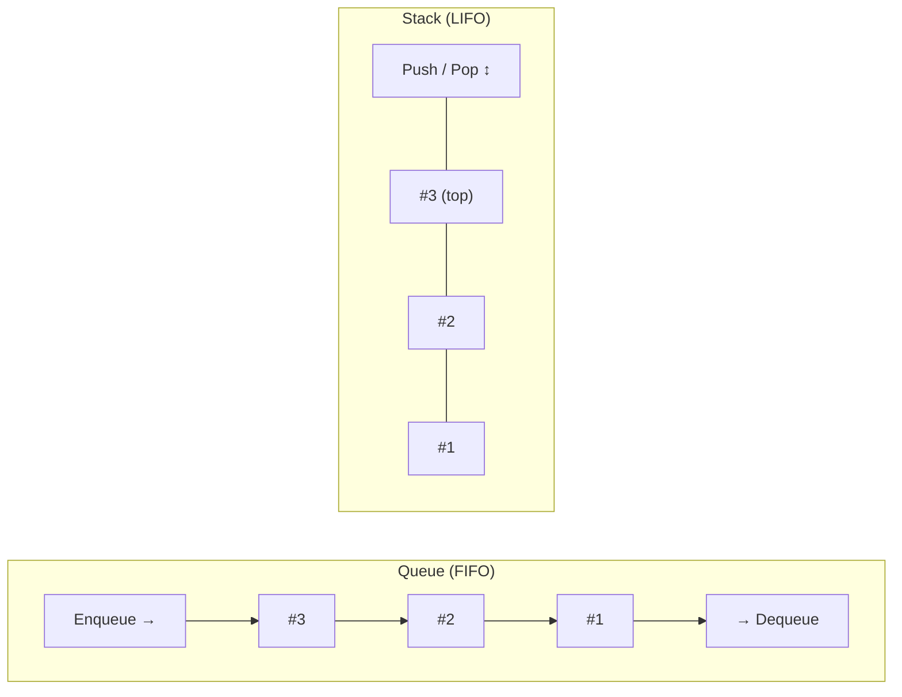

The diagram shows that a queue takes items out at the opposite end from where they went in, while a stack uses the same end for both.

### Code

```csharp
namespace Chapter02.Topics;

public static class T03_QueueStackLinkedListSorted
{
    private record EmailNotification(string To, string Subject);
    private record CartAction(string Description, string Sku, int Quantity);
    private enum ShippingTier { Express = 1, Standard = 2, Economy = 3 }

    // A tiny "recently viewed products" list: newest first, keeps the last N.
    // LinkedList + Dictionary gives O(1) "move to front" and O(1) lookup.
    private class RecentlyViewed(int capacity)
    {
        private readonly LinkedList<string> _order = new();
        private readonly Dictionary<string, LinkedListNode<string>> _nodes = new();

        public void View(string sku)
        {
            if (_nodes.TryGetValue(sku, out var existing))
            {
                _order.Remove(existing);          // O(1): we already have the node
                _order.AddFirst(existing);
                return;
            }
            _nodes[sku] = _order.AddFirst(sku);
            if (_order.Count > capacity)
            {
                _nodes.Remove(_order.Last!.Value);
                _order.RemoveLast();              // O(1)
            }
        }

        public override string ToString() => string.Join(", ", _order);
    }

    public static void Run()
    {
        // ---- Queue<T>: first in, first out (FIFO) ----
        var outbox = new Queue<EmailNotification>();
        outbox.Enqueue(new("asha@shop.com", "Order #1 confirmed"));
        outbox.Enqueue(new("ravi@shop.com", "Order #2 confirmed"));
        outbox.Enqueue(new("asha@shop.com", "Order #1 shipped"));
        Console.WriteLine($"Next email (Peek, not removed): {outbox.Peek().Subject}");
        while (outbox.TryDequeue(out var email))
            Console.WriteLine($"  sending: {email.Subject} -> {email.To}");

        try { outbox.Dequeue(); }
        catch (InvalidOperationException) { Console.WriteLine("Dequeue on empty queue: InvalidOperationException (use TryDequeue)"); }

        // ---- Stack<T>: last in, first out (LIFO). Undo in a shopping cart ----
        var undo = new Stack<CartAction>();
        undo.Push(new("Add", "SKU-1", 1));
        undo.Push(new("Add", "SKU-2", 2));
        undo.Push(new("Remove", "SKU-1", 1));
        var last = undo.Pop();
        Console.WriteLine($"Undo: '{last.Description} {last.Sku}'. Next undo would be '{undo.Peek().Description} {undo.Peek().Sku}'");

        // ---- LinkedList<T>: O(1) insert/remove when you already hold the node ----
        var recent = new RecentlyViewed(capacity: 3);
        foreach (var sku in new[] { "Laptop", "Mouse", "Keyboard", "Mouse", "Monitor" })
            recent.View(sku);
        Console.WriteLine($"Recently viewed (newest first, max 3): {recent}");

        // ---- SortedDictionary<TKey,TValue>: keys always kept in sorted order ----
        var dailySales = new SortedDictionary<DateOnly, decimal>
        {
            [new DateOnly(2026, 10, 3)] = 18_000m,
            [new DateOnly(2026, 10, 1)] = 12_500m,
            [new DateOnly(2026, 10, 2)] = 9_750m,
        };
        Console.WriteLine("Daily sales report (inserted out of order, printed sorted):");
        foreach (var (day, total) in dailySales)
            Console.WriteLine($"  {day:yyyy-MM-dd}: {total,8:N0}");

        // ---- PriorityQueue<TElement,TPriority> (.NET 6+): smallest priority comes out first ----
        var dispatch = new PriorityQueue<string, ShippingTier>();
        dispatch.Enqueue("Order #11", ShippingTier.Economy);
        dispatch.Enqueue("Order #12", ShippingTier.Express);
        dispatch.Enqueue("Order #13", ShippingTier.Standard);
        dispatch.Enqueue("Order #14", ShippingTier.Express);
        Console.Write("Packing order:");
        while (dispatch.TryDequeue(out var order, out var tier))
            Console.Write($" {order}({tier})");
        Console.WriteLine();

        // Equal priorities do NOT come out in insertion order (a heap is not "stable")
        var sameTier = new PriorityQueue<string, ShippingTier>();
        for (int i = 1; i <= 6; i++) sameTier.Enqueue($"#{i}", ShippingTier.Standard);
        Console.Write("Six Standard orders, inserted #1..#6, come out as:");
        while (sameTier.TryDequeue(out var order, out _)) Console.Write($" {order}");
        Console.WriteLine();

        // Fix: add a sequence number as a tie-breaker, so the priority is (tier, arrival order)
        var fair = new PriorityQueue<string, (ShippingTier Tier, long Seq)>();
        long seq = 0;
        for (int i = 1; i <= 6; i++) fair.Enqueue($"#{i}", (ShippingTier.Standard, seq++));
        Console.Write("With (tier, sequence) as the priority:");
        while (fair.TryDequeue(out var order, out _)) Console.Write($" {order}");
        Console.WriteLine();
    }
}
```

> `out var email` declares a variable inside the method call (Chapter 1, topic 6). `{total,8:N0}` means "right-align in 8 characters, number format with no decimals".

**Output:**

```text
Next email (Peek, not removed): Order #1 confirmed
  sending: Order #1 confirmed -> asha@shop.com
  sending: Order #2 confirmed -> ravi@shop.com
  sending: Order #1 shipped -> asha@shop.com
Dequeue on empty queue: InvalidOperationException (use TryDequeue)
Undo: 'Remove SKU-1'. Next undo would be 'Add SKU-2'
Recently viewed (newest first, max 3): Monitor, Mouse, Keyboard
Daily sales report (inserted out of order, printed sorted):
  2026-10-01:   12,500
  2026-10-02:    9,750
  2026-10-03:   18,000
Packing order: Order #12(Express) Order #14(Express) Order #13(Standard) Order #11(Economy)
Six Standard orders, inserted #1..#6, come out as: #1 #6 #5 #4 #3 #2
With (tier, sequence) as the priority: #1 #2 #3 #4 #5 #6
```

### Common mistakes / gotchas

- **`Dequeue`/`Pop`/`Peek` on an empty collection throw `InvalidOperationException`.** Use `TryDequeue`, `TryPop`, `TryPeek`.
- **Using `List<T>` as a queue** (`list.RemoveAt(0)`) is O(n) per removal, because every item shifts.
- **Choosing `LinkedList<T>` "because inserts are O(1)".** That's true only when you already hold the node. Finding the spot is O(n). Each node is a separate heap object, so it uses much more memory and is slower to loop over than a `List<T>` (topic 5). In practice `List<T>` usually wins.
- **Expecting `PriorityQueue` to be fair for equal priorities.** It isn't **stable**: in the demo, six Standard orders inserted as #1..#6 came out as `#1 #6 #5 #4 #3 #2`. **Real impact:** customers who ordered first get shipped last within the same tier. Fix it with a tie-breaker: use `(tier, sequenceNumber)` as the priority.
- **`Queue<T>`, `Stack<T>`, etc. aren't thread-safe.** For background workers, use `ConcurrentQueue<T>` or `Channel<T>` (topic 8, Chapter 5).

### 5-YOE depth

- **LRU cache (Least Recently Used) = `Dictionary` + `LinkedList`.** The dictionary gives O(1) lookup of the node; the linked list gives O(1) "move to front" and "remove the oldest". This is a classic interview design, and `RecentlyViewed` above is exactly that. In production, use `IMemoryCache` with a size limit (Chapter 18) instead of writing your own.
- **`SortedDictionary` vs `SortedList` vs "sort at the end":** if you only need sorted output **once** (e.g. a report), add to a `Dictionary`/`List` and sort once at the end: O(n log n) total, with fewer allocations. A sorted collection pays off when you need sorted order **while** data keeps changing.
- **In-memory queues lose data on restart.** A `Queue<EmailNotification>` in a web app is gone when the app restarts or scales to two instances. For anything that must not be lost, use a durable queue (Azure Service Bus, RabbitMQ, SQS; see Chapter 19) or the outbox pattern (Chapter 15).
- **`PriorityQueue` has no "update priority" and no `Contains`.** To change an item's priority you usually enqueue it again and skip stale entries when you dequeue them.
- **Stack depth:** recursion uses the *call stack* (a different thing from `Stack<T>`). Walking a deep category tree recursively can cause a `StackOverflowException`, which can't be caught and kills the process. Rewriting the walk with an explicit `Stack<T>` avoids that.

### Interview questions

1. **FIFO vs LIFO with a backend example of each?**
   FIFO (`Queue<T>`): process notifications in arrival order. LIFO (`Stack<T>`): undo the most recent cart change first, or depth-first tree traversal without recursion.
2. **When would you actually use `LinkedList<T>`?**
   When you keep references to nodes and need O(1) insert/remove/move at any position, as in an LRU cache paired with a dictionary. For general lists, `List<T>` is faster because of memory locality and fewer allocations.
3. **`SortedDictionary` vs `SortedList`?**
   Both keep keys sorted. `SortedDictionary` is a red-black tree: O(log n) insert/remove, more memory. `SortedList` uses sorted arrays: O(n) insert in the middle, less memory, index access. Use `SortedList` for data built once in order and read often.
4. **How does `PriorityQueue` handle equal priorities?**
   It doesn't guarantee any order among equal priorities, because a heap isn't stable. If fairness matters, include a sequence number in the priority.
5. **How would you build an LRU cache?**
   A `Dictionary<TKey, LinkedListNode<T>>` plus a `LinkedList<T>`. On access, move the node to the front; on insert past capacity, remove the last node and its dictionary entry. All operations are O(1). In real apps use `IMemoryCache` with `SizeLimit`.

---

## 2.4 Collection interfaces: IEnumerable<T>, ICollection<T>, IList<T>, IReadOnlyList<T>, IReadOnlyCollection<T>

### What it is

An **interface** (Chapter 1, topic 11) is a contract: "anything that implements me can do these things". The collection interfaces describe **what a collection can do**, from "can be looped over" up to "can be changed by index".

| Interface | What it promises | Members you get |
|---|---|---|
| `IEnumerable<T>` | "You can loop over me with `foreach`." That's all. | `GetEnumerator()` |
| `IReadOnlyCollection<T>` | Loop + "I know my size". | `Count` |
| `IReadOnlyList<T>` | Loop + size + read by index. | `Count`, `this[int]` (get only) |
| `ICollection<T>` | Loop + size + add/remove/contains. | `Count`, `Add`, `Remove`, `Contains`, `Clear`, `IsReadOnly` |
| `IList<T>` | Everything in `ICollection<T>` + index access. | `this[int]` (get/set), `Insert`, `RemoveAt`, `IndexOf` |

`List<T>` implements **all** of them. Arrays implement all of them too, but `Add`/`Remove` throw `NotSupportedException` because arrays are fixed-size.

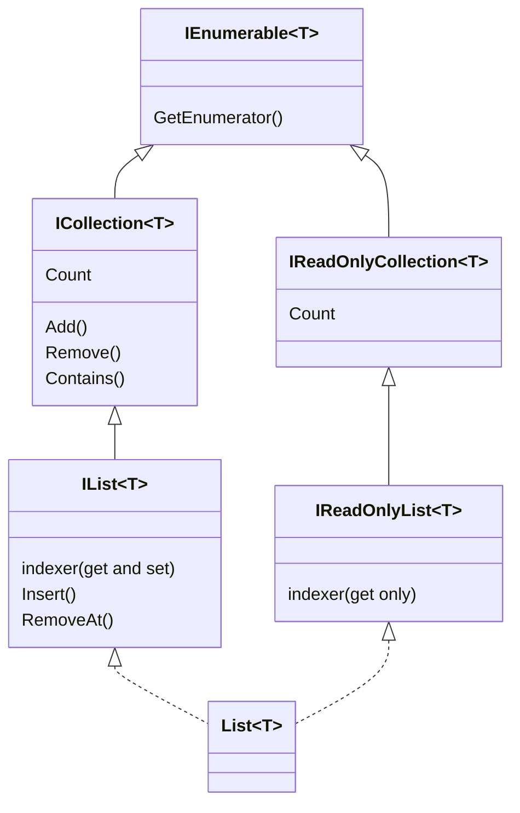

The diagram shows two separate "families": the read-only interfaces and the mutable ones. They only meet at `IEnumerable<T>`, and `List<T>` implements both families.

> **Language/library fact (verified on .NET 10):** `IList<T>` does **not** inherit `IReadOnlyList<T>`, and `ICollection<T>` does **not** inherit `IReadOnlyCollection<T>`. The read-only interfaces were added later (.NET 4.5), and changing the old ones would have broken existing code. So a method that takes `IReadOnlyList<T>` can't directly accept a variable typed as `IList<T>`, even though every `List<T>` is both.

### Why it matters

- **Parameters:** accept the **smallest** interface you need. A method that only loops should take `IEnumerable<T>`, so callers can pass an array, a list, a set or a LINQ query.
- **Return types and properties:** return something that **doesn't let callers break your object**. Exposing `List<OrderLine>` lets anyone add a line with a negative quantity and skip your validation. Expose `IReadOnlyList<OrderLine>` instead.
- **Deferred execution:** an `IEnumerable<T>` might be a **lazy** sequence that re-runs its work every time you loop over it, for example a database query. Looping twice can mean two database calls.

### How it works

**How `foreach` works:** the compiler turns

```csharp
foreach (var line in order.Lines) Console.WriteLine(line);
```

into roughly:

```csharp
using var e = order.Lines.GetEnumerator();
while (e.MoveNext())
{
    var line = e.Current;
    Console.WriteLine(line);
}
```

An **enumerator** is a small object that remembers "where am I in the collection".

**`yield return`** lets you write a method that produces items one at a time. The compiler turns the method into an enumerator. **Nothing in the method runs until someone loops**, and it runs **again from the start** on every new loop. That's called **deferred (lazy) execution**. LINQ (Chapter 3) and EF Core queries (Chapter 11) work the same way.

**`AsReadOnly()`** returns a `ReadOnlyCollection<T>`: a thin **wrapper** around your list. Reads go to the real list; writes throw `NotSupportedException`. It's a **view**, not a copy: if the owner later changes the list, the view shows the change.

### Code

```csharp
using System.Collections.ObjectModel;

namespace Chapter02.Topics;

public static class T04_CollectionInterfaces
{
    private record OrderLine(string Sku, int Quantity, decimal UnitPrice);

    // BAD: exposes the real List, so any caller can change the order behind its back
    private class LeakyOrder
    {
        public List<OrderLine> Lines { get; } = new();
    }

    // GOOD: the list is private; callers get a read-only view and must use AddLine
    private class Order
    {
        private readonly List<OrderLine> _lines = new();
        public IReadOnlyList<OrderLine> Lines => _lines.AsReadOnly();   // a ReadOnlyCollection wrapper
        public decimal Total => _lines.Sum(l => l.Quantity * l.UnitPrice);

        public void AddLine(OrderLine line)
        {
            if (line.Quantity <= 0) throw new ArgumentOutOfRangeException(nameof(line), "Quantity must be positive.");
            _lines.Add(line);
        }
    }

    private static int _databaseCalls;

    // Pretends to stream invoices from a database. 'yield return' makes it lazy:
    // nothing runs until someone loops over the result, and it runs again on every loop.
    private static IEnumerable<decimal> StreamInvoiceTotals()
    {
        _databaseCalls++;
        yield return 1_000m;
        yield return 2_500m;
        yield return 400m;
    }

    // Accept the smallest interface you need: any collection (array, list, set, query) works
    private static decimal SumTotals(IEnumerable<decimal> totals)
    {
        decimal sum = 0;
        foreach (var t in totals) sum += t;
        return sum;
    }

    public static void Run()
    {
        decimal[] fromArray = [100m, 200m];
        List<decimal> fromList = [300m];
        HashSet<decimal> fromSet = [400m, 500m];
        Console.WriteLine($"SumTotals works with array {SumTotals(fromArray)}, list {SumTotals(fromList)}, set {SumTotals(fromSet)}");

        // ---- Leaky vs encapsulated ----
        var leaky = new LeakyOrder();
        leaky.Lines.Add(new("SKU-1", -5, 100m));        // nothing stops a negative quantity
        Console.WriteLine($"LeakyOrder accepted quantity {leaky.Lines[0].Quantity}");

        var order = new Order();
        order.AddLine(new("SKU-1", 2, 250m));
        IReadOnlyList<OrderLine> view = order.Lines;
        Console.WriteLine($"Order: {view.Count} line(s), first SKU {view[0].Sku}, total {order.Total}");

        // A caller tries to cheat by casting the read-only view back to a list
        if (order.Lines is IList<OrderLine> asList)
        {
            try { asList.Add(new("SKU-FREE", 1, 0m)); }
            catch (NotSupportedException) { Console.WriteLine("Cast to IList and Add: NotSupportedException (AsReadOnly wrapper blocks it)"); }
        }

        // If you return the List itself typed as IReadOnlyList, a cast gets the real list back
        List<OrderLine> realList = [new("SKU-1", 1, 10m)];
        IReadOnlyList<OrderLine> weakView = realList;
        ((List<OrderLine>)weakView).Add(new("SKU-HACK", 1, 0m));
        Console.WriteLine($"Plain List typed as IReadOnlyList: after cast + Add, Count = {realList.Count}");

        // ---- Arrays implement IList<T>, but Add is not supported ----
        IList<string> currencies = new[] { "INR", "USD" };
        try { currencies.Add("EUR"); }
        catch (NotSupportedException) { Console.WriteLine("Array as IList<T>.Add: NotSupportedException (fixed size)"); }

        // ---- Multiple enumeration of a lazy IEnumerable ----
        _databaseCalls = 0;
        IEnumerable<decimal> invoices = StreamInvoiceTotals();
        Console.WriteLine($"After calling StreamInvoiceTotals(): database calls = {_databaseCalls} (nothing ran yet)");
        decimal total = invoices.Sum();
        int count = invoices.Count();
        Console.WriteLine($"Sum {total}, Count {count}: database calls = {_databaseCalls} (ran twice!)");

        _databaseCalls = 0;
        List<decimal> materialized = StreamInvoiceTotals().ToList();
        Console.WriteLine($"With ToList() first: Sum {materialized.Sum()}, Count {materialized.Count}, database calls = {_databaseCalls}");

        // ---- ReadOnlyCollection is a view, not a copy ----
        var source = new List<string> { "Pending" };
        ReadOnlyCollection<string> readOnlyView = source.AsReadOnly();
        source.Add("Shipped");
        Console.WriteLine($"Read-only view sees later changes to the source: {string.Join(", ", readOnlyView)}");
    }
}
```

**Output:**

```text
SumTotals works with array 300, list 300, set 900
LeakyOrder accepted quantity -5
Order: 1 line(s), first SKU SKU-1, total 500
Cast to IList and Add: NotSupportedException (AsReadOnly wrapper blocks it)
Plain List typed as IReadOnlyList: after cast + Add, Count = 2
Array as IList<T>.Add: NotSupportedException (fixed size)
After calling StreamInvoiceTotals(): database calls = 0 (nothing ran yet)
Sum 3900, Count 3: database calls = 2 (ran twice!)
With ToList() first: Sum 3900, Count 3, database calls = 1
Read-only view sees later changes to the source: Pending, Shipped
```

### Common mistakes / gotchas

- **Exposing `List<T>` as a public property.** Callers bypass your validation (`LeakyOrder` accepted quantity -5). Keep the list private and expose `IReadOnlyList<T>`.
- **Returning the list itself typed as `IReadOnlyList<T>`.** A caller can cast it back to `List<T>` and modify it (shown in the demo). Usually that's acceptable inside your own codebase, but for real protection return `AsReadOnly()`, a copy, or an immutable collection.
- **Enumerating an `IEnumerable<T>` more than once.** If it's lazy (a `yield` method, a LINQ query, an EF Core query), the work runs again. The demo's "database" ran twice for `Sum()` + `Count()`. Call `.ToList()` once when you need the data more than once. The IDE warns about this ("Possible multiple enumeration").
- **Calling `.Count()` (the LINQ method) on an `IEnumerable<T>`** may loop over everything. If you need the count, ask for `IReadOnlyCollection<T>`, which has a `Count` property.
- **Accepting `IList<T>` "to be flexible" and then calling `Add`.** An array passed in throws `NotSupportedException` at runtime.

### 5-YOE depth

- **Which type to accept and which to return (design guidance):**
  - Parameters: `IEnumerable<T>` if you loop once; `IReadOnlyCollection<T>`/`IReadOnlyList<T>` if you need `Count` or indexing or will loop several times.
  - Return values: `IReadOnlyList<T>` or `IReadOnlyCollection<T>` for materialized data. Return `IEnumerable<T>` only when you deliberately want laziness or streaming.
  - Avoid `ICollection<T>`/`IList<T>` in public APIs unless the caller is meant to modify the collection.
- **`IEnumerable<T>` vs `IQueryable<T>`:** `IQueryable<T>` (EF Core) builds an **expression tree** that is translated to SQL. Filtering an `IQueryable` runs in the database; filtering an `IEnumerable` runs in memory **after** loading all rows. Returning `IEnumerable<T>` from a repository and then calling `.Where()` can silently load a whole table. Chapter 3 and Chapter 11 go deep on this.
- **Read-only ≠ immutable.** `IReadOnlyList<T>` means *you* can't change it, but the owner can (the view saw "Shipped" appear). For truly unchangeable data shared between threads, use `ImmutableList<T>`/`ImmutableArray<T>` (System.Collections.Immutable) or `FrozenSet<T>` (.NET 8).
- **`IEnumerable<T>` and `IReadOnlyList<T>` are covariant** (`out T`, topic 7): an `IReadOnlyList<CardPayment>` can be passed where `IReadOnlyList<Payment>` is expected. `IList<T>` isn't covariant, because it accepts items as input too.
- **EF Core navigation properties** are usually declared as `ICollection<T>` (EF needs to add to them). For DDD-style aggregates you can map a private `List<T>` field and expose `IReadOnlyCollection<T>`. EF Core supports this with "backing fields" (Chapter 11).
- **`IAsyncEnumerable<T>`** (C# 8): the async version, for streaming rows or API pages with `await foreach` (Chapter 5).

### Interview questions

1. **Difference between `IEnumerable<T>`, `ICollection<T>` and `IList<T>`?**
   `IEnumerable<T>`: can only be looped over. `ICollection<T>`: adds `Count`, `Add`, `Remove`, `Contains`. `IList<T>`: adds index access, `Insert`, `RemoveAt`. Each level promises more.
2. **What should a repository method return: `List<T>`, `IEnumerable<T>` or `IReadOnlyList<T>`?**
   Usually `IReadOnlyList<T>` (or `IReadOnlyCollection<T>`): the data is already loaded, callers get `Count` and indexing, and they can't modify your internal state. `IEnumerable<T>` hides whether the data is loaded and invites multiple enumeration.
3. **What is deferred execution?**
   The work doesn't run when you create the sequence; it runs when you loop over it, and again on every loop. `yield return`, LINQ operators and EF Core queries are deferred. Materialize with `ToList()` when you need the results more than once.
4. **Is `IReadOnlyList<T>` immutable?**
   No. It only hides the methods that modify the collection. The underlying list can still change, and a caller may even cast it back. Use immutable or frozen collections when you need a real guarantee.
5. **Why does `IList<string> x = new string[2]; x.Add("a");` throw?**
   Arrays implement `IList<T>` for compatibility, but they're fixed-size, so `Add` throws `NotSupportedException` at runtime. `IsReadOnly`/`IsFixedSize` tell you in advance.

---

## 2.5 Choosing a collection: lookup and insertion costs (Big-O) and memory trade-offs

### What it is

**Big-O notation** describes how the cost of an operation **grows** as the number of items (called **n**) grows. It ignores constant factors and only looks at the shape of the growth.

| Big-O | Name | Plain meaning | Example |
|---|---|---|---|
| **O(1)** | constant | About the same work for 10 items or 10 million. | `dict[key]`, `list[i]` |
| **O(log n)** | logarithmic | Doubling the items adds only **one** more step. 1 million items ≈ 20 steps. | `SortedDictionary` lookup, `BinarySearch` |
| **O(n)** | linear | Twice the items, about twice the work. | `list.Contains(x)`, `list.Insert(0, x)` |
| **O(n log n)** | | Typical cost of sorting. | `list.Sort()`, `OrderBy` |
| **O(n²)** | quadratic | Twice the items, **four times** the work. | `list.Contains` called inside a loop over another list |

**Analogy:** finding a name in a phone book. Reading every page from the start is O(n). Opening it in the middle and halving each time is O(log n). Knowing the exact page number in advance is O(1).

### Why it matters

The most common real performance bug in backend code isn't a slow database. It's an **accidental O(n²)** in C#: a `List.Contains` or a LINQ `.First(x => ...)` inside a loop. It works fine in testing with 50 rows and times out in production with 50,000.

### How it works: the cheat sheet

Average costs (*runtime behaviour* of today's implementations; worst cases noted):

| Collection | Get by index | Find by key/value | Add | Insert/remove middle | Remove first | Ordered? | Memory |
|---|---|---|---|---|---|---|---|
| `T[]` | O(1) | O(n) | — | — | — | by index | smallest |
| `List<T>` | O(1) | O(n) | O(1)* | O(n) | O(n) | by index | small (up to 2× slack) |
| `Dictionary<K,V>` | — | **O(1)** (worst O(n)) | O(1)* | O(1) remove | — | no | larger (buckets + entries) |
| `HashSet<T>` | — | **O(1)** (worst O(n)) | O(1)* | O(1) remove | — | no | larger |
| `SortedDictionary<K,V>` | — | O(log n) | O(log n) | O(log n) | O(log n) | by key | a node object per item |
| `SortedList<K,V>` | O(1) | O(log n) | O(n) | O(n) | O(n) | by key | small |
| `Queue<T>` | — | O(n) | O(1)* | — | O(1) | FIFO | small |
| `Stack<T>` | — | O(n) | O(1)* | — | O(1) (top) | LIFO | small |
| `LinkedList<T>` | O(n) | O(n) | O(1) | O(1) if you hold the node | O(1) | by position | a node object per item |
| `PriorityQueue<E,P>` | — | — | O(log n) | — | O(log n) (min) | by priority | small |

\* amortized: occasionally O(n) when the inner array grows.

**Decision guide:**

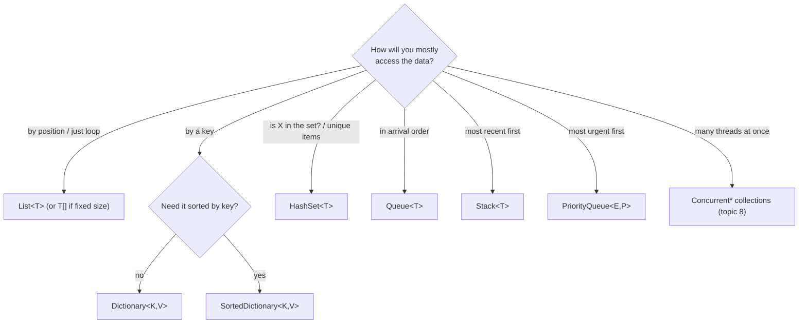

The flowchart picks a collection from the main way you will access the data.

**Memory trade-offs:** hash-based collections trade memory for speed. Each `Dictionary` entry stores the key, the value, the cached hash code and a "next" index, plus a separate buckets array. Linked structures (`LinkedList`, `SortedDictionary`) allocate **one object per item**, and each object has a header (about 16 bytes on 64-bit, *runtime behaviour*). Arrays and lists store items side by side, which also makes them **cache-friendly**: the CPU loads neighbouring items together, so looping over a `List<T>` is much faster than following `LinkedList<T>` pointers scattered across memory.

### Code

The scenario: an import job receives 20,000 customer IDs and must skip the 10,000 that appear in a 20,000-item block list.

```csharp
using System.Diagnostics;

namespace Chapter02.Topics;

public static class T05_ChoosingACollection
{
    public static void Run()
    {
        // Scenario: an import job receives 20,000 customer ids and must skip
        // the ones that are blocked. There are 20,000 blocked ids.
        const int n = 20_000;
        var blockedList = Enumerable.Range(0, n).Select(i => i * 2).ToList();   // even ids are blocked
        var blockedSet = blockedList.ToHashSet();
        var incoming = Enumerable.Range(0, n).ToArray();

        // Warm up once so JIT compilation is not counted in the timing
        _ = CountBlocked(incoming[..100], blockedList.Contains);
        _ = CountBlocked(incoming[..100], blockedSet.Contains);

        var sw = Stopwatch.StartNew();
        int hitsList = CountBlocked(incoming, blockedList.Contains);   // O(n) per lookup -> O(n * m) overall
        var listTime = sw.Elapsed;

        sw.Restart();
        int hitsSet = CountBlocked(incoming, blockedSet.Contains);     // O(1) average per lookup
        var setTime = sw.Elapsed;

        Console.WriteLine($"Blocked found: List {hitsList}, HashSet {hitsSet}");
        Console.WriteLine($"List.Contains x {n:N0}:    {listTime.TotalMilliseconds,8:N2} ms");
        Console.WriteLine($"HashSet.Contains x {n:N0}: {setTime.TotalMilliseconds,8:N2} ms");

        // ---- Memory: bytes allocated to hold 100,000 ints ----
        const int count = 100_000;
        long Measure(Func<object> build)
        {
            long before = GC.GetAllocatedBytesForCurrentThread();
            var keepAlive = build();
            long after = GC.GetAllocatedBytesForCurrentThread();
            GC.KeepAlive(keepAlive);
            return after - before;
        }

        long arrayBytes = Measure(() => new int[count]);
        long listGrowBytes = Measure(() => { var l = new List<int>(); for (int i = 0; i < count; i++) l.Add(i); return l; });
        long listSizedBytes = Measure(() => { var l = new List<int>(count); for (int i = 0; i < count; i++) l.Add(i); return l; });
        long setBytes = Measure(() => { var s = new HashSet<int>(count); for (int i = 0; i < count; i++) s.Add(i); return s; });
        long dictBytes = Measure(() => { var d = new Dictionary<int, int>(count); for (int i = 0; i < count; i++) d[i] = i; return d; });

        Console.WriteLine($"Allocated for {count:N0} ints:");
        Console.WriteLine($"  int[]                       {arrayBytes,10:N0} bytes");
        Console.WriteLine($"  List<int> (grows)           {listGrowBytes,10:N0} bytes");
        Console.WriteLine($"  List<int>(capacity)         {listSizedBytes,10:N0} bytes");
        Console.WriteLine($"  HashSet<int>(capacity)      {setBytes,10:N0} bytes");
        Console.WriteLine($"  Dictionary<int,int>(cap.)   {dictBytes,10:N0} bytes");
    }

    private static int CountBlocked(int[] ids, Func<int, bool> isBlocked)
    {
        int hits = 0;
        foreach (var id in ids)
            if (isBlocked(id)) hits++;
        return hits;
    }
}
```

> `incoming[..100]` is a **range** (C# 8): the first 100 items. `Func<int, bool>` is a delegate type, "a function that takes an int and returns a bool" (Chapter 3). `GC.GetAllocatedBytesForCurrentThread()` returns how many bytes this thread has allocated so far.

**Output** (measured on the machine described at the top; your numbers will differ):

```text
Blocked found: List 10000, HashSet 10000
List.Contains x 20,000:       35.97 ms
HashSet.Contains x 20,000:     0.15 ms
Allocated for 1,00,000 ints:
  int[]                         4,00,024 bytes
  List<int> (grows)            10,48,976 bytes
  List<int>(capacity)           4,00,056 bytes
  HashSet<int>(capacity)       17,38,216 bytes
  Dictionary<int,int>(cap.)    21,72,752 bytes
```

**Reading the numbers:**

- `List.Contains` scanned on average half the list for each of 20,000 lookups, about 200 million comparisons. `HashSet.Contains` did roughly one comparison each. In this run, the `HashSet` was about **240×** faster (35.97 ms vs 0.15 ms). The gap grows with the size of the data.
- `int[]` of 100,000 ints: 400,000 bytes of data + 24 bytes of array header (*runtime behaviour*, 64-bit).
- The **growing** `List<int>` allocated about **2.6×** the memory of the pre-sized one: all the abandoned smaller arrays (4, 8, 16, … 131,072 slots) are garbage.
- `HashSet<int>` used about **4.3×** and `Dictionary<int,int>` about **5.4×** the memory of the plain array for the same 100,000 numbers. That's the price of O(1) lookup.

### Common mistakes / gotchas

- **`list.Contains` / `list.Any(x => x.Id == id)` / `list.First(...)` inside a loop** is O(n²). Build a `HashSet` or `Dictionary` once (O(n)), then look up in O(1). This fix often turns minutes into milliseconds.
- **Treating Big-O as the whole story.** For very small collections (say under ~10 items, *rough guideline*), a linear scan of an array can beat a hash lookup, because hashing has a fixed cost. Measure before micro-optimizing.
- **Forgetting the worst case.** A `Dictionary` with a bad hash (or attacker-chosen keys) is O(n) per lookup (topic 2).
- **Ignoring memory.** Caching 5 million items in a `Dictionary` "for speed" can use gigabytes and trigger long GC pauses.

### 5-YOE depth

- **Explaining a fix in an interview:** "We joined 40,000 order lines to 40,000 products with `products.First(p => p.Id == line.ProductId)`. That's 1.6 billion comparisons in the worst case. I replaced it with `products.ToDictionary(p => p.Id)`, so it became 40,000 + 40,000 operations, and the job went from 3 minutes to under a second." Concrete numbers like these make a strong interview story. LINQ's `Join`, `ToLookup` and `GroupBy` use hashing internally for the same reason (Chapter 3).
- **Amortized vs worst case:** `List.Add` is O(1) amortized, but a single `Add` that triggers a resize is O(n). In latency-sensitive code (a hot API path), pre-sizing removes those spikes.
- **Cache locality** often matters more than Big-O for small and medium n. That's why `List<T>` beats `LinkedList<T>` even for many middle insertions at moderate sizes.
- **Sorted vs hash:** use `Dictionary` and sort once when needed, unless you need range queries ("all orders between 10:00 and 11:00") or ordered iteration while the data changes. Then use `SortedDictionary`, or better, let the **database** do it with an index (Chapter 14).
- **Frozen and immutable collections:** `FrozenDictionary`/`FrozenSet` (.NET 8) are optimized for read-only lookup tables built once at startup. `ImmutableDictionary` is a tree: O(log n), slower than `Dictionary`, but cheap to "copy with one change" and safe to share between threads.
- **Measure with BenchmarkDotNet** (Chapter 21), not `Stopwatch`, when making real decisions. `Stopwatch` numbers (like the ones above) are fine for spotting 100× differences, not 10% ones.

### Interview questions

1. **What is the time complexity of `Dictionary` lookup, and when is it not O(1)?**
   O(1) on average. It degrades towards O(n) when many keys collide: a bad `GetHashCode`, a constant hash, or attacker-crafted keys. Resizing makes an individual insert O(n), but inserts are still O(1) amortized.
2. **You have a slow endpoint that loops over 10,000 orders and calls `customers.First(c => c.Id == order.CustomerId)`. What's wrong?**
   It's O(n × m): each `First` scans the customer list. Build `customers.ToDictionary(c => c.Id)` once and use `TryGetValue`. Even better, let the database join (or include) the customers in the original query.
3. **`List<T>` vs `LinkedList<T>` for frequent inserts in the middle?**
   On paper, `LinkedList` is O(1) per insert if you hold the node, but finding the position is O(n), every node is a separate allocation, and memory locality is poor. In practice, `List<T>` is usually as fast or faster up to quite large sizes. Measure.
4. **Why does a `HashSet<int>` use several times more memory than an `int[]`?**
   Each entry stores the value plus its hash code and a "next" index, and there's a separate buckets array. In the demo: about 1.74 MB vs 0.4 MB for 100,000 ints.
5. **What does "amortized O(1)" mean?**
   Most operations are O(1), but occasionally one is expensive (like a list resize). Averaged over a long sequence of operations, the cost per operation is constant.

---

## 2.6 Generics: classes, methods and constraints

### What it is

**Generics** let you write a class or method **once** with a **type placeholder** (usually called `T`), and use it with many types, with full compile-time type checking.

```csharp
public class InMemoryRepository<TEntity> { ... }   // TEntity is the placeholder ("type parameter")
var customers = new InMemoryRepository<Customer>(); // Customer is the "type argument"
```

**Analogy:** a shipping box template. The template says "a box that holds **one kind** of item". You make a box of laptops or a box of phones from the same template, and the warehouse system refuses to put a phone into the laptop box.

**Constraints** (`where T : ...`) restrict which types can be used, and in return let your code **use** features of those types:

| Constraint | Meaning | Lets you |
|---|---|---|
| `where T : class` | T must be a reference type | use `null` |
| `where T : class?` | reference type, may be nullable | |
| `where T : struct` | T must be a non-nullable value type | use `T?` as `Nullable<T>` |
| `where T : notnull` | T must not be nullable | e.g. dictionary keys |
| `where T : unmanaged` | value type with no references inside | low-level/binary code |
| `where T : new()` | T must have a public parameterless constructor | `new T()` |
| `where T : IEntity` | T must implement the interface | call `entity.Id` |
| `where T : Payment` | T must be (or derive from) the class | use `Payment` members |
| `where T : U` | T must be or derive from another type parameter U | |
| `where T : Enum` / `Delegate` (C# 7.3) | T must be an enum / delegate type | |
| `where T : INumber<T>` (.NET 7, "generic math") | T is a number type | `+`, `T.Zero` |
| `allows ref struct` (C# 13, .NET 9) | T may be a ref struct like `Span<T>` | advanced, rarely needed |

### Why it matters

Before generics (.NET 1.0) there was `ArrayList`, which stores everything as `object`:

- **No type safety.** You could put a string in a "list of prices"; the crash came at runtime (`InvalidCastException`, shown in the demo).
- **Boxing.** Every `int` added was boxed into a heap object (Chapter 1, topic 18). Slow and memory-hungry.
- **Casts everywhere.**

Generics fix all three. They also let you remove duplication: one `Repository<T>`, one `Result<T>` (topic 12), one `PagedResponse<T>` for API responses, one `IValidator<T>`.

### How it works

- **Compile time (language rule):** the compiler checks every use. `customers.Add(new Invoice(...))` is a compile error.
- **Runtime (runtime behaviour):** .NET generics are **reified**, meaning the runtime knows the real type argument. `typeof(List<int>)` and `typeof(List<string>)` are different types, and you can inspect `T` with reflection. (Java's generics, by contrast, are "erased" at runtime.)
- **Code sharing:** the JIT (Just-In-Time compiler) generates **one shared native version** for all reference-type arguments (`List<Customer>`, `List<string>` share code, since references are all the same size) and a **separate specialized version** for each value-type argument (`List<int>`, `List<decimal>`), so value types are stored directly with no boxing.
- **Static fields belong to each closed type.** `TypeCache<Customer>.Hits` and `TypeCache<Invoice>.Hits` are two separate variables. "Closed type" means a generic type with all placeholders filled in.
- **Open vs closed:** `List<>` (no argument) is an **open** generic type definition. It's used in DI registration: `services.AddScoped(typeof(IRepository<>), typeof(EfRepository<>))` (Chapter 6).

### Code

```csharp
using System.Collections;
using System.Numerics;

namespace Chapter02.Topics;

// Every stored entity has an Id
public interface IEntity
{
    int Id { get; }
}

public record Customer(int Id, string Email) : IEntity;
public record Invoice(int Id, decimal Amount) : IEntity;

// ---- A generic class with a constraint ----
// One repository class works for Customer, Invoice, Product... and the compiler checks the type.
public class InMemoryRepository<TEntity> where TEntity : class, IEntity
{
    private readonly Dictionary<int, TEntity> _items = new();

    public void Add(TEntity entity) => _items.Add(entity.Id, entity);   // allowed because TEntity : IEntity
    public TEntity? GetById(int id) => _items.GetValueOrDefault(id);    // null if missing (allowed because TEntity : class)
    public IReadOnlyCollection<TEntity> GetAll() => _items.Values;
}

// ---- Static fields are per closed type: Cache<Customer> and Cache<Invoice> are different classes ----
public static class TypeCache<T>
{
    public static int Hits;
    public static readonly string TypeName = typeof(T).Name;   // computed once per T
}

public static class T06_Generics
{
    // ---- A generic method with an interface constraint ----
    private static T Highest<T>(IEnumerable<T> items) where T : IComparable<T>
    {
        using var e = items.GetEnumerator();
        if (!e.MoveNext()) throw new ArgumentException("Sequence is empty.", nameof(items));
        T best = e.Current;
        while (e.MoveNext())
            if (e.Current.CompareTo(best) > 0) best = e.Current;
        return best;
    }

    // ---- new() constraint: the method can create T ----
    private static T CreateDefaultSettings<T>() where T : new() => new T();

    private class EmailSettings
    {
        public string SmtpHost { get; set; } = "smtp.local";
        public int Port { get; set; } = 25;
    }

    // ---- Generic math (.NET 7+): one Sum for int, decimal, double... ----
    private static T SumAll<T>(IEnumerable<T> values) where T : INumber<T>
    {
        T total = T.Zero;
        foreach (var v in values) total += v;
        return total;
    }

    // ---- default(T): 0 for numbers, null for reference types ----
    private static T FirstOrFallback<T>(IReadOnlyList<T> items) => items.Count > 0 ? items[0] : default!;

    public static void Run()
    {
        var customers = new InMemoryRepository<Customer>();
        customers.Add(new Customer(1, "asha@shop.com"));
        customers.Add(new Customer(2, "ravi@shop.com"));
        var invoices = new InMemoryRepository<Invoice>();
        invoices.Add(new Invoice(501, 1_250m));

        Console.WriteLine($"Customer 2: {customers.GetById(2)?.Email}, Customer 9: {customers.GetById(9)?.Email ?? "(null)"}, invoices: {invoices.GetAll().Count}");
        // customers.Add(new Invoice(1, 5m));        // compile error: Invoice is not a Customer
        // var bad = new InMemoryRepository<int>();  // compile error: int is not a class and not IEntity

        Console.WriteLine($"Highest invoice amount: {Highest(new[] { 1_250m, 980m, 4_100m })}");
        Console.WriteLine($"Latest order date: {Highest(new[] { new DateOnly(2026, 1, 5), new DateOnly(2026, 3, 1) }):yyyy-MM-dd}");

        var settings = CreateDefaultSettings<EmailSettings>();
        Console.WriteLine($"new() constraint: {settings.SmtpHost}:{settings.Port}");

        Console.WriteLine($"SumAll<int>: {SumAll(new[] { 3, 4, 5 })}, SumAll<decimal>: {SumAll(new[] { 10.25m, 0.75m })}");

        Console.WriteLine($"default(T): int -> {FirstOrFallback(Array.Empty<int>())}, string -> {FirstOrFallback(Array.Empty<string>()) ?? "null"}");

        TypeCache<Customer>.Hits++;
        TypeCache<Customer>.Hits++;
        TypeCache<Invoice>.Hits++;
        Console.WriteLine($"Static per closed type: {TypeCache<Customer>.TypeName} hits {TypeCache<Customer>.Hits}, {TypeCache<Invoice>.TypeName} hits {TypeCache<Invoice>.Hits}");

        // ---- Why generics exist: the old non-generic ArrayList ----
        var oldStyle = new ArrayList { 100, 200, "three hundred" };   // anything goes in, as object (ints are boxed)
        try
        {
            int sum = 0;
            foreach (object o in oldStyle) sum += (int)o;              // the string fails only at runtime
        }
        catch (InvalidCastException) { Console.WriteLine("ArrayList: InvalidCastException at runtime. List<int> would be a compile error."); }

        // Reified generics: the runtime knows the real type argument
        Console.WriteLine($"Runtime types: {typeof(List<int>).Name}<{typeof(List<int>).GetGenericArguments()[0].Name}> vs open type {typeof(List<>).Name}, IsGenericTypeDefinition = {typeof(List<>).IsGenericTypeDefinition}");
    }
}
```

> `INumber<T>` is "generic math" (.NET 7, C# 11): interfaces that let generic code use operators like `+`. `T.Zero` is a **static abstract interface member**. `default!` returns the default value and tells the compiler "I know this may be null" (the `!` is from Chapter 1, topic 5). `List`1` is the runtime name of `List<T>`: the `` `1 `` means "one type parameter".

**Output:**

```text
Customer 2: ravi@shop.com, Customer 9: (null), invoices: 1
Highest invoice amount: 4100
Latest order date: 2026-03-01
new() constraint: smtp.local:25
SumAll<int>: 12, SumAll<decimal>: 11.00
default(T): int -> 0, string -> null
Static per closed type: Customer hits 2, Invoice hits 1
ArrayList: InvalidCastException at runtime. List<int> would be a compile error.
Runtime types: List`1<Int32> vs open type List`1, IsGenericTypeDefinition = True
```

### Common mistakes / gotchas

- **Using `==` on an unconstrained `T`.** It doesn't compile. Use `EqualityComparer<T>.Default.Equals(a, b)` (Chapter 1, topic 15).
- **Forgetting that `default(T)` is `null` for reference types and `0`/`false` for value types.** Code like `if (result == default)` can be ambiguous: is `0` a "not found" or a real value of 0?
- **Expecting static fields to be shared across all `T`.** A "global" cache in `Cache<T>` is actually one cache per `T`. Usually that's useful, occasionally surprising.
- **Over-generalizing.** A `GenericRepository<T>` with 30 methods for every entity often leaks EF Core details and hides real queries. Many teams prefer specific repositories or using `DbContext` directly (Chapter 11). Use generics where the behaviour truly is the same for every type.
- **Too many type parameters** (`Handler<TRequest, TResponse, TContext, TError>`). Hard to read and to register in DI.

### 5-YOE depth

- **Constraints are the price of capability.** Without constraints, the only things you can do with a `T` are what `object` offers (`ToString`, `Equals`, `GetHashCode`). Every capability you need (`new()`, `.Id`, `<`) requires a constraint.
- **`new()` constraint uses reflection-like activation** (`Activator.CreateInstance<T>()`) under the hood in many cases (*runtime behaviour*). It's slower than calling `new Customer()` directly. For hot paths, pass a factory `Func<T>` instead.
- **Generic math (`INumber<T>`, .NET 7)** lets you write one `Sum`/`Average` for `int`, `decimal`, `double`. Interviewers at .NET 8+ shops may ask about static abstract members in interfaces.
- **Generic type inference:** `Highest(new[] { 1m, 2m })` works without `<decimal>`, because the compiler infers `T` from the arguments. It can't infer from the **return type** only, so `CreateDefaultSettings<EmailSettings>()` needs the explicit argument.
- **Covariance/contravariance** (topic 7) is the "why can't I pass `List<CardPayment>` as `List<Payment>`" question.
- **Constraints are not part of a method's signature** (language rule). You can't declare two methods `Save<T>(T x) where T : class` and `Save<T>(T x) where T : struct` side by side: that's a "duplicate member" compile error.
- **Open generic DI registration:** `services.AddScoped(typeof(IRepository<>), typeof(EfRepository<>))` lets the container close the type automatically (`IRepository<Order>` → `EfRepository<Order>`). It's a common real-world use of open generics (Chapter 6).
- **MediatR and AutoMapper moved to commercial licenses in 2025.** Both are built heavily on generics (`IRequestHandler<TRequest, TResponse>`). If a project can't take the license, the usual alternatives are plain handler interfaces you write yourself (`ICommandHandler<TCommand>`), registered with open generics, and manual mapping or Mapster.

### Interview questions

1. **What problems do generics solve?**
   Type safety at compile time, no boxing for value types, no casts, and reuse of one implementation for many types. `ArrayList` vs `List<T>` is the classic example.
2. **What constraints exist, and why would you use `where T : class, IEntity`?**
   `class`, `struct`, `notnull`, `unmanaged`, `new()`, a base class, an interface, another type parameter, `Enum`, `Delegate`. `class, IEntity` lets the repository use `entity.Id` and return `null` when an item isn't found.
3. **Are `List<int>` and `List<string>` the same type at runtime?**
   No. .NET generics are reified, so each closed type is a distinct type with its own static fields. The JIT shares native code between reference-type instantiations and generates specialized code for each value type.
4. **How do you compare two `T` values for equality in generic code?**
   `EqualityComparer<T>.Default.Equals(a, b)`. It uses `IEquatable<T>` when available (no boxing) and handles nulls.
5. **What does `default(T)` return?**
   The zero value for value types (`0`, `false`, a struct with all fields zeroed) and `null` for reference types.
6. **Have you used open generics?**
   Yes: registering `typeof(IRepository<>)` → `typeof(EfRepository<>)` in DI, or a generic `IValidator<T>`/handler pipeline, so each new entity or command gets its implementation without extra registration code.

---

## 2.7 Covariance and contravariance (in / out)

### What it is

These are rules about when one generic type can be used **in place of** another, based on the inheritance between their type arguments.

Assume `CardPayment` derives from `Payment` (every card payment **is a** payment).

- **Covariance (`out`)**: you can use `IEnumerable<CardPayment>` where `IEnumerable<Payment>` is expected. The direction **follows** inheritance. Allowed when `T` only comes **out** (return values).
- **Contravariance (`in`)**: you can use `IPaymentAuditor<Payment>` where `IPaymentAuditor<CardPayment>` is expected. The direction is **reversed**. Allowed when `T` only goes **in** (parameters).
- **Invariance (no keyword)**: no substitution at all. `List<CardPayment>` is **not** a `List<Payment>`.

**Analogy:**

- *Covariance:* a vending machine that **gives out** only Pepsi can be used by someone who asked for "a machine that gives out drinks". They'll get a drink. Safe.
- *Contravariance:* a recycling bin that **accepts** any bottle can be used wherever "a bin that accepts glass bottles" is needed. It'll accept glass bottles. Safe.
- *Invariance:* a fridge you can both **put in** and **take out**. A "Pepsi-only fridge" can't be treated as a "drinks fridge", because someone might put milk into it.

### Why it matters

- It explains a very common compile error: "Cannot convert `List<CardPayment>` to `List<Payment>`".
- It lets you write one `IComparer<Payment>`, `Action<Payment>` or auditor and reuse it for every payment type.
- The array covariance trap (`ArrayTypeMismatchException`) is a classic senior interview question.

### How it works

**Language rules:**

1. Variance can only be declared on **interfaces and delegates**, never on classes or structs. That's why `List<T>` (a class) is always invariant.
2. `out T` means T may appear only in **output** positions (return types, `get`-only properties). The compiler checks this.
3. `in T` means T may appear only in **input** positions (method parameters).
4. Variance works only when the type arguments are **reference types**. `IEnumerable<int>` isn't an `IEnumerable<object>`, because converting would need boxing (verified in the demo: `False`).

**Why `List<T>` can't be covariant:** if `List<CardPayment>` could be used as `List<Payment>`, you could call `.Add(new UpiPayment(...))` on it and put a UPI payment into a list that's supposed to hold only card payments.

**Common variant types in .NET:**

| Covariant (`out T`) | Contravariant (`in T`) |
|---|---|
| `IEnumerable<out T>`, `IEnumerator<out T>` | `IComparer<in T>`, `IEqualityComparer<in T>` |
| `IReadOnlyList<out T>`, `IReadOnlyCollection<out T>` | `IComparable<in T>` |
| `IQueryable<out T>` | `Action<in T>` |
| `Func<out TResult>` | `Func<in T, out TResult>` (in for parameters, out for result) |

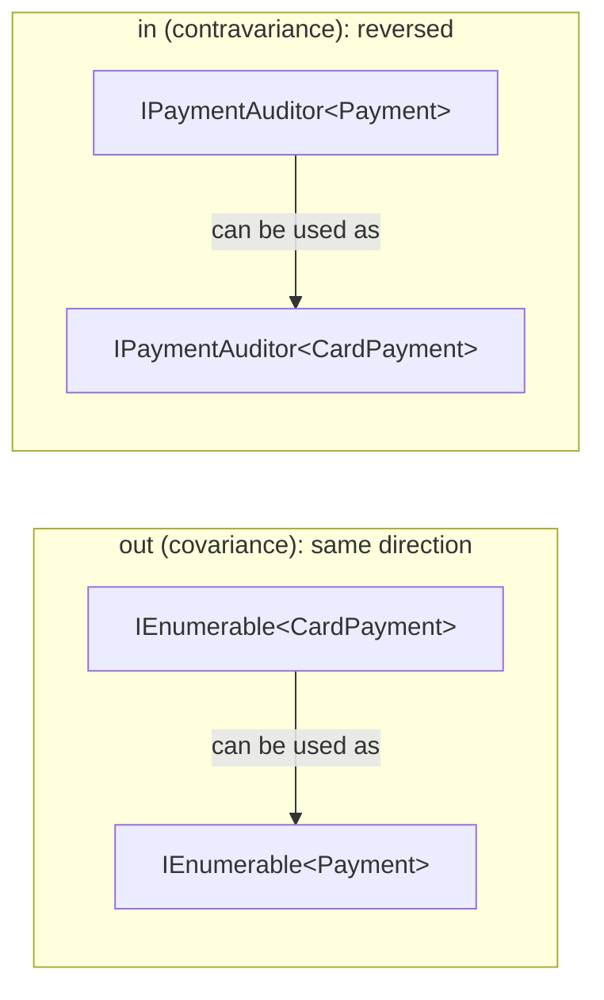

The diagram shows that `out` substitutes in the same direction as inheritance and `in` in the opposite direction.

### Code

```csharp
namespace Chapter02.Topics;

public abstract record Payment(string Id, decimal Amount);
public record CardPayment(string Id, decimal Amount, string Last4) : Payment(Id, Amount);
public record UpiPayment(string Id, decimal Amount, string Vpa) : Payment(Id, Amount);

// out T: T only comes OUT of the interface (return values) -> covariant
public interface IPaymentSource<out T> where T : Payment
{
    T Next();
}

// in T: T only goes IN to the interface (parameters) -> contravariant
public interface IPaymentAuditor<in T> where T : Payment
{
    string Audit(T payment);
}

public class CardPaymentSource : IPaymentSource<CardPayment>
{
    public CardPayment Next() => new("pay_77", 1_999m, "4242");
}

// One auditor that understands ANY payment
public class GenericPaymentAuditor : IPaymentAuditor<Payment>
{
    public string Audit(Payment payment) => $"audited {payment.GetType().Name} {payment.Id} for {payment.Amount}";
}

public static class T07_Variance
{
    private static decimal TotalOf(IEnumerable<Payment> payments) => payments.Sum(p => p.Amount);

    public static void Run()
    {
        // ---- Covariance (out): a sequence of CardPayment IS usable as a sequence of Payment ----
        List<CardPayment> cardPayments = [new("pay_1", 500m, "1111"), new("pay_2", 250m, "2222")];
        IEnumerable<Payment> asPayments = cardPayments;          // OK: IEnumerable<out T>
        Console.WriteLine($"Total of card payments via IEnumerable<Payment>: {TotalOf(asPayments)}");

        // List<Payment> list = cardPayments;   // compile error: List<T> is invariant.
        // If it compiled, list.Add(new UpiPayment(...)) would put a UPI payment into a List<CardPayment>.

        IPaymentSource<Payment> source = new CardPaymentSource();   // OK: IPaymentSource<out T>
        Console.WriteLine($"Covariant source returned: {source.Next().GetType().Name}");

        // ---- Contravariance (in): something that handles ANY Payment can handle a CardPayment ----
        IPaymentAuditor<CardPayment> cardAuditor = new GenericPaymentAuditor();   // OK: IPaymentAuditor<in T>
        Console.WriteLine($"Contravariant auditor: {cardAuditor.Audit(cardPayments[0])}");

        Action<Payment> logAny = p => Console.WriteLine($"  log: {p.Id}");
        Action<CardPayment> logCard = logAny;                     // OK: Action<in T>
        logCard(cardPayments[1]);

        IComparer<Payment> byAmount = Comparer<Payment>.Create((a, b) => a.Amount.CompareTo(b.Amount));
        cardPayments.Sort(byAmount);                              // a List<CardPayment> sorted with an IComparer<Payment>
        Console.WriteLine($"Sorted card payments with IComparer<Payment>: {string.Join(", ", cardPayments.Select(p => p.Id))}");

        // ---- Variance only works for reference types ----
        IEnumerable<int> quantities = [1, 2, 3];
        Console.WriteLine($"IEnumerable<int> is IEnumerable<object>? {quantities is IEnumerable<object>}");
        IEnumerable<string> skus = ["SKU-1"];
        Console.WriteLine($"IEnumerable<string> is IEnumerable<object>? {skus is IEnumerable<object>}");

        // ---- The old trap: arrays are covariant, and it is checked only at runtime ----
        Payment[] batch = new CardPayment[2];                     // compiles!
        batch[0] = new CardPayment("pay_3", 10m, "3333");         // fine
        try
        {
            batch[1] = new UpiPayment("pay_4", 20m, "asha@upi");  // compiles, fails at runtime
        }
        catch (ArrayTypeMismatchException ex)
        {
            Console.WriteLine($"Array covariance: {ex.GetType().Name}");
        }
    }
}
```

**Output:**

```text
Total of card payments via IEnumerable<Payment>: 750
Covariant source returned: CardPayment
Contravariant auditor: audited CardPayment pay_1 for 500
  log: pay_2
Sorted card payments with IComparer<Payment>: pay_2, pay_1
IEnumerable<int> is IEnumerable<object>? False
IEnumerable<string> is IEnumerable<object>? True
Array covariance: ArrayTypeMismatchException
```

### Common mistakes / gotchas

- **Expecting `List<Derived>` to convert to `List<Base>`.** It never will. Accept `IEnumerable<Base>` or `IReadOnlyList<Base>` as the parameter type instead, and callers can pass their `List<Derived>`.
- **Array covariance.** `Payment[] batch = new CardPayment[2];` compiles (a design decision from C#'s first version, copied from Java). Writing a `UpiPayment` into it fails at **runtime** with `ArrayTypeMismatchException`. Every write into an array of a non-sealed reference type also pays for a hidden runtime type check.
- **Expecting variance with value types.** `IEnumerable<int>` → `IEnumerable<object>` doesn't work; use `.Cast<object>()` (which boxes).
- **Trying to put `out T` on an interface that also takes `T` as a parameter.** That's a compile error, and the compiler is right: it wouldn't be safe.

### 5-YOE depth

- **Why the rules are safe:** covariance is safe for outputs because whatever comes out is at least a `Payment`. Contravariance is safe for inputs because a handler of any `Payment` can certainly handle a `CardPayment`. That one sentence answers most variance questions.
- **Real uses in backend code:**
  - A generic `INotificationHandler<in TNotification>` lets one `AuditLogHandler : INotificationHandler<DomainEvent>` handle `OrderPlaced`, `OrderShipped`, etc.
  - An `IReadOnlyList<OrderDto>` returned from a service can be passed to a method that accepts `IReadOnlyList<object>` for logging.
  - Delegates: an `Action<Exception>` error callback can be used as an `Action<HttpRequestException>`.
- **DI containers and variance:** the default Microsoft DI container doesn't automatically resolve variant matches (e.g. resolving `IHandler<OrderPlaced>` won't find a registered `IHandler<DomainEvent>`). Some third-party containers (Autofac) support this with extra configuration. Know that this limitation exists.
- **Delegate variance with `+=`:** combining delegates of different variant types (e.g. an `Action<object>` and an `Action<string>` into one `Action<string>`) can throw at runtime. Rare, but a known edge case.
- **Covariant return types (C# 9)** are a different feature: an override can return a more derived type than the base method declares (e.g. `CardPayment Clone()` overriding `Payment Clone()`).

### Interview questions

1. **Explain covariance and contravariance with an example.**
   Covariance (`out`): an `IEnumerable<CardPayment>` can be used as an `IEnumerable<Payment>`, because items only come out. Contravariance (`in`): an `IComparer<Payment>` can sort a `List<CardPayment>`, because items only go in. Invariance: `List<T>` allows both, so no conversion is allowed.
2. **Why isn't `List<string>` convertible to `List<object>`?**
   Because `List<T>` lets you add items. If the conversion were allowed, you could add an `int` to a list of strings. Classes can't be variant in C#; only interfaces and delegates can.
3. **What is array covariance and why is it considered a mistake?**
   `object[] arr = new string[1];` compiles, but `arr[0] = 5;` throws `ArrayTypeMismatchException` at runtime. It moves a compile-time error to runtime and adds a type check to every array write.
4. **Does `IEnumerable<int>` convert to `IEnumerable<object>`?**
   No. Variance only applies to reference types, because a conversion that needs boxing can't happen without copying.
5. **Name some built-in variant interfaces or delegates.**
   `IEnumerable<out T>`, `IReadOnlyList<out T>`, `IQueryable<out T>`, `IComparer<in T>`, `IEqualityComparer<in T>`, `Action<in T>`, `Func<in T, out TResult>`.

---

## 2.8 Concurrent collections: ConcurrentDictionary, ConcurrentQueue, BlockingCollection

### What it is

**Concurrent collections** (namespace `System.Collections.Concurrent`) are collections that **many threads can use at the same time** without you writing locks.

| Collection | What it is | Backend example |
|---|---|---|
| `ConcurrentDictionary<K,V>` | A thread-safe dictionary with atomic "get or add" and "add or update" operations. | In-memory counters, a per-tenant settings cache. |
| `ConcurrentQueue<T>` | A thread-safe FIFO queue. | Audit events produced by many request threads. |
| `ConcurrentStack<T>` | A thread-safe LIFO stack. | Rare in business code. |
| `ConcurrentBag<T>` | Unordered; fastest when the same thread adds and takes items. | Object pools. |
| `BlockingCollection<T>` | A wrapper that adds **blocking** (wait when empty) and **bounding** (wait when full) to the collections above. | A producer/consumer pipeline: one thread reads orders, another prints labels. |

**Key terms:**

- **Race condition:** a bug where the result depends on the exact timing of threads. Example: two threads read stock = 1, both see "in stock", and both reserve the last unit.
- **Atomic:** happens as one indivisible step. No other thread can see it half-done.
- **Lock:** `lock (gate) { ... }` lets only one thread at a time run the block (details in Chapter 5).
- **Producer/consumer:** some threads produce work items; others consume them.

### Why it matters

ASP.NET Core handles many requests in parallel. Any collection stored in a **singleton** service or a **static field** is shared by all those threads. A plain `Dictionary` or `List` there is a production bug waiting to happen: lost updates, exceptions, or (in older .NET) a corrupted dictionary stuck in an infinite loop at 100% CPU.

### How it works

- **`ConcurrentDictionary`** (*runtime behaviour*): reads take **no lock**. Writes lock only a small **stripe** (one of several locks, each covering a group of buckets), so writes to different keys rarely block each other.
- **The factory delegates run outside the lock.** `GetOrAdd(key, factory)` and `AddOrUpdate(key, add, update)` call your function *without* holding the lock (to avoid deadlocks and long blocking). So **two threads can run the factory for the same key at the same time**. Only one result is stored, and both callers get the stored value, but the factory ran twice. The demo forces this with a `Barrier` and shows `factory ran 2 times`. If the factory calls a paid API or creates a database connection, that matters. Fix: store `Lazy<T>` values.
- **`AddOrUpdate`'s update function may run more than once** for the same call, because it retries when another thread changes the value first. Keep it side-effect free.
- **`ConcurrentQueue`** is **lock-free**: it uses atomic CPU instructions (compare-and-swap) instead of locks.
- **`BlockingCollection`** wraps a `ConcurrentQueue` by default. `Add` blocks while the collection is full (if bounded); `GetConsumingEnumerable()` blocks while it's empty and ends after `CompleteAdding()` is called and the collection is drained.

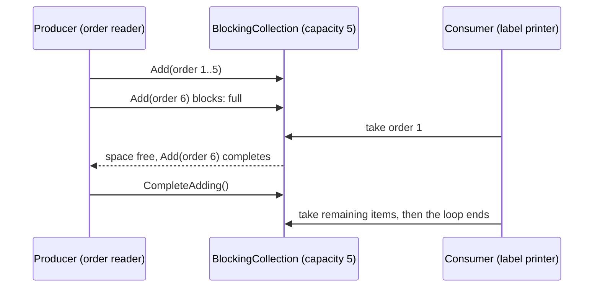

The sequence diagram shows bounding: a fast producer is paused when the buffer is full, so memory can't grow without limit.

### Code

```csharp
using System.Collections.Concurrent;

namespace Chapter02.Topics;

public static class T08_ConcurrentCollections
{
    private record Shipment(int OrderId, string Carrier);

    public static void Run()
    {
        // ---- ConcurrentDictionary: count product views coming from many requests at once ----
        string[] products = ["Laptop", "Mouse", "Keyboard"];
        var views = new ConcurrentDictionary<string, int>();
        Parallel.For(0, 30_000, i =>
        {
            string sku = products[i % products.Length];
            views.AddOrUpdate(sku, addValue: 1, updateValueFactory: (_, current) => current + 1);   // atomic per key
        });
        Console.WriteLine($"Views: {string.Join(", ", views.OrderBy(kv => kv.Key).Select(kv => $"{kv.Key}={kv.Value}"))} (expected 10000 each)");

        // The same counting with a plain Dictionary needs a lock
        var viewsLocked = new Dictionary<string, int>();
        var gate = new object();
        Parallel.For(0, 30_000, i =>
        {
            string sku = products[i % products.Length];
            lock (gate)
            {
                viewsLocked[sku] = viewsLocked.GetValueOrDefault(sku) + 1;
            }
        });
        Console.WriteLine($"Dictionary + lock total: {viewsLocked.Values.Sum()}");

        // ---- GetOrAdd: the value factory CAN run more than once ----
        // Two threads ask for the same missing key at the same moment. The barrier forces both
        // factories to be running at the same time, which is exactly the race that happens under load.
        var exchangeRates = new ConcurrentDictionary<string, decimal>();
        int factoryRuns = 0;
        using var barrier = new Barrier(2);
        decimal FetchRateFromApi(string currency)
        {
            Interlocked.Increment(ref factoryRuns);
            barrier.SignalAndWait();          // wait until the other thread is also inside the factory
            return 83.25m;
        }
        var t1 = Task.Run(() => exchangeRates.GetOrAdd("USD", FetchRateFromApi));
        var t2 = Task.Run(() => exchangeRates.GetOrAdd("USD", FetchRateFromApi));
        Task.WaitAll(t1, t2);
        Console.WriteLine($"GetOrAdd: factory ran {factoryRuns} times; both callers got {t1.Result} and {t2.Result}; stored {exchangeRates["USD"]}");

        // Fix: store Lazy<T>. Only one Lazy wins the race, and Lazy runs its factory once.
        var lazyRates = new ConcurrentDictionary<string, Lazy<decimal>>();
        int lazyRuns = 0;
        Parallel.For(0, 100, _ =>
        {
            var rate = lazyRates.GetOrAdd("USD", c => new Lazy<decimal>(() =>
            {
                Interlocked.Increment(ref lazyRuns);
                return 83.25m;
            })).Value;
        });
        Console.WriteLine($"GetOrAdd with Lazy<T>: expensive call ran {lazyRuns} time(s) for 100 callers");

        // ---- ConcurrentQueue: many producers, no lock needed ----
        var auditEvents = new ConcurrentQueue<string>();
        Parallel.For(0, 1_000, i => auditEvents.Enqueue($"order-{i}-viewed"));
        int drained = 0;
        while (auditEvents.TryDequeue(out _)) drained++;
        Console.WriteLine($"ConcurrentQueue: enqueued by many threads, drained {drained}");

        // ---- BlockingCollection: bounded producer/consumer ----
        // The producer blocks when 5 items are waiting, so a slow consumer cannot cause unbounded memory growth.
        using var labelQueue = new BlockingCollection<Shipment>(boundedCapacity: 5);
        int printed = 0;
        var consumer = Task.Run(() =>
        {
            foreach (var shipment in labelQueue.GetConsumingEnumerable())   // blocks while empty, ends after CompleteAdding
                Interlocked.Increment(ref printed);
        });
        for (int orderId = 1; orderId <= 20; orderId++)
            labelQueue.Add(new Shipment(orderId, orderId % 2 == 0 ? "BlueDart" : "Delhivery"));
        labelQueue.CompleteAdding();       // "no more items": lets the consumer loop finish
        consumer.Wait();
        Console.WriteLine($"BlockingCollection: printed {printed} shipping labels, IsCompleted = {labelQueue.IsCompleted}");

        // ---- Thread-safe does not mean your multi-step logic is atomic ----
        var reservations = new ConcurrentDictionary<string, int> { ["SKU-1"] = 1 };
        int successfulReservations = 0;
        Parallel.For(0, 50, _ =>
        {
            // Atomic check-and-decrement: retry with TryUpdate until we win or stock is gone
            while (true)
            {
                int current = reservations["SKU-1"];
                if (current == 0) return;
                if (reservations.TryUpdate("SKU-1", current - 1, current))
                {
                    Interlocked.Increment(ref successfulReservations);
                    return;
                }
            }
        });
        Console.WriteLine($"Last unit of SKU-1: {successfulReservations} reservation succeeded out of 50 attempts, stock now {reservations["SKU-1"]}");
    }
}
```

> `Parallel.For(0, 30_000, i => ...)` runs the body for every `i` on several threads at once. `Interlocked.Increment(ref x)` adds 1 atomically. `Task.Run` runs code on a thread-pool thread. These are covered properly in Chapter 5; here they're just a way to create many threads.

**Output:**

```text
Views: Keyboard=10000, Laptop=10000, Mouse=10000 (expected 10000 each)
Dictionary + lock total: 30000
GetOrAdd: factory ran 2 times; both callers got 83.25 and 83.25; stored 83.25
GetOrAdd with Lazy<T>: expensive call ran 1 time(s) for 100 callers
ConcurrentQueue: enqueued by many threads, drained 1000
BlockingCollection: printed 20 shipping labels, IsCompleted = True
Last unit of SKU-1: 1 reservation succeeded out of 50 attempts, stock now 0
```

### Common mistakes / gotchas

- **Thread-safe methods ≠ thread-safe logic.** Each call on a `ConcurrentDictionary` is atomic, but a **sequence** of calls isn't:

  ```csharp
  // RACE: two threads can both see stock 1 and both reserve it
  if (stock["SKU-1"] > 0) stock["SKU-1"] = stock["SKU-1"] - 1;
  ```

  Use one atomic operation (`AddOrUpdate`, `TryUpdate` in a loop as in the demo, `GetOrAdd`) or a lock.
- **`if (!dict.ContainsKey(k)) dict.TryAdd(k, v)`** is the same check-then-act race. Just call `TryAdd` or `GetOrAdd`.
- **Assuming `GetOrAdd`'s factory runs once.** It may run several times under contention. Use `Lazy<T>` for expensive or side-effecting factories.
- **Calling `Count`, `Keys`, `Values` or `ToArray()` often** on a `ConcurrentDictionary`. These take **all** the stripe locks, which is expensive under load (*runtime behaviour*). `IsEmpty` is cheaper than `Count == 0`.
- **Using a plain `Dictionary`/`List` in a singleton or static field** and "it worked in testing". Concurrency bugs appear only under real load.
- **Forgetting `CompleteAdding()`** on a `BlockingCollection`. The consumer waits forever and the app never shuts down cleanly.
- **Blocking thread-pool threads** with `BlockingCollection` in ASP.NET Core. It's a synchronous API. For async code use `Channel<T>` (Chapters 5 and 19).

### 5-YOE depth

- **Which tool when (design guidance):**
  - Shared mutable state accessed by many requests → `ConcurrentDictionary`, or better, `IMemoryCache` for caches (it has expiry and size limits, Chapter 18).
  - Read-mostly data loaded at startup → an immutable or frozen collection, swapped atomically when it changes (`Interlocked.Exchange` or a `volatile` reference). Readers need no locks at all.
  - Producer/consumer in async code → `System.Threading.Channels.Channel<T>` (bounded, async, supports backpressure). `BlockingCollection` is the older, synchronous equivalent.
  - Several related values that must change together → a `lock` around all of them. Concurrent collections can't make multi-key updates atomic.
- **The in-memory cache stampede:** 100 requests miss the cache for the same product at the same moment and all hit the database. `ConcurrentDictionary<string, Lazy<Task<T>>>` (or `HybridCache` in .NET 9+, Chapter 18) makes only one caller do the work.
- **In-memory state doesn't work across instances.** With 3 app instances behind a load balancer, each has its own `ConcurrentDictionary`. Counters, rate limits and idempotency keys that must be global need Redis or the database (Chapters 18–19).
- **`ConcurrentBag<T>`** keeps a list per thread. It's great when the same thread adds and removes, but poor as a general queue, because "stealing" items from other threads is slow. It doesn't keep order.
- **Deadlock-safety by design:** `ConcurrentDictionary` doesn't hold its locks while calling your factory. If it did, a factory that touched the same dictionary could deadlock. That design choice is the reason the factory can run more than once.
- **Memory-model detail:** reads from a `ConcurrentDictionary` see a consistent value for each key, but there's no snapshot across keys while other threads write. Enumerating while others write is allowed (no exception), but you may see some updates and miss others.

### Interview questions

1. **Why can't you use `Dictionary<TKey,TValue>` from multiple threads?**
   It isn't designed for concurrent writes. Two threads resizing or inserting at once can lose entries, throw, or corrupt internal chains. Older .NET versions could even hang in an infinite loop. Concurrent reads with no writers are safe.
2. **How does `ConcurrentDictionary` achieve thread safety?**
   Lock-free reads, and fine-grained (striped) locks for writes, so different keys rarely contend. Operations like `GetOrAdd`, `AddOrUpdate` and `TryUpdate` are atomic for a single key.
3. **Can the value factory in `GetOrAdd` run more than once?**
   Yes. Factories run outside the lock, so two threads that miss at the same time can both run it. Only one value is stored and returned to both. Wrap expensive factories in `Lazy<T>` so the work runs once.
4. **Is this code thread-safe: `if (!cd.ContainsKey(k)) cd[k] = Load(k);`?**
   No. It's a check-then-act race: two threads can both see "missing" and both load. Use `cd.GetOrAdd(k, Load)` (and `Lazy<T>` if `Load` is expensive).
5. **`BlockingCollection` vs `Channel<T>`?**
   Both are producer/consumer queues with optional bounding. `BlockingCollection` blocks threads (synchronous). `Channel<T>` is async (`await reader.ReadAsync()`), which doesn't waste threads, so it's the right choice in ASP.NET Core and background services.
6. **You cache product prices in a singleton `Dictionary` and occasionally see wrong prices or exceptions under load. What do you do?**
   Replace it with `ConcurrentDictionary` or `IMemoryCache`. If the data is loaded once and refreshed periodically, build a new immutable or frozen dictionary and swap the reference atomically, so readers never see a half-updated state. If there are multiple instances, consider a distributed cache.

---

## 2.9 Exception hierarchy and try / catch / finally

### What it is

An **exception** is an object that describes an error. When something goes wrong, code **throws** it (`throw new TimeoutException(...)`). Normal execution stops immediately and .NET searches up the chain of calling methods for a **catch** block that handles that type of exception. If it finds none, the app (or, in ASP.NET Core, the request) fails.

- **`try { }`**: the code that might fail.
- **`catch (SomeException ex) { }`**: what to do if an exception of that type (or a type derived from it) is thrown.
- **`finally { }`**: code that runs **whether or not** an exception happened. Used for cleanup: release a lock, close a file.

**Analogy:** a fire alarm. When it goes off (throw), everyone stops what they're doing. Each floor (method) checks whether it has a fire warden trained for this kind of fire (a matching catch). If not, the alarm goes up to the next floor. The cleaning crew (finally) always locks the doors on the way out, fire or no fire.

**The hierarchy:** every exception derives from `System.Exception`.

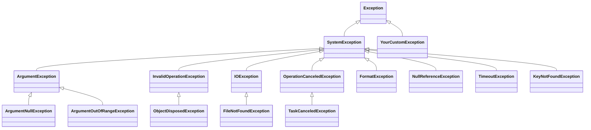

The class diagram shows that catching a base type (e.g. `ArgumentException`) also catches everything below it. (`HttpRequestException` derives directly from `Exception`, not `SystemException`.)

| Exception | Typical cause | Who's at fault |
|---|---|---|
| `ArgumentNullException` / `ArgumentOutOfRangeException` / `ArgumentException` | A caller passed a bad value | The caller (a bug, or unvalidated input) |
| `InvalidOperationException` | The object isn't in a state where this call makes sense (e.g. shipping a cancelled order) | Usually the caller |
| `NullReferenceException` | Using a member on a `null` reference | Always a bug in **your** code. Never throw it yourself. |
| `KeyNotFoundException` | Dictionary indexer with a missing key | Use `TryGetValue` |
| `FormatException` | `int.Parse("12O0")` | Use `TryParse` for input |
| `IOException` / `FileNotFoundException` | File system problems | Environment |
| `TimeoutException`, `HttpRequestException` | A remote system is slow or down | Environment; often worth a retry |
| `OperationCanceledException` | Cancellation was requested (e.g. the HTTP client disconnected) | Nobody: it's expected |

### Why it matters

Exceptions are how .NET reports failures. Handling them well is the difference between "the payment failed, here's a clear message and a log entry with the cause" and "500 Internal Server Error, nothing in the logs, the warehouse lock is never released".

### How it works

1. `throw` creates the exception and captures the **stack trace**.
2. The runtime looks for a matching `catch` in the current method, then in its caller, and so on up the stack.
3. **Catch blocks are checked top to bottom; the first match wins.** A `catch` for a base type before a `catch` for a derived type is a **compile error** (CS0160, *language rule*), so list the most specific first.
4. Before control jumps to the matching catch, the `finally` blocks of all the methods being exited run (this is called **unwinding** the stack).
5. `finally` also runs when the `try` block finishes normally or with `return`.

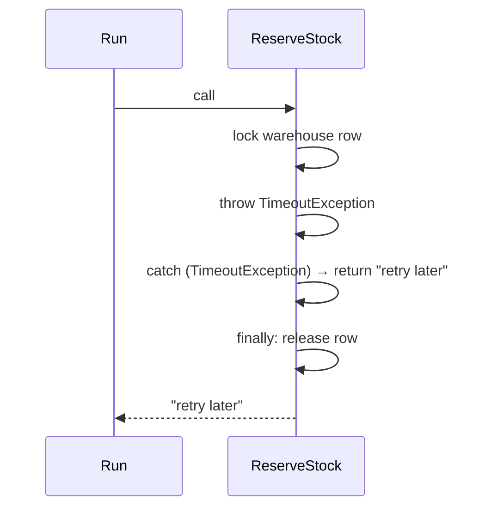

The diagram shows that even with an early `return` inside `catch`, the `finally` block runs before the method actually returns.

**Guard clauses** check arguments at the start of a public method and throw immediately. .NET has helpers: `ArgumentNullException.ThrowIfNull(x)` (.NET 6), `ArgumentException.ThrowIfNullOrEmpty(s)` (.NET 7), `ArgumentOutOfRangeException.ThrowIfNegative(n)` / `ThrowIfNegativeOrZero` / `ThrowIfGreaterThan` (.NET 8). They automatically fill in the parameter name.

**Wrapping:** `throw new InvalidDataException("Row 7 has an invalid price.", ex)` adds business context and keeps the original exception in `InnerException`.

### Code

```csharp
namespace Chapter02.Topics;

public static class T09_ExceptionBasics
{
    // Guard clauses: reject bad input at the start of a public method
    private static decimal ApplyDiscount(decimal orderTotal, decimal percent, string? couponCode)
    {
        ArgumentNullException.ThrowIfNull(couponCode);                // .NET 6+
        ArgumentOutOfRangeException.ThrowIfNegative(orderTotal);      // .NET 8+
        if (percent is < 0 or > 100)
            throw new ArgumentOutOfRangeException(nameof(percent), percent, "Discount must be between 0 and 100.");
        return orderTotal - orderTotal * percent / 100;
    }

    private static void TryDiscount(decimal total, decimal percent, string? code)
    {
        try
        {
            Console.WriteLine($"  ApplyDiscount({total}, {percent}, {code ?? "null"}) = {ApplyDiscount(total, percent, code)}");
        }
        // Order matters: most specific first. ArgumentNullException and ArgumentOutOfRangeException
        // both derive from ArgumentException. Putting catch (ArgumentException) first is compile error CS0160.
        catch (ArgumentNullException ex)
        {
            Console.WriteLine($"  ArgumentNullException for '{ex.ParamName}'");
        }
        catch (ArgumentOutOfRangeException ex)
        {
            Console.WriteLine($"  ArgumentOutOfRangeException for '{ex.ParamName}'");
        }
        catch (ArgumentException ex)
        {
            Console.WriteLine($"  Other ArgumentException: {ex.Message}");
        }
    }

    // finally runs whether the try block returns normally, returns early, or throws
    private static string ReserveStock(string sku, bool gatewayFails)
    {
        Console.WriteLine($"  [{sku}] lock warehouse row");
        try
        {
            if (gatewayFails) throw new TimeoutException("Inventory service timed out.");
            return "reserved";                     // finally still runs before the method returns
        }
        catch (TimeoutException ex)
        {
            Console.WriteLine($"  [{sku}] caught: {ex.Message}");
            return "retry later";
        }
        finally
        {
            Console.WriteLine($"  [{sku}] finally: release warehouse row");
        }
    }

    // DANGER: an exception thrown inside finally replaces the original one
    private static void UploadInvoice()
    {
        try
        {
            throw new IOException("Disk full while writing invoice INV-42.");   // the REAL problem
        }
        finally
        {
            throw new InvalidOperationException("Cleanup failed: temp file already deleted.");
        }
    }

    public static void Run()
    {
        Console.WriteLine("Guard clauses and catch order:");
        TryDiscount(1_000m, 10m, "DIWALI10");
        TryDiscount(1_000m, 10m, null);
        TryDiscount(-5m, 10m, "DIWALI10");
        TryDiscount(1_000m, 150m, "DIWALI10");

        Console.WriteLine("try / catch / finally:");
        Console.WriteLine($"  result: {ReserveStock("SKU-1", gatewayFails: false)}");
        Console.WriteLine($"  result: {ReserveStock("SKU-2", gatewayFails: true)}");

        Console.WriteLine("Exception thrown from finally:");
        try { UploadInvoice(); }
        catch (Exception ex) { Console.WriteLine($"  caller sees: {ex.GetType().Name}: {ex.Message}  <- the IOException is lost"); }

        // Wrapping: add context, keep the cause in InnerException
        try
        {
            try { _ = int.Parse("12O0"); }   // letter O instead of zero, from a CSV import
            catch (FormatException ex) { throw new InvalidDataException("Row 7 of price-list.csv has an invalid price.", ex); }
        }
        catch (InvalidDataException ex)
        {
            Console.WriteLine($"Wrapped: {ex.Message} | Inner: {ex.InnerException?.GetType().Name}");
        }

        // The hierarchy
        Console.WriteLine($"Base chain of ArgumentNullException: {BaseChain(typeof(ArgumentNullException))}");
        Console.WriteLine($"Base chain of FileNotFoundException: {BaseChain(typeof(FileNotFoundException))}");
        Console.WriteLine($"Base chain of TaskCanceledException: {BaseChain(typeof(TaskCanceledException))}");
    }

    private static string BaseChain(Type t)
    {
        var names = new List<string>();
        for (Type? current = t; current != null && current != typeof(object); current = current.BaseType)
            names.Add(current.Name);
        return string.Join(" -> ", names);
    }
}
```

> `percent is < 0 or > 100` is a **pattern** (C# 9): "less than 0 or greater than 100". `nameof(percent)` gives the string `"percent"` and stays correct if the parameter is renamed.

**Output:**

```text
Guard clauses and catch order:
  ApplyDiscount(1000, 10, DIWALI10) = 900
  ArgumentNullException for 'couponCode'
  ArgumentOutOfRangeException for 'orderTotal'
  ArgumentOutOfRangeException for 'percent'
try / catch / finally:
  [SKU-1] lock warehouse row
  [SKU-1] finally: release warehouse row
  result: reserved
  [SKU-2] lock warehouse row
  [SKU-2] caught: Inventory service timed out.
  [SKU-2] finally: release warehouse row
  result: retry later
Exception thrown from finally:
  caller sees: InvalidOperationException: Cleanup failed: temp file already deleted.  <- the IOException is lost
Wrapped: Row 7 of price-list.csv has an invalid price. | Inner: FormatException
Base chain of ArgumentNullException: ArgumentNullException -> ArgumentException -> SystemException -> Exception
Base chain of FileNotFoundException: FileNotFoundException -> IOException -> SystemException -> Exception
Base chain of TaskCanceledException: TaskCanceledException -> OperationCanceledException -> SystemException -> Exception
```

### Common mistakes / gotchas

- **`catch (Exception)` everywhere.** It hides bugs (`NullReferenceException`) together with real failures. Catch specific exceptions you can **handle**. Catch-all belongs at the boundary (middleware, a background-worker loop) for logging.
- **Throwing from `finally`.** The new exception **replaces** the one in flight, and the real cause is lost (the demo lost "Disk full"). Keep `finally` blocks simple, and wrap risky cleanup in its own `try/catch`.
- **`return` inside `finally`** isn't allowed in C# (compile error CS0157), which prevents one classic way of swallowing exceptions.
- **Throwing `Exception` or `SystemException` directly.** Callers can't catch it selectively. Throw a specific built-in type or a custom one.
- **Throwing `NullReferenceException` yourself.** Throw `ArgumentNullException` with the parameter name instead.
- **Using exceptions for normal flow** (e.g. `int.Parse` in a `try/catch` to validate user input). Use `TryParse` and validation (topic 12).

### 5-YOE depth

- **`finally` doesn't always run (runtime behaviour):** not on `Environment.FailFast`, a killed process, a `StackOverflowException` (which can't be caught at all), or a power cut. Don't rely on `finally` for things that must happen, like committing money. Use transactions and idempotency (Chapter 15).
- **Unhandled exceptions:** in a console app or on a background thread, an unhandled exception **terminates the process**. In ASP.NET Core, the server catches exceptions from a request and returns a 500, so the app survives. But an exception in a `BackgroundService.ExecuteAsync` stops the host by default since .NET 6 (`BackgroundServiceExceptionBehavior.StopHost`), Chapter 19.
- **`TaskCanceledException` derives from `OperationCanceledException`**, so always catch `OperationCanceledException`. `HttpClient` throws `TaskCanceledException` both for real cancellations and for **timeouts**. Check `cancellationToken.IsCancellationRequested` to tell them apart (Chapter 20).
- **`AggregateException`** wraps several exceptions (from `Task.WaitAll`, `Parallel.For`, `.Result`). `await` unwraps the first one. Chapter 5.
- **Throw helpers and inlining:** the `ThrowIfNull`-style helpers keep the `throw` in a separate method, so the calling method stays small enough for the JIT to inline. That's why the .NET libraries use them (*runtime behaviour*).
- **`ApplicationException`:** an old base class that Microsoft's own guidance now says **not** to use. Derive custom exceptions directly from `Exception` (topic 10).
- **`throw` expressions (C# 7):** `_repo = repo ?? throw new ArgumentNullException(nameof(repo));`.

### Interview questions

1. **Does `finally` run if the `try` block returns?**
   Yes. It runs before the method actually returns. It also runs after a `catch`, and when an exception passes through uncaught. It doesn't run if the process is killed, on `Environment.FailFast` or on a stack overflow.
2. **What's the order of catch blocks, and what happens if you put `catch (Exception)` first?**
   Most specific to most general; the first match wins. A general catch before a specific one is compile error CS0160 ("a previous catch clause already catches all exceptions of this or of a super type").
3. **What happens if an exception is thrown inside `finally`?**
   It replaces the original exception, which is lost. Keep `finally` simple and protect risky cleanup with its own `try/catch`.
4. **When would you catch `Exception`?**
   Only at a boundary where you log and convert the failure: global exception-handling middleware, the top of a background-worker loop (so one bad message doesn't kill the worker), or a top-level `Main`. Never just to hide errors.
5. **`ArgumentException` vs `InvalidOperationException`?**
   `ArgumentException`: the **argument** is bad, whatever the object's state (negative quantity). `InvalidOperationException`: the argument may be fine, but the **object's current state** doesn't allow the operation (shipping an order that's already cancelled).

---

## 2.10 Custom exceptions and exception filters (when)

### What it is

A **custom exception** is your own exception class, e.g. `InsufficientStockException`, that represents a specific failure in your domain and can carry extra data (`Sku`, `Requested`, `Available`).

An **exception filter** is a condition on a catch block: `catch (HttpRequestException ex) when (ex.StatusCode == HttpStatusCode.ServiceUnavailable)`. The catch block runs **only if** the condition is true. Otherwise the exception keeps travelling up as if this catch didn't exist. Filters were added in C# 6.

### Why it matters

- **Custom exceptions** let callers react precisely: an API can turn `InsufficientStockException` into "409 Conflict: only 3 left", without parsing message strings.
- **Filters** let you catch only the cases you can handle (retry a 503, but not a 400) **without catching and rethrowing**. That keeps the original stack trace and makes the code clearer.

### How it works

**Writing a custom exception (design guidance from the .NET guidelines):**

1. Derive from `Exception` (not `ApplicationException`).
2. End the name with `Exception`.
3. Provide the three standard constructors: `()`, `(string message)`, `(string message, Exception inner)`. Add your own constructor that takes the domain data.
4. Add **read-only properties** for the data callers need.
5. Create one only when callers will **catch it specifically** or need its data. Otherwise, a built-in type is fine (`ArgumentException`, `InvalidOperationException`).

**How filters run: the two-pass model (runtime behaviour):**

1. **Pass 1 (search):** the runtime walks up the stack looking for a catch that matches, **running `when` filters as it goes**. Nothing has been unwound yet, so the throwing method's frames and local variables still exist.
2. **Pass 2 (unwind):** once a catch is chosen, the runtime goes back and runs the `finally` blocks of the frames being exited, then enters the catch.

So **a filter runs before the inner `finally` blocks**. The demo proves it: "filter in Run" is printed before "ChargeCard finally". This is why filters are great for logging: a debugger or a crash dump taken at that moment still shows the full state at the throw point.

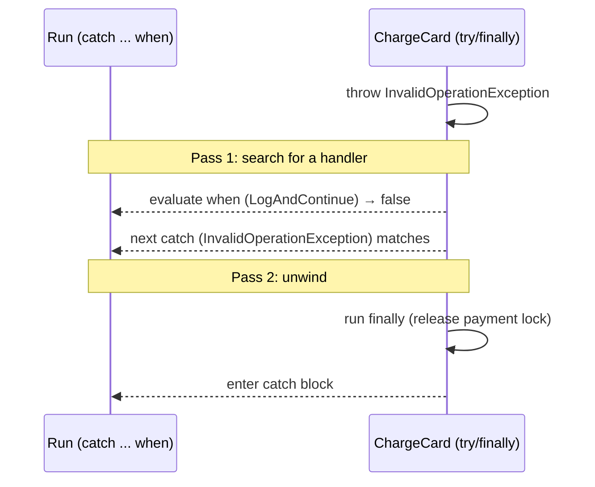

The diagram shows the two passes: filters are evaluated first, `finally` blocks run second, and the catch body runs last.

### Code

```csharp
using System.Net;

namespace Chapter02.Topics;

// A custom exception: a clear name, extra data callers can act on, and the standard constructors
public class InsufficientStockException : Exception
{
    public string Sku { get; } = "";
    public int Requested { get; }
    public int Available { get; }

    public InsufficientStockException() { }
    public InsufficientStockException(string message) : base(message) { }
    public InsufficientStockException(string message, Exception innerException) : base(message, innerException) { }

    public InsufficientStockException(string sku, int requested, int available)
        : base($"Cannot reserve {requested} of {sku}; only {available} left.")
    {
        Sku = sku;
        Requested = requested;
        Available = available;
    }
}

public static class T10_CustomExceptionsAndFilters
{
    private static readonly Dictionary<string, int> Stock = new() { ["SKU-1"] = 3 };

    private static void Reserve(string sku, int quantity)
    {
        int available = Stock.GetValueOrDefault(sku);
        if (quantity > available) throw new InsufficientStockException(sku, quantity, available);
        Stock[sku] = available - quantity;
    }

    // Simulates a shipping-rate API that is down for the first two calls
    private static int _rateCalls;
    private static decimal GetShippingRate(string pincode)
    {
        _rateCalls++;
        if (_rateCalls <= 2) throw new HttpRequestException("Service Unavailable", null, HttpStatusCode.ServiceUnavailable);
        if (pincode == "000000") throw new HttpRequestException("Bad Request", null, HttpStatusCode.BadRequest);
        return 49m;
    }

    private static decimal GetShippingRateWithRetry(string pincode, int maxAttempts)
    {
        for (int attempt = 1; ; attempt++)
        {
            try
            {
                return GetShippingRate(pincode);
            }
            // The filter decides BEFORE catching: only 503s are retried, and only while attempts remain.
            // A 400 Bad Request is not caught here at all, so it flows to the caller untouched.
            catch (HttpRequestException ex) when (ex.StatusCode == HttpStatusCode.ServiceUnavailable && attempt < maxAttempts)
            {
                Console.WriteLine($"  attempt {attempt}: 503, retrying");
            }
        }
    }

    // A filter that always returns false: it lets you look at (log) the exception without catching it
    private static bool LogAndContinue(Exception ex, string where)
    {
        Console.WriteLine($"  filter in {where}: saw {ex.GetType().Name} (stack not unwound yet)");
        return false;
    }

    private static void ChargeCard()
    {
        try
        {
            throw new InvalidOperationException("Card declined.");
        }
        finally
        {
            Console.WriteLine("  ChargeCard finally: release payment lock");
        }
    }

    public static void Run()
    {
        try { Reserve("SKU-1", 5); }
        catch (InsufficientStockException ex)
        {
            Console.WriteLine($"{ex.Message} -> API can reply: \"Only {ex.Available} of {ex.Sku} available\"");
        }

        Console.WriteLine("Retry only on 503 with an exception filter:");
        _rateCalls = 0;
        Console.WriteLine($"  rate = {GetShippingRateWithRetry("411001", maxAttempts: 3)}");

        try { GetShippingRateWithRetry("000000", maxAttempts: 3); }
        catch (HttpRequestException ex) { Console.WriteLine($"  400 is not retried: caller got StatusCode {(int?)ex.StatusCode}"); }

        Console.WriteLine("Order of execution: filter runs BEFORE inner finally blocks:");
        try
        {
            ChargeCard();
        }
        catch (Exception ex) when (LogAndContinue(ex, "Run"))
        {
            Console.WriteLine("  never printed: the filter returned false");
        }
        catch (InvalidOperationException ex)
        {
            Console.WriteLine($"  catch block: {ex.Message}");
        }
    }
}
```

> `for (int attempt = 1; ; attempt++)` is a loop with no stop condition; it ends when `return` runs or an exception escapes. `(int?)ex.StatusCode` converts the nullable enum to a nullable int for printing.

**Output:**

```text
Cannot reserve 5 of SKU-1; only 3 left. -> API can reply: "Only 3 of SKU-1 available"
Retry only on 503 with an exception filter:
  attempt 1: 503, retrying
  attempt 2: 503, retrying
  rate = 49
  400 is not retried: caller got StatusCode 400
Order of execution: filter runs BEFORE inner finally blocks:
  filter in Run: saw InvalidOperationException (stack not unwound yet)
  ChargeCard finally: release payment lock
  catch block: Card declined.
```

### Common mistakes / gotchas

- **One custom exception per error message** (`OrderNotFoundException`, `OrderAlreadyShippedException`, `OrderTotalTooLowException`, …). Most of these are *expected* business outcomes and are better modelled as results (topic 12), or as one exception with an error code.
- **Putting all information only in the message string**, so callers must parse text. Add typed properties.
- **Forgetting the inner exception** when wrapping. The root cause disappears from the logs.
- **Side effects in filters** other than logging. A filter runs during the search pass, possibly while locks are still held deeper in the stack. Keep filters fast and safe.
- **An exception thrown inside a filter** is swallowed and treated as `false` (*runtime behaviour*). A buggy filter silently stops matching.
- **Catch, check, rethrow instead of `when`:**

  ```csharp
  catch (HttpRequestException ex)
  {
      if (ex.StatusCode != HttpStatusCode.ServiceUnavailable) throw;   // works, but unwinds first
      ...
  }
  ```

  It works, but the stack has already been unwound (finally blocks ran) before you decide. A crash dump then shows the rethrow point instead of the original state. Prefer `when`.

### 5-YOE depth

- **Serialization constructors are obsolete.** Old guidance said to add `[Serializable]` and a `protected (SerializationInfo, StreamingContext)` constructor. Those were for `BinaryFormatter`, which is obsolete and removed in .NET 9. In .NET 8 the base constructor is marked obsolete (warning `SYSLIB0051`). Don't add them in new code.
- **Mapping domain exceptions to HTTP:** a single `IExceptionHandler` (.NET 8) or exception middleware maps `InsufficientStockException` → 409, `NotFoundException` → 404, everything else → 500, returning `ProblemDetails` (RFC 9457) JSON. Controllers then stay free of try/catch (Chapter 8).
- **Don't leak internals:** an exception message may contain SQL, file paths or customer data. Return a safe message and a `traceId` to the client, and log the details (Chapter 9).
- **Retry belongs in a resilience library.** The hand-written retry loop above shows the idea, but in production use `Microsoft.Extensions.Http.Resilience`/Polly with exponential backoff and jitter (Chapter 20). The `when` filter is still how such libraries' predicates are often written ("handle `HttpRequestException` when status is 5xx").
- **`when` for logging without catching**, the `LogAndContinue` trick (a filter that logs and returns `false`), is a known pattern. It's useful in a library that wants to record an exception without changing how it propagates.
- **Filters with `OperationCanceledException`:** `catch (OperationCanceledException) when (ct.IsCancellationRequested)` separates "the user cancelled" from "a timeout inside `HttpClient`".

### Interview questions

1. **When would you create a custom exception?**
   When callers need to catch that specific failure or need structured data about it, e.g. `InsufficientStockException` with `Sku` and `Available` so the API can return 409 with a useful message. If no one would catch it specifically, use a built-in type.
2. **What should a custom exception class contain?**
   It derives from `Exception`, its name ends with `Exception`, it has the three standard constructors plus a domain constructor, and it has read-only properties for the data. No serialization constructor in modern .NET.
3. **What is an exception filter, and how is it different from catching and rethrowing?**
   `catch (X ex) when (condition)`. The condition is evaluated before the stack unwinds; if it's false, the catch is skipped as if it didn't exist. Catch-and-rethrow has already unwound the stack, run inner `finally` blocks and moved the "throw point" for debugging purposes.
4. **In what order do a filter and an inner `finally` run?**
   The filter first (search pass), then the `finally` blocks (unwind pass), then the catch body.
5. **What happens if the filter expression throws?**
   That exception is swallowed and the filter is treated as `false`. The original exception keeps propagating.

---

## 2.11 throw vs throw ex, and stack traces

### What it is

A **stack trace** is the list of method calls active when an exception was thrown, from the throw point up to the top. It's the single most useful piece of information when debugging a production error.

When you catch an exception and want it to keep propagating, there are four options:

| Code | What happens to the stack trace | Use it when |
|---|---|---|
| `throw;` | **Preserved.** The same exception continues, with its original trace. | You logged or cleaned up and want the exception to continue unchanged. |
| `throw ex;` | **Reset.** The trace now starts at this line; everything below it is **lost**. | Never (the CA2200 analyzer warns about it). |
| `throw new XException("context", ex);` | New exception with a new trace; the **original is kept in `InnerException`**. | You want to add business context or translate to a domain exception. |
| `ExceptionDispatchInfo.Capture(ex).Throw();` | **Preserved**, plus a note of where it was rethrown. | You need to rethrow later or elsewhere (after cleanup, on another thread). |

### Why it matters

**Real-world story:** a payment service had `catch (Exception ex) { _log.Warn("retrying"); throw ex; }` in its controller. Every production error showed the controller as the source. The real cause (a timeout three layers down in the gateway client) was invisible, and the team spent days adding logging to find it. Changing `throw ex;` to `throw;` made the real frame appear immediately.

### How it works

- An exception object records the stack trace **when it is thrown**.
- `throw ex;` throws the same object **again**, as a new throw, so the runtime records a new stack trace starting from the current method. *(Language rule: `throw expr;` is a throw statement; the trace reset is runtime behaviour.)*
- `throw;` (only allowed inside a catch block) **rethrows** the current exception without resetting the trace.
- `ExceptionDispatchInfo` (namespace `System.Runtime.ExceptionServices`) captures the exception together with its trace. When you call `.Throw()`, it appends the new location after a line `--- End of stack trace from previous location ---`. That's why the demo shows `PlaceOrder_CaptureAndRethrowLater` twice: once from the original call path, once from the rethrow point. `await` uses this same mechanism to rethrow exceptions from tasks with their original traces.

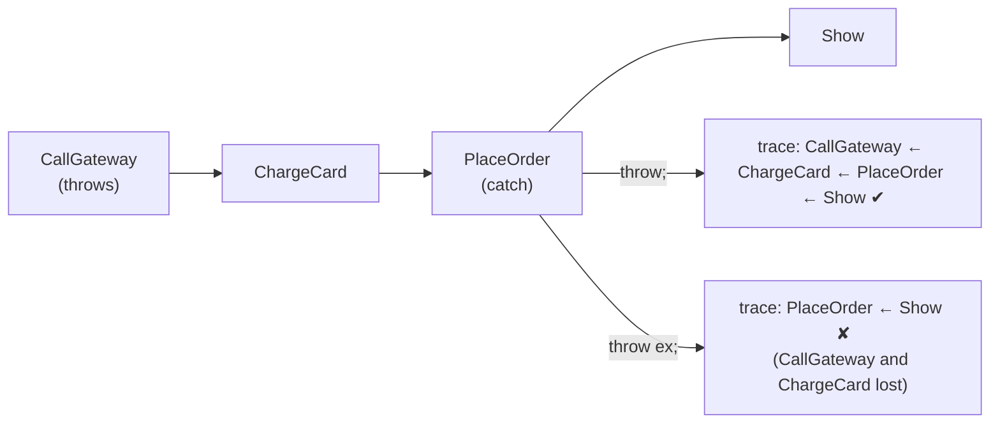

The diagram compares the two traces: `throw;` keeps the frames where the error happened, `throw ex;` drops them.

### Code

```csharp
using System.Diagnostics;
using System.Runtime.CompilerServices;
using System.Runtime.ExceptionServices;

namespace Chapter02.Topics;

public class PaymentFailedException(string message, Exception inner) : Exception(message, inner);

public static class T11_ThrowVsThrowEx
{
    // NoInlining keeps each method as its own stack frame so the demo prints the same in Debug and Release

    [MethodImpl(MethodImplOptions.NoInlining)]
    private static void CallGateway() => throw new TimeoutException("Gateway did not answer in 30s.");

    [MethodImpl(MethodImplOptions.NoInlining)]
    private static void ChargeCard() => CallGateway();

    [MethodImpl(MethodImplOptions.NoInlining)]
    private static void PlaceOrder_Rethrow()
    {
        try { ChargeCard(); }
        catch (TimeoutException)
        {
            throw;            // rethrows the SAME exception, stack trace kept
        }
    }

    [MethodImpl(MethodImplOptions.NoInlining)]
    private static void PlaceOrder_ThrowEx()
    {
        try { ChargeCard(); }
        catch (TimeoutException ex)
        {
#pragma warning disable CA2200 // the analyzer warns about exactly this bug
            throw ex;         // throws it AGAIN from here: stack trace restarts at this line
#pragma warning restore CA2200
        }
    }

    [MethodImpl(MethodImplOptions.NoInlining)]
    private static void PlaceOrder_Wrap()
    {
        try { ChargeCard(); }
        catch (TimeoutException ex)
        {
            throw new PaymentFailedException("Payment for order #1001 failed.", ex);   // new exception, original inside
        }
    }

    // Capture now, rethrow later (e.g. after cleanup or on another thread), keeping the original trace
    [MethodImpl(MethodImplOptions.NoInlining)]
    private static void PlaceOrder_CaptureAndRethrowLater()
    {
        ExceptionDispatchInfo? captured = null;
        try { ChargeCard(); }
        catch (TimeoutException ex) { captured = ExceptionDispatchInfo.Capture(ex); }

        Console.WriteLine("  (cleanup ran between catch and rethrow)");
        captured?.Throw();
    }

    // Prints only method names from the stack trace (file paths and line numbers differ per machine)
    private static string Frames(Exception ex) =>
        string.Join(" <- ", new StackTrace(ex).GetFrames()
            .Select(f => f.GetMethod()?.Name ?? "?")
            .Where(n => !n.StartsWith("<") && n != "Throw"));

    private static void Show(string label, Action placeOrder)
    {
        Console.WriteLine(label);
        try { placeOrder(); }
        catch (Exception ex)
        {
            Console.WriteLine($"  {ex.GetType().Name} frames: {Frames(ex)}");
            if (ex.InnerException is { } inner)
                Console.WriteLine($"  Inner {inner.GetType().Name} frames: {Frames(inner)}");
        }
    }

    public static void Run()
    {
        Show("throw;", PlaceOrder_Rethrow);
        Show("throw ex;", PlaceOrder_ThrowEx);
        Show("throw new ...(msg, ex);", PlaceOrder_Wrap);
        Show("ExceptionDispatchInfo.Capture(ex).Throw():", PlaceOrder_CaptureAndRethrowLater);
    }
}
```

> `[MethodImpl(MethodImplOptions.NoInlining)]` tells the JIT not to merge a small method into its caller. Without it, in a Release build, tiny methods like `ChargeCard` could disappear from the trace. `public class PaymentFailedException(string message, Exception inner) : Exception(message, inner);` is a one-line class using a primary constructor (C# 12). `inner is { } inner` means "not null, and call it `inner`".

**Output** (only method names are printed; a real `ex.ToString()` also shows file names and line numbers):

```text
throw;
  TimeoutException frames: CallGateway <- ChargeCard <- PlaceOrder_Rethrow <- Show
throw ex;
  TimeoutException frames: PlaceOrder_ThrowEx <- Show
throw new ...(msg, ex);
  PaymentFailedException frames: PlaceOrder_Wrap <- Show
  Inner TimeoutException frames: CallGateway <- ChargeCard <- PlaceOrder_Wrap
ExceptionDispatchInfo.Capture(ex).Throw():
  (cleanup ran between catch and rethrow)
  TimeoutException frames: CallGateway <- ChargeCard <- PlaceOrder_CaptureAndRethrowLater <- PlaceOrder_CaptureAndRethrowLater <- Show
```

### Common mistakes / gotchas

- **`throw ex;`**: loses the original frames. Turn on analyzer rule **CA2200** as an error.
- **Wrapping without the inner exception:** `throw new PaymentFailedException("Payment failed");` (no `ex`) loses the cause completely.
- **Logging `ex.Message` instead of the whole exception.** The message has no stack trace and no inner exceptions. Pass the exception object to the logger (topic 14), or use `ex.ToString()`.
- **Catching only to rethrow:** `catch (Exception) { throw; }` with nothing else in the block is pointless noise. Remove it.
- **Wrapping at every layer.** Five levels of `InnerException` make logs hard to read. Wrap only where you add meaningful context (usually at a boundary between layers, e.g. infrastructure → domain).

### 5-YOE depth

- **Release builds and inlining:** the JIT can inline small methods, so they're missing from stack traces in Release (*runtime behaviour*). Line numbers come from PDB (symbol) files: deploy them (or use embedded PDBs) so production traces have line numbers.
- **Line numbers with `throw;`:** in the old .NET Framework, `throw;` inside the **same** method that threw could replace that frame's line number with the rethrow line. Modern .NET keeps the original location (verified on .NET 10: the trace still points at the original `throw new` line). It's a nice detail if an interviewer has a .NET Framework background.
- **Async stack traces:** since .NET Core 2.1, async traces are cleaned up (no more state-machine noise like `MoveNext`), and `await` rethrows with `ExceptionDispatchInfo`, so the original frames are kept (Chapter 5).
- **`Exception.Data`** is a dictionary on every exception where you can attach context (`ex.Data["OrderId"] = 1001`) without wrapping. Structured logging scopes are usually a better tool (Chapter 8).
- **`ex.StackTrace` is null until the exception is thrown.** An exception created with `new` but never thrown has no trace. (Topic 14's logger prints "has stack trace" for this reason.)
- **`throw;` inside a nested `try` in a catch** rethrows the exception of the **innermost** catch currently executing. Keep rethrow code simple.

### Interview questions

1. **Difference between `throw` and `throw ex`?**
   `throw;` rethrows the current exception with its original stack trace. `throw ex;` throws it again from the current line, resetting the trace and losing the frames where the error actually happened.
2. **How do you add context to an exception without losing the original?**
   Wrap it: `throw new PaymentFailedException("Payment for order 1001 failed", ex);`. The original exception, with its full trace, is in `InnerException`, and loggers print the whole chain.
3. **What is `ExceptionDispatchInfo` used for?**
   To capture an exception and rethrow it later, possibly on another thread, while preserving the original stack trace. `await` uses it internally.
4. **Why might a method be missing from a production stack trace?**
   The JIT may have inlined it in a Release build, or a `throw ex;` somewhere reset the trace. Missing line numbers usually mean the PDB files weren't deployed.
5. **What analyzer rule catches `throw ex`?**
   CA2200, "Rethrow to preserve stack details".

---

## 2.12 Expected errors vs exceptional failures (Result pattern vs exceptions)

### What it is

Not every failure is "exceptional":

- **Expected errors** (business outcomes): a coupon code doesn't exist, a coupon has expired, the order total is below the minimum, an email is already registered, stock is insufficient. They happen **every day** in normal use, and you know exactly how to respond.
- **Exceptional failures** (unexpected problems): the database is unreachable, a config value is missing, a bug causes a `NullReferenceException`, the disk is full. The current code **can't** do anything sensible about them.

The **Result pattern** means returning an object that says "success, here is the value" **or** "failure, here is the error", instead of throwing for expected errors:

```csharp
Result<decimal> result = ApplyCoupon("DIWALI10", 300m, today);
if (result.IsSuccess) ... else ... result.Error.Code ...
```

**Analogy:** a shop assistant who says "sorry, that size is out of stock, here are other options" (a Result) versus pulling the fire alarm (an exception). The fire alarm is the right tool for a fire, not for an out-of-stock shirt.

### Why it matters

- **Clarity:** the method signature `Result<decimal> ApplyCoupon(...)` tells the caller "this can fail, and you must handle it". With exceptions, nothing in the signature tells you what may be thrown.
- **Performance:** throwing and catching is far more expensive than returning a value. In the demo, 100,000 invalid coupons took **217 ms** with exceptions vs **7 ms** with results (about 30×; measured once on the machine described at the top, Debug build). That's about 2 microseconds per exception: irrelevant once, significant at thousands of requests per second or in a loop over a large import file.
- **Observability:** if expected errors are exceptions, your error logs and APM dashboards fill with "errors" that aren't problems, and real incidents get buried.

### How it works

**Design guidance (a balanced view interviewers like):**

| Situation | Use |
|---|---|
| Invalid user input, business-rule violations, "not found" in a lookup | Result (or validation errors, or a `Try...` method) |
| Programming errors: null argument, impossible state | Exception (`ArgumentNullException`, `InvalidOperationException`). Fail fast. |
| Infrastructure failures: DB down, timeout, disk full | Exception. Let it propagate to the global handler, retry policies and alerts. |
| Constructors, property setters, operators | Exception (they can't return a Result) |

**Built-in examples of the same idea:** `int.TryParse`, `Dictionary.TryGetValue` and `ConcurrentQueue.TryDequeue` all return `bool` instead of throwing. `Parse`/indexer versions throw. .NET gives you both and you choose based on whether failure is expected.

**In an API**, the endpoint maps result error codes to HTTP status codes: `coupon.not_found` → 404, rule violations → 422 (or 400/409), success → 200. Exceptions go to the global exception handler → 500/503.

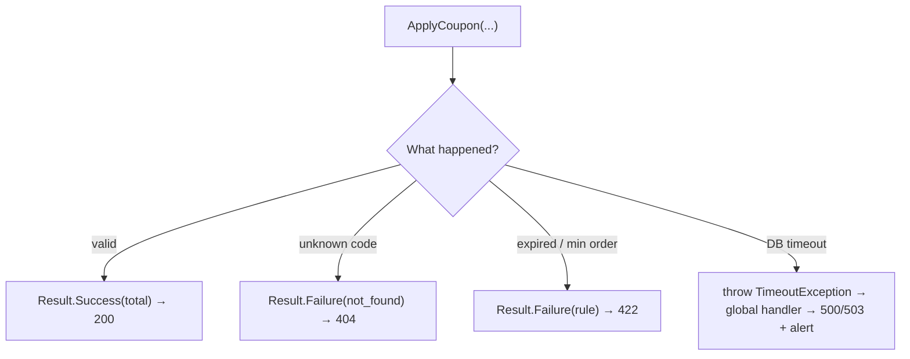

The flowchart shows the split: expected outcomes become results with specific status codes, and only the infrastructure failure becomes an exception.

### Code

```csharp
using System.Diagnostics;

namespace Chapter02.Topics;

// ---- A small Result type ----
public record Error(string Code, string Message);

public readonly record struct Result<T>
{
    public T? Value { get; }
    public Error? Error { get; }
    public bool IsSuccess => Error is null;

    private Result(T? value, Error? error) { Value = value; Error = error; }

    public static Result<T> Success(T value) => new(value, null);
    public static Result<T> Failure(Error error) => new(default, error);
}

public record Coupon(string Code, decimal Percent, decimal MinOrder, DateOnly ExpiresOn);

public static class T12_ResultPattern
{
    private static readonly Dictionary<string, Coupon> Coupons = new(StringComparer.OrdinalIgnoreCase)
    {
        ["DIWALI10"] = new("DIWALI10", 10m, 500m, new DateOnly(2026, 11, 15)),
        ["SUMMER20"] = new("SUMMER20", 20m, 1_000m, new DateOnly(2026, 6, 30)),
    };

    private static bool _databaseDown;

    // Expected outcomes (unknown code, expired, minimum not met) are RETURNED as errors.
    // A truly unexpected failure (database unreachable) is THROWN.
    private static Result<decimal> ApplyCoupon(string code, decimal orderTotal, DateOnly today)
    {
        if (_databaseDown) throw new TimeoutException("Coupon database did not respond.");

        if (!Coupons.TryGetValue(code, out var coupon))
            return Result<decimal>.Failure(new("coupon.not_found", $"Coupon '{code}' does not exist."));
        if (today > coupon.ExpiresOn)
            return Result<decimal>.Failure(new("coupon.expired", $"Coupon '{coupon.Code}' expired on {coupon.ExpiresOn:yyyy-MM-dd}."));
        if (orderTotal < coupon.MinOrder)
            return Result<decimal>.Failure(new("coupon.min_order", $"Add {coupon.MinOrder - orderTotal} more to use '{coupon.Code}'."));

        return Result<decimal>.Success(orderTotal - orderTotal * coupon.Percent / 100);
    }

    // What an API endpoint would do with the result: map error codes to HTTP status codes
    private static string ToHttpResponse(Result<decimal> result) => result switch
    {
        { IsSuccess: true } => $"200 OK, new total {result.Value}",
        { Error.Code: "coupon.not_found" } => $"404 Not Found: {result.Error.Message}",
        _ => $"422 Unprocessable: {result.Error!.Message}",
    };

    public static void Run()
    {
        var today = new DateOnly(2026, 10, 20);
        Console.WriteLine($"DIWALI10 on 800:  {ToHttpResponse(ApplyCoupon("diwali10", 800m, today))}");
        Console.WriteLine($"DIWALI10 on 300:  {ToHttpResponse(ApplyCoupon("DIWALI10", 300m, today))}");
        Console.WriteLine($"SUMMER20 on 2000: {ToHttpResponse(ApplyCoupon("SUMMER20", 2_000m, today))}");
        Console.WriteLine($"FREE100:          {ToHttpResponse(ApplyCoupon("FREE100", 800m, today))}");

        _databaseDown = true;
        try { ApplyCoupon("DIWALI10", 800m, today); }
        catch (TimeoutException ex) { Console.WriteLine($"Database down:    exception -> global handler -> 500/503 ({ex.Message})"); }
        _databaseDown = false;

        // The built-in version of the same idea: TryParse instead of Parse
        string[] quantitiesFromCsv = ["3", "two", "-1", "5"];
        foreach (var raw in quantitiesFromCsv)
            Console.WriteLine($"  qty '{raw}': {(int.TryParse(raw, out var q) && q > 0 ? $"ok {q}" : "rejected")}");

        // ---- Cost: an exception is far more expensive than a returned value ----
        const int iterations = 100_000;
        try { ApplyCouponThrowing("NOPE"); } catch (KeyNotFoundException) { }   // warm-up (JIT) so it is not timed
        _ = ApplyCoupon("NOPE", 800m, today);

        var sw = Stopwatch.StartNew();
        for (int i = 0; i < iterations; i++)
        {
            try { ApplyCouponThrowing("NOPE"); } catch (KeyNotFoundException) { }
        }
        var throwTime = sw.Elapsed;

        sw.Restart();
        for (int i = 0; i < iterations; i++)
            _ = ApplyCoupon("NOPE", 800m, today);
        var resultTime = sw.Elapsed;

        Console.WriteLine($"{iterations:N0} invalid coupons: throw/catch {throwTime.TotalMilliseconds:N0} ms, Result {resultTime.TotalMilliseconds:N0} ms");
    }

    private static void ApplyCouponThrowing(string code)
    {
        if (!Coupons.ContainsKey(code)) throw new KeyNotFoundException($"Coupon '{code}' does not exist.");
    }
}
```

> `readonly record struct Result<T>` is a small immutable value type with generated equality. The `switch` expression with `{ IsSuccess: true }` and `{ Error.Code: "coupon.not_found" }` uses **property patterns** (C# 8; nested `Error.Code` form is C# 10).

**Output** (the last line's timings are a measurement and will differ on your machine):

```text
DIWALI10 on 800:  200 OK, new total 720
DIWALI10 on 300:  422 Unprocessable: Add 200 more to use 'DIWALI10'.
SUMMER20 on 2000: 422 Unprocessable: Coupon 'SUMMER20' expired on 2026-06-30.
FREE100:          404 Not Found: Coupon 'FREE100' does not exist.
Database down:    exception -> global handler -> 500/503 (Coupon database did not respond.)
  qty '3': ok 3
  qty 'two': rejected
  qty '-1': rejected
  qty '5': ok 5
1,00,000 invalid coupons: throw/catch 217 ms, Result 7 ms
```

### Common mistakes / gotchas

- **Using exceptions for validation.** `throw new ValidationException("Email already exists")` on every duplicate sign-up is slow, noisy in logs, and hides the possible outcomes from the method signature.
- **Using Result for everything**, including DB-down and bugs. Now every caller has to check and forward infrastructure errors by hand, and it's easy to ignore a failed result by mistake. Truly exceptional failures should stay exceptions.
- **Ignoring the result.** Unlike an exception, a `Result` can be silently ignored. Code review (or analyzers in Result libraries) must catch `ApplyCoupon(...);` with the return value discarded.
- **Accessing `.Value` on a failure.** Make the API safe: `Value` returns default on failure here; some libraries throw on access, others force a `Match(onSuccess, onFailure)`.
- **Stringly-typed errors.** Use stable error **codes** (`coupon.expired`) that clients and tests can rely on, not just messages.

### 5-YOE depth

- **This is a design debate, not a rule.** A strong answer: "Exceptions for exceptional, unexpected or programming errors; results for expected business outcomes that the caller must handle. At the API boundary both become `ProblemDetails`. I keep the decision consistent within a codebase."
- **Libraries:** FluentResults, ErrorOr and OneOf are popular. Many teams write a 30-line `Result<T>` like the one above. In ASP.NET Core, `TypedResults` and `Results<Ok<T>, NotFound, ValidationProblem>` (.NET 7) make result-to-HTTP mapping type-safe (Chapter 7).
- **Exception cost details (runtime behaviour):** the cost is mainly capturing the stack trace and the two-pass search and unwind. .NET 9 rewrote exception handling in managed code, and Microsoft reported it as roughly 2–4× faster than .NET 8. It's still much more expensive than a return.
- **Validation is its own category:** model validation (data annotations, FluentValidation) returns **all** field errors at once as a 400 `ValidationProblemDetails`, before your business logic runs (Chapter 7). Results are for rules that need data (e.g. "coupon expired").
- **Exceptions and transactions:** throwing inside a unit of work naturally rolls back (the transaction is never committed). With results, make sure a failure path doesn't accidentally call `SaveChanges` (Chapters 11 and 15).
- **"Not found":** a `GetById` returning `null`/`Result.NotFound` is usually better than `throw new NotFoundException()`. But a `NotFoundException` mapped to 404 by a global handler is a common, accepted pattern in many codebases. Know both and their trade-offs.

### Interview questions

1. **When should you throw an exception, and when return an error?**
   Throw for unexpected or unrecoverable situations at that level: programming errors, infrastructure failures, broken invariants. Return a result for expected business outcomes the caller must handle: invalid coupon, insufficient stock, duplicate email.
2. **Why not use exceptions for validation?**
   They're expensive (stack trace capture, unwinding), they hide possible outcomes from the method signature, they pollute error logs and monitoring, and they're easy to catch too broadly.
3. **What is the Result pattern?**
   A return type that holds either a success value or an error (code + message). The caller checks `IsSuccess` or pattern-matches. `TryParse`/`TryGetValue` are built-in examples of the same idea.
4. **What are the downsides of the Result pattern?**
   More code at every call site, results can be ignored by mistake, and there's no automatic propagation, so each layer must forward failures. Overusing it for infrastructure errors makes code noisy.
5. **How do results and exceptions become HTTP responses?**
   The endpoint maps result error codes to 404/409/422 with `ProblemDetails`. Unhandled exceptions are caught by global exception-handling middleware (`IExceptionHandler`), logged once, and returned as 500 with a trace id.

---

## 2.13 IDisposable, using statements and unmanaged resources

### What it is

The .NET **garbage collector (GC)** automatically frees **memory** that's no longer used. But some objects hold things that **aren't** .NET memory:

- open **files** (an operating-system file handle),
- **database connections**,
- **network sockets**,
- native memory or handles from C libraries.

These are called **unmanaged resources**: the GC doesn't know how to release them, or releases them only "eventually". Holding them too long causes real failures: locked files, an exhausted connection pool, too many open sockets.

**`IDisposable`** is the interface for "this object holds something that must be released **now**, deterministically":

```csharp
public interface IDisposable { void Dispose(); }
```

**`using`** guarantees `Dispose()` is called, even if an exception is thrown:

```csharp
using var report = new CsvReportWriter(path, "report");   // using declaration (C# 8): disposed at the end of the scope
using (var conn = new SqlConnection(cs)) { ... }          // using statement: disposed at the closing brace
```

**Analogy:** a library book. Garbage collection is the library eventually noticing that a book has gone missing. `Dispose` is returning it on time so the next person can borrow it.

### Why it matters

**Real bug (shown in the demo):** a report generator created a `FileStream` and never disposed it. The nightly upload job then failed with `IOException: the process cannot access the file because it is being used by another process`.

Other classic production incidents:

- `SqlConnection` not disposed → the connection pool (default max 100) runs out → "Timeout expired. The timeout period elapsed prior to obtaining a connection from the pool."
- `new HttpClient()` per request and dispose → sockets stay in `TIME_WAIT` → **socket exhaustion** under load (more below).

### How it works

**`using` is compiler shorthand for `try/finally`** (*language rule*):

```csharp
using var report = new CsvReportWriter(path, "report");
report.WriteRow(1001, 2_500m);

// becomes roughly:
var report = new CsvReportWriter(path, "report");
try
{
    report.WriteRow(1001, 2_500m);
}
finally
{
    report?.Dispose();
}
```

Several `using` declarations in one scope are disposed in **reverse order** (the last created is disposed first: `second` before `first` in the demo), because each one is a nested `try/finally`.

**Two cases when implementing `IDisposable`:**

1. **You own other disposable objects** (the common case, 99% of business code): a `FileStream`, a `DbConnection`, a `Timer`. Implement `Dispose()` to dispose them. **No finalizer needed.** Make the class `sealed` and the implementation is simple (like `CsvReportWriter`).
2. **You directly own a raw unmanaged handle** (an `IntPtr` from a native API: rare). Wrap it in a **`SafeHandle`** subclass. `SafeHandle` has a finalizer built in, so the handle is released even if someone forgets to dispose. That's what `NativeLabelPrinter` does.

**What's a finalizer?** A method `~ClassName() { ... }` that the GC calls **some time** after an object becomes unreachable, on a special finalizer thread. It's a safety net, not a cleanup strategy: the timing is unpredictable, and objects with finalizers survive an extra GC cycle, which costs performance.

**The classic full "Dispose pattern"** (for non-sealed classes meant to be inherited):

```csharp
public class ReportExporter : IDisposable
{
    private readonly FileStream _file = new("export.csv", FileMode.Create);
    private bool _disposed;

    public void Dispose()
    {
        Dispose(disposing: true);
        GC.SuppressFinalize(this);   // a finalizer (if any, here or in a subclass) is no longer needed
    }

    protected virtual void Dispose(bool disposing)
    {
        if (_disposed) return;
        if (disposing)
        {
            _file.Dispose();         // managed objects: only touch them when called from Dispose()
        }
        // raw unmanaged resources would be freed here (better: use a SafeHandle instead)
        _disposed = true;
    }
}
```

`disposing` is `true` when called from `Dispose()` and `false` when called from a finalizer. From a finalizer, other managed objects may already have been finalized, so you must not touch them.

**Rules of a good `Dispose` (design guidance from the .NET guidelines):**

- Safe to call **more than once** (the second call does nothing).
- Doesn't throw, as far as possible.
- After disposal, other members throw `ObjectDisposedException` (`ObjectDisposedException.ThrowIf(_disposed, this)` is a .NET 7 helper).

**`IAsyncDisposable` / `await using`** (C# 8, .NET Core 3.0): for resources whose cleanup involves I/O, like flushing a stream to the network. `DbContext`, `SqlConnection`, `Stream` and `Utf8JsonWriter` implement it. Chapter 5.

### Code

```csharp
using Microsoft.Win32.SafeHandles;
using System.Runtime.InteropServices;

namespace Chapter02.Topics;

// ---- The common case: a class that OWNS another IDisposable (here a FileStream) ----
// No finalizer needed: FileStream already cleans up its own OS handle.
public sealed class CsvReportWriter : IDisposable
{
    private readonly StreamWriter _writer;
    private readonly string _name;
    private bool _disposed;

    public CsvReportWriter(string path, string name)
    {
        _name = name;
        _writer = new StreamWriter(new FileStream(path, FileMode.Create, FileAccess.Write, FileShare.None));
        _writer.WriteLine("OrderId,Total");
    }

    public void WriteRow(int orderId, decimal total)
    {
        ObjectDisposedException.ThrowIf(_disposed, this);   // .NET 7+
        if (total < 0) throw new ArgumentOutOfRangeException(nameof(total), "Total cannot be negative.");
        _writer.WriteLine($"{orderId},{total}");
    }

    public void Dispose()
    {
        if (_disposed) return;          // Dispose must be safe to call twice
        _writer.Dispose();              // flushes buffered text and closes the file handle
        _disposed = true;
        Console.WriteLine($"  [{_name}] disposed");
    }
}

// ---- The rare case: a class that DIRECTLY owns an unmanaged handle ----
// Best practice: wrap the raw handle in a SafeHandle. SafeHandle has the finalizer, so this class does not need one.
public sealed class NativeLabelPrinter : IDisposable
{
    private readonly SafeHandle _handle;

    public NativeLabelPrinter()
    {
        // In real code this would come from a native "open printer" call via P/Invoke.
        // Here we allocate unmanaged memory as a stand-in for a native resource.
        IntPtr raw = Marshal.AllocHGlobal(64);
        _handle = new UnmanagedMemoryHandle(raw);
    }

    public bool IsOpen => !_handle.IsClosed;
    public void Dispose() => _handle.Dispose();

    private sealed class UnmanagedMemoryHandle : SafeHandleZeroOrMinusOneIsInvalid
    {
        public UnmanagedMemoryHandle(IntPtr existing) : base(ownsHandle: true) => SetHandle(existing);
        protected override bool ReleaseHandle()
        {
            Marshal.FreeHGlobal(handle);   // runs from Dispose OR, if someone forgot, from the finalizer
            return true;
        }
    }
}

public static class T13_Disposable
{
    public static void Run()
    {
        string folder = Path.Combine(Path.GetTempPath(), "chapter02-reports");
        Directory.CreateDirectory(folder);
        string path = Path.Combine(folder, "daily-sales.csv");

        // ---- Bug: forgetting to dispose keeps the file locked ----
        var leaked = new FileStream(path, FileMode.Create, FileAccess.Write, FileShare.None);   // never disposed (yet)
        try
        {
            using var uploader = new FileStream(path, FileMode.Open, FileAccess.Read);           // e.g. the upload job
        }
        catch (IOException)
        {
            Console.WriteLine("Upload job: IOException, the file is still locked by an undisposed FileStream");
        }
        leaked.Dispose();

        // ---- using declaration: disposed at the end of the enclosing scope ----
        {
            using var report = new CsvReportWriter(path, "report");
            report.WriteRow(1001, 2_500m);
            report.WriteRow(1002, 799m);
            Console.WriteLine("  rows written, leaving scope...");
        }
        Console.WriteLine($"File content after dispose: {File.ReadAllText(path).Replace(Environment.NewLine, " | ")}");

        // ---- using also disposes when an exception is thrown ----
        try
        {
            using var report = new CsvReportWriter(path, "report-with-error");
            report.WriteRow(1003, 100m);
            report.WriteRow(1004, -1m);   // throws
        }
        catch (ArgumentOutOfRangeException)
        {
            Console.WriteLine("  caught the exception AFTER dispose ran");
        }

        // ---- Several usings: disposed in reverse order ----
        {
            using var first = new CsvReportWriter(Path.Combine(folder, "a.csv"), "first");
            using var second = new CsvReportWriter(Path.Combine(folder, "b.csv"), "second");
            Console.WriteLine("  leaving scope with two writers...");
        }

        // ---- Using an object after Dispose ----
        var closed = new CsvReportWriter(path, "closed");
        closed.Dispose();
        closed.Dispose();                 // second call is harmless
        try { closed.WriteRow(1, 1m); }
        catch (ObjectDisposedException) { Console.WriteLine("WriteRow after Dispose: ObjectDisposedException"); }

        // ---- SafeHandle-based wrapper ----
        var printer = new NativeLabelPrinter();
        Console.WriteLine($"Native printer open: {printer.IsOpen}");
        printer.Dispose();
        Console.WriteLine($"Native printer open after Dispose: {printer.IsOpen}");

        Directory.Delete(folder, recursive: true);
    }
}
```

> `using Microsoft.Win32.SafeHandles;` brings in `SafeHandleZeroOrMinusOneIsInvalid`, a ready-made base class for handles where 0 or -1 means "invalid". `Marshal.AllocHGlobal` allocates unmanaged memory; here it stands in for a real native resource.

**Output:**

```text
Upload job: IOException, the file is still locked by an undisposed FileStream
  rows written, leaving scope...
  [report] disposed
File content after dispose: OrderId,Total | 1001,2500 | 1002,799 | 
  [report-with-error] disposed
  caught the exception AFTER dispose ran
  leaving scope with two writers...
  [second] disposed
  [first] disposed
  [closed] disposed
WriteRow after Dispose: ObjectDisposedException
Native printer open: True
Native printer open after Dispose: False
```

### Common mistakes / gotchas

- **Forgetting `using`** on `FileStream`, `StreamWriter`, `SqlConnection`, `SqlCommand`, `SqlDataReader`, `Process`, `CancellationTokenSource`, `Timer`, `MemoryStream`... (Some, like `MemoryStream`, release nothing important, but disposing everything that implements `IDisposable` is the safe habit.)
- **Disposing something you don't own.** If an object was **injected** by the DI container, **the container** disposes it at the end of its scope. Calling `Dispose()` yourself breaks other users of the same instance (e.g. a scoped `DbContext` used by two services in one request).
- **`new HttpClient()` in a `using` per request.** Disposing closes the connection, but the OS keeps each socket in `TIME_WAIT` for a while (often up to a few minutes, OS-dependent). Under load, you run out of sockets. Use `IHttpClientFactory` (typed clients), or one long-lived `HttpClient` with `SocketsHttpHandler.PooledConnectionLifetime` set so DNS changes are picked up (Chapter 20).
- **Writing a finalizer when you don't own an unmanaged handle.** It only adds GC cost. Most classes never need one.
- **Returning a disposable from inside a `using` block:** `using var conn = ...; return conn;` returns an already-disposed object.
- **Lazy sequences and `using`:** returning a `yield` iterator that reads from a `using` stream is fine (the iterator disposes when the loop ends), but returning `reader.ReadLines()` from **inside** a `using` block in a normal method disposes the reader before the caller loops.

### 5-YOE depth

- **Who disposes what in ASP.NET Core:** the DI container tracks disposable **transient** and **scoped** services it creates and disposes them at the end of the request scope. Singletons are disposed when the app shuts down. Transient disposables resolved from the **root** provider are kept until shutdown, which is a memory leak pattern (Chapter 6).
- **`SafeHandle` over finalizers.** It already contains a correct finalizer (it's a "critical" finalizer object, run after ordinary finalizers), it reference-counts the handle so it can't be freed while a native call is still using it, and it removes the need for the full Dispose pattern in most classes. Note: in modern .NET, finalizers are **not** run when the process exits (*runtime behaviour*). Another reason never to rely on them.
- **Connection pooling:** `SqlConnection.Dispose()` doesn't close the TCP connection. It returns it to the **pool** for reuse. That's why "open late, dispose early" is cheap and right (Chapter 16).
- **`Dispose` vs `Close`:** for streams and connections they do the same thing; `Close` is just the domain-friendly name.
- **`await using` and `ConfigureAwait(false)`:** library code can apply `ConfigureAwait(false)` to the disposal too (`await using var s = stream.ConfigureAwait(false);`). It's mostly irrelevant in ASP.NET Core, which has no synchronization context (Chapter 5).
- **Finalizers cost (runtime behaviour):** an object with a finalizer is put on a finalization queue when created and survives at least one extra GC (it's promoted to an older generation). That's why `GC.SuppressFinalize(this)` in `Dispose` matters for classes that do have a finalizer.
- **Disposable structs:** a `using` on a struct calls `Dispose` without boxing (the compiler calls it directly). High-performance struct enumerators and buffer wrappers rely on this.

### Interview questions

1. **What is `IDisposable` for, if .NET has a garbage collector?**
   The GC only manages memory, and only on its own schedule. `IDisposable` releases unmanaged or scarce resources (file handles, DB connections, sockets) deterministically, at a time you choose.
2. **What does `using` compile to?**
   A `try/finally` that calls `Dispose()` in the `finally`, so disposal happens even if an exception is thrown. Several usings in one scope are disposed in reverse order.
3. **When do you need a finalizer?**
   Almost never: only when your class directly owns a raw unmanaged handle, and even then you should wrap it in a `SafeHandle`, which has its own finalizer. Classes that only own other `IDisposable` objects just implement `Dispose()`.
4. **Explain the Dispose pattern and `GC.SuppressFinalize`.**
   `Dispose()` calls `Dispose(true)` then `GC.SuppressFinalize(this)`. The finalizer (if any) calls `Dispose(false)`. With `disposing == true` you release managed and unmanaged resources; with `false` (from the finalizer) only unmanaged ones. `SuppressFinalize` tells the GC the finalizer doesn't need to run, which saves an extra GC cycle.
5. **Should you wrap `HttpClient` in `using`?**
   Not per request. Disposing it closes connections, but the sockets linger in `TIME_WAIT`, and many short-lived clients cause socket exhaustion. Use `IHttpClientFactory` or a long-lived client with `PooledConnectionLifetime`.
6. **Should you dispose a `DbContext` injected into your service?**
   No. The DI container created it and will dispose it at the end of the scope. Only dispose what you create.

---

## 2.14 Logging exceptions without swallowing or duplicating them

### What it is

When an exception happens in production, the **log** is often the only evidence you'll have. Good exception logging means:

- **Every real failure is logged exactly once**,
- **with the full exception** (type, message, stack trace, inner exceptions),
- **with business context** (order id, user id, tenant), as structured data,
- **at the right level** (Error for real failures, Information or Warning for expected events).

Two opposite mistakes break this:

- **Swallowing:** catching an exception and doing nothing (or not logging it). The failure becomes invisible.
- **Duplicating:** catching, logging and rethrowing at **every** layer. One failure produces 3–5 log entries, alerts fire several times, and the logs are hard to read.

**Key terms:**

- **`ILogger<T>`**: the standard .NET logging interface (from `Microsoft.Extensions.Logging`). You call `logger.LogError(...)`, and configured **providers** (console, Serilog, Application Insights, OpenTelemetry) write the entries somewhere.
- **Structured logging**: instead of a flat string, each entry stores named values (`OrderId = 1003`) that you can search and filter on, e.g. "show all errors for OrderId 1003".
- **Message template**: `"Checkout failed for order {OrderId}"`. The `{OrderId}` placeholder is filled from the arguments **and** stored as a named property.
- **Boundary**: the outermost place where an operation starts and ends: the ASP.NET Core exception middleware for HTTP requests, or the loop of a background worker or message consumer.

### Why it matters

- **Swallowed exceptions cause silent data corruption.** In the demo, `SwallowingPaymentService` returned "paid" when the gateway failed: the order would ship with no money taken, and there were **0** log entries.
- **Duplicate logging wastes money and attention.** One failure produced **3** error entries in the demo, one of them without a stack trace. Log ingestion is often billed per GB, and on-call engineers learn to ignore noisy alerts.

### How it works

**The rule of thumb (design guidance):** *handle it, or let it go up; log at the boundary.*

At each `catch`, choose **one**:

| You can... | Do this | Log? |
|---|---|---|
| **Handle it** (retry, use a fallback, return a meaningful result) | Handle it | Yes: **Warning**/**Information**, because it was handled ("Shipping-rate API returned 503, used the cached rate") |
| **Add context** | Wrap: `throw new PaymentFailedException("...order 1003...", ex)` | **No**: the boundary will log it |
| **Neither** | Don't catch at all | No |
| **You *are* the boundary** | Catch everything, log once with the full exception, return 500 / move the message to a dead-letter queue | **Yes: Error** |

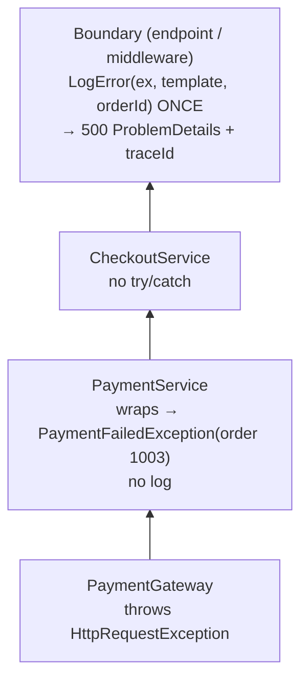

The diagram shows the exception travelling up through layers that don't log, until a single boundary logs it with full details.

**Calling `LogError` correctly:**

```csharp
// GOOD: exception object first, message template, values as arguments
logger.LogError(ex, "Checkout failed for order {OrderId}", orderId);

// BAD: no exception object, so no stack trace and no inner exception
logger.LogError(ex.Message);

// BAD: string interpolation, so OrderId isn't a searchable property, and the string is built even if Error logging is off
logger.LogError(ex, $"Checkout failed for order {orderId}");
```

**In ASP.NET Core**, the boundary already exists: `app.UseExceptionHandler()` plus an `IExceptionHandler` (.NET 8) logs unhandled exceptions and returns `ProblemDetails` (Chapter 8). Your services usually need **no** try/catch at all just for logging.

### Code

```csharp
using Microsoft.Extensions.Logging;

namespace Chapter02.Topics;

// A tiny logger provider that prints one compact line per log entry, synchronously,
// so the demo output is easy to read. In a real app you would use the built-in
// console provider, Serilog, or OpenTelemetry instead.
public sealed class CompactConsoleLoggerProvider : ILoggerProvider
{
    public static int EntriesWritten;
    public ILogger CreateLogger(string categoryName) => new CompactLogger(categoryName.Split('.')[^1]);
    public void Dispose() { }

    private sealed class CompactLogger(string category) : ILogger
    {
        public IDisposable? BeginScope<TState>(TState state) where TState : notnull => null;
        public bool IsEnabled(LogLevel logLevel) => true;

        public void Log<TState>(LogLevel logLevel, EventId eventId, TState state, Exception? exception,
            Func<TState, Exception?, string> formatter)
        {
            EntriesWritten++;
            string ex = exception is null ? "no exception attached" : $"exception: {exception.GetType().Name}, has stack trace: {exception.StackTrace is not null}";
            Console.WriteLine($"    LOG {logLevel} [{category}] {formatter(state, exception)} ({ex})");
        }
    }
}

public class PaymentGateway
{
    public void Charge(int orderId, decimal amount) =>
        throw new HttpRequestException($"Gateway returned 502 for order {orderId}.");
}

// ---- Anti-pattern 1: swallow ----
public class SwallowingPaymentService(PaymentGateway gateway)
{
    public bool Pay(int orderId, decimal amount)
    {
        try { gateway.Charge(orderId, amount); return true; }
        catch { return true; }   // "it's fine" -> the order is marked paid but no money was taken
    }
}

// ---- Anti-pattern 2: log and rethrow at every layer ----
public class NoisyPaymentService(PaymentGateway gateway, ILogger<NoisyPaymentService> logger)
{
    public void Pay(int orderId, decimal amount)
    {
        try { gateway.Charge(orderId, amount); }
        catch (Exception ex) { logger.LogError(ex, "Payment failed"); throw; }
    }
}

public class NoisyCheckoutService(NoisyPaymentService payments, ILogger<NoisyCheckoutService> logger)
{
    public void Checkout(int orderId, decimal amount)
    {
        try { payments.Pay(orderId, amount); }
        catch (Exception ex) { logger.LogError(ex.Message); throw; }   // also loses the stack trace in the log
    }
}

// ---- Good: lower layers add context (or do nothing); ONE boundary logs ----
public class PaymentService(PaymentGateway gateway)
{
    public void Pay(int orderId, decimal amount)
    {
        try { gateway.Charge(orderId, amount); }
        catch (HttpRequestException ex)
        {
            // Wrap to add business context. Do not log here: the boundary will.
            throw new PaymentFailedException($"Payment of {amount} for order {orderId} failed.", ex);
        }
    }
}

public class CheckoutService(PaymentService payments)
{
    public void Checkout(int orderId, decimal amount) => payments.Pay(orderId, amount);   // nothing to add, so no try/catch
}

public static class T14_LoggingExceptions
{
    public static void Run()
    {
        using var loggerFactory = LoggerFactory.Create(b => b.AddProvider(new CompactConsoleLoggerProvider()));
        var gateway = new PaymentGateway();

        Console.WriteLine("1) Swallowing:");
        CompactConsoleLoggerProvider.EntriesWritten = 0;
        bool paid = new SwallowingPaymentService(gateway).Pay(1001, 2_500m);
        Console.WriteLine($"   Pay returned {paid}; log entries: {CompactConsoleLoggerProvider.EntriesWritten}. Nobody knows it failed.");

        Console.WriteLine("2) Log-and-rethrow in every layer:");
        CompactConsoleLoggerProvider.EntriesWritten = 0;
        var noisy = new NoisyCheckoutService(
            new NoisyPaymentService(gateway, loggerFactory.CreateLogger<NoisyPaymentService>()),
            loggerFactory.CreateLogger<NoisyCheckoutService>());
        var endpointLogger = loggerFactory.CreateLogger("CheckoutEndpoint");
        try { noisy.Checkout(1002, 799m); }
        catch (Exception ex) { endpointLogger.LogError(ex, "Unhandled error in checkout"); }
        Console.WriteLine($"   ONE failure produced {CompactConsoleLoggerProvider.EntriesWritten} error log entries.");

        Console.WriteLine("3) Wrap with context, log once at the boundary (structured):");
        CompactConsoleLoggerProvider.EntriesWritten = 0;
        var checkout = new CheckoutService(new PaymentService(gateway));
        int orderId = 1003;
        try { checkout.Checkout(orderId, 4_100m); }
        catch (PaymentFailedException ex)
        {
            // Message TEMPLATE with named placeholders, not string interpolation.
            // The exception object is the FIRST argument, so the full stack trace and inner exception are kept.
            endpointLogger.LogError(ex, "Checkout failed for order {OrderId}", orderId);
            Console.WriteLine($"   Inner cause kept: {ex.InnerException?.Message}");
        }
        Console.WriteLine($"   Log entries: {CompactConsoleLoggerProvider.EntriesWritten}.");

        Console.WriteLine("4) Cancellation is not an error:");
        using var cts = new CancellationTokenSource();
        cts.Cancel();
        try { cts.Token.ThrowIfCancellationRequested(); }
        catch (OperationCanceledException)
        {
            endpointLogger.LogInformation("Report export cancelled by the user");
        }
    }
}
```

> `LoggerFactory.Create(b => b.AddProvider(...))` builds a logger factory outside of ASP.NET Core (in a web app, DI gives you `ILogger<T>` automatically). `CompactConsoleLoggerProvider` is a tiny custom provider for readable demo output; in real apps you configure the console provider, Serilog or OpenTelemetry instead. `catch { return true; }` without a type catches **everything**.

**Output:**

```text
1) Swallowing:
   Pay returned True; log entries: 0. Nobody knows it failed.
2) Log-and-rethrow in every layer:
    LOG Error [NoisyPaymentService] Payment failed (exception: HttpRequestException, has stack trace: True)
    LOG Error [NoisyCheckoutService] Gateway returned 502 for order 1002. (no exception attached)
    LOG Error [CheckoutEndpoint] Unhandled error in checkout (exception: HttpRequestException, has stack trace: True)
   ONE failure produced 3 error log entries.
3) Wrap with context, log once at the boundary (structured):
    LOG Error [CheckoutEndpoint] Checkout failed for order 1003 (exception: PaymentFailedException, has stack trace: True)
   Inner cause kept: Gateway returned 502 for order 1003.
   Log entries: 1.
4) Cancellation is not an error:
    LOG Information [CheckoutEndpoint] Report export cancelled by the user (no exception attached)
```

### Common mistakes / gotchas

- **Empty catch blocks** (`catch { }`), or a catch that returns a default value without logging. If you truly expect and ignore an exception, catch the **specific** type and write a comment explaining why.
- **Log-and-rethrow in every layer.** One failure, many entries. Pick one place.
- **`LogError(ex.Message)`**: no stack trace, no inner exception, no exception type. Always pass `ex` as the first argument.
- **String interpolation in log calls.** Use message templates: interpolation loses structure and costs CPU even when the level is disabled (analyzer **CA2254**).
- **Logging sensitive data:** card numbers, passwords, tokens, full request bodies with personal data. This creates compliance (PCI-DSS, GDPR) problems. Log ids, not secrets.
- **Logging `OperationCanceledException` as Error.** A user closing the browser tab isn't an incident. Log it at Information/Debug or not at all.
- **Catching in a background worker without logging**, and the worker silently stops processing messages.

### 5-YOE depth

- **Correlation:** ASP.NET Core attaches a `TraceId` (W3C trace context, via `Activity`) to every log entry in a request. Return the same `traceId` in the `ProblemDetails` response, so support can find the exact log entry from a customer's error screen. Use logging **scopes** (`using (logger.BeginScope(new { OrderId = id }))`) to attach context to every entry in a block of code (Chapter 8).
- **High-performance logging:** the `[LoggerMessage]` source generator (.NET 6) creates strongly typed, allocation-free logging methods: `[LoggerMessage(Level = LogLevel.Error, Message = "Checkout failed for order {OrderId}")] static partial void CheckoutFailed(ILogger logger, Exception ex, int orderId);`. Worth mentioning for hot paths.
- **Background services and message consumers** have no middleware. The worker loop **is** the boundary: catch per message, log once with the message id, then retry or dead-letter the message, and keep the loop alive. An unhandled exception in `ExecuteAsync` stops the host by default since .NET 6 (Chapter 19).
- **Handled ≠ invisible:** when you handle an exception (retry succeeded, fallback used), still log at Warning with context, and emit a **metric** (e.g. a retry counter). Ten retries per second is an incident even if every request eventually succeeds.
- **Exception "fingerprinting":** tools like Application Insights and Sentry group exceptions by type and stack trace. `throw ex;` (topic 11) and generic wrapper exceptions break that grouping. That's one more reason to preserve stack traces and use specific types.
- **Don't log in a `catch` and then return an error result for the same failure, only for the boundary to log it again.** Decide which layer owns logging for each kind of failure, and write it down in the team's conventions.

### Interview questions

1. **What's wrong with catching an exception and logging it in every layer before rethrowing?**
   The same failure is logged multiple times (noise, cost, duplicate alerts), and it's often logged badly in some layers (message only). Log once at the boundary; lower layers either handle it, wrap it with context, or let it propagate.
2. **What's wrong with `catch (Exception) { }`?**
   It swallows every failure, including bugs, so the system continues in a wrong state with no evidence, e.g. marking an order paid when the charge failed. Catch only what you can handle, and log what you handle.
3. **How do you log an exception correctly with `ILogger`?**
   `logger.LogError(ex, "Checkout failed for order {OrderId}", orderId);`. The exception object goes first (the full trace and inner exceptions are kept), followed by a message template with named placeholders (structured, searchable properties). Don't use interpolation and don't use `ex.Message` alone.
4. **Where is the "boundary" in an ASP.NET Core app?**
   The exception-handling middleware (`UseExceptionHandler` + `IExceptionHandler`) for HTTP requests, and the per-message `try/catch` inside a `BackgroundService` or message consumer loop.
5. **Should every caught exception be logged at Error?**
   No. Error is for failures that need attention. Handled and expected situations (a retry that succeeded, a fallback, cancellation by the client) are Warning, Information or Debug, often with a metric.
6. **What is structured logging, and why does it matter?**
   Log entries store named properties (OrderId, UserId) instead of only a flat string. You can then query "all errors for order 1003" or "error rate per tenant" in tools like Application Insights, Seq or Elasticsearch.

---

## Quick revision

**Arrays and List<T>**
- Array: fixed size, O(1) by index. `List<T>`: wraps an array; when full it allocates a bigger one (2×, starting at 4: runtime behaviour) and copies. `Add` is O(1) amortized.
- Pre-size when you know the count. Insert/remove in the middle is O(n).
- Never modify a list inside `foreach` over it (`InvalidOperationException`). Use `RemoveAll` or a backwards `for` loop.

**Dictionary / HashSet**
- Hash → bucket → compare hash, then `Equals`. O(1) average, O(n) with many collisions.
- Equal keys ⇒ equal hash codes. Never mutate a key after inserting it. A constant hash still works, but is O(n).
- `TryGetValue` over `ContainsKey` + indexer. `Add` throws on duplicates; the indexer overwrites. Use `StringComparer.OrdinalIgnoreCase` for user-typed keys.
- Order is undefined (removal + add reuses slots). String hashes are randomized per process, so never persist them. Not thread-safe for writes.

**Queue / Stack / LinkedList / Sorted / PriorityQueue**
- Queue = FIFO, Stack = LIFO, both O(1). Use the `Try...` methods on empty collections.
- LinkedList: O(1) insert/remove only if you hold the node; poor locality. LRU = Dictionary + LinkedList.
- SortedDictionary = red-black tree, O(log n); SortedList = sorted arrays, less memory, O(n) insert.
- PriorityQueue (.NET 6) = min-heap, **not stable** for equal priorities. Add a sequence number as a tie-breaker.

**Interfaces**
- `IEnumerable<T>` (loop) → `ICollection<T>` (Count/Add/Remove) → `IList<T>` (index). The read-only family: `IReadOnlyCollection<T>` → `IReadOnlyList<T>`. `IList<T>` doesn't inherit `IReadOnlyList<T>`.
- Accept the smallest interface you need; return `IReadOnlyList<T>`. Never expose an internal `List<T>`; use `AsReadOnly()` for real protection.
- Lazy `IEnumerable` runs again on every enumeration, so `ToList()` once. Read-only ≠ immutable.

**Big-O and memory**
- `List.Contains` inside a loop = O(n²); build a `HashSet`/`Dictionary` (measured: ~240× faster for 20k lookups).
- Hash collections use ~4–5× the memory of an array for ints (measured). Linked structures allocate one object per item. Small n: a scan may win, so measure with BenchmarkDotNet.

**Generics**
- Type safety, no boxing, reuse. Constraints: `class`, `struct`, `notnull`, `unmanaged`, `new()`, base class, interface, `Enum`, `Delegate`, `INumber<T>` (.NET 7).
- Reified: `List<int>` ≠ `List<string>` at runtime; static fields are per closed type. Shared native code for reference types, specialized code for value types.
- Generic equality: `EqualityComparer<T>.Default`. Open generics in DI: `typeof(IRepository<>)`. MediatR/AutoMapper are commercial since 2025.

**Variance**
- `out` = covariant (outputs only): `IEnumerable<CardPayment>` → `IEnumerable<Payment>`. `in` = contravariant (inputs only): `IComparer<Payment>` → `IComparer<CardPayment>`.
- Only interfaces and delegates, only reference-type arguments. `List<T>` is invariant. Array covariance → `ArrayTypeMismatchException` at runtime.

**Concurrent collections**
- Plain collections aren't thread-safe for writes. `ConcurrentDictionary`: lock-free reads, striped write locks, atomic single-key operations.
- `GetOrAdd`/`AddOrUpdate` factories can run more than once, so use `Lazy<T>`. Check-then-act is still a race. `Count`/`Keys` take all locks.
- `BlockingCollection` = bounded sync producer/consumer (call `CompleteAdding`). In async code use `Channel<T>`. In-memory state isn't shared across instances.

**Exceptions**
- All derive from `Exception`. Catch most specific first (CS0160 otherwise). `finally` runs on return and on throw, but not on FailFast, process kill or stack overflow.
- An exception thrown in `finally` replaces the original. Wrap with `InnerException` to add context. Guard clauses: `ThrowIfNull` (.NET 6), `ThrowIfNegative` (.NET 8).
- Catch `OperationCanceledException`, not `TaskCanceledException`.

**Custom exceptions and filters**
- Derive from `Exception`, name ends in `Exception`, 3 standard constructors + typed properties; no serialization constructor (obsolete, SYSLIB0051).
- `catch (X ex) when (cond)`: evaluated **before** unwinding, so the filter runs before inner `finally` blocks. A false filter = the catch doesn't exist. An exception inside a filter = false.

**throw vs throw ex**
- `throw;` keeps the trace. `throw ex;` resets it (CA2200). `throw new X("context", ex)` keeps the original as inner. `ExceptionDispatchInfo.Capture(ex).Throw()` rethrows later with the trace kept (what `await` uses).
- Missing frames in production: inlining in Release, or missing PDBs (no line numbers).

**Result vs exceptions**
- Expected business outcomes → Result / `Try...` / validation errors. Bugs and infrastructure failures → exceptions → global handler.
- Throwing is expensive (measured: ~30× slower than returning a result, ~2 µs per throw). Results can be ignored by mistake, so use stable error codes and map them to 404/409/422.

**IDisposable**
- The GC frees memory only; `Dispose` releases files, connections and sockets deterministically. `using` = `try/finally`; several usings dispose in reverse order.
- Owning other disposables → simple `Dispose()`, no finalizer. Owning raw handles → `SafeHandle`. Full pattern: `Dispose(bool)` + `GC.SuppressFinalize`.
- Dispose must be idempotent; afterwards members throw `ObjectDisposedException`. Don't dispose DI-injected objects. Don't create and dispose an `HttpClient` per request.

**Logging exceptions**
- Handle it, wrap it, or let it go up. Log **once** at the boundary (exception middleware / worker loop).
- `logger.LogError(ex, "Checkout failed for order {OrderId}", orderId)`: exception first, message template, no interpolation, no `ex.Message` alone.
- Never swallow silently. Cancellation isn't an error. No secrets in logs. Use a TraceId, scopes and `[LoggerMessage]` for hot paths.
