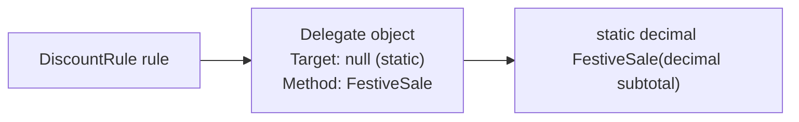
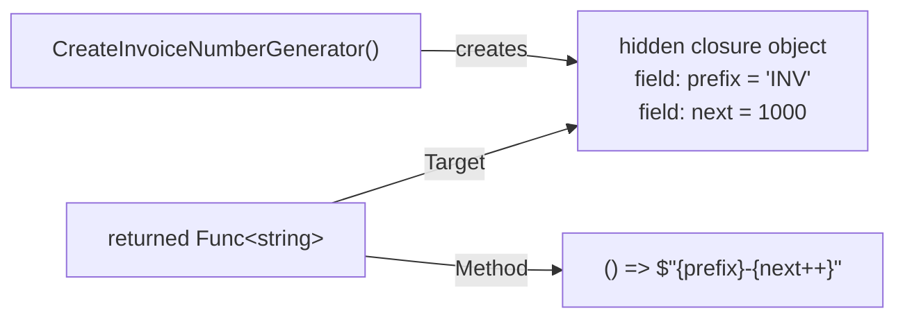
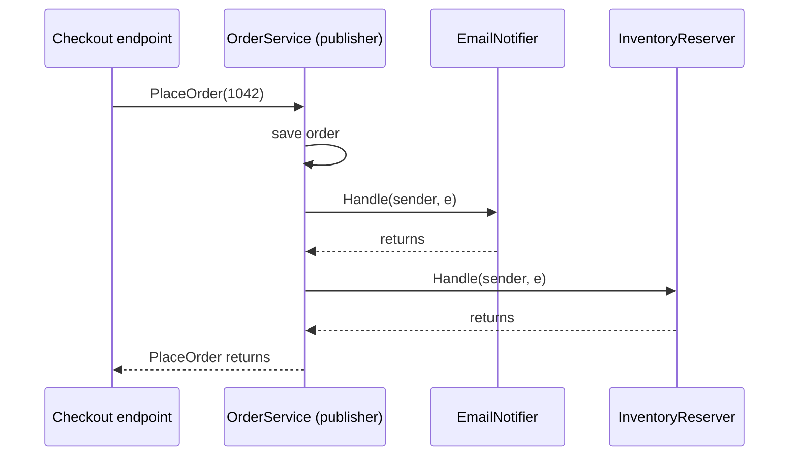
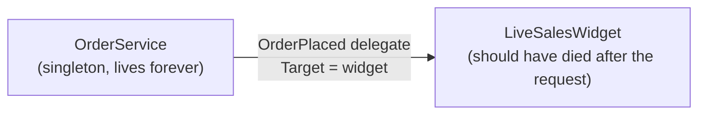
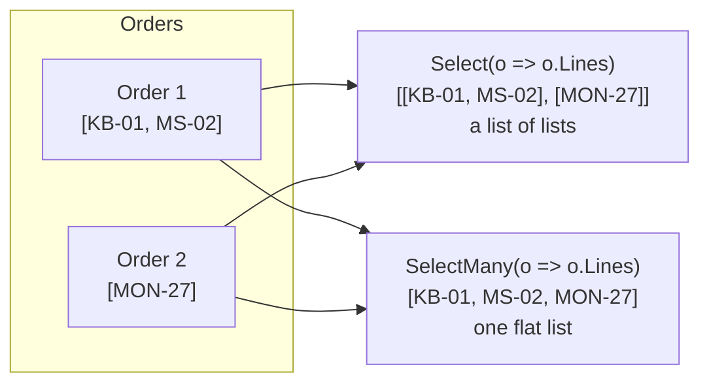
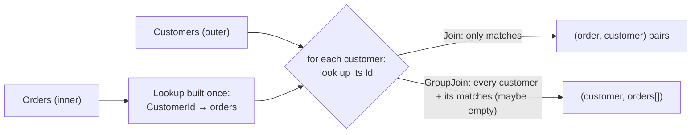
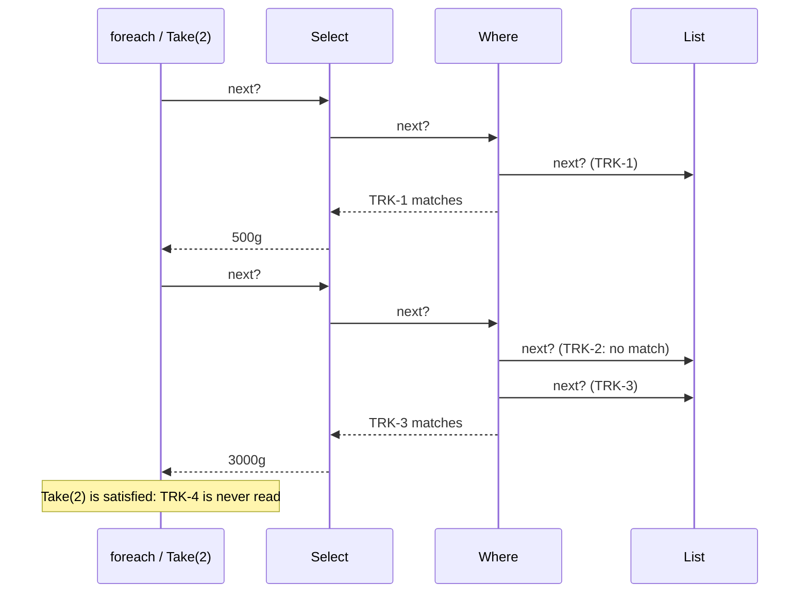
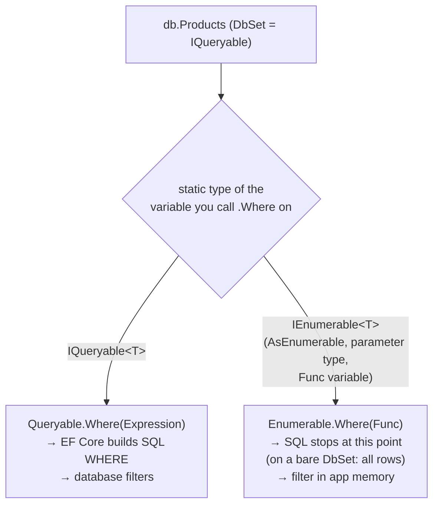
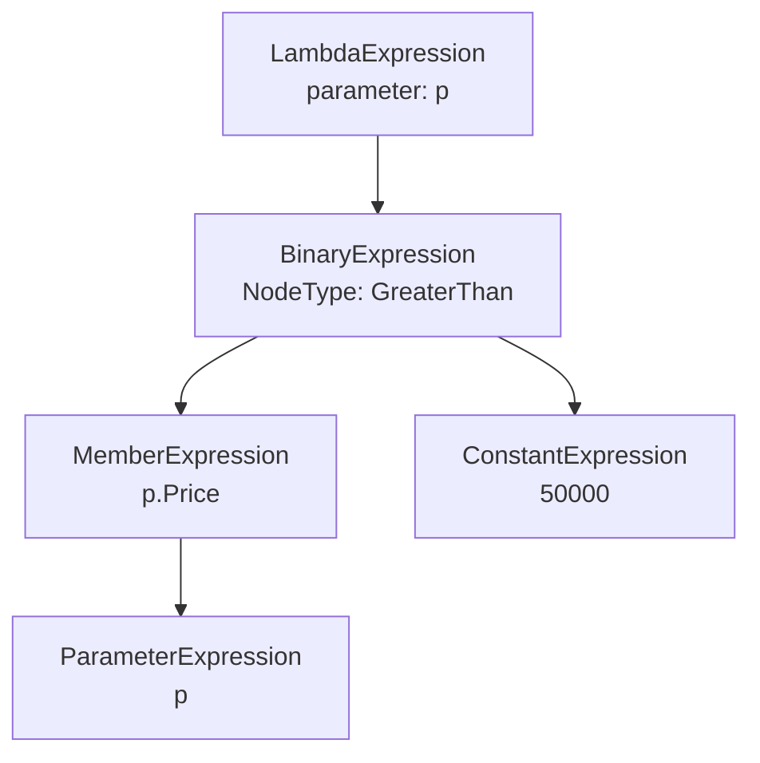
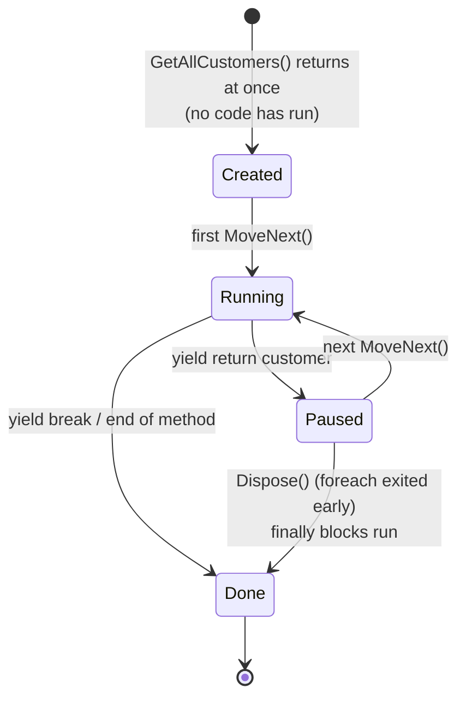

# Chapter 3 — LINQ, delegates and advanced C#

> **Days:** 7–8 · **Status:** Notes, code, quiz and exercises ready · learner has not taken the quiz yet
>
> **Interview target:** Understand what the compiler and the LINQ provider do, and when newer language features improve code.

## Topics in this chapter

1. [Delegates, Action, Func and Predicate](#topic-1)
2. [Lambda expressions and closures (including the loop-variable capture trap)](#topic-2)
3. [Events and the publisher/subscriber pattern](#topic-3)
4. [LINQ basics: Where, Select, SelectMany, OrderBy](#topic-4)
5. [LINQ grouping, joins and aggregation: GroupBy, Join, GroupJoin, Sum, Count, Aggregate](#topic-5)
6. [First vs FirstOrDefault vs Single vs SingleOrDefault, Any vs All](#topic-6)
7. [Deferred vs immediate execution, and multiple enumeration](#topic-7)
8. [`IEnumerable<T>` vs `IQueryable<T>`](#topic-8)
9. [Expression trees: how LINQ becomes SQL (concept level)](#topic-9)
10. [Extension methods](#topic-10)
11. [Tuples and deconstruction](#topic-11)
12. [Pattern matching: is, switch expressions, property and list patterns](#topic-12)
13. [Iterators and yield return](#topic-13)
14. [Attributes and basic reflection](#topic-14)
15. [Modern C# (10–12): file-scoped namespaces, global usings, top-level statements, primary constructors, collection expressions, required and init members](#topic-15)
16. [Newest C# (13–14): params collections, System.Threading.Lock, the field keyword, extension members, null-conditional assignment](#topic-16)

**Also in this chapter:** [Key words](#glossary) · [How to run the code](#how-to-run) · [Rule vs behaviour vs advice, and C#/.NET versions](#how-to-read) · [Quick revision](#quick-revision)

---

<a id="glossary"></a>

## Before you start: a few words you will see everywhere

| Word | Plain meaning |
|---|---|
| **Delegate** | A variable that holds a **method** instead of data. You can pass it around and call it later. |
| **Lambda** | A small method written inline, without a name: `order => order.Total > 1000`. |
| **Closure** | A lambda that uses a variable from the code around it. The lambda keeps that variable alive. |
| **Event** | A way for one object to say "something happened" so other objects can react, without knowing who they are. |
| **LINQ** | Language Integrated Query. A set of methods (`Where`, `Select`, `OrderBy`...) for filtering, transforming and summarising collections and database tables. |
| **Sequence** | Anything you can loop over with `foreach`. In C# that means something that implements `IEnumerable<T>`. |
| **Enumerate** | Loop over a sequence and read its items one by one. |
| **Deferred execution** | The work is described now and done later, when someone enumerates the result. |
| **Materialize** | Run a query and store the results in memory, e.g. with `ToList()`. |
| **Provider** | The code that actually runs a LINQ query. For EF Core, the provider turns the query into SQL. |
| **Expression tree** | Code stored as **data** (a tree of objects) so another program can read it, e.g. turn it into SQL. |
| **Reflection** | Code that inspects types, properties and attributes at runtime. |
| **Attribute** | A label in square brackets, like `[Required]`, that adds information to a class, method or property. |
| **EF Core** | Entity Framework Core, Microsoft's library for talking to databases using C# classes. Chapter 11 covers it fully; this chapter only uses it to show the SQL that LINQ produces. |

<a id="how-to-run"></a>

## How to run the code for this chapter

All code in this chapter is also in a runnable project: `chapters/03-linq-delegates-advanced-csharp/code/Chapter03/`.

```bash
cd chapters/03-linq-delegates-advanced-csharp/code/Chapter03
dotnet run          # runs all topics (1 to 16)
dotnet run -- 8     # runs only topic 8
```

The project file (`Chapter03.csproj`). It references one NuGet package, `Microsoft.EntityFrameworkCore.Sqlite`, so topics 8 and 9 can show real SQL from a small in-memory database:

```xml
<Project Sdk="Microsoft.NET.Sdk">

  <PropertyGroup>
    <OutputType>Exe</OutputType>
    <TargetFramework>net10.0</TargetFramework>
    <ImplicitUsings>enable</ImplicitUsings>
    <Nullable>enable</Nullable>
    <RootNamespace>Chapter03</RootNamespace>
  </PropertyGroup>

  <ItemGroup>
    <!-- EF Core with an in-memory SQLite database, used in topics 8 and 9 to show the SQL that LINQ becomes -->
    <PackageReference Include="Microsoft.EntityFrameworkCore.Sqlite" Version="10.0.14" />
  </ItemGroup>

</Project>
```

`GlobalUsings.cs` (explained in topic 15):

```csharp
// C# 10 global usings: these apply to every file in the project.
// ImplicitUsings in the .csproj already adds System, System.Linq, System.Collections.Generic and a few more.
global using System.Text.Json;
```

`Program.cs` runs each topic's `Run()` method:

```csharp
// Run one topic:   dotnet run -- 3
// Run all topics:  dotnet run
using Chapter03.Topics;

var demos = new Dictionary<int, (string Title, Action Run)>
{
    [1] = ("Delegates, Action, Func and Predicate", T01_Delegates.Run),
    [2] = ("Lambdas and closures", T02_LambdasAndClosures.Run),
    [3] = ("Events and publisher/subscriber", T03_Events.Run),
    [4] = ("LINQ basics: Where, Select, SelectMany, OrderBy", T04_LinqBasics.Run),
    [5] = ("LINQ grouping, joins and aggregation", T05_GroupingJoinsAggregation.Run),
    [6] = ("First / Single / OrDefault, Any / All", T06_FirstSingleAnyAll.Run),
    [7] = ("Deferred vs immediate execution", T07_DeferredExecution.Run),
    [8] = ("IEnumerable<T> vs IQueryable<T>", T08_EnumerableVsQueryable.Run),
    [9] = ("Expression trees", T09_ExpressionTrees.Run),
    [10] = ("Extension methods", T10_ExtensionMethods.Run),
    [11] = ("Tuples and deconstruction", T11_TuplesAndDeconstruction.Run),
    [12] = ("Pattern matching", T12_PatternMatching.Run),
    [13] = ("Iterators and yield return", T13_Iterators.Run),
    [14] = ("Attributes and basic reflection", T14_AttributesAndReflection.Run),
    [15] = ("Modern C# (10-12)", T15_ModernCSharp.Run),
    [16] = ("Newest C# (13-14)", T16_NewestCSharp.Run),
};

if (args.Length > 0)
{
    if (int.TryParse(args[0], out var topic) && demos.TryGetValue(topic, out var demo))
        Print(topic, demo);
    else
        Console.WriteLine($"Unknown topic '{args[0]}'. Valid topics: {string.Join(", ", demos.Keys)}");
    return;
}

foreach (var (number, d) in demos)
    Print(number, d);

static void Print(int number, (string Title, Action Run) demo)
{
    Console.WriteLine($"===== Topic {number}: {demo.Title} =====");
    demo.Run();
    Console.WriteLine();
}
```

> **About the outputs:** every output block below was captured by running this project on .NET 10 (10.0.10 runtime), 64-bit Windows, in the Debug build that `dotnet run` uses. The machine uses Indian formatting, so currency prints as `₹8,45,000.50`. Generated SQL comes from the SQLite provider; SQL Server's SQL looks slightly different (e.g. `TOP` instead of `LIMIT`), but the ideas are the same.

<a id="how-to-read"></a>

## How to read these notes: rule vs behaviour vs advice

| Kind | Meaning | Example from this chapter |
|---|---|---|
| **Language rule** | Guaranteed by the C# specification. | A `for` loop has one loop variable shared by all iterations; `foreach` gets a new one per iteration (since C# 5). |
| **Runtime behaviour** | What .NET or a library does today. True in practice, but can change between versions. | EF Core throws if it can't translate part of a `Where` to SQL (since EF Core 3.0). |
| **Design guidance** | Good advice that has exceptions. | Return `IReadOnlyList<T>` from repositories, not `IQueryable<T>`. |

**C# version → .NET version.** The **language version** and the **target framework** are separate settings. The SDK picks a *default* C# version from the target framework (`net8.0` → C# 12, `net10.0` → C# 14), and that default is what Microsoft supports. You *can* set a newer `<LangVersion>` while targeting an older framework. Pure syntax features then often work, but it's an unsupported setup, and any feature that needs a runtime type or API won't compile. Verified with the .NET 10 SDK: a `net8.0` project with `<LangVersion>14</LangVersion>` compiled and ran the `field` keyword, extension members, `?.` assignment and collection expressions, but `System.Threading.Lock` failed with CS0234 because that type only exists in .NET 9+. Built-in library APIs (like `CountBy`, `LeftJoin` or `Lock`) need the .NET version that ships them. On an older target you'd have to write the equivalent code yourself or use a package. So read the table below as "the default pairing", and treat "C# 12 feature" at work as "safe on .NET 8+".

| C# | Default language version for | Features from this chapter |
|---|---|---|
| 7–7.3 | .NET Core 2.x / .NET Framework 4.7+ | tuples, deconstruction, type patterns, tuple `==` |
| 8 | .NET Core 3.x | switch expressions, property/tuple patterns, `IAsyncEnumerable` |
| 9 | .NET 5 | records, `init`, top-level statements, relational and `and`/`or`/`not` patterns, `static` lambdas |
| 10 | .NET 6 | file-scoped namespaces, global usings, record structs, extended property patterns, lambda natural types |
| 11 | .NET 7 | `required`, raw string literals, list patterns |
| 12 | .NET 8 | primary constructors on classes, collection expressions, lambda default parameters |
| 13 | .NET 9 | `params` collections, `Lock` support in `lock` |
| 14 | .NET 10 | `field`, extension members, null-conditional assignment |

---

<a id="topic-1"></a>

## 3.1 Delegates, Action, Func and Predicate

### What it is

A **delegate** is a variable that holds a **method** instead of a number or a string. You can store it, pass it to another method, and call it later.

**Analogy:** a delegate is like a phone number written on a card. The card isn't the person, but anyone holding the card can call them. A checkout method can be handed a "discount rule card" and call whichever rule is written on it, without knowing in advance which one it is.

A **delegate type** describes the *shape* of the methods it can hold: the parameter types and the return type.

```csharp
public delegate decimal DiscountRule(decimal subtotal);   // "takes a decimal, returns a decimal"
```

Any method with that shape can be stored in a `DiscountRule` variable.

.NET ships ready-made generic delegate types, so you rarely need to declare your own:

| Type | Shape | Example |
|---|---|---|
| `Action` / `Action<T1..T16>` | takes 0–16 inputs, returns **nothing** (`void`) | `Action<string> sendSms` |
| `Func<TResult>` / `Func<T1..T16, TResult>` | takes 0–16 inputs, returns a value. **The last type argument is the return type.** | `Func<decimal, decimal> gst` |
| `Predicate<T>` | takes one input, returns `bool` | `Predicate<Order> isOverdue`, used by `List<T>.FindAll`, `RemoveAll`, `Array.Find` |

### Why it matters

Delegates let you **pass behaviour as a parameter**. Without them, every variation (festive discount, flat discount, no discount) would need its own `if`/`else` branch inside the checkout code, or a whole class hierarchy.

They are everywhere in .NET backends:

- LINQ over in-memory collections (`System.Linq.Enumerable`) takes delegates: `orders.Where(o => o.IsPaid)` passes a `Func<Order, bool>`. (LINQ over a database, `System.Linq.Queryable`, takes the same lambda as an **expression tree** instead: topics 8 and 9),
- ASP.NET Core middleware is a chain of `RequestDelegate`s (Chapter 6),
- minimal API endpoints are delegates: `app.MapGet("/orders/{id}", (int id) => ...)`,
- DI factory registrations: `services.AddScoped<IClock>(sp => new SystemClock())`,
- retry policies, callbacks, events (topic 3).

### How it works

A delegate is an **object** (a reference type that derives from `System.MulticastDelegate`). Inside it stores:

- **the method** to call, and
- **the target**: the object to call it on (`null` for a static method).



The diagram shows that a delegate variable points to a delegate object, which points to the method.

**Multicast.** One delegate can hold a **list** of methods, called the **invocation list**. `+=` adds a method and `-=` removes one. Calling the delegate calls every method in order (*language rule*: order of addition).

- If the delegate returns a value, you get **only the last method's result**.
- If one method throws, **the rest don't run**.
- Delegates are **immutable**: `+=` builds a *new* delegate object with a longer list and assigns it back to the variable.

### Code

```csharp
namespace Chapter03.Topics;

public static class T01_Delegates
{
    // A custom delegate type: "any method that takes a subtotal and returns a discount"
    public delegate decimal DiscountRule(decimal subtotal);

    // Three ordinary methods that match the DiscountRule shape
    private static decimal NoDiscount(decimal subtotal) => 0m;
    private static decimal FestiveSale(decimal subtotal) => subtotal * 0.10m;
    private static decimal FlatHundredOverThousand(decimal subtotal) => subtotal >= 1_000m ? 100m : 0m;

    // The checkout code doesn't know which rule it gets: the caller decides
    private static decimal Checkout(decimal subtotal, DiscountRule rule)
    {
        decimal discount = rule(subtotal);
        return subtotal - discount;
    }

    public static void Run()
    {
        // ---- 1. A delegate variable holds a reference to a method ----
        DiscountRule rule = FestiveSale;                 // method group conversion: no () after the name
        Console.WriteLine($"Festive sale on 2000: pay {Checkout(2_000m, rule)}");
        Console.WriteLine($"Flat 100 on 2000: pay {Checkout(2_000m, FlatHundredOverThousand)}");
        Console.WriteLine($"Flat 100 on 800:  pay {Checkout(800m, FlatHundredOverThousand)}");

        // Choosing behaviour at runtime, e.g. from configuration
        string campaign = "festive";
        DiscountRule chosen = campaign switch
        {
            "festive" => FestiveSale,
            "flat100" => FlatHundredOverThousand,
            _ => NoDiscount,
        };
        Console.WriteLine($"Campaign '{campaign}' uses {chosen.Method.Name}");

        // ---- 2. Built-in delegate types: Func, Action, Predicate ----
        Func<decimal, decimal> gst = amount => amount * 0.18m;            // input decimal, returns decimal
        Func<int, int, decimal> lineTotal = (qty, paise) => qty * paise / 100m; // two inputs, one result
        Action<string> sendSms = message => Console.WriteLine($"  SMS: {message}"); // returns nothing
        Predicate<decimal> isHighValue = amount => amount > 50_000m;      // returns bool

        Console.WriteLine($"GST on 1000: {gst(1_000m)}");
        Console.WriteLine($"3 x 4999 paise = {lineTotal(3, 4_999)}");
        sendSms("Your order #1042 has shipped");
        Console.WriteLine($"Is 75000 high value? {isHighValue(75_000m)}");

        // Predicate<T> and Func<T,bool> have the same shape but are different types
        Func<decimal, bool> asFunc = amount => amount > 50_000m;
        // Predicate<decimal> p = asFunc;          // compile error CS0029: no conversion between delegate types
        Predicate<decimal> converted = new Predicate<decimal>(asFunc);   // wrap it explicitly
        Console.WriteLine($"Converted predicate on 10: {converted(10m)}");

        // ---- 3. Multicast: one delegate, many methods ----
        Action<int> onOrderShipped = id => Console.WriteLine($"  Email sent for order {id}");
        onOrderShipped += id => Console.WriteLine($"  SMS sent for order {id}");
        onOrderShipped += id => Console.WriteLine($"  Loyalty points added for order {id}");
        Console.WriteLine($"Invocation list has {onOrderShipped.GetInvocationList().Length} methods:");
        onOrderShipped(1042);

        // With a return value, only the LAST method's result is returned
        Func<decimal, decimal> discounts = FestiveSale;
        discounts += FlatHundredOverThousand;
        Console.WriteLine($"Multicast Func result on 2000: {discounts(2_000m)} (only the last method's result)");

        // If one method throws, the rest do not run
        Action<int> fragile = id => Console.WriteLine($"  Step 1 for {id}");
        fragile += id => throw new InvalidOperationException("SMS gateway down");
        fragile += id => Console.WriteLine($"  Step 3 for {id}");
        try { fragile(7); }
        catch (InvalidOperationException ex) { Console.WriteLine($"  Stopped: {ex.Message}. Step 3 never ran."); }

        // Calling each method yourself lets every subscriber run
        foreach (Action<int> handler in fragile.GetInvocationList().Cast<Action<int>>())
        {
            try { handler(8); }
            catch (Exception ex) { Console.WriteLine($"  Handler failed ({ex.Message}), continuing"); }
        }

        // ---- 4. Removing and null ----
        Action<string>? audit = null;
        audit?.Invoke("nothing subscribed");        // ?.Invoke avoids NullReferenceException
        Action<string> log = msg => Console.WriteLine($"  AUDIT: {msg}");
        audit += log;
        audit -= log;                               // removing the only method makes it null again
        Console.WriteLine($"After += then -=, audit is null: {audit is null}");
    }
}
```

**Output:**

```text
Festive sale on 2000: pay 1800.00
Flat 100 on 2000: pay 1900
Flat 100 on 800:  pay 800
Campaign 'festive' uses FestiveSale
GST on 1000: 180.00
3 x 4999 paise = 149.97
  SMS: Your order #1042 has shipped
Is 75000 high value? True
Converted predicate on 10: False
Invocation list has 3 methods:
  Email sent for order 1042
  SMS sent for order 1042
  Loyalty points added for order 1042
Multicast Func result on 2000: 100 (only the last method's result)
  Step 1 for 7
  Stopped: SMS gateway down. Step 3 never ran.
  Step 1 for 8
  Handler failed (SMS gateway down), continuing
  Step 3 for 8
After += then -=, audit is null: True
```

`1800.00` vs `1900`: `decimal` remembers how many decimal places a calculation produced. `2000 * 0.10m` gives `200.00`, so the result keeps two places. That's normal `decimal` behaviour, not a bug.

### Common mistakes / gotchas

- **Calling a `null` delegate** throws `NullReferenceException`. A delegate with no methods is `null`, not "empty". Use `handler?.Invoke(...)`.
- **Using a multicast `Func` and expecting all results.** You only get the last one. If you need every result, loop over `GetInvocationList()`.
- **One failing subscriber stops the others.** Real bug: an "order shipped" delegate had email, SMS and loyalty-points handlers. When the SMS gateway was down, customers stopped getting loyalty points too. Fix: call each handler in its own `try/catch` (shown above), or move side effects to a queue (Chapter 19).
- **`-=` with a lambda does nothing.** `onShipped -= id => Send(id);` creates a *new* lambda, which isn't equal to the one you added. (Verified on .NET 10: after `-=` with an identical-looking lambda, both methods were still in the list.) Keep a reference to the delegate if you need to remove it.
- **`Predicate<T>` and `Func<T, bool>` aren't interchangeable** (CS0029), even though they have the same shape. Delegate types are compared by name, not by shape.

### 5-YOE depth

- **Delegates vs interfaces.** Use a delegate for **one** operation, especially a small one passed inline (`Func<Order, bool>`). Use an interface when there are several related operations, when you need a name in DI, or when the behaviour has dependencies of its own (`IDiscountRule` with `IsApplicable` + `Calculate`). Strategy pattern in .NET is often just a `Func`.
- **Delegate variance.** `Func<in T, out TResult>` and `Action<in T>` are variant (Chapter 2, topic 7). A `Func<Order, string>` can be assigned to a `Func<Order, object>` variable (covariant return), and an `Action<object>` to an `Action<string>` (contravariant parameter), but only for reference types.
- **Cost.** Calling a delegate is a little slower than a direct call, because the JIT usually can't inline it (*runtime behaviour*; recent .NET versions can devirtualize some cases). It only matters in very hot loops. Creating a delegate that captures variables allocates objects (topic 2).
- **Method group to delegate.** Since C# 11 the compiler caches the delegate for a static method group, as it already did for non-capturing lambdas, so `list.Where(IsPaid)` doesn't allocate a new delegate each time.
- **Thread safety of `?.Invoke`.** `handler?.Invoke(x)` reads the field once into a hidden temporary, so another thread removing the last subscriber between the null check and the call can't cause a `NullReferenceException`. Writing `if (handler != null) handler(x);` on a field can.

### Interview questions

1. **What is a delegate?**
   A type-safe reference to a method: an object that stores the method and its target object. You can pass it as a parameter and call it later. The delegate type fixes the parameter and return types, so the compiler checks every call.
2. **Difference between `Action`, `Func` and `Predicate`?**
   `Action` returns nothing, `Func` returns a value (its last type argument is the return type), `Predicate<T>` takes one `T` and returns `bool`. `Predicate<T>` is older and is used by `List<T>.FindAll`/`RemoveAll`; LINQ uses `Func<T, bool>`.
3. **What is a multicast delegate? What happens with return values and exceptions?**
   A delegate with several methods in its invocation list, added with `+=`. Calling it runs them in order. For a non-void delegate only the last result is returned. If one method throws, the remaining methods don't run and the exception goes to the caller.
4. **When would you use a delegate instead of an interface?**
   For a single operation that callers supply inline, like a filter, a key selector or a callback. Use an interface when there are several related members, the implementation has its own dependencies, or you want to register it in DI by type.
5. **Why does `-=` with a lambda not unsubscribe?**
   Each lambda expression becomes its own compiler-generated method, so the lambda you remove isn't equal to the one you added (delegates are equal only if they have the same method and target). Store the delegate in a variable or field and use that for both `+=` and `-=`.

---

<a id="topic-2"></a>

## 3.2 Lambda expressions and closures (including the loop-variable capture trap)

### What it is

A **lambda expression** is a method written inline without a name. The `=>` reads as "goes to":

```csharp
Func<decimal, decimal> addShipping = total => total + 49m;
```

- **Expression lambda**: one expression after `=>`; its value is the result.
- **Statement lambda**: a block `{ ... }` with `return`, for more than one line.

A **closure** is a lambda that **uses a variable from the surrounding code**. The lambda "captures" the variable and keeps it alive, even after the method that declared it has returned.

**Analogy:** a closure is like a delivery agent who took a photo of your address board, not a copy of the address. If you change the board, the agent sees the new address. The lambda captures the **variable**, not its value at that moment.

### Why it matters

- Every LINQ query, minimal API endpoint and callback uses lambdas.
- Closures are very handy (a tax calculator "remembers" its rate), but they cause two classic interview bugs: the **loop-variable capture trap** and "the value changed before the lambda ran".
- Closures allocate memory. In high-traffic code that shows up in profiles.

### How it works

When a lambda captures a local variable, the compiler moves that variable out of the method into a hidden class (often called a **display class** or **closure class**). The lambda becomes a method on that class.



The diagram shows that the returned delegate points to a heap object that holds the captured variables, so they live as long as the delegate does.

Consequences (*language rules*, implemented this way by the compiler):

1. The lambda and the method share **the same variable**. A change made by either one is seen by the other.
2. The variable lives **as long as the delegate** lives.
3. Capturing costs **heap allocations** (the closure object plus the delegate). A lambda that captures nothing can be cached by the compiler and reused (*runtime/compiler behaviour*).

**The loop trap.** A `for` loop declares **one** variable `i` for the whole loop. Every lambda created inside the loop captures that same `i`. When the lambdas run later, the loop has finished and `i` is 3. A `foreach` loop gets **a new variable per iteration** (*language rule* since C# 5), so it's safe.

### Code

```csharp
namespace Chapter03.Topics;

public static class T02_LambdasAndClosures
{
    // Returns a function that "remembers" the rate it was created with
    private static Func<decimal, decimal> CreateTaxCalculator(decimal rate)
    {
        return amount => amount * rate;            // 'rate' is captured: the lambda keeps it alive
    }

    // Returns a function that remembers and CHANGES a counter
    private static Func<string> CreateInvoiceNumberGenerator(string prefix)
    {
        int next = 1000;
        return () => $"{prefix}-{next++}";          // 'next' lives on after this method returns
    }

    public static void Run()
    {
        // ---- 1. Lambda syntax ----
        Func<decimal, decimal> addShipping = total => total + 49m;          // expression lambda
        Func<decimal, string, decimal> convert = (amount, currency) =>      // statement lambda
        {
            decimal rate = currency == "USD" ? 0.012m : 1m;
            return Math.Round(amount * rate, 2);
        };
        var isWeekend = (DateOnly d) => d.DayOfWeek is DayOfWeek.Saturday or DayOfWeek.Sunday; // C# 10: natural type
        Console.WriteLine($"Add shipping: {addShipping(500m)}, INR->USD: {convert(10_000m, "USD")}, 2026-11-01 weekend? {isWeekend(new DateOnly(2026, 11, 1))}");
        Console.WriteLine($"Natural type of isWeekend: {isWeekend.GetType().Name}");

        // ---- 2. Closures: a lambda captures variables, not values ----
        var gst = CreateTaxCalculator(0.18m);
        var vat = CreateTaxCalculator(0.20m);
        Console.WriteLine($"GST on 1000: {gst(1_000m)}, VAT on 1000: {vat(1_000m)}");

        var nextInvoice = CreateInvoiceNumberGenerator("INV");
        Console.WriteLine($"Invoices: {nextInvoice()}, {nextInvoice()}, {nextInvoice()}");

        decimal threshold = 1_000m;
        Func<decimal, bool> isBigOrder = total => total > threshold;
        Console.WriteLine($"Is 1500 big (threshold 1000)? {isBigOrder(1_500m)}");
        threshold = 2_000m;                         // the lambda sees the NEW value
        Console.WriteLine($"Is 1500 big (threshold changed to 2000)? {isBigOrder(1_500m)}");

        // ---- 3. The loop-variable capture trap ----
        // A 'for' loop has ONE variable i shared by every iteration.
        var retryJobs = new List<Action>();
        for (int i = 0; i < 3; i++)
            retryJobs.Add(() => Console.Write($"attempt {i}; "));
        Console.Write("for loop, captured i:      ");
        foreach (var job in retryJobs) job();
        Console.WriteLine();

        // Fix: copy into a variable declared INSIDE the loop body (a new one per iteration)
        retryJobs.Clear();
        for (int i = 0; i < 3; i++)
        {
            int attempt = i;
            retryJobs.Add(() => Console.Write($"attempt {attempt}; "));
        }
        Console.Write("for loop, copied variable: ");
        foreach (var job in retryJobs) job();
        Console.WriteLine();

        // foreach gets a fresh variable per iteration since C# 5, so it is safe
        var warehouses = new[] { "Pune", "Delhi", "Chennai" };
        var syncJobs = new List<Action>();
        foreach (var warehouse in warehouses)
            syncJobs.Add(() => Console.Write($"sync {warehouse}; "));
        Console.Write("foreach loop:              ");
        foreach (var job in syncJobs) job();
        Console.WriteLine();

        // ---- 4. static lambdas (C# 9): the compiler refuses any capture ----
        Func<decimal, decimal> roundToRupee = static amount => Math.Round(amount, 0, MidpointRounding.AwayFromZero);
        // Func<decimal, bool> bad = static t => t > threshold;   // compile error CS8820: static lambda can't capture
        Console.WriteLine($"Static lambda rounding 249.50: {roundToRupee(249.50m)}");

        // ---- 5. Lambda parameters with defaults (C# 12) ----
        var formatPrice = (decimal amount, string currency = "INR") => $"{amount:0.00} {currency}";
        Console.WriteLine($"Default parameter: {formatPrice(99m)}, explicit: {formatPrice(5m, "USD")}");
    }
}
```

**Output:**

```text
Add shipping: 549, INR->USD: 120.00, 2026-11-01 weekend? True
Natural type of isWeekend: Func`2
GST on 1000: 180.00, VAT on 1000: 200.00
Invoices: INV-1000, INV-1001, INV-1002
Is 1500 big (threshold 1000)? True
Is 1500 big (threshold changed to 2000)? False
for loop, captured i:      attempt 3; attempt 3; attempt 3; 
for loop, copied variable: attempt 0; attempt 1; attempt 2; 
foreach loop:              sync Pune; sync Delhi; sync Chennai; 
Static lambda rounding 249.50: 250
Default parameter: 99.00 INR, explicit: 5.00 USD
```

Note `attempt 3` three times: `i` stopped at 3 (the value that ended the loop), a number the loop body never even used.

### Common mistakes / gotchas

- **The `for` loop capture trap.** Real bug: a job scheduler created one `Task.Run(() => ProcessPartition(i))` per partition inside a `for` loop. Most tasks processed the last partition (or crashed with an index error), and some partitions were never processed. Fix: copy `i` into a local inside the loop, or use `foreach`.
- **Expecting a snapshot.** A closure reads the variable's **current** value when it runs (see `threshold` above). This matters for LINQ queries that run later (topic 7).
- **Capturing `this` by accident.** A lambda that uses an instance field or method captures `this`, which keeps the whole object alive as long as the delegate exists. Combined with a long-lived event or cache, that's a memory leak (topic 3).
- **Capturing a disposable or scoped object** (a `DbContext`, an `HttpContext`) in a lambda that runs later on a background thread. By then the request has ended and the object is disposed: `ObjectDisposedException`.

### 5-YOE depth

- **Allocations.** With today's compiler, entering the scope that declares a captured variable typically allocates a closure object, and creating the capturing lambda allocates a delegate (*compiler implementation detail*, not a language guarantee: the exact count depends on how many scopes and lambdas capture what). In a hot path (millions of calls), prefer `static` lambdas plus "state" overloads that pass the data in as a parameter, e.g. `ConcurrentDictionary.GetOrAdd(key, static (k, arg) => ..., arg)` or `string.Create(length, state, static (span, s) => ...)`.
- **`static` lambdas (C# 9)** make "no capture" a compile-time guarantee (CS8820 if you try). Good for hot paths and for making intent obvious.
- **One closure object per scope, shared by all lambdas in that scope.** If two lambdas in the same method capture different variables, both variables may end up in the same closure object, so a short-lived lambda can keep a large captured object alive through its long-lived sibling. Rare, but it explains some "why is this still in memory?" heap dumps.
- **Natural type (C# 10).** `var f = (DateOnly d) => ...;` infers `Func<DateOnly, bool>`. This is what makes minimal APIs work: `app.MapGet("/", () => "ok")` passes a lambda whose type is inferred.
- **Lambda improvements:** attributes on lambdas (C# 10), explicit return types `var f = int (string s) => s.Length;` (C# 10), default parameter values (C# 12, shown above).

### Interview questions

1. **What is a closure? What exactly is captured?**
   A lambda that uses a variable from its surrounding scope. The **variable itself** is captured, not a copy of its value. The compiler moves it into a hidden heap object shared by the method and the lambda, so changes on either side are visible to both, and the variable lives as long as the delegate does.
2. **Explain the loop-variable capture problem.**
   A `for` loop has one variable shared by all iterations. Lambdas created in the loop all capture that one variable, so when they run later they all see its final value. `foreach` has had a fresh variable per iteration since C# 5. Fix the `for` case by copying the loop variable into a local declared inside the loop body.
3. **What is a static lambda and why use it?**
   A lambda marked `static` (C# 9) that isn't allowed to capture locals or `this`. The compiler enforces it. It documents intent and guarantees there's no closure allocation, which helps in hot paths.
4. **Do lambdas allocate memory?**
   With the current compiler, a non-capturing lambda's delegate is created once and cached. A capturing lambda typically allocates a closure object and a new delegate each time the enclosing code runs. That's how the compiler implements it today, not a language rule. In very hot code it adds GC pressure.
5. **What's the risk of capturing a `DbContext` in a lambda passed to a background task?**
   The lambda can run after the request ends. The scoped `DbContext` is disposed by then (`ObjectDisposedException`), and `DbContext` isn't thread-safe anyway. Create a new scope inside the background work with `IServiceScopeFactory` (Chapter 19).

---

<a id="topic-3"></a>

## 3.3 Events and the publisher/subscriber pattern

### What it is

An **event** lets one object (the **publisher**) announce "something happened" while other objects (the **subscribers**) react to it. The publisher doesn't know who the subscribers are or how many there are.

**Analogy:** a shop's "notify me when back in stock" list. The shop (publisher) just sends the notice. It doesn't care whether 0 or 500 people signed up, or what each of them does next.

In C#, an event is a **delegate field with restricted access**, declared with the `event` keyword:

```csharp
public event EventHandler<OrderPlacedEventArgs>? OrderPlaced;
```

- **Inside** the class you can raise it: `OrderPlaced?.Invoke(this, args)`.
- **Outside** the class you can only subscribe (`+=`) or unsubscribe (`-=`). You can't raise it and you can't replace the list (CS0070).

This is the **observer pattern** (also called publisher/subscriber, or pub/sub) built into the language.

### Why it matters

- It **decouples** the code: `OrderService` doesn't need references to `EmailNotifier`, `InventoryReserver` and `FraudCheck`. Adding a new reaction doesn't change `OrderService`.
- Why not a plain public delegate field? Then any outside code could **raise** the event (fake an "order placed") or **overwrite** it with `=` and silently remove every other subscriber. `event` blocks both.
- Interviewers love the **event memory leak**: one of the most common causes of memory growth in long-running .NET services.

### How it works

When you write `public event EventHandler<T>? OrderPlaced;`, the compiler generates:

1. a **private** delegate field, and
2. public `add` and `remove` accessors that `+=` and `-=` call. (For these field-like events, today's compiler generates thread-safe accessors using an `Interlocked.CompareExchange` loop. That's *compiler implementation behaviour*. If you write custom `add`/`remove` accessors yourself, thread safety is your job.)

The .NET convention for event handlers:

- signature `void Handler(object? sender, TEventArgs e)`: `sender` is the publisher, `e` holds the data,
- the data class derives from `EventArgs` (optional since .NET 4.5, still conventional),
- the event is raised by a method named `On<EventName>`.



The diagram shows that raising an event is just a **synchronous** call to each handler, one after another, on the same thread. `PlaceOrder` doesn't return until every handler has finished.

**Why events leak memory.** The publisher's delegate stores a reference to each subscriber (the delegate's **target**). As long as the publisher is alive, every subscriber that never unsubscribed is alive too, because the garbage collector sees it as still in use.



The diagram shows a long-lived publisher keeping a short-lived subscriber alive through the delegate's target reference.

### Code

```csharp
using System.Runtime.CompilerServices;

namespace Chapter03.Topics;

public static class T03_Events
{
    // The data sent with the event. Deriving from EventArgs is the .NET convention (optional since .NET 4.5).
    public sealed class OrderPlacedEventArgs(int orderId, decimal total) : EventArgs
    {
        public int OrderId { get; } = orderId;
        public decimal Total { get; } = total;
    }

    // PUBLISHER: raises the event. It doesn't know who is listening.
    public sealed class OrderService
    {
        public event EventHandler<OrderPlacedEventArgs>? OrderPlaced;

        public void PlaceOrder(int orderId, decimal total)
        {
            Console.WriteLine($"  OrderService: order {orderId} saved");
            OnOrderPlaced(new OrderPlacedEventArgs(orderId, total));
        }

        // Convention: an On<EventName> method raises the event. In a non-sealed class it is
        // 'protected virtual' so derived classes can hook in; this class is sealed, so it is private.
        private void OnOrderPlaced(OrderPlacedEventArgs e) => OrderPlaced?.Invoke(this, e);

        public int SubscriberCount => OrderPlaced?.GetInvocationList().Length ?? 0;
    }

    // SUBSCRIBERS: react to the event
    public sealed class EmailNotifier
    {
        public void Handle(object? sender, OrderPlacedEventArgs e) =>
            Console.WriteLine($"  EmailNotifier: confirmation for order {e.OrderId}");
    }

    public sealed class InventoryReserver
    {
        public void Handle(object? sender, OrderPlacedEventArgs e) =>
            Console.WriteLine($"  InventoryReserver: stock reserved for order {e.OrderId}");
    }

    // A short-lived object (e.g. a per-request dashboard widget) that subscribes to a long-lived publisher
    public sealed class LiveSalesWidget
    {
        public decimal RunningTotal { get; private set; }
        public void Handle(object? sender, OrderPlacedEventArgs e) => RunningTotal += e.Total;
    }

    [MethodImpl(MethodImplOptions.NoInlining)]
    private static WeakReference CreateWidget(OrderService service, bool unsubscribe)
    {
        var widget = new LiveSalesWidget();
        service.OrderPlaced += widget.Handle;
        if (unsubscribe) service.OrderPlaced -= widget.Handle;
        return new WeakReference(widget);   // lets us ask "is it still alive?" without keeping it alive
    }

    public static void Run()
    {
        var service = new OrderService();
        var email = new EmailNotifier();
        var inventory = new InventoryReserver();

        service.OrderPlaced += email.Handle;
        service.OrderPlaced += inventory.Handle;
        service.OrderPlaced += (_, e) => { if (e.Total > 50_000m) Console.WriteLine($"  FraudCheck: review order {e.OrderId}"); };

        Console.WriteLine($"Subscribers: {service.SubscriberCount}");
        service.PlaceOrder(1042, 75_000m);

        service.OrderPlaced -= email.Handle;
        Console.WriteLine($"After email unsubscribed: {service.SubscriberCount} subscribers");
        service.PlaceOrder(1043, 900m);

        // From OUTSIDE the class you can only += and -=. These lines do not compile:
        // service.OrderPlaced(service, args);   // CS0070: can only appear on the left of += or -=
        // service.OrderPlaced = null;           // CS0070: would wipe every other subscriber

        // ---- Memory leak: the publisher keeps the subscriber alive ----
        var longLivedService = new OrderService();      // imagine a singleton
        WeakReference leaked = CreateWidget(longLivedService, unsubscribe: false);
        WeakReference released = CreateWidget(longLivedService, unsubscribe: true);
        GC.Collect();
        GC.WaitForPendingFinalizers();
        GC.Collect();
        Console.WriteLine($"Widget that never unsubscribed still alive after GC: {leaked.IsAlive}");
        Console.WriteLine($"Widget that unsubscribed still alive after GC:       {released.IsAlive}");
    }
}
```

> `WeakReference` points to an object **without** keeping it alive, so we can check whether the garbage collector freed it. `[MethodImpl(MethodImplOptions.NoInlining)]` keeps the widget's local variable inside its own method, so the Debug build doesn't keep it alive by accident. `GC.Collect()` is only for this demo; don't call it in application code.

**Output:**

```text
Subscribers: 3
  OrderService: order 1042 saved
  EmailNotifier: confirmation for order 1042
  InventoryReserver: stock reserved for order 1042
  FraudCheck: review order 1042
After email unsubscribed: 2 subscribers
  OrderService: order 1043 saved
  InventoryReserver: stock reserved for order 1043
Widget that never unsubscribed still alive after GC: True
Widget that unsubscribed still alive after GC:       False
```

The last two lines show the leak: the widget that never unsubscribed survived a full garbage collection, because the publisher still pointed to it.

### Common mistakes / gotchas

- **Forgetting to unsubscribe from a long-lived publisher.** Real production story: a singleton `PriceFeed` raised `PriceChanged`, and every SignalR connection handler subscribed but never unsubscribed. Memory grew all day until the pod was restarted. Fix: unsubscribe in `Dispose()`, or don't use in-process events across lifetimes.
- **A throwing handler breaks the publisher.** Handlers run inside `PlaceOrder`. If `EmailNotifier` throws, the exception comes out of `PlaceOrder` **after the order was saved**, the API returns 500, the client retries, and you get a duplicate order. Either catch inside each handler, or publish to a queue/outbox after the transaction commits (Chapters 15 and 19).
- **`async void` handlers.** Event handlers must return `void`, so people write `async void Handle(...)`. The publisher can't await the handler, so it can't catch an exception thrown after the handler's first `await`. Where that exception goes depends on the `SynchronizationContext` (*runtime behaviour*). ASP.NET Core, console apps and worker services have none, so it's rethrown on the thread pool and, by default, crashes the process (verified on .NET 10: the caller's `catch` never ran and the process exited with an unhandled exception). UI apps (WPF, WinForms) have one, and the exception goes to the UI thread's unhandled-exception handler instead. Chapter 5 covers this.
- **Raising with `if (OrderPlaced != null) OrderPlaced(...)`**: race-prone on a field. Use `?.Invoke`.
- **Events are in-process only.** They don't cross service boundaries, don't survive a restart, and don't reach other instances behind a load balancer. For that, use a message broker (Chapter 19).

### 5-YOE depth

- **In modern ASP.NET Core, C# events are uncommon in business code.** DI lifetimes make cross-lifetime subscriptions risky. Common alternatives:
  - **domain events**: entities collect events in a list, and they're dispatched after `SaveChanges` (Chapter 11),
  - an **in-process mediator** with handler interfaces such as `INotificationHandler<T>`. MediatR became commercial in 2025; a plain `IEnumerable<IOrderPlacedHandler>` injected by DI does the same job for free,
  - `Channel<T>` + a `BackgroundService` for async in-process work (Chapter 19),
  - a broker (Azure Service Bus, RabbitMQ) plus the **outbox pattern** for cross-service events.
- **Where you still see events:** `IHostApplicationLifetime` (cancellation tokens), `IOptionsMonitor.OnChange` (returns an `IDisposable` you must dispose), `ChangeToken`, EF Core's `ChangeTracker.Tracked`/`StateChanged` events, `AppDomain.UnhandledException`, Windows desktop apps.
- **Custom `add`/`remove` accessors** let you store handlers elsewhere, e.g. weak references (the "weak event" pattern), so subscribers aren't kept alive.
- **Handlers run on the publisher's thread, in subscription order.** The order isn't a contract you should rely on for business logic.

### Interview questions

1. **Difference between a delegate and an event?**
   An event wraps a delegate field and restricts it: outside code can only `+=` and `-=`. Only the declaring class can raise it or reset it. With a public delegate field, any caller could invoke it or overwrite it with `=` and drop all other subscribers.
2. **How can events cause memory leaks? How do you prevent them?**
   The publisher's delegate holds a reference to each subscriber. If the publisher lives longer (a singleton) and the subscriber never unsubscribes, the subscriber can't be collected. Prevent it by unsubscribing in `Dispose`, using weak events, or avoiding cross-lifetime events (use DI-based handlers or messaging).
3. **Are event handlers called synchronously or asynchronously?**
   Synchronously, one after another, on the thread that raised the event. The publisher waits for all of them, and an exception in one stops the rest and propagates to the publisher.
4. **What's the standard event signature in .NET?**
   `event EventHandler<TEventArgs>`, with handlers shaped `void (object? sender, TEventArgs e)`, raised from an `On<EventName>` method using `?.Invoke(this, e)`.
5. **Would you use C# events to tell the shipping service that an order was placed?**
   No, not across services. In-process events are lost on a restart and don't reach other instances. Use a message broker with the outbox pattern so the message is sent reliably after the order is committed. Inside one process, use domain events or DI-resolved handlers.

---

<a id="topic-4"></a>

## 3.4 LINQ basics: Where, Select, SelectMany, OrderBy

### What it is

**LINQ** (Language Integrated Query) is a set of methods for asking questions about collections: "which orders are paid?", "what are their totals?", "sort them by city". The same methods also work on database tables through EF Core (topic 8).

The four you'll use most:

| Method | What it does | SQL equivalent |
|---|---|---|
| `Where(predicate)` | keeps items that match a condition | `WHERE` |
| `Select(selector)` | turns each item into something else (a DTO, a number) | the column list in `SELECT` |
| `SelectMany(selector)` | turns each item into **many** items and flattens them into one sequence | a join to child rows |
| `OrderBy` / `ThenBy` (and `...Descending`) | sorts, with tie-breakers | `ORDER BY a, b` |

**Analogy:** LINQ is like an assembly line. Each method is one station: a filter station (`Where`), a reshaping station (`Select`), a sorting station (`OrderBy`). You plug stations together with dots.

### Why it matters

- It replaces hand-written loops with short, readable code that says *what* you want, not *how* to loop.
- The same knowledge applies to in-memory data and to the database.
- Interviewers check that you know `Select` vs `SelectMany`, `ThenBy` vs a second `OrderBy`, and why paging needs a sort order.

### How it works

LINQ methods are **extension methods** (topic 10) defined in the `System.Linq.Enumerable` class. They work on anything that implements `IEnumerable<T>`: arrays, lists, sets, dictionaries, and `yield` methods.

Each method takes a sequence and returns a **new** sequence. The original collection is **never changed**. Most of them are **lazy**: they don't do anything until you loop over the result (topic 7).

**Select vs SelectMany:**



The diagram shows `Select` keeping one result per order (a list per order), while `SelectMany` flattens every order's lines into a single sequence.

**Query syntax.** C# also lets you write LINQ in a SQL-like form (`from o in orders where ... select ...`). The compiler translates it into the same method calls (*language rule*). Method syntax is more common in backend code because some operators (`Distinct`, `Take`, `Count`) have no query keyword.

### Code

```csharp
namespace Chapter03.Topics;

public static class T04_LinqBasics
{
    private record OrderLine(string Sku, int Quantity, decimal UnitPrice);
    private record Order(int Id, string Customer, string City, string Status, DateOnly PlacedOn, List<OrderLine> Lines)
    {
        public decimal Total => Lines.Sum(l => l.Quantity * l.UnitPrice);
    }

    private static readonly List<Order> Orders =
    [
        new(1, "Asha",  "Pune",  "Paid",      new(2026, 10, 1), [new("KB-01", 1, 2_500m), new("MS-02", 2, 800m)]),
        new(2, "Ravi",  "Delhi", "Cancelled", new(2026, 10, 2), [new("MON-27", 1, 18_000m)]),
        new(3, "Asha",  "Pune",  "Paid",      new(2026, 10, 5), [new("MS-02", 1, 800m)]),
        new(4, "Meera", "Delhi", "Paid",      new(2026, 10, 5), [new("LAP-14", 1, 72_000m), new("KB-01", 1, 2_500m)]),
        new(5, "John",  "Pune",  "Pending",   new(2026, 10, 7), []),
    ];

    public static void Run()
    {
        // ---- Where: filter ----
        var paidOrders = Orders.Where(o => o.Status == "Paid");
        Console.WriteLine($"Paid orders: {string.Join(", ", paidOrders.Select(o => o.Id))}");

        // ---- Select: transform each item (here into a DTO-like anonymous object) ----
        var summaries = Orders
            .Where(o => o.Status == "Paid")
            .Select(o => new { o.Id, o.Customer, Total = o.Total });
        foreach (var s in summaries)
            Console.WriteLine($"  #{s.Id} {s.Customer,-6} {s.Total,8}");

        // Select with index: number the rows of a report
        var numbered = Orders.Select((o, index) => $"{index + 1}. order {o.Id}");
        Console.WriteLine($"Numbered: {string.Join(" | ", numbered)}");

        // ---- Select vs SelectMany ----
        IEnumerable<List<OrderLine>> nested = Orders.Select(o => o.Lines);     // a sequence of LISTS
        IEnumerable<OrderLine> flat = Orders.SelectMany(o => o.Lines);         // ONE flat sequence of lines
        Console.WriteLine($"Select gives {nested.Count()} lists; SelectMany gives {flat.Count()} lines");

        // Which SKUs were sold (in paid orders), without duplicates?
        var soldSkus = Orders.Where(o => o.Status == "Paid")
                             .SelectMany(o => o.Lines)
                             .Select(l => l.Sku)
                             .Distinct();
        Console.WriteLine($"Distinct SKUs sold: {string.Join(", ", soldSkus)}");

        // SelectMany with a result selector keeps the parent: (order id, sku) pairs for a CSV export
        var exportRows = Orders.SelectMany(o => o.Lines, (o, line) => $"{o.Id}:{line.Sku}");
        Console.WriteLine($"Export rows: {string.Join(", ", exportRows)}");

        // ---- OrderBy / ThenBy ----
        var sorted = Orders.OrderBy(o => o.City)
                           .ThenByDescending(o => o.Total);
        Console.WriteLine("Sorted by city, then total (highest first):");
        foreach (var o in sorted)
            Console.WriteLine($"  {o.City,-6} #{o.Id} {o.Total,8}");

        // Mistake: two OrderBy calls. The second one becomes the NEW primary sort; because OrderBy is stable,
        // the first survives only as a tie-breaker. So this equals OrderBy(Id).ThenBy(City), the reverse of the intent.
        // Intended: by city, then by id. Got: by id first, cities mixed up.
        var wrong = Orders.OrderBy(o => o.City).OrderBy(o => o.Id);
        var right = Orders.OrderBy(o => o.City).ThenBy(o => o.Id);
        Console.WriteLine($"OrderBy + OrderBy (wrong): {string.Join(", ", wrong.Select(o => $"{o.City}#{o.Id}"))}");
        Console.WriteLine($"OrderBy + ThenBy (right):  {string.Join(", ", right.Select(o => $"{o.City}#{o.Id}"))}");

        // OrderBy is stable: orders 3 and 4 share a date and keep their original order
        var byDate = Orders.OrderBy(o => o.PlacedOn).Select(o => $"{o.PlacedOn:MM-dd}#{o.Id}");
        Console.WriteLine($"By date (stable): {string.Join(", ", byDate)}");

        // .NET 7: Order() / OrderDescending() for simple values
        var amounts = Orders.Select(o => o.Total).OrderDescending();
        Console.WriteLine($"Totals, highest first: {string.Join(", ", amounts)}");

        // ---- Paging: Skip / Take (how page 2 of an order list works) ----
        int page = 2, pageSize = 2;
        var pageTwo = Orders.OrderBy(o => o.Id).Skip((page - 1) * pageSize).Take(pageSize);
        Console.WriteLine($"Page {page} (size {pageSize}): {string.Join(", ", pageTwo.Select(o => o.Id))}");

        // .NET 6: Chunk splits into batches, e.g. send emails 2 at a time
        foreach (var batch in Orders.Select(o => o.Id).Chunk(2))
            Console.WriteLine($"  Email batch: [{string.Join(", ", batch)}]");

        // ---- Query syntax: the same query, SQL-like form. The compiler turns it into method calls. ----
        var delhiPaid = from o in Orders
                        where o.City == "Delhi" && o.Status == "Paid"
                        orderby o.Total descending
                        select new { o.Id, o.Total };
        Console.WriteLine($"Query syntax, Delhi paid: {string.Join(", ", delhiPaid)}");
    }
}
```

> `new { o.Id, o.Customer, Total = o.Total }` creates an **anonymous type**: a small read-only class the compiler generates for you, with value-based equality and a readable `ToString()`. It's handy inside a method, but you can't return it with a proper type name, so use a record or DTO for anything that leaves the method.

**Output:**

```text
Paid orders: 1, 3, 4
  #1 Asha       4100
  #3 Asha        800
  #4 Meera     74500
Numbered: 1. order 1 | 2. order 2 | 3. order 3 | 4. order 4 | 5. order 5
Select gives 5 lists; SelectMany gives 6 lines
Distinct SKUs sold: KB-01, MS-02, LAP-14
Export rows: 1:KB-01, 1:MS-02, 2:MON-27, 3:MS-02, 4:LAP-14, 4:KB-01
Sorted by city, then total (highest first):
  Delhi  #4    74500
  Delhi  #2    18000
  Pune   #1     4100
  Pune   #3      800
  Pune   #5        0
OrderBy + OrderBy (wrong): Pune#1, Delhi#2, Pune#3, Delhi#4, Pune#5
OrderBy + ThenBy (right):  Delhi#2, Delhi#4, Pune#1, Pune#3, Pune#5
By date (stable): 10-01#1, 10-02#2, 10-05#3, 10-05#4, 10-07#5
Totals, highest first: 74500, 18000, 4100, 800, 0
Page 2 (size 2): 3, 4
  Email batch: [1, 2]
  Email batch: [3, 4]
  Email batch: [5]
Query syntax, Delhi paid: { Id = 4, Total = 74500 }
```

Order 5 has no lines, so its `Total` is `0` (`Sum` of an empty sequence is 0). `SelectMany` simply contributes nothing for it.

### Common mistakes / gotchas

- **Two `OrderBy` calls.** The second `OrderBy` starts a **new primary ordering**. Because `OrderBy` is stable, the first ordering only survives among items whose new keys are equal, so `OrderBy(City).OrderBy(Id)` behaves like `OrderBy(Id).ThenBy(City)`: the priority is reversed (verified on .NET 10 with tied ids: both gave `(Agra, 1), (Pune, 1), (Delhi, 2), (Pune, 2)`). Use `ThenBy` to add a secondary key to the existing ordering.
- **Paging without a sort.** `Skip/Take` without `OrderBy` gives pages in whatever order the source happens to return. On a database that order can change between requests, so the same row can appear on two pages or on none. Always sort by a unique key (or end with one, e.g. `.ThenBy(o => o.Id)`).
- **`Select` when you meant `SelectMany`.** You get `IEnumerable<List<OrderLine>>` and later code fails to compile or counts lists instead of lines.
- **Thinking LINQ changes the source.** `orders.OrderBy(...)` returns a new sorted sequence; `orders` is unchanged. To sort a `List<T>` in place, use `list.Sort(...)` (which is **not** stable; `OrderBy` is).
- **`List<T>.ForEach` isn't LINQ.** It's a `List<T>` method taking an `Action<T>`, so it doesn't exist on `IEnumerable<T>`, and LINQ deliberately has no `ForEach` (LINQ is for queries without side effects; use a plain `foreach` for actions). Real trap: `orders.ForEach(async o => await _email.SendAsync(o));` turns the lambda into an **`async void`**: nothing awaits the sends, the method returns before they finish, and an exception can crash the process (topic 3). Use `foreach` with `await`, or `Task.WhenAll` / `Parallel.ForEachAsync` (Chapter 5).
- **`Distinct` on classes** uses `Equals`/`GetHashCode`. For a normal class that means reference equality, so two "equal" DTOs aren't merged. Records compare by value. Or use `DistinctBy(x => x.Sku)` (.NET 6).

### 5-YOE depth

- **Cost of LINQ in memory.** Each operator allocates an iterator object and calls a delegate per item. That's fine for business code. In very hot paths (millions of items per second) a plain loop is faster and allocates nothing. .NET 7–10 added many internal optimizations (e.g. `Where(...).Select(...)` combined into one iterator, `Count()` on lists using `.Count` directly), so measure before rewriting.
- **Stable sort (*documented behaviour*, LINQ to Objects only).** `Enumerable.OrderBy` keeps the original order of items with equal keys. `List<T>.Sort` and `Array.Sort` don't guarantee that. **Databases don't either.** `Queryable.OrderBy` on EF Core becomes SQL `ORDER BY`, and SQL leaves the order of rows with equal sort keys undefined: it can change between runs or after an index change. So in database queries, don't rely on stability (or on an earlier `OrderBy`) for ties. Use `ThenBy` explicitly and end with a unique key (`.ThenBy(o => o.Id)`) whenever the order must be deterministic, e.g. for paging.
- **`OrderBy` is O(n log n) and buffers the whole input** before returning the first item. `First()` after `OrderBy` is optimized to a single O(n) scan in modern .NET, but `MinBy`/`MaxBy` (.NET 6) state the intent better.
- **`Zip`** pairs two sequences item by item and stops at the shorter one: `skus.Zip(quantities)` gives `(First, Second)` tuples (tuple overload since .NET Core 3.0; three-sequence overload since .NET 6). Handy for matching parallel arrays from a CSV or an external API.
- **Newer operators worth knowing:** `Chunk`, `DistinctBy`, `MinBy`/`MaxBy`, `FirstOrDefault(defaultValue)` (.NET 6); `Order`/`OrderDescending` (.NET 7); `CountBy`, `AggregateBy`, `Index` (.NET 9); `LeftJoin`, `RightJoin` (.NET 10).
- **Keyset paging vs `Skip/Take`.** On a database, `Skip(100_000)` still makes the server read and discard 100,000 rows. For deep pages, filter by "after the last id I saw": `Where(o => o.Id > lastId).OrderBy(o => o.Id).Take(20)` (Chapter 14).

### Interview questions

1. **Difference between `Select` and `SelectMany`?**
   `Select` maps each item to exactly one result, so a selector that returns a collection gives a sequence of collections. `SelectMany` maps each item to a sequence and flattens them all into one sequence, like getting all order lines from a list of orders.
2. **How do you sort by two keys?**
   `OrderBy(first).ThenBy(second)`. A second `OrderBy` re-sorts the whole sequence by the new key, which becomes the primary key. Since the sort is stable, the earlier ordering survives only as a tie-breaker, so the priority ends up reversed.
3. **Is LINQ `OrderBy` stable?**
   `Enumerable.OrderBy` (LINQ to Objects) is documented as stable: equal keys keep their original relative order. `List<T>.Sort` is unstable. On EF Core the sort runs in the database, where SQL doesn't define the order of ties, so add `ThenBy` with a unique key when you need a deterministic order.
4. **How would you implement paging with LINQ, and what's the pitfall?**
   `OrderBy(uniqueKey).Skip((page - 1) * size).Take(size)`. Without a deterministic order, rows can repeat or go missing between pages. For deep pages on large tables, keyset paging is faster than `Skip`.
5. **Query syntax or method syntax?**
   They compile to the same calls. Method syntax is more common and supports every operator. Query syntax can be easier to read for joins and `let` clauses. Pick what the team uses and stay consistent.

---

<a id="topic-5"></a>

## 3.5 LINQ grouping, joins and aggregation: GroupBy, Join, GroupJoin, Sum, Count, Aggregate

### What it is

These operators summarise and combine data, like SQL's `GROUP BY`, `JOIN` and aggregate functions:

| Operator | What it does | Example |
|---|---|---|
| `GroupBy(key)` | splits items into groups that share a key. Each group has a `Key` and its items. | revenue per city |
| `ToLookup(key)` | like `GroupBy` but runs **immediately** and lets you look up a key | orders by customer id |
| `Join` | **inner join**: pairs items from two sequences with matching keys. Unmatched items are dropped. | order + customer name |
| `GroupJoin` | each left item with **all** its matches (possibly none) | customer + their orders |
| `LeftJoin` (.NET 10) | **left outer join**: every left item, matched or not | customers with or without orders |
| `Sum`, `Count`, `Average`, `Min`, `Max` | numeric aggregates | total revenue |
| `MinBy`, `MaxBy` (.NET 6) | the **item** with the smallest/largest key | the biggest order |
| `Aggregate` | general "fold": combine all items into one value step by step | apply coupons one after another |
| `CountBy`, `AggregateBy` (.NET 9) | grouped count / grouped fold without building groups | orders per status |

### Why it matters

Reports, dashboards and data imports are full of "group by X and sum Y" and "match these two lists by id". Interviewers check:

- that you know which join drops rows (inner) and which keeps them (left),
- that you know `Average`/`Max` on an empty list throw but `Sum` doesn't,
- and that you know these joins are efficient (hash-based), unlike nested loops.

### How it works

**GroupBy** reads the whole source and builds a key → list-of-items map. Each group implements `IGrouping<TKey, TElement>`, which is an `IEnumerable<TElement>` with an extra `Key` property.

**Join / GroupJoin** are **hash joins** (*runtime behaviour* of LINQ to Objects): they first build a lookup from the inner (right) sequence by key, then walk the outer (left) sequence and look up each key. Cost is about O(n + m), not O(n × m).



The diagram shows how the inner sequence is hashed once and each outer item is matched by key, and how `Join` and `GroupJoin` differ in what they return.

**Left join.** Before .NET 10, the standard trick was `GroupJoin` + `SelectMany` + `DefaultIfEmpty()`: every customer is paired with each of their orders, or with `null` if they have none. .NET 10 adds a `LeftJoin` method that does it in one call (EF Core 10 can translate it to SQL `LEFT JOIN` too).

**Empty sequences** (*documented behaviour*):

| Operator | Empty sequence of non-nullable values | Empty sequence of nullable values (`decimal?`) |
|---|---|---|
| `Sum` | `0` | `0` |
| `Count` | `0` | `0` |
| `Average`, `Min`, `Max` | throws `InvalidOperationException` | returns `null` |
| `Aggregate` without a seed | throws `InvalidOperationException` | throws |

### Code

```csharp
namespace Chapter03.Topics;

public static class T05_GroupingJoinsAggregation
{
    private record Customer(int Id, string Name, string Tier);
    private record Order(int Id, int CustomerId, string City, decimal Total, string Status);
    private record Coupon(string Code, decimal PercentOff);

    private static readonly List<Customer> Customers =
    [
        new(1, "Asha", "Gold"),
        new(2, "Ravi", "Silver"),
        new(3, "Meera", "Gold"),
        new(4, "John", "Silver"),      // John has no orders
    ];

    private static readonly List<Order> Orders =
    [
        new(101, 1, "Pune",  4_100m,  "Paid"),
        new(102, 2, "Delhi", 18_000m, "Cancelled"),
        new(103, 1, "Pune",  800m,    "Paid"),
        new(104, 3, "Delhi", 74_500m, "Paid"),
        new(105, 3, "Delhi", 1_200m,  "Paid"),
        new(106, 9, "Agra",  300m,    "Paid"),  // customer 9 does not exist (bad data)
    ];

    public static void Run()
    {
        // ---- GroupBy: revenue per city ----
        var revenueByCity = Orders
            .Where(o => o.Status == "Paid")
            .GroupBy(o => o.City)
            .Select(g => new { City = g.Key, Orders = g.Count(), Revenue = g.Sum(o => o.Total) })
            .OrderByDescending(x => x.Revenue);
        Console.WriteLine("Revenue by city:");
        foreach (var row in revenueByCity)
            Console.WriteLine($"  {row.City,-6} orders {row.Orders}  revenue {row.Revenue}");

        // Group by two keys with an anonymous type (or a tuple)
        var byCityAndStatus = Orders.GroupBy(o => new { o.City, o.Status })
                                    .Select(g => $"{g.Key.City}/{g.Key.Status}={g.Count()}");
        Console.WriteLine($"By city and status: {string.Join(", ", byCityAndStatus)}");

        // ToLookup: like GroupBy, but runs immediately and lets you look up a key (missing key = empty, no exception)
        ILookup<int, Order> ordersByCustomer = Orders.ToLookup(o => o.CustomerId);
        Console.WriteLine($"Lookup: customer 1 has {ordersByCustomer[1].Count()} orders, customer 4 has {ordersByCustomer[4].Count()}");

        // .NET 9: CountBy and AggregateBy skip building the groups
        var countByStatus = Orders.CountBy(o => o.Status);
        Console.WriteLine($"CountBy status (.NET 9): {string.Join(", ", countByStatus.Select(kv => $"{kv.Key}={kv.Value}"))}");
        var revenueByCustomer = Orders.Where(o => o.Status == "Paid")
                                      .AggregateBy(o => o.CustomerId, seed: 0m, (sum, o) => sum + o.Total);
        Console.WriteLine($"AggregateBy customer (.NET 9): {string.Join(", ", revenueByCustomer.Select(kv => $"{kv.Key}={kv.Value}"))}");

        // ---- Join: inner join. Orders without a matching customer DISAPPEAR. ----
        var joined = Orders.Join(Customers,
                                 order => order.CustomerId,       // key from the left side
                                 customer => customer.Id,         // key from the right side
                                 (order, customer) => $"{order.Id}:{customer.Name}");
        Console.WriteLine($"Inner join: {string.Join(", ", joined)}   (order 106 is gone)");

        // ---- GroupJoin: each customer with ALL their orders (possibly none) ----
        var customerOrders = Customers.GroupJoin(Orders,
                                                 c => c.Id,
                                                 o => o.CustomerId,
                                                 (c, orders) => new { c.Name, Count = orders.Count(), Spent = orders.Sum(o => o.Total) });
        Console.WriteLine("GroupJoin (every customer, even with zero orders):");
        foreach (var c in customerOrders)
            Console.WriteLine($"  {c.Name,-6} orders {c.Count}  spent {c.Spent}");

        // Classic LEFT JOIN: GroupJoin + SelectMany + DefaultIfEmpty
        var leftJoinClassic = Customers
            .GroupJoin(Orders, c => c.Id, o => o.CustomerId, (c, orders) => new { c, orders })
            .SelectMany(x => x.orders.DefaultIfEmpty(), (x, o) => $"{x.c.Name}:{(o is null ? "none" : o.Id.ToString())}");
        Console.WriteLine($"Left join (classic): {string.Join(", ", leftJoinClassic)}");

        // .NET 10: LeftJoin does the same in one call
        var leftJoinNet10 = Customers.LeftJoin(Orders, c => c.Id, o => o.CustomerId,
                                               (c, o) => $"{c.Name}:{(o is null ? "none" : o.Id.ToString())}");
        Console.WriteLine($"Left join (.NET 10):  {string.Join(", ", leftJoinNet10)}");

        // ---- Aggregation ----
        var paid = Orders.Where(o => o.Status == "Paid").ToList();
        Console.WriteLine($"Paid: count {paid.Count}, sum {paid.Sum(o => o.Total)}, avg {paid.Average(o => o.Total):0.00}, min {paid.Min(o => o.Total)}, max {paid.Max(o => o.Total)}");

        // .NET 6: MaxBy / MinBy return the ITEM, not the value
        Order biggest = paid.MaxBy(o => o.Total)!;
        Console.WriteLine($"MaxBy: order {biggest.Id} ({biggest.Total}); Max: {paid.Max(o => o.Total)}");

        // Aggregate: fold a sequence into one value. Apply coupons one after another (compounding).
        var coupons = new List<Coupon> { new("WELCOME10", 10m), new("FESTIVE5", 5m) };
        decimal finalPrice = coupons.Aggregate(1_000m, (price, coupon) => price * (1 - coupon.PercentOff / 100m));
        Console.WriteLine($"1000 after compounding coupons: {finalPrice}");

        // ---- Empty sequences: Sum is safe, Average/Max throw ----
        var noOrders = new List<Order>();
        Console.WriteLine($"Empty Sum: {noOrders.Sum(o => o.Total)}");
        try { noOrders.Average(o => o.Total); }
        catch (InvalidOperationException ex) { Console.WriteLine($"Empty Average: {ex.GetType().Name}: {ex.Message}"); }
        // Fix: project to a nullable type. Max/Average of an empty nullable sequence return null.
        decimal? maxOrNull = noOrders.Max(o => (decimal?)o.Total);
        Console.WriteLine($"Empty Max as decimal?: {(maxOrNull is null ? "null" : maxOrNull)}");
        try { coupons.Take(0).Aggregate((a, b) => a); }
        catch (InvalidOperationException ex) { Console.WriteLine($"Aggregate without seed on empty: {ex.GetType().Name}"); }
    }
}
```

**Output:**

```text
Revenue by city:
  Delhi  orders 2  revenue 75700
  Pune   orders 2  revenue 4900
  Agra   orders 1  revenue 300
By city and status: Pune/Paid=2, Delhi/Cancelled=1, Delhi/Paid=2, Agra/Paid=1
Lookup: customer 1 has 2 orders, customer 4 has 0
CountBy status (.NET 9): Paid=5, Cancelled=1
AggregateBy customer (.NET 9): 1=4900, 3=75700, 9=300
Inner join: 101:Asha, 102:Ravi, 103:Asha, 104:Meera, 105:Meera   (order 106 is gone)
GroupJoin (every customer, even with zero orders):
  Asha   orders 2  spent 4900
  Ravi   orders 1  spent 18000
  Meera  orders 2  spent 75700
  John   orders 0  spent 0
Left join (classic): Asha:101, Asha:103, Ravi:102, Meera:104, Meera:105, John:none
Left join (.NET 10):  Asha:101, Asha:103, Ravi:102, Meera:104, Meera:105, John:none
Paid: count 5, sum 80900, avg 16180.00, min 300, max 74500
MaxBy: order 104 (74500); Max: 74500
1000 after compounding coupons: 855.000
Empty Sum: 0
Empty Average: InvalidOperationException: Sequence contains no elements
Empty Max as decimal?: null
Aggregate without seed on empty: InvalidOperationException
```

Two things to notice. The inner join silently dropped order 106 (its customer doesn't exist), while the per-city report still counted it under Agra. And the coupons compound: 10% then 5% gives 855, not 850.

### Common mistakes / gotchas

- **Inner join hiding bad data.** Real bug: a monthly revenue report joined orders to customers. Orders whose customer had been hard-deleted vanished from the report, so finance saw lower revenue than the payments system did. Decide explicitly: left join and show "unknown customer", or fix the data.
- **`Average`/`Max`/`Min` on an empty list** throws `InvalidOperationException: Sequence contains no elements`. A dashboard that worked all month crashed on the 1st, when "orders this month" was empty. Fix: cast to a nullable type (`Max(o => (decimal?)o.Total)`), or check `Any()` first.
- **`Sum` of `int` can overflow.** `Enumerable.Sum` for `int` and `long` uses checked arithmetic, so it throws `OverflowException` (verified on .NET 10 with `{ int.MaxValue, 1 }.Sum()`). Sum quantities into `long`, and money into `decimal`.
- **Grouping in memory after loading everything.** `db.Orders.ToList().GroupBy(...)` loads every order into memory. Group in the database instead (topic 8).
- **`GroupBy` is deferred but buffered.** It doesn't run until enumerated, and then it reads the **entire** source before returning the first group.

### 5-YOE depth

- **Join complexity.** LINQ to Objects' `Join`, `GroupJoin` and `ToLookup` hash the inner sequence: about O(n + m), assuming keys hash well. A hand-written `foreach` with `customers.First(c => c.Id == o.CustomerId)` inside is O(n × m) (Chapter 2, topic 5). Interviewers like hearing you know the difference. This applies to **in-memory** LINQ only. On an `IQueryable` (EF Core), the `Join` becomes SQL `JOIN`, and the **database's optimizer** picks the strategy (hash, merge or nested-loop join) based on indexes and statistics (Chapter 14).
- **`ToLookup` vs `ToDictionary`.** A lookup allows many items per key and returns an empty sequence for a missing key. `ToDictionary` throws `ArgumentException` on a duplicate key and `KeyNotFoundException` on a missing one.
- **`GroupBy` in EF Core.** EF Core translates `GroupBy(...).Select(g => new { g.Key, Sum = g.Sum(...) })` to SQL `GROUP BY`. Returning the groups themselves (`GroupBy(...).ToList()`) can't be done in plain SQL; EF Core 7+ can do it for some providers, but it brings all rows back. Prefer aggregates in the projection.
- **`Aggregate` with a seed** never throws on empty input; it returns the seed. Without a seed, the first item is the seed, so an empty sequence throws.
- **`CountBy`/`AggregateBy` (.NET 9)** avoid allocating a list per group: useful for large in-memory counts.
- **Decimal precision.** `855.000`: the result keeps the scale created by the multiplications. Round explicitly (`Math.Round(x, 2, MidpointRounding.AwayFromZero)`) before showing or storing money.

### Interview questions

1. **How do you do a left join in LINQ?**
   Before .NET 10: `GroupJoin` the right side, then `SelectMany(x => x.matches.DefaultIfEmpty(), ...)`, which gives `null` for left items without matches. In .NET 10 there's a `LeftJoin` method (EF Core 10 translates it). In EF Core you can also use navigation properties, which usually generate the left join for you.
2. **What's the difference between `Join` and `GroupJoin`?**
   `Join` is an inner join that returns one result per matching pair and drops unmatched items. `GroupJoin` returns one result per left item, together with the (possibly empty) collection of its matches.
3. **What happens when you call `Average()` or `Max()` on an empty sequence?**
   For non-nullable value types they throw `InvalidOperationException`. For nullable types they return `null`. `Sum` and `Count` return 0.
4. **`GroupBy` vs `ToLookup`?**
   `GroupBy` is deferred and gives a sequence of groups. `ToLookup` runs immediately and returns an `ILookup<TKey, T>` you can index by key; a missing key gives an empty sequence instead of throwing.
5. **What is `Aggregate` and when would you use it?**
   A general fold: it carries an accumulator through the sequence, applying a function to each item. Use it when no built-in aggregate fits, e.g. compounding discounts or merging date ranges. Give it a seed so empty input is safe.
6. **What's the time complexity of LINQ `Join` in memory?**
   About O(n + m), because it builds a hash lookup of the inner sequence once and then probes it for each outer item.

---

<a id="topic-6"></a>

## 3.6 First vs FirstOrDefault vs Single vs SingleOrDefault, Any vs All

### What it is

These operators get **one** item or a **yes/no** answer from a sequence.

| Method | 0 matches | 1 match | 2+ matches |
|---|---|---|---|
| `First()` | **throws** | returns it | returns the first |
| `FirstOrDefault()` | returns `default` (`null` / `0`) | returns it | returns the first |
| `Single()` | **throws** | returns it | **throws** |
| `SingleOrDefault()` | returns `default` | returns it | **throws** |

| Method | Meaning | Empty sequence |
|---|---|---|
| `Any()` / `Any(predicate)` | "is there at least one (matching) item?" | `false` |
| `All(predicate)` | "do **all** items match?" (= "no item breaks the rule") | **`true`** |

`default` means the type's default value: `null` for classes, `0` for numbers, `false` for `bool`.

### Why it matters

- Choosing between them **states your assumption** about the data. `Single` says "exactly one, and anything else is a bug". `First` says "I only care about the first".
- `FirstOrDefault` on a list of `int` returning `0` is a classic silent bug.
- `All()` on an empty list returning `true` has caused real "order fully paid" bugs.

### How it works

- `First` stops as soon as it finds a match.
- `Single` must keep going after the first match to make sure there isn't a second one. On a list it may read the whole thing. In EF Core, `Single` becomes `SELECT TOP(2)` (or `LIMIT 2`) and `First` becomes `TOP(1)` (*runtime behaviour*).
- `Any` stops at the first match. `Count()` has to count everything (unless the source is a collection with a `Count` property). On a database, `Any` becomes `EXISTS (...)`, which can stop early.
- `All` stops at the first item that **fails**. If there are no items, nothing fails, so the answer is `true`. Mathematicians call this "vacuous truth".

### Code

```csharp
namespace Chapter03.Topics;

public static class T06_FirstSingleAnyAll
{
    private record User(int Id, string Email, string Role, bool IsActive);
    private record Payment(string TransactionId, decimal Amount, string Status);

    private static readonly List<User> Users =
    [
        new(1, "asha@shop.in",  "Admin",    true),
        new(2, "ravi@shop.in",  "Customer", true),
        new(3, "meera@shop.in", "Customer", false),
        new(4, "ravi@shop.in",  "Customer", true),   // duplicate email: bad data
    ];

    private static string Try(Func<object?> action)
    {
        try { return action()?.ToString() ?? "null"; }
        catch (InvalidOperationException ex) { return $"{ex.GetType().Name}: {ex.Message}"; }
    }

    public static void Run()
    {
        // ---- First / FirstOrDefault ----
        Console.WriteLine($"First customer:                {Try(() => Users.First(u => u.Role == "Customer").Id)}");
        Console.WriteLine($"First 'Support' user:          {Try(() => Users.First(u => u.Role == "Support"))}");
        Console.WriteLine($"FirstOrDefault 'Support' user: {Try(() => Users.FirstOrDefault(u => u.Role == "Support"))}");

        // ---- Single / SingleOrDefault: "there must be at most one" ----
        Console.WriteLine($"Single admin:                  {Try(() => Users.Single(u => u.Role == "Admin").Email)}");
        Console.WriteLine($"Single by email (duplicate):   {Try(() => Users.Single(u => u.Email == "ravi@shop.in"))}");
        Console.WriteLine($"SingleOrDefault (duplicate):   {Try(() => Users.SingleOrDefault(u => u.Email == "ravi@shop.in"))}");
        Console.WriteLine($"SingleOrDefault (none):        {Try(() => Users.SingleOrDefault(u => u.Email == "x@shop.in"))}");

        // ---- The default(T) trap with value types ----
        var retryDelaysMs = new List<int> { 200, 400, 800 };
        int firstSlowDelay = retryDelaysMs.FirstOrDefault(ms => ms > 5_000);
        Console.WriteLine($"FirstOrDefault on List<int> with no match: {firstSlowDelay} (0 looks like a real value!)");

        // Fix 1 (.NET 6): pass the default you want
        int withDefault = retryDelaysMs.FirstOrDefault(ms => ms > 5_000, defaultValue: -1);
        Console.WriteLine($"FirstOrDefault(..., defaultValue: -1): {withDefault}");
        // Fix 2: work with a nullable type
        int? asNullable = retryDelaysMs.Select(ms => (int?)ms).FirstOrDefault(ms => ms > 5_000);
        Console.WriteLine($"Nullable version: {(asNullable is null ? "null" : asNullable)}");

        // Last / ElementAt work the same way (and ElementAtOrDefault)
        Console.WriteLine($"Last: {retryDelaysMs.Last()}, ElementAtOrDefault(10): {retryDelaysMs.ElementAtOrDefault(10)}");

        // ---- Any / All ----
        Console.WriteLine($"Any inactive user? {Users.Any(u => !u.IsActive)}");
        Console.WriteLine($"All users have an email? {Users.All(u => u.Email.Contains('@'))}");

        // All() on an EMPTY sequence is TRUE ("no item breaks the rule")
        var payments = new List<Payment>();
        Console.WriteLine($"Empty payments: All succeeded? {payments.All(p => p.Status == "Succeeded")}, Any? {payments.Any()}");
        bool fullyPaid = payments.Any() && payments.All(p => p.Status == "Succeeded");
        Console.WriteLine($"Safer 'fully paid' check on empty list: {fullyPaid}");

        // Any() vs Count() > 0 on a lazy sequence: Any stops at the first match, Count reads everything
        int checkedCount = 0;
        IEnumerable<User> lazyUsers = Users.Where(u => { checkedCount++; return u.IsActive; });
        _ = lazyUsers.Any();
        int afterAny = checkedCount;
        checkedCount = 0;
        _ = lazyUsers.Count() > 0;
        Console.WriteLine($"Items checked: Any() = {afterAny}, Count() > 0 = {checkedCount}");

        // Contains for a simple membership test
        var blockedDomains = new HashSet<string> { "spam.com", "fake.org" };
        Console.WriteLine($"Is 'fake.org' blocked? {blockedDomains.Contains("fake.org")}");
    }
}
```

**Output:**

```text
First customer:                2
First 'Support' user:          InvalidOperationException: Sequence contains no matching element
FirstOrDefault 'Support' user: null
Single admin:                  asha@shop.in
Single by email (duplicate):   InvalidOperationException: Sequence contains more than one matching element
SingleOrDefault (duplicate):   InvalidOperationException: Sequence contains more than one matching element
SingleOrDefault (none):        null
FirstOrDefault on List<int> with no match: 0 (0 looks like a real value!)
FirstOrDefault(..., defaultValue: -1): -1
Nullable version: null
Last: 800, ElementAtOrDefault(10): 0
Any inactive user? True
All users have an email? True
Empty payments: All succeeded? True, Any? False
Safer 'fully paid' check on empty list: False
Items checked: Any() = 1, Count() > 0 = 4
Is 'fake.org' blocked? True
```

Note that `SingleOrDefault` **still throws** when there are two matches. "OrDefault" only covers the zero-match case.

### Common mistakes / gotchas

- **Believing `SingleOrDefault` never throws.** It throws on 2+ matches. That's usually what you want: duplicate emails are a data bug that should fail loudly, not be hidden.
- **`FirstOrDefault` on value types.** `0`, `false` or `default(DateTime)` (year 1) can look like real data. Use the `defaultValue` overload (.NET 6), a nullable projection, or `TryGet...` style code.
- **Not checking for `null` after `FirstOrDefault`.** The next line, `user.Email`, throws `NullReferenceException`. With nullable reference types enabled, the compiler warns you (the return type is `User?`).
- **`All` on an empty collection.** Real bug: "mark the order as paid if all payments succeeded" also marked orders with **zero** payments as paid. Use `payments.Any() && payments.All(...)`.
- **`Count() > 0` instead of `Any()`.** On a lazy query or a database query it does more work than needed (`COUNT(*)` vs `EXISTS`).
- **`First()` without an `OrderBy` on a database query.** "First" of an unordered SQL result isn't defined, so you can get a different row each time. EF Core logs a warning when `First` is used with no `OrderBy` and no filter, and another when `Skip`/`Take` is used without `OrderBy`.

### 5-YOE depth

- **Pick by intent, not habit.** `Single` for lookups by a unique key where a duplicate means corrupted data (you want the exception). `First` with `OrderBy` for "latest/earliest". `FirstOrDefault` when "not found" is a normal outcome you handle (return 404).
- **Cost on a database:** `First` → `TOP(1)`, `Single` → `TOP(2)` (it needs to detect a second row), `Any` → `EXISTS`. Uniqueness is better enforced by a **unique index** than by `Single`: the index stops the duplicate from ever being inserted.
- **`Find` on a `DbSet`** first checks EF Core's change tracker (objects already loaded) before querying, unlike `FirstOrDefault` (Chapter 11).
- **`Any()` without a predicate on a collection** is O(1) (it checks `Count`). On a lazy sequence it starts the enumeration, which might run a query or a `yield` method.
- **`TryGetNonEnumeratedCount` (.NET 6)** tells you the count only if it's cheap to know, without enumerating.

### Interview questions

1. **Difference between `First`, `FirstOrDefault`, `Single` and `SingleOrDefault`?**
   `First` returns the first match and throws if there's none. `FirstOrDefault` returns `default` instead of throwing. `Single` requires exactly one match and throws on zero or many. `SingleOrDefault` returns `default` on zero but still throws on many.
2. **When would you prefer `Single` over `First`?**
   When the data must contain at most one match (a lookup by email or by unique key) and a duplicate means a bug. `Single` fails loudly instead of silently picking one. Back the rule with a unique index.
3. **What does `All()` return for an empty sequence? Why can that be dangerous?**
   `true`, because no item fails the condition. A check like "all payments succeeded" passes for an order with no payments. Combine it with `Any()`.
4. **`Any()` or `Count() > 0`?**
   `Any()`. It stops at the first item (`EXISTS` in SQL), while `Count()` may enumerate everything (`COUNT(*)`). On a `List<T>`, use the `Count` property.
5. **What's the risk of `FirstOrDefault` on a `List<int>`?**
   It returns `0` when nothing matches, which can't be told apart from a real 0. Use `FirstOrDefault(predicate, defaultValue)` or project to `int?`.

---

<a id="topic-7"></a>

## 3.7 Deferred vs immediate execution, and multiple enumeration

### What it is

**Deferred execution** means a LINQ query is only a **description** of work. Nothing happens when you write it. The work happens later, **each time** someone enumerates the result (`foreach`, `ToList()`, `Count()`, ...).

**Immediate execution** means the operator runs the query right away and returns a finished result: `ToList`, `ToArray`, `ToDictionary`, `ToHashSet`, `Count`, `Sum`, `First`, `Any`, `Max`, and so on.

**Analogy:** a deferred query is a **recipe**. Writing the recipe doesn't cook anything. Every time you follow it, you cook again, using whatever ingredients are in the fridge **at that moment**. `ToList()` is cooking once and putting the meal in a box.

### Why it matters

Deferred execution is the root cause of several interview favourites:

- a query runs **twice** (two database calls, two API calls) because the result was enumerated twice,
- results include items added **after** the query was written,
- an exception shows up far away from the line that "caused" it,
- `ObjectDisposedException` because the `DbContext` was disposed before the query actually ran.

### How it works

There are three kinds of operators:

| Kind | Behaviour | Examples |
|---|---|---|
| **Deferred, streaming** | do nothing until enumerated, then pass items through **one at a time** | `Where`, `Select`, `SelectMany`, `Take`, `Skip`, `Distinct`, `Concat` |
| **Deferred, buffering** | do nothing until enumerated, then must read **everything** before returning the first item | `OrderBy`, `GroupBy`, `Reverse`, `Join` (for the inner side) |
| **Immediate** | run now and return a value or a collection | `ToList`, `ToArray`, `ToDictionary`, `Count`, `Sum`, `First`, `Any`, `Max` |

**Streaming** means items flow through the pipeline one by one. The first item goes through `Where` and `Select` and reaches your `foreach` before the second item is even read:



The diagram shows the pull model: the consumer asks for the next item, and each operator pulls from the one before it, only as far as needed.

### Code

```csharp
namespace Chapter03.Topics;

public static class T07_DeferredExecution
{
    private record Shipment(string TrackingId, string Status, int WeightGrams);

    private static int _apiCalls;

    // Pretends to call a courier API. Each enumeration calls it again.
    private static IEnumerable<Shipment> FetchShipmentsFromCourierApi()
    {
        _apiCalls++;
        yield return new("TRK-1", "InTransit", 500);
        yield return new("TRK-2", "Delivered", 1_200);
        yield return new("TRK-3", "InTransit", 3_000);
    }

    public static void Run()
    {
        // ---- 1. Defining a query does NOT run it ----
        var shipments = new List<Shipment> { new("TRK-1", "InTransit", 500), new("TRK-2", "Delivered", 1_200) };
        var inTransit = shipments.Where(s => s.Status == "InTransit");   // nothing runs here
        shipments.Add(new("TRK-3", "InTransit", 3_000));                  // added AFTER the query was defined
        Console.WriteLine($"Deferred: {string.Join(", ", inTransit.Select(s => s.TrackingId))} (TRK-3 is included)");

        var snapshot = shipments.Where(s => s.Status == "InTransit").ToList();   // runs NOW
        shipments.Add(new("TRK-4", "InTransit", 100));
        Console.WriteLine($"ToList snapshot: {string.Join(", ", snapshot.Select(s => s.TrackingId))} (TRK-4 is not)");

        // ---- 2. Streaming: each item flows through the whole pipeline before the next one starts ----
        Console.WriteLine("Pipeline order (Where -> Select -> foreach):");
        var pipeline = shipments
            .Where(s => { Console.WriteLine($"  Where  {s.TrackingId}"); return s.Status == "InTransit"; })
            .Select(s => { Console.WriteLine($"  Select {s.TrackingId}"); return s.WeightGrams; });
        Console.WriteLine("  (query defined, nothing printed yet)");
        foreach (var grams in pipeline.Take(2))
            Console.WriteLine($"  foreach got {grams}g");
        Console.WriteLine("  (Take(2) stopped early: TRK-4 was never read)");

        // ---- 3. Some operators must read EVERYTHING before giving the first item (buffering) ----
        Console.WriteLine("OrderBy reads all items before yielding the first:");
        var sorted = shipments
            .Where(s => { Console.WriteLine($"  Where  {s.TrackingId}"); return true; })
            .OrderBy(s => s.WeightGrams);
        Console.WriteLine($"  First after OrderBy: {sorted.First().TrackingId}");

        // ---- 4. Multiple enumeration: the source runs once per enumeration ----
        _apiCalls = 0;
        IEnumerable<Shipment> fromApi = FetchShipmentsFromCourierApi();
        int count = fromApi.Count();
        int heavy = fromApi.Count(s => s.WeightGrams > 1_000);
        var first = fromApi.First();
        Console.WriteLine($"Count {count}, heavy {heavy}, first {first.TrackingId}: courier API called {_apiCalls} times");

        _apiCalls = 0;
        List<Shipment> loaded = FetchShipmentsFromCourierApi().ToList();
        Console.WriteLine($"After ToList(): Count {loaded.Count}, heavy {loaded.Count(s => s.WeightGrams > 1_000)}, first {loaded[0].TrackingId}: API called {_apiCalls} time");

        // ---- 5. Captured variables are read when the query RUNS ----
        int minWeight = 1_000;
        var heavyQuery = shipments.Where(s => s.WeightGrams >= minWeight);
        minWeight = 0;   // changed before enumeration
        Console.WriteLine($"Captured minWeight changed to 0 before running: {heavyQuery.Count()} matches (not 2)");

        // ---- 6. Exceptions also happen at enumeration time, not at definition time ----
        var parsed = new[] { "500", "abc", "750" }.Select(int.Parse);   // no error yet
        Console.WriteLine("Select(int.Parse) defined without error");
        try { Console.WriteLine(parsed.Sum()); }
        catch (FormatException) { Console.WriteLine("FormatException thrown when Sum() enumerated the query"); }

        // Immediate operators: ToList, ToArray, ToDictionary, ToHashSet, Count, Sum, First, Any, Max ...
        var byId = shipments.ToDictionary(s => s.TrackingId);
        Console.WriteLine($"ToDictionary ran immediately: {byId.Count} entries");
    }
}
```

**Output:**

```text
Deferred: TRK-1, TRK-3 (TRK-3 is included)
ToList snapshot: TRK-1, TRK-3 (TRK-4 is not)
Pipeline order (Where -> Select -> foreach):
  (query defined, nothing printed yet)
  Where  TRK-1
  Select TRK-1
  foreach got 500g
  Where  TRK-2
  Where  TRK-3
  Select TRK-3
  foreach got 3000g
  (Take(2) stopped early: TRK-4 was never read)
OrderBy reads all items before yielding the first:
  Where  TRK-1
  Where  TRK-2
  Where  TRK-3
  Where  TRK-4
  First after OrderBy: TRK-4
Count 3, heavy 2, first TRK-1: courier API called 3 times
After ToList(): Count 3, heavy 2, first TRK-1: API called 1 time
Captured minWeight changed to 0 before running: 4 matches (not 2)
Select(int.Parse) defined without error
FormatException thrown when Sum() enumerated the query
ToDictionary ran immediately: 4 entries
```

Look at "courier API called 3 times": three innocent-looking calls (`Count`, `Count`, `First`) on the same `IEnumerable` ran the source three times.

### Common mistakes / gotchas

- **Enumerating an expensive `IEnumerable` more than once.** Real bug: a report method took `IEnumerable<Order>` from an EF Core query and called `.Count()`, then `.Sum()`, then `foreach`. That's three database round trips, and the numbers could even disagree if data changed in between. Fix: `ToList()` once, or compute everything in one database query. Rider/ReSharper warn "Possible multiple enumeration", and .NET has the analyzer **CA1851** (off by default).
- **Returning a deferred query from a method that disposes its resource.**

  ```csharp
  public IEnumerable<Order> GetPaidOrders()
  {
      using var db = new ShopDbContext(options);
      return db.Orders.Where(o => o.Status == "Paid");    // not executed yet!
  }   // db disposed here
  // caller: foreach (var o in GetPaidOrders())  -> ObjectDisposedException
  ```

  Fix: materialize before returning (`return db.Orders.Where(...).ToList();`) and use `IReadOnlyList<T>` as the return type, so it's obvious the data is already loaded.
- **Changing a captured variable** after defining the query but before running it (section 5 above).
- **Exceptions far from their cause.** A bad `int.Parse` inside a `Select` throws where the query is enumerated, maybe in a different layer, which makes the stack trace confusing.
- **Modifying the source list while enumerating a query over it** throws `InvalidOperationException: Collection was modified` (Chapter 2, topic 1).

### 5-YOE depth

- **Not calling `ToList()` everywhere "just in case".** Materializing has a cost: it allocates a list and loses streaming. Streaming matters when processing large data (a 2 GB CSV with `File.ReadLines(...).Where(...)` keeps memory flat; `ReadAllLines` loads everything). Materialize when you need the data more than once, need a stable snapshot, or are about to leave the scope of a resource (`DbContext`, file).
- **API boundary rule (design guidance):** accept `IEnumerable<T>` if you loop once; accept `IReadOnlyCollection<T>`/`IReadOnlyList<T>` if you need `Count` or several passes, so the caller has to materialize. Return `IReadOnlyList<T>` for loaded data. That makes multiple enumeration safe by design.
- **Buffering operators and memory.** `OrderBy` and `GroupBy` hold the whole input in memory. `OrderBy` on 10 million rows in memory is a memory spike; sort in the database.
- **`IAsyncEnumerable<T>`** is the async version of streaming (`await foreach`, EF Core `AsAsyncEnumerable()`), used to stream rows without loading them all. Chapter 5 (topic 21) covers it, including cancellation with `[EnumeratorCancellation]` and `WithCancellation`. Related topics covered elsewhere: `Span<T>`/`Memory<T>` (Chapter 4), PLINQ (Chapter 5, topic 15), `AsNoTracking` and the N+1 query problem (Chapter 11).

### Interview questions

1. **What is deferred execution?**
   A LINQ query describes work but doesn't do it until it's enumerated. It runs again every time it's enumerated, using the source data and captured variables as they are at that moment. Operators like `ToList`, `Count`, `First` and `Sum` run immediately.
2. **Why is enumerating an `IEnumerable<T>` twice a problem?**
   The whole pipeline, including its source, runs again: another database query, API call or file read, more CPU, and possibly different results. Materialize once with `ToList()` when you need the data several times.
3. **Which LINQ operators are deferred and which are immediate?**
   Deferred: `Where`, `Select`, `SelectMany`, `OrderBy`, `GroupBy`, `Skip`, `Take`, `Distinct`, `Join`. Immediate: anything returning a single value or a concrete collection, such as `ToList`, `ToArray`, `ToDictionary`, `Count`, `Sum`, `Average`, `First`, `Single`, `Any`, `All`, `Max`.
4. **What's the difference between streaming and buffering operators?**
   Streaming operators (`Where`, `Select`) pass each item through as soon as it's read and can stop early. Buffering operators (`OrderBy`, `GroupBy`) must read the whole input before returning the first item, so they use memory for all of it.
5. **A method returns `db.Orders.Where(...)` from inside a `using` block, and the caller gets `ObjectDisposedException`. Why?**
   The query is deferred. It runs when the caller enumerates it, after the `using` block has disposed the `DbContext`. Materialize inside the method and return `IReadOnlyList<T>`, or let DI manage the context lifetime.

---

<a id="topic-8"></a>

## 3.8 IEnumerable<T> vs IQueryable<T>

### What it is

Both look the same when you write LINQ, but they run in completely different places:

| | `IEnumerable<T>` | `IQueryable<T>` |
|---|---|---|
| Where the query runs | **in your app's memory** (LINQ to Objects) | **somewhere else**, usually the database, through a **provider** like EF Core |
| What `Where` receives | a `Func<T, bool>`: compiled code it can only call | an `Expression<Func<T, bool>>`: a description of the code it can read and translate (topic 9) |
| Defined in | `System.Linq.Enumerable` | `System.Linq.Queryable` |
| Typical source | `List<T>`, arrays, `yield` methods | `DbSet<T>` in EF Core |

`IQueryable<T>` **inherits** from `IEnumerable<T>`. So any `IQueryable<T>` can be treated as an `IEnumerable<T>`, and that's exactly where the trouble starts.

**Analogy:** `IQueryable` is like phoning the warehouse and saying "send me only the red shirts in size M". `IEnumerable` over a database table is like asking the warehouse to ship **every** shirt to your office, and then sorting through the boxes yourself.

### Why it matters

This is one of the most common performance bugs in .NET backends, and one of the most common interview questions. If the query becomes an `IEnumerable` too early, every operator **after** that point runs in your web server's memory, so the database sends every row (and every column) that the SQL **before** that point selects. Starting from `db.Products`, that's the whole table. Operators composed while it was still `IQueryable` stay in the SQL. With 5 rows in a demo nobody notices. With 5 million rows in production, the endpoint times out and memory spikes.

### How it works

**Which `Where` you call is decided at compile time by the variable's static type** (*language rule*: extension methods are chosen at compile time).

- If the variable is `IQueryable<Product>`, the compiler picks `Queryable.Where(Expression<...>)`. The lambda is stored as an expression tree. EF Core reads the tree when the query runs and writes SQL.
- If the variable is `IEnumerable<Product>` (even if the object behind it is a `DbSet`), the compiler picks `Enumerable.Where(Func<...>)`. Enumerating starts by asking the `DbSet` for **all** its rows. EF Core doesn't write a literal `SELECT *`; it lists every mapped column (`SELECT "p"."Id", "p"."Category", ... FROM "Products"`, as the output below shows) with no `WHERE`. Then the `Func` runs on each row in memory.



The diagram shows that the same `.Where` call becomes database filtering or in-memory filtering depending only on the static type at the call site.

**The switch happens at a point, not for the whole query.** Everything composed while the static type was `IQueryable<T>` stays in the SQL. Only the operators **after** the switch run in memory. In section 2b of the code below, `db.Products.Where(category)` is stored in an `IEnumerable<Product>` variable: the category filter is still in the SQL `WHERE`, but the later price filter and `Count()` run in C#. So "`IEnumerable` means the whole table" is only true when the switch happens directly on the `DbSet`. Also, `IEnumerable<T>` describes **how** later operators run (compiled delegates, in your process), not where the data comes from: the source can still be a database, a file or an API.

Three silent ways to fall into the `IEnumerable` path:

1. calling `.AsEnumerable()` (or `.ToList()`) too early,
2. passing the query to a method whose parameter is `IEnumerable<T>`,
3. passing a `Func<T, bool>` **variable** to `Where` (`Queryable.Where` needs an `Expression`, so the compiler falls back to `Enumerable.Where`).

**Translation failures.** If a lambda uses something the provider can't translate (your own C# method), EF Core (since 3.0) **throws** `InvalidOperationException ... could not be translated` instead of silently loading everything (*runtime behaviour*). The one exception is the **top-level projection**, the last `Select` that shapes the results the query returns. It may call C# methods, because EF Core can fetch the needed columns and run that part in memory on each returned row. A `Select` in the middle of the query (followed by `Where`, `OrderBy` and so on) or inside a subquery must still be translatable.

### Code

This topic and topic 9 share a small in-memory SQLite database. `SqlCapture` records the SQL text EF Core sends, so we can print it.

```csharp
using System.Data.Common;
using Microsoft.Data.Sqlite;
using Microsoft.EntityFrameworkCore;
using Microsoft.EntityFrameworkCore.Diagnostics;

namespace Chapter03.Topics;

// Shared by topics 8 and 9: a tiny product catalogue in an in-memory SQLite database.
public class Product
{
    public int Id { get; set; }
    public string Name { get; set; } = "";
    public string Category { get; set; } = "";
    public decimal Price { get; set; }
    public bool IsActive { get; set; }
}

public class ShopDbContext(DbContextOptions<ShopDbContext> options) : DbContext(options)
{
    public DbSet<Product> Products => Set<Product>();

    protected override void OnModelCreating(ModelBuilder modelBuilder)
    {
        // SQLite has no decimal type. Storing as REAL (double) lets SQLite compare and sort prices.
        // On SQL Server you would use .HasPrecision(18, 2) instead.
        modelBuilder.Entity<Product>().Property(p => p.Price).HasConversion<double>();
    }
}

// Records the SQL text of every query EF Core sends, so the demos can print it
public sealed class SqlCapture : DbCommandInterceptor
{
    public List<string> Commands { get; } = [];

    public override InterceptionResult<DbDataReader> ReaderExecuting(
        DbCommand command, CommandEventData eventData, InterceptionResult<DbDataReader> result)
    {
        Commands.Add(command.CommandText);
        return result;
    }
}

public static class ShopDb
{
    public static (ShopDbContext Db, SqlCapture Sql) CreateSeeded()
    {
        var connection = new SqliteConnection("DataSource=:memory:");
        connection.Open();                         // the in-memory database lives as long as this connection

        var sql = new SqlCapture();
        var options = new DbContextOptionsBuilder<ShopDbContext>()
            .UseSqlite(connection)
            .AddInterceptors(sql)
            .Options;

        var db = new ShopDbContext(options);
        db.Database.EnsureCreated();
        db.Products.AddRange(
            new Product { Name = "ThinkPad X1",    Category = "Laptops",     Price = 145_000m, IsActive = true },
            new Product { Name = "MacBook Air",    Category = "Laptops",     Price = 99_000m,  IsActive = true },
            new Product { Name = "Budget Laptop",  Category = "Laptops",     Price = 32_000m,  IsActive = false },
            new Product { Name = "USB-C Hub",      Category = "Accessories", Price = 2_499m,   IsActive = true },
            new Product { Name = "Wireless Mouse", Category = "Accessories", Price = 899m,     IsActive = true });
        db.SaveChanges();
        db.ChangeTracker.Clear();
        sql.Commands.Clear();
        return (db, sql);
    }
}
```

> Storing money as `double` is only a workaround for SQLite in this demo. On SQL Server, map `decimal` to `decimal(18,2)`. An **interceptor** is a class EF Core calls before or after each database command; Chapter 11 covers them.

```csharp
using Microsoft.EntityFrameworkCore;

namespace Chapter03.Topics;

public static class T08_EnumerableVsQueryable
{
    // A plain C# method. EF Core cannot turn this into SQL.
    private static bool IsPremiumName(string name) => name.StartsWith("Mac") || name.StartsWith("Think");

    // BAD repository helper: the parameter type IEnumerable<Product> forces in-memory LINQ
    private static int CountActive(IEnumerable<Product> products) => products.Count(p => p.IsActive);

    // GOOD: IQueryable<Product> keeps the query translatable to SQL
    private static int CountActive(IQueryable<Product> products) => products.Count(p => p.IsActive);

    private static void PrintSql(SqlCapture sql, string label)
    {
        Console.WriteLine($"{label}:");
        foreach (var command in sql.Commands)
            Console.WriteLine("    " + command.ReplaceLineEndings("\n    "));
        sql.Commands.Clear();
    }

    public static void Run()
    {
        var (db, sql) = ShopDb.CreateSeeded();
        using var _ = db;

        // ---- 1. IQueryable: the whole query becomes SQL and runs in the database ----
        IQueryable<string> query = db.Products
            .Where(p => p.Category == "Laptops" && p.Price > 50_000m)
            .OrderBy(p => p.Price)
            .Select(p => p.Name);
        Console.WriteLine($"Query type: {query.GetType().Name}");
        Console.WriteLine($"Result: {string.Join(", ", query.ToList())}");
        PrintSql(sql, "  SQL sent (filter, sort and column list are all in SQL)");

        // ---- 2. AsEnumerable() switches to in-memory LINQ: the database returns EVERY row ----
        var inMemory = db.Products
            .AsEnumerable()                                     // from here on: LINQ to Objects
            .Where(p => p.Category == "Laptops" && p.Price > 50_000m)
            .Select(p => p.Name)
            .ToList();
        Console.WriteLine($"Result: {string.Join(", ", inMemory)}");
        PrintSql(sql, "  SQL sent after AsEnumerable() (no WHERE: all rows and all columns)");

        // ---- 2b. Only what comes AFTER the switch runs in memory. Operators composed before it stay in SQL. ----
        IEnumerable<Product> laptops = db.Products.Where(p => p.Category == "Laptops");   // still IQueryable underneath
        var expensiveLaptops = laptops.Where(p => p.Price > 50_000m).Count();              // Enumerable.Where + Enumerable.Count
        Console.WriteLine($"Expensive laptops = {expensiveLaptops}");
        PrintSql(sql, "  SQL sent (category filter in SQL; price filter and count in memory)");

        // ---- 3. The same thing happens silently through a parameter type ----
        Console.WriteLine($"CountActive(IEnumerable) = {CountActive((IEnumerable<Product>)db.Products)}");
        PrintSql(sql, "  SQL sent");
        Console.WriteLine($"CountActive(IQueryable)  = {CountActive(db.Products)}");
        PrintSql(sql, "  SQL sent");

        // ---- 4. A Func<T,bool> variable also forces in-memory filtering ----
        Func<Product, bool> isCheapFunc = p => p.Price < 5_000m;
        var cheap = db.Products.Where(isCheapFunc).Count();     // picks Enumerable.Where (Func), not Queryable.Where (Expression)
        Console.WriteLine($"Where(Func) count = {cheap}");
        PrintSql(sql, "  SQL sent");

        // ---- 5. Untranslatable code inside the query: EF Core throws instead of guessing ----
        try
        {
            db.Products.Where(p => IsPremiumName(p.Name)).ToList();
        }
        catch (InvalidOperationException ex)
        {
            Console.WriteLine($"Custom method in Where: {ex.GetType().Name}:");
            Console.WriteLine("    " + ex.Message.ReplaceLineEndings("\n    "));
        }

        // ---- 6. ToQueryString(): see the SQL without running it (handy for debugging) ----
        var page = db.Products.Where(p => p.IsActive).OrderBy(p => p.Id).Skip(1).Take(2);
        Console.WriteLine("ToQueryString() for Skip(1).Take(2):");
        Console.WriteLine("    " + page.ToQueryString().ReplaceLineEndings("\n    "));
    }
}
```

**Output:**

```text
Query type: EntityQueryable`1
Result: MacBook Air, ThinkPad X1
  SQL sent (filter, sort and column list are all in SQL):
    SELECT "p"."Name"
    FROM "Products" AS "p"
    WHERE "p"."Category" = 'Laptops' AND "p"."Price" > 50000.0
    ORDER BY "p"."Price"
Result: ThinkPad X1, MacBook Air
  SQL sent after AsEnumerable() (no WHERE: all rows and all columns):
    SELECT "p"."Id", "p"."Category", "p"."IsActive", "p"."Name", "p"."Price"
    FROM "Products" AS "p"
Expensive laptops = 2
  SQL sent (category filter in SQL; price filter and count in memory):
    SELECT "p"."Id", "p"."Category", "p"."IsActive", "p"."Name", "p"."Price"
    FROM "Products" AS "p"
    WHERE "p"."Category" = 'Laptops'
CountActive(IEnumerable) = 4
  SQL sent:
    SELECT "p"."Id", "p"."Category", "p"."IsActive", "p"."Name", "p"."Price"
    FROM "Products" AS "p"
CountActive(IQueryable)  = 4
  SQL sent:
    SELECT COUNT(*)
    FROM "Products" AS "p"
    WHERE "p"."IsActive"
Where(Func) count = 2
  SQL sent:
    SELECT "p"."Id", "p"."Category", "p"."IsActive", "p"."Name", "p"."Price"
    FROM "Products" AS "p"
Custom method in Where: InvalidOperationException:
    The LINQ expression 'DbSet<Product>()
        .Where(p => T08_EnumerableVsQueryable.IsPremiumName(p.Name))' could not be translated. Additional information: Translation of method 'Chapter03.Topics.T08_EnumerableVsQueryable.IsPremiumName' failed. If this method can be mapped to your custom function, see https://go.microsoft.com/fwlink/?linkid=2132413 for more information. Either rewrite the query in a form that can be translated, or switch to client evaluation explicitly by inserting a call to 'AsEnumerable', 'AsAsyncEnumerable', 'ToList', or 'ToListAsync'. See https://go.microsoft.com/fwlink/?linkid=2101038 for more information.
ToQueryString() for Skip(1).Take(2):
    .param set @p1 2
    .param set @p 1
    
    SELECT "p"."Id", "p"."Category", "p"."IsActive", "p"."Name", "p"."Price"
    FROM "Products" AS "p"
    WHERE "p"."IsActive"
    ORDER BY "p"."Id"
    LIMIT @p1 OFFSET @p
```

Compare the two `CountActive` calls: same method name, same lambda, same answer (4). One version made the database send back every row and column; the other sent back a single number. Also notice the `AsEnumerable` result comes back in table order, because the `OrderBy` was dropped from that version.

### Common mistakes / gotchas

- **`ToList()` or `AsEnumerable()` before `Where`/`Skip`/`Take`.** Real production story: `GET /api/products?page=3` called `_db.Products.ToList()` and then paged in memory. It worked in development with 200 products. In production the catalogue had 1.8 million rows: each request loaded the whole table, the response took 40 seconds, and the pods ran out of memory. Fix: keep it `IQueryable` until the last step, and `ToListAsync()` at the end.
- **Repository methods with `IEnumerable<T>` parameters or return types** that wrap a query. The caller adds `.Where(...)` thinking it goes to SQL, but it runs in memory.
- **Passing `Func<T, bool>` around** as a "reusable filter" for EF Core queries. Use `Expression<Func<T, bool>>` instead (topic 9).
- **Calling your own C# methods inside `Where`.** EF Core throws "could not be translated". Rewrite with translatable operations (`p.Name.StartsWith("Mac")` is translatable), or materialize only after filtering as much as possible in SQL.
- **Selecting whole entities when you need two columns.** `Select(p => new ProductDto(p.Id, p.Name))` in the `IQueryable` limits the SQL to those columns.

### 5-YOE depth

- **Should repositories return `IQueryable<T>`?** It's a real debate. Returning `IQueryable` lets callers compose filters and paging efficiently, but it leaks EF Core into upper layers: any caller can write untranslatable queries, trigger N+1 queries, or enumerate after the `DbContext` is gone. A common middle ground (*design guidance*): repositories return materialized `IReadOnlyList<T>`/DTOs and take explicit filter/paging parameters, or use the **specification pattern**. Inside the data layer, compose `IQueryable` freely.
- **Captured variables become SQL parameters; literals become SQL literals.** In the `ToQueryString` output, `Skip(1).Take(2)` became `@p`/`@p1`. Parameters let the database reuse one execution plan for all values. Topic 9 shows a case where values get baked into the SQL as literals, and why that matters on SQL Server.
- **Client evaluation history.** EF Core 1.x/2.x silently ran untranslatable parts in memory (with only a warning in the logs). That caused hidden full-table loads, so EF Core 3.0 changed it to throw. Interviewers sometimes ask about this change.
- **`IAsyncEnumerable` and async.** On `IQueryable`, use `ToListAsync`, `FirstOrDefaultAsync`, `AnyAsync` (EF Core extension methods) so the request thread isn't blocked (Chapter 5). The sync `ToList()` blocks a thread-pool thread while waiting for the database.
- **`IQueryable` isn't only EF Core.** OData, Cosmos DB's LINQ provider and MongoDB's driver all implement providers. Each supports a different subset of operators.
- **`AsQueryable()` on a `List<T>`** gives an `IQueryable` backed by an in-memory provider that compiles the expression and runs it. Useful for unit-testing code that takes `IQueryable<T>`, but it doesn't catch "could not be translated" errors. Integration tests against a real database do (Chapter 17).

### Interview questions

1. **What's the difference between `IEnumerable<T>` and `IQueryable<T>`?**
   `IEnumerable<T>` runs LINQ in memory using compiled delegates (`Func`). `IQueryable<T>` holds an expression tree and a provider. The provider (e.g. EF Core) translates the whole query into another language, like SQL, and runs it at the source. `IQueryable<T>` inherits from `IEnumerable<T>`.
2. **What happens if you call `AsEnumerable()` on a `DbSet` and then `Where`?**
   The `Where` becomes LINQ to Objects. EF Core sends `SELECT` of all columns without a `WHERE`, streams every row into memory, and the filter runs in C#. Correct results, but potentially huge data transfer and memory use.
3. **How does the compiler decide whether `Where` runs in SQL or in memory?**
   By the static type of the expression `Where` is called on. `IQueryable<T>` binds to `Queryable.Where(Expression<Func<T,bool>>)`; `IEnumerable<T>` binds to `Enumerable.Where(Func<T,bool>)`. Passing a `Func` variable also forces the `Enumerable` version.
4. **What happens when EF Core can't translate part of a query?**
   Since EF Core 3.0 it throws `InvalidOperationException` ("could not be translated"), except in the top-level projection (the final `Select` that shapes the results), where it can evaluate C# code on the returned rows. Before 3.0 it silently evaluated on the client.
5. **How do you see the SQL that EF Core generates?**
   `query.ToQueryString()` (EF Core 5+), logging with `LogTo` or the `Microsoft.EntityFrameworkCore.Database.Command` log category, an interceptor, or SQL Server tools like Extended Events / Query Store.
6. **Should a repository return `IQueryable<T>`?**
   Trade-off. It's flexible and efficient for composition, but it leaks persistence details, lets callers write untranslatable or N+1 queries, and ties lifetime to the `DbContext`. Many teams return materialized DTOs or `IReadOnlyList<T>` and expose explicit query parameters or specifications.

---

<a id="topic-9"></a>

## 3.9 Expression trees: how LINQ becomes SQL (concept level)

### What it is

An **expression tree** is code stored as **data**: a tree of objects that describes what the code does, instead of compiled instructions.

The **same lambda** can become either of these, depending on the variable type (*language rule*):

```csharp
Func<Product, bool>             asCode = p => p.Price > 50_000m;   // compiled IL: can only be called
Expression<Func<Product, bool>> asData = p => p.Price > 50_000m;   // a tree of objects: can be read
```

`asData` looks like this in memory:



The diagram shows the tree for `p => p.Price > 50000`: a "greater than" node whose left child reads `p.Price` and whose right child is the constant.

**Analogy:** a `Func` is a cooked dish: you can eat it, but you can't see the recipe. An expression tree is the written recipe: someone else (EF Core) can read it and cook it in a different kitchen (the database), in a different language (SQL).

### Why it matters

- It's the mechanism behind `IQueryable` (topic 8). EF Core walks the tree and writes SQL.
- Many libraries you use every day read expression trees:
  - EF Core: `Where`, `Include(o => o.Lines)`, `HasKey(p => p.Id)`,
  - FluentValidation: `RuleFor(x => x.Email)` reads the property name from the tree,
  - Moq: `mock.Setup(r => r.GetById(5))`,
  - mapping libraries' `ProjectTo` (AutoMapper is commercial since 2025; Mapster is a free alternative).
- Interviewers at 5 YOE ask "how does LINQ become SQL?" and "how would you build a dynamic filter?".

### How it works

1. When a lambda is assigned to `Expression<TDelegate>`, the compiler emits code that **builds the tree** with factory methods (`Expression.Parameter`, `Expression.Property`, `Expression.GreaterThan`, ...) instead of compiling the lambda body.
2. Each `IQueryable` operator (`Where`, `OrderBy`, `Select`) adds a method-call node on top of the previous tree. The final query is one big tree.
3. When you enumerate, the **provider** walks the tree (using a `ExpressionVisitor`) and translates each node: `GreaterThan` → `>`, `MemberExpression p.Price` → `"p"."Price"`, `AndAlso` → `AND`.
4. `Compile()` can also turn a tree back into a runnable delegate. That's expensive (it generates IL at runtime), so cache the result if you need it repeatedly.

**Limits (*language rules*):** only expression-bodied lambdas can become trees. A statement body `{ ... }` is error CS0834, and the null-conditional `?.` is error CS8072 (both verified on .NET 10). Providers add their own limits: something can be a valid tree but still not be translatable to SQL.

### Code

```csharp
using System.Linq.Expressions;
using Microsoft.EntityFrameworkCore;

namespace Chapter03.Topics;

public static class T09_ExpressionTrees
{
    // Filters from a product search form. Any of them may be empty.
    private record ProductSearch(string? Category, decimal? MinPrice, decimal? MaxPrice);

    // Builds p => (p.IsActive) && (p.Category == category) && (p.Price >= min) && (p.Price <= max)
    // using only the filters the user actually filled in.
    private static Expression<Func<Product, bool>> BuildFilter(ProductSearch search)
    {
        ParameterExpression p = Expression.Parameter(typeof(Product), "p");
        Expression body = Expression.Property(p, nameof(Product.IsActive));          // p.IsActive

        if (!string.IsNullOrWhiteSpace(search.Category))
            body = Expression.AndAlso(body,
                Expression.Equal(Expression.Property(p, nameof(Product.Category)),
                                 Expression.Constant(search.Category)));               // && p.Category == "..."

        if (search.MinPrice is decimal min)
            body = Expression.AndAlso(body,
                Expression.GreaterThanOrEqual(Expression.Property(p, nameof(Product.Price)),
                                              Expression.Constant(min)));               // && p.Price >= min

        if (search.MaxPrice is decimal max)
            body = Expression.AndAlso(body,
                Expression.LessThanOrEqual(Expression.Property(p, nameof(Product.Price)),
                                           Expression.Constant(max)));                  // && p.Price <= max

        return Expression.Lambda<Func<Product, bool>>(body, p);
    }

    public static void Run()
    {
        // ---- 1. Same lambda, two very different results ----
        Func<Product, bool> asCode = p => p.Price > 50_000m;                      // compiled IL: can only be run
        Expression<Func<Product, bool>> asData = p => p.Price > 50_000m;          // a tree of objects: can be read

        Console.WriteLine($"Func:       {asCode}");
        Console.WriteLine($"Expression: {asData}");

        // ---- 2. Reading the tree ----
        var comparison = (BinaryExpression)asData.Body;
        var left = (MemberExpression)comparison.Left;
        var right = (ConstantExpression)comparison.Right;
        Console.WriteLine($"Body node type: {comparison.NodeType}");
        Console.WriteLine($"Left:  {left.NodeType} -> property '{left.Member.Name}' on parameter '{asData.Parameters[0].Name}'");
        Console.WriteLine($"Right: {right.NodeType} -> value {right.Value}");

        // ---- 3. Compile() turns the data back into a runnable delegate ----
        Func<Product, bool> compiled = asData.Compile();
        var laptop = new Product { Name = "ThinkPad X1", Price = 145_000m };
        Console.WriteLine($"Compiled expression on 145000 laptop: {compiled(laptop)}");

        // ---- 4. Building a filter at runtime and sending it to the database ----
        var (db, sql) = ShopDb.CreateSeeded();
        using var _ = db;

        var searches = new[]
        {
            new ProductSearch("Laptops", MinPrice: 50_000m, MaxPrice: null),
            new ProductSearch(null, MinPrice: null, MaxPrice: 3_000m),
        };
        foreach (var search in searches)
        {
            Expression<Func<Product, bool>> filter = BuildFilter(search);
            Console.WriteLine($"Built filter: {filter}");
            var names = db.Products.Where(filter).Select(p => p.Name).ToList();
            Console.WriteLine($"  Results: {string.Join(", ", names)}");
            Console.WriteLine($"  SQL WHERE: {sql.Commands[^1].Split("WHERE")[1].Trim()}");
        }

        // The usual simpler alternative: chain Where calls on IQueryable. EF Core combines them with AND.
        var form = new ProductSearch("Accessories", null, 1_000m);
        IQueryable<Product> q = db.Products.Where(p => p.IsActive);
        if (form.Category is not null) q = q.Where(p => p.Category == form.Category);
        if (form.MinPrice is not null) q = q.Where(p => p.Price >= form.MinPrice);
        if (form.MaxPrice is not null) q = q.Where(p => p.Price <= form.MaxPrice);
        Console.WriteLine($"Chained Where results: {string.Join(", ", q.Select(p => p.Name))}");
        Console.WriteLine($"  SQL WHERE: {sql.Commands[^1].Split("WHERE")[1].Trim()}");
    }
}
```

**Output:**

```text
Func:       System.Func`2[Chapter03.Topics.Product,System.Boolean]
Expression: p => (p.Price > 50000)
Body node type: GreaterThan
Left:  MemberAccess -> property 'Price' on parameter 'p'
Right: Constant -> value 50000
Compiled expression on 145000 laptop: True
Built filter: p => ((p.IsActive AndAlso (p.Category == "Laptops")) AndAlso (p.Price >= 50000))
  Results: ThinkPad X1, MacBook Air
  SQL WHERE: "p"."IsActive" AND "p"."Category" = 'Laptops' AND "p"."Price" >= 50000.0
Built filter: p => (p.IsActive AndAlso (p.Price <= 3000))
  Results: USB-C Hub, Wireless Mouse
  SQL WHERE: "p"."IsActive" AND "p"."Price" <= 3000.0
Chained Where results: Wireless Mouse
  SQL WHERE: "p"."IsActive" AND "p"."Category" = @form_Category AND "p"."Price" <= @form_MaxPrice
```

Printing the `Func` shows only its type name, because there's nothing to read inside. Printing the expression shows the code itself.

Now compare the last two `SQL WHERE` lines. The hand-built filter used `Expression.Constant`, so the values went into the SQL as **literals** (`'Laptops'`, `50000.0`). The chained `Where` captured variables, so EF Core sent **parameters** (`@form_Category`).

### Common mistakes / gotchas

- **Using `Func<T, bool>` where `Expression<Func<T, bool>>` is needed.** It compiles, but the query silently runs in memory (topic 8).
- **Calling `Compile()` repeatedly** in a hot path. Each call generates new IL. Compile once and cache the delegate.
- **Building trees with string property names** (`Expression.Property(p, "Prise")`): a typo only fails at runtime with `ArgumentException`. Use `nameof(Product.Price)`, as above.
- **Combining two separately written lambdas with `Expression.AndAlso`.** Each lambda has its **own** `p` parameter object, so the combined tree references two different parameters and EF Core can't translate it. You must replace one lambda's parameter with the other's (an `ExpressionVisitor`), or use a helper like LINQKit's `PredicateBuilder` (MIT-licensed).
- **Expecting every C# feature in a tree.** No statement bodies (CS0834), no `?.` (CS8072). Inside EF Core queries, write `p.Customer.Name` (EF Core handles nulls in SQL) instead of `p.Customer?.Name`.

### 5-YOE depth

- **Literals vs parameters.** `Expression.Constant(value)` puts the value straight into the SQL text. When that value **varies a lot** (a price, a customer id, a search term), each new value gives a different expression tree and a different SQL string. That costs in **two separate caches**: (1) EF Core's own query cache misses, so EF Core re-translates the query each time (extra CPU in your app), and (2) the database's execution-plan cache fills with near-identical one-use plans (**plan cache pollution**, a known problem on SQL Server). Values captured from variables become parameters and share one cached translation and one plan. Not every literal is bad: a fixed structural constant (`IsActive = 1`, a status that never changes in this query) gives one stable query and can even help the optimizer. The distinction is between a **raw constant node** (`Expression.Constant(min)`) and a **captured value** (a member read from a closure object, which is what the compiler produces when a lambda uses a local variable). EF Core parameterizes the second and inlines the first. That's EF Core's behaviour (verified here with EF Core 10 + SQLite in the output above), so check `ToQueryString()` on your provider and version. If you build trees by hand, wrap values so they're parameterized (e.g. capture them in a small closure object and use `Expression.Property` on it), or prefer chaining `Where` calls, which is simpler and parameterizes automatically.
- **Prefer conditional `Where` chaining** for optional filters. Build trees by hand only when the *shape* is dynamic: OR conditions from user-defined rules, a filter grammar, or sorting by a column name chosen at runtime.
- **`ExpressionVisitor`** is the base class for walking and rewriting trees. EF Core's query pipeline is a long series of visitors. Interviewers may ask you to explain this at a high level, not to write one.
- **Performance:** building a tree allocates many small objects. EF Core caches compiled queries by tree *shape*, so the same query with different captured values reuses the translation. `EF.CompileAsyncQuery` (Chapter 11) skips even that lookup for very hot queries.
- **Uses beyond LINQ:** reading property names safely (`RuleFor(x => x.Email)`), generating fast property accessors in serializers and mappers (largely replaced by **source generators** today, which also work with Native AOT).

### Interview questions

1. **What is an expression tree?**
   A data structure that represents code as a tree of nodes (parameters, property accesses, operators, method calls). A lambda assigned to `Expression<TDelegate>` is compiled into code that builds this tree instead of into IL, so a provider can inspect and translate it.
2. **How does EF Core turn LINQ into SQL?**
   `IQueryable` operators add method-call nodes to an expression tree. When the query is enumerated, EF Core walks the tree with visitors, translates each node (members to columns, operators to SQL operators, captured variables to parameters), generates SQL for the provider, runs it, and materializes the rows into objects. Translations are cached by query shape.
3. **Difference between `Func<T, bool>` and `Expression<Func<T, bool>>`?**
   `Func` is compiled code that can only be invoked. `Expression<Func>` is a description of the code that can be inspected, translated or compiled. `Queryable` methods take expressions, `Enumerable` methods take `Func`s.
4. **How would you build a dynamic search filter for an API?**
   Usually by chaining `Where` calls on `IQueryable` for each filter that's present. EF Core combines them with `AND` and parameterizes the values. For dynamic `OR` logic or user-defined rules, build an `Expression<Func<T, bool>>` with the `Expression` factory methods or LINQKit's `PredicateBuilder`, taking care that all parts share the same parameter and that values become parameters.
5. **What can't go in an expression tree lambda?**
   A statement body (CS0834), the null-conditional operator `?.` (CS8072), and several other newer constructs. Providers add more limits: arbitrary C# methods can't be translated to SQL.

---

<a id="topic-10"></a>

## 3.10 Extension methods

### What it is

An **extension method** is a static method that you can call **as if it were an instance method** of another type, without changing that type's code.

```csharp
public static class InvoiceExtensions
{
    public static bool IsOverdue(this Invoice invoice, DateOnly today) =>
        !invoice.IsPaid && invoice.DueDate < today;
}

bool late = invoice.IsOverdue(today);     // reads like an Invoice method
```

The keyword `this` before the first parameter is what makes it an extension method.

**Analogy:** a phone case with a card holder. The phone (the type) isn't modified, but now it looks like the phone has a card slot.

### Why it matters

- **All of LINQ is extension methods** on `IEnumerable<T>` and `IQueryable<T>`. That's how `Where` appears on every list, array and set.
- ASP.NET Core's setup code is built from them: `builder.Services.AddDbContext(...)`, `app.UseAuthentication()`, `services.AddOrderModule()`.
- They let you add helpers to types you don't own (`decimal`, `string`, `IQueryable<T>`) and keep calling code readable.

### How it works

Rules (*language rules*):

1. The method must be `static` and live in a **static, non-generic, non-nested** class.
2. The first parameter has the `this` modifier. Its type is the type you're extending (a class, struct, interface, or a generic `T`).
3. The class's namespace must be imported (`using`) where you call it.
4. `invoice.IsOverdue(today)` is just syntax. The compiler rewrites it to `InvoiceExtensions.IsOverdue(invoice, today)`.

Consequences:

- **Instance methods win.** If the type already has a method with a matching signature, the compiler picks the instance method and the extension is ignored, with no warning.
- **No access to private members.** It's a normal static method from the outside.
- **Statically bound.** The method is chosen at compile time by the variable's declared type. There's no `virtual`/`override` for extension methods.
- **A `null` receiver doesn't throw by itself.** `missingName.OrDefault("Guest")` calls the static method with `null` as the first argument. It only throws if the method body dereferences it.

### Code

```csharp
using System.Globalization;

namespace Chapter03.Topics;

public record Invoice(string Number, string Customer, decimal Amount, DateOnly DueDate, bool IsPaid)
{
    // An instance method with the same name as an extension method below
    public string Describe() => $"Invoice {Number} (instance method)";
}

// Extension methods live in a static, non-generic, top-level class
public static class InvoiceExtensions
{
    // 'this Invoice invoice' makes it callable as invoice.IsOverdue(today)
    public static bool IsOverdue(this Invoice invoice, DateOnly today) =>
        !invoice.IsPaid && invoice.DueDate < today;

    // Never called: the instance method Invoice.Describe() always wins
    public static string Describe(this Invoice invoice) => $"Invoice {invoice.Number} (extension method)";
}

public static class MoneyExtensions
{
    private static readonly CultureInfo India = CultureInfo.GetCultureInfo("en-IN");

    public static string ToRupees(this decimal amount) => amount.ToString("C", India);
}

public static class StringExtensions
{
    // Works on null: an extension method is just a static call, so there is no NullReferenceException
    public static string OrDefault(this string? value, string fallback) =>
        string.IsNullOrWhiteSpace(value) ? fallback : value;

    public static string Mask(this string value, int visibleAtEnd = 4) =>
        value.Length <= visibleAtEnd ? value : new string('*', value.Length - visibleAtEnd) + value[^visibleAtEnd..];
}

// Extension methods on interfaces: this is exactly how LINQ itself is built
public static class QueryExtensions
{
    // Apply a filter only when a condition is true, e.g. an optional search field
    public static IEnumerable<T> WhereIf<T>(this IEnumerable<T> source, bool condition, Func<T, bool> predicate) =>
        condition ? source.Where(predicate) : source;

    // IQueryable version keeps the filter translatable to SQL
    public static IQueryable<T> Page<T>(this IQueryable<T> source, int page, int pageSize)
    {
        ArgumentOutOfRangeException.ThrowIfLessThan(page, 1);
        ArgumentOutOfRangeException.ThrowIfLessThan(pageSize, 1);
        return source.Skip((page - 1) * pageSize).Take(pageSize);
    }
}

public static class T10_ExtensionMethods
{
    public static void Run()
    {
        var today = new DateOnly(2026, 11, 1);
        var invoices = new List<Invoice>
        {
            new("INV-1001", "Asha", 12_500m, new(2026, 10, 15), IsPaid: false),
            new("INV-1002", "Ravi", 3_200m,  new(2026, 10, 20), IsPaid: true),
            new("INV-1003", "Meera", 845_000.5m, new(2026, 11, 30), IsPaid: false),
        };

        foreach (var inv in invoices)
            Console.WriteLine($"{inv.Number}: {inv.Amount.ToRupees(),15}  overdue: {inv.IsOverdue(today)}");

        // It is only syntax: these two lines compile to the same static call
        bool a = invoices[0].IsOverdue(today);
        bool b = InvoiceExtensions.IsOverdue(invoices[0], today);
        Console.WriteLine($"Extension call == static call: {a == b}");

        // Instance methods win over extension methods with the same signature
        Console.WriteLine(invoices[0].Describe());

        // Null receiver: allowed, because nothing is dereferenced before the method body runs
        string? missingName = null;
        Console.WriteLine($"Customer: {missingName.OrDefault("Guest")}");
        Console.WriteLine($"Card: {"4111111111111111".Mask()}");

        // WhereIf with an optional filter
        string? customerFilter = null;
        var filtered = invoices.WhereIf(customerFilter is not null, i => i.Customer == customerFilter);
        Console.WriteLine($"WhereIf with no filter: {filtered.Count()} invoices");
        customerFilter = "Ravi";
        filtered = invoices.WhereIf(customerFilter is not null, i => i.Customer == customerFilter);
        Console.WriteLine($"WhereIf with filter 'Ravi': {filtered.Count()} invoice");

        // Page<T> on IQueryable (AsQueryable lets us use it on an in-memory list here)
        var pageTwo = invoices.AsQueryable().Page(page: 2, pageSize: 2);
        Console.WriteLine($"Page 2: {string.Join(", ", pageTwo.Select(i => i.Number))}");
        try { invoices.AsQueryable().Page(page: 0, pageSize: 2); }
        catch (ArgumentOutOfRangeException ex) { Console.WriteLine($"Page 0: {ex.GetType().Name} for '{ex.ParamName}'"); }
    }
}
```

**Output:**

```text
INV-1001:      ₹12,500.00  overdue: True
INV-1002:       ₹3,200.00  overdue: False
INV-1003:    ₹8,45,000.50  overdue: False
Extension call == static call: True
Invoice INV-1001 (instance method)
Customer: Guest
Card: ************1111
WhereIf with no filter: 3 invoices
WhereIf with filter 'Ravi': 1 invoice
Page 2: INV-1003
Page 0: ArgumentOutOfRangeException for 'page'
```

`INV-1002` is past due but paid, so it isn't overdue. `INV-1003` isn't due yet. The `Describe` line shows the instance method winning silently.

### Common mistakes / gotchas

- **The `WhereIf` here takes a `Func`**, so it only works for in-memory sequences. Use it on an `IQueryable` and the compiler picks this `IEnumerable` version, which pulls the query into memory (topic 8). A real codebase needs a second overload taking `IQueryable<T>` and `Expression<Func<T, bool>>`.
- **An extension silently stops being called** when the library author later adds an instance method with the same signature. Your code now calls their method, which may behave differently.
- **Expecting polymorphism.** An extension method for `CardPayment` isn't called through a `Payment` variable, because the method is chosen from the declared type at compile time.
- **"Extension method not found"**: usually a missing `using` for the namespace of the static class.
- **Dumping-ground classes** like `StringExtensions` with 80 unrelated methods. Group them by purpose, and don't add extensions to `object` (they appear on every type in IntelliSense).

### 5-YOE depth

- **The DI registration pattern.** Each feature module exposes `public static IServiceCollection AddOrders(this IServiceCollection services, IConfiguration config)` and returns `services` so calls chain. `Program.cs` stays short, and each module owns its registrations. This is the idiomatic .NET way to organise startup code (Chapter 6).
- **Extending interfaces gives every implementation the method for free.** That's why LINQ works on every collection. Default interface methods (C# 8) are an alternative, but they're only visible through the interface type and they're part of the contract.
- **Ambiguity:** if two imported namespaces define the same extension method, the call is a compile error (CS0121). Fix by calling the static method directly or removing one `using`.
- **C# 14 extension members** (topic 16) add extension *properties*, *static* extension members and operators using a new `extension(...)` block. The classic `this` syntax still works and is still the most common.
- **Extensions on `IQueryable<T>` are composable query helpers** (`Page`, `WhereActive`, `ForTenant(tenantId)`). They keep queries translatable as long as they only use translatable operations and `Expression` parameters.

### Interview questions

1. **What is an extension method and how does the compiler handle it?**
   A static method in a static class whose first parameter has `this`. It can be called with instance syntax on that type. The compiler rewrites the call into a normal static call, so there's no runtime magic and no access to private members.
2. **What happens if a class has an instance method with the same signature as an extension method?**
   The instance method always wins and the extension is ignored, with no warning.
3. **Can you call an extension method on `null`?**
   Yes. It's a static call with `null` as the first argument. It only throws if the method dereferences the argument. That's how helpers like `string.IsNullOrEmpty`-style extensions can be null-safe.
4. **Are extension methods polymorphic?**
   No. They're bound at compile time based on the declared type of the expression. You can't override them.
5. **Where are extension methods used in ASP.NET Core?**
   Everywhere in startup: `AddControllers`, `AddDbContext`, `UseRouting`, `MapGet`, and custom `AddXyz(this IServiceCollection)` methods that group a module's registrations. Also all of LINQ and EF Core's `Include`, `ToListAsync`, and so on.

---

<a id="topic-11"></a>

## 3.11 Tuples and deconstruction

### What it is

A **tuple** groups a few values together without creating a class for them:

```csharp
(decimal Subtotal, decimal Tax, decimal Total) totals = (4100m, 738m, 4838m);
```

**Deconstruction** splits a tuple (or any object that supports it) back into separate variables:

```csharp
var (subtotal, tax, total) = CalculateCart(cart, 0.18m);
```

Modern C# tuples are `System.ValueTuple<...>` (C# 7): **structs** with public, **mutable fields** named `Item1`, `Item2`, ... The nice names (`Subtotal`, `Tax`) exist only at compile time.

The older `System.Tuple<...>` is a **class** with read-only `Item1` properties. You'll still see it in old code; prefer `ValueTuple`.

### Why it matters

- **Returning several values** from a private helper without an `out` parameter or a one-off class.
- **Composite dictionary keys**: `Dictionary<(string Region, string Sku), decimal>` gets correct equality and hashing for free.
- **Deconstruction** makes `foreach (var (sku, qty) in stock)` and records much nicer to use.
- Interviewers ask about `ValueTuple` vs `Tuple`, names at runtime, and when to use a record instead.

### How it works

- **Names are compile-time only.** At runtime, `(Sku: "KB-01", Qty: 2)` and `(Code: "KB-01", Count: 2)` are both `ValueTuple<string, int>`. When a method returns a named tuple, the compiler stores the names in an attribute (`TupleElementNames`) so other code can see them, but the object itself has no names. Reflection and serializers only see `Item1`, `Item2`.
- **Equality (C# 7.3).** `==` compares element by element, in order. Names are ignored.
- **Value semantics.** `ValueTuple` is a struct, so assigning it copies it. Changing the copy doesn't change the original.
- **Deconstruction** works on:
  - tuples,
  - any type with a `Deconstruct(out ...)` method (instance or extension),
  - positional records (the compiler generates `Deconstruct`),
  - `KeyValuePair<TKey, TValue>` (.NET Core 2.0+).
- **Discards** `_` ignore the parts you don't need.

### Code

```csharp
namespace Chapter03.Topics;

public static class T11_TuplesAndDeconstruction
{
    private record CartItem(string Sku, int Quantity, decimal UnitPrice);

    // A positional record gets a Deconstruct method for free
    private record ShippingQuote(string Courier, decimal Cost, int Days);

    // A normal class can support deconstruction by adding a Deconstruct method
    private sealed class Address(string line1, string city, string pinCode)
    {
        public string Line1 { get; } = line1;
        public string City { get; } = city;
        public string PinCode { get; } = pinCode;

        public void Deconstruct(out string city, out string pinCode)
        {
            city = City;
            pinCode = PinCode;
        }
    }

    // Return several values without creating a class just for that
    private static (decimal Subtotal, decimal Tax, decimal Total) CalculateCart(IEnumerable<CartItem> items, decimal taxRate)
    {
        decimal subtotal = items.Sum(i => i.Quantity * i.UnitPrice);
        decimal tax = Math.Round(subtotal * taxRate, 2);
        return (subtotal, tax, subtotal + tax);
    }

    // The Try pattern with a tuple instead of an out parameter
    private static (bool Found, decimal Rate) TryGetTaxRate(string state) => state switch
    {
        "MH" => (true, 0.18m),
        "KA" => (true, 0.18m),
        _ => (false, 0m),
    };

    public static void Run()
    {
        var cart = new List<CartItem> { new("KB-01", 1, 2_500m), new("MS-02", 2, 800m) };

        // ---- 1. Named tuple elements ----
        var totals = CalculateCart(cart, 0.18m);
        Console.WriteLine($"Subtotal {totals.Subtotal}, tax {totals.Tax}, total {totals.Total}");
        Console.WriteLine($"Item1 still works: {totals.Item1}. ToString(): {totals}");

        // ---- 2. Deconstruction into separate variables ----
        var (subtotal, tax, total) = CalculateCart(cart, 0.05m);
        Console.WriteLine($"Deconstructed: {subtotal} + {tax} = {total}");

        (_, _, decimal onlyTotal) = CalculateCart([], 0.18m);   // discard what you don't need; empty cart is fine
        Console.WriteLine($"Empty cart total: {onlyTotal}");

        var (found, rate) = TryGetTaxRate("GOA");
        Console.WriteLine($"Tax rate for GOA found: {found}, rate {rate}");

        // ---- 3. Deconstructing records, classes and dictionary entries ----
        var (courier, cost, days) = new ShippingQuote("BlueDart", 120m, 2);
        Console.WriteLine($"Record: {courier} costs {cost} and takes {days} days");

        var (city, pin) = new Address("12 MG Road", "Pune", "411001");
        Console.WriteLine($"Class with Deconstruct: {city} {pin}");

        var stock = new Dictionary<string, int> { ["KB-01"] = 14, ["MS-02"] = 0 };
        foreach (var (sku, qty) in stock)                       // KeyValuePair has Deconstruct (.NET Core 2.0+)
            Console.WriteLine($"  {sku}: {(qty == 0 ? "out of stock" : qty)}");

        // ---- 4. Swap without a temp variable ----
        decimal oldPrice = 999m, newPrice = 799m;
        (oldPrice, newPrice) = (newPrice, oldPrice);
        Console.WriteLine($"Swapped: old {oldPrice}, new {newPrice}");

        // ---- 5. Equality and names ----
        var a = (Sku: "KB-01", Qty: 2);
        var b = (Code: "KB-01", Count: 2);                      // different names, same values
        Console.WriteLine($"(KB-01, 2) == (KB-01, 2) with different names: {a == b}");
        // Names exist only at compile time. At runtime both are ValueTuple<string, int>.
        Console.WriteLine($"Runtime type: {a.GetType().Name}<{string.Join(", ", a.GetType().GetGenericArguments().Select(t => t.Name))}>");

        // ---- 6. ValueTuple is a mutable struct: copies are independent ----
        var original = (Sku: "KB-01", Qty: 2);
        var copy = original;
        copy.Qty = 99;
        Console.WriteLine($"Original Qty {original.Qty}, copy Qty {copy.Qty}");

        // ---- 7. Tuples as composite dictionary keys ----
        var priceByRegionAndSku = new Dictionary<(string Region, string Sku), decimal>
        {
            [("IN", "KB-01")] = 2_500m,
            [("US", "KB-01")] = 30m,
        };
        Console.WriteLine($"Price for (US, KB-01): {priceByRegionAndSku[("US", "KB-01")]}");

        // Tuples in LINQ: a lightweight projection
        var lines = cart.Select(i => (i.Sku, LineTotal: i.Quantity * i.UnitPrice));
        Console.WriteLine($"LINQ tuples: {string.Join(", ", lines.Select(l => $"{l.Sku}={l.LineTotal}"))}");
    }
}
```

**Output:**

```text
Subtotal 4100, tax 738.00, total 4838.00
Item1 still works: 4100. ToString(): (4100, 738.00, 4838.00)
Deconstructed: 4100 + 205.00 = 4305.00
Empty cart total: 0.00
Tax rate for GOA found: False, rate 0
Record: BlueDart costs 120 and takes 2 days
Class with Deconstruct: Pune 411001
  KB-01: 14
  MS-02: out of stock
Swapped: old 799, new 999
(KB-01, 2) == (KB-01, 2) with different names: True
Runtime type: ValueTuple`2<String, Int32>
Original Qty 2, copy Qty 99
Price for (US, KB-01): 30
LINQ tuples: KB-01=2500, MS-02=1600
```

`ToString()` prints `(4100, 738.00, 4838.00)` with no names: more evidence that names don't exist at runtime.

### Common mistakes / gotchas

- **Returning a tuple from a Web API endpoint.** Real bug: an endpoint returned `(int Count, decimal Total)` and the client received `{}`. `System.Text.Json` serializes **properties** by default, and `ValueTuple` only has **fields**, so nothing is written (verified on .NET 10: `JsonSerializer.Serialize((Sku: "KB-01", Qty: 2))` gives `{}`; with `IncludeFields = true` you get `{"Item1":"KB-01","Item2":2}`, still without your names). Use a record or DTO for anything that crosses an API boundary.
- **Tuples in public APIs.** `(string, string, int)` says nothing to the caller. A record has a name, documentation, and can grow new fields without breaking every caller.
- **Positional mix-ups.** `var (tax, subtotal, total) = CalculateCart(...)` compiles fine and silently swaps the values, because deconstruction is by **position**, not by name.
- **Mutating a tuple inside a collection.** Like any struct, `list[0].Qty = 5` doesn't compile for a `List<(string, int)>`, and modifying a copy changes nothing.

### 5-YOE depth

- **When to use what (*design guidance*):**

  | Situation | Use |
  |---|---|
  | private/internal helper returning 2–3 values | tuple |
  | composite key in a dictionary or `GroupBy` | tuple (or a record struct) |
  | anything public, persisted, serialized, or with more than ~3 values | record / DTO |
  | a value with behaviour or validation | class or record |

- **Performance.** `ValueTuple` is a struct, so returning one doesn't allocate on the heap (unlike `System.Tuple` or an anonymous type). Large tuples are copied on each assignment, like any large struct.
- **Hashing.** `ValueTuple` implements `GetHashCode` by combining its elements, so it works correctly as a dictionary key as long as the elements themselves hash well.
- **Deconstruct as an extension method** lets you deconstruct types you don't own: `public static void Deconstruct(this DateOnly d, out int year, out int month, out int day)`.
- **Records vs tuples.** A positional `record struct` (C# 10) gives value semantics and no heap allocation like a tuple, plus a real name and properties that serialize. It's often the best of both.

### Interview questions

1. **Difference between `System.Tuple` and `System.ValueTuple`?**
   `Tuple` is an immutable class (heap allocated) with `Item1..` properties, from .NET 4. `ValueTuple` is a mutable struct with public fields, used by C# 7 tuple syntax, supports element names and deconstruction, and avoids heap allocation.
2. **Are tuple element names available at runtime?**
   No. They're compile-time only (stored in a `TupleElementNames` attribute on method signatures). The runtime type is just `ValueTuple<T1, T2, ...>` with `Item1`, `Item2`. That's why serializers and reflection don't see your names.
3. **How do you make your own class deconstructable?**
   Add a `Deconstruct` method with `out` parameters, as an instance method or an extension method. Positional records get one automatically.
4. **When would you not use a tuple?**
   For public API return types, API responses, anything persisted or serialized, or more than about three values. Use a record or DTO, which has a name, real properties and room to evolve.
5. **What does tuple equality compare?**
   Each element in order with `==` (C# 7.3+). Element names are ignored.

---

<a id="topic-12"></a>

## 3.12 Pattern matching: is, switch expressions, property and list patterns

### What it is

**Pattern matching** lets you test a value against a **shape** ("is it a `CardPayment` whose `IsInternational` is true?") and pull data out of it in the same step.

You use patterns in three places:

- `is` expressions: `if (payment is CardPayment { IsInternational: true } card) ...`
- `switch` expressions (C# 8): `var fee = payment switch { ... };`
- `switch` statements with `case` patterns.

The main kinds of patterns:

| Pattern | Example | Since |
|---|---|---|
| type | `CardPayment c` | C# 7 |
| constant | `null`, `"Amex"`, `OrderState.Paid` | C# 7 |
| `var` | `var orderId` (matches anything, captures it) | C# 7 |
| discard | `_` (matches anything) | C# 8 |
| property | `{ Network: "Amex", Amount: > 0 }` | C# 8 |
| tuple / positional | `(OrderState.Paid, "ship")` | C# 8 |
| relational | `< 1`, `>= 500` | C# 9 |
| logical | `and`, `or`, `not` | C# 9 |
| extended property | `{ Destination.Country: "IN" }` | C# 10 |
| list | `["refund", var id]`, `[_, .. var rest]` | C# 11 |

**Analogy:** pattern matching is a sorting machine at a courier hub. Each rule says "parcels that look like *this* go to *that* belt", and the first matching rule wins.

### Why it matters

- Replaces long chains of `if (x is A) { var a = (A)x; if (a.Prop == ...) ... }` with short, readable rules.
- Business rules like fee tables, shipping costs and order state transitions become tables you can read top to bottom.
- The compiler **checks your rules**: it warns if you missed a case and gives an error if a rule can never be reached.

### How it works

- **A switch expression** is checked **top to bottom**; the **first** matching arm wins (*language rule*). Put specific rules before general ones.
- **Exhaustiveness.** If the compiler can see an input that no arm matches, it warns (CS8509; CS8524 for an enum value without a name). At runtime, an unmatched input throws `SwitchExpressionException` (verified on .NET 10). End with `_ => throw ...` to make the failure explicit.
- **Unreachable arms** are a compile **error** (CS8510): e.g. `> 10` after `> 0` can never match.
- **`is not null`** always means "not null". `!= null` calls the type's `!=` operator, which a class could overload to do something odd.
- **List patterns** work on arrays, lists, spans, and anything with `Length`/`Count` and an indexer. `..` matches "zero or more items", and `.. var rest` captures them.
- **`when` guards** add any extra condition a pattern can't express: `CardPayment c when c.Amount > customer.CreditLimit => ...`. The arm matches only if both the pattern matches **and** the guard is true; otherwise checking continues with the next arm (the `'resend invoice'` case in the output below shows this). Use guards for comparisons with variables, method calls or cross-property checks. The compiler can't reason about guards, so arms with guards don't count toward exhaustiveness.

### Code

```csharp
namespace Chapter03.Topics;

public static class T12_PatternMatching
{
    // Payment types for type patterns
    private abstract record Payment(decimal Amount);
    private sealed record CardPayment(decimal Amount, string Network, bool IsInternational) : Payment(Amount);
    private sealed record UpiPayment(decimal Amount, string Vpa) : Payment(Amount);
    private sealed record WalletPayment(decimal Amount, string Provider) : Payment(Amount);
    private sealed record GiftCardPayment(decimal Amount) : Payment(Amount);

    private record Address(string Country, string City);
    private record Parcel(decimal WeightKg, Address Destination, bool IsFragile);

    private enum OrderState { Created, Paid, Shipped, Delivered, Cancelled }

    // ---- Type patterns + property patterns + relational patterns ----
    private static decimal GatewayFee(Payment payment) => payment switch
    {
        CardPayment { IsInternational: true } c => c.Amount * 0.035m,
        CardPayment { Network: "Amex" } c => c.Amount * 0.025m,
        CardPayment c => c.Amount * 0.018m,
        UpiPayment { Amount: <= 2_000m } => 0m,                 // small UPI payments are free
        UpiPayment u => u.Amount * 0.003m,
        WalletPayment w => w.Amount * 0.01m,
        null => throw new ArgumentNullException(nameof(payment)),
        _ => throw new NotSupportedException($"No fee rule for {payment.GetType().Name}"),
    };

    // ---- Nested property patterns, 'and' / 'or', relational patterns ----
    private static decimal ShippingCost(Parcel parcel) => parcel switch
    {
        { WeightKg: <= 0 } => throw new ArgumentOutOfRangeException(nameof(parcel), "Weight must be positive"),
        { Destination.Country: not "IN" } => 2_500m,                       // extended property pattern (C# 10)
        { Destination.City: "Mumbai" or "Delhi", WeightKg: < 1 } => 40m,
        { WeightKg: < 1 } => 60m,
        { WeightKg: >= 1 and < 5, IsFragile: true } => 180m,
        { WeightKg: >= 1 and < 5 } => 120m,
        _ => 120m + (parcel.WeightKg - 5) * 20m,
    };

    // ---- Tuple patterns: a tiny order state machine ----
    private static OrderState Transition(OrderState state, string action) => (state, action) switch
    {
        (OrderState.Created, "pay") => OrderState.Paid,
        (OrderState.Paid, "ship") => OrderState.Shipped,
        (OrderState.Shipped, "deliver") => OrderState.Delivered,
        (OrderState.Created or OrderState.Paid, "cancel") => OrderState.Cancelled,
        _ => throw new InvalidOperationException($"Cannot '{action}' an order that is {state}"),
    };

    // ---- List patterns (C# 11): parse an admin command split into words ----
    private static string HandleCommand(string[] words) => words switch
    {
        [] => "Empty command",
        ["refund", var orderId] => $"Full refund for order {orderId}",
        ["refund", var orderId, var amount] => $"Partial refund of {amount} for order {orderId}",
        ["resend", "invoice", .. var orderIds] when orderIds.Length > 0 => $"Resend invoices for {string.Join(", ", orderIds)}",
        [var verb, ..] => $"Unknown command '{verb}'",
    };

    public static void Run()
    {
        // ---- 'is' patterns ----
        object incoming = new UpiPayment(1_500m, "asha@okbank");
        if (incoming is UpiPayment { Vpa: var vpa } upi)              // type test + cast + read a property
            Console.WriteLine($"UPI payment of {upi.Amount} from {vpa}");

        string? couponCode = null;
        Console.WriteLine($"Coupon is not null: {couponCode is not null}");   // 'is not null' can't be fooled by an overloaded !=

        int httpStatus = 503;
        bool shouldRetry = httpStatus is 408 or 429 or (>= 500 and <= 599);
        Console.WriteLine($"Retry on {httpStatus}? {shouldRetry}");

        // ---- switch expression over types ----
        Payment[] payments =
        [
            new CardPayment(10_000m, "Visa", IsInternational: true),
            new CardPayment(10_000m, "Amex", IsInternational: false),
            new CardPayment(10_000m, "Visa", IsInternational: false),
            new UpiPayment(1_500m, "ravi@okbank"),
            new UpiPayment(10_000m, "ravi@okbank"),
            new WalletPayment(10_000m, "Paytm"),
        ];
        foreach (var p in payments)
            Console.WriteLine($"  {p.GetType().Name,-14} {p.Amount,7}  fee {GatewayFee(p)}");
        try { GatewayFee(new GiftCardPayment(500m)); }
        catch (NotSupportedException ex) { Console.WriteLine($"  {ex.Message}"); }

        // ---- property and relational patterns ----
        var parcels = new[]
        {
            new Parcel(0.5m, new("IN", "Mumbai"), false),
            new Parcel(0.5m, new("IN", "Pune"), false),
            new Parcel(3m,   new("IN", "Pune"), true),
            new Parcel(8m,   new("IN", "Pune"), false),
            new Parcel(2m,   new("US", "Austin"), false),
        };
        foreach (var parcel in parcels)
            Console.WriteLine($"  {parcel.WeightKg}kg to {parcel.Destination.City,-7} fragile={parcel.IsFragile,-5} => {ShippingCost(parcel)}");
        try { ShippingCost(new Parcel(-1m, new("IN", "Pune"), false)); }
        catch (ArgumentOutOfRangeException) { Console.WriteLine("  Negative weight rejected"); }

        // ---- tuple patterns ----
        var state = OrderState.Created;
        foreach (var action in new[] { "pay", "ship", "deliver" })
        {
            state = Transition(state, action);
            Console.Write($"{action} -> {state}; ");
        }
        Console.WriteLine();
        try { Transition(OrderState.Shipped, "cancel"); }
        catch (InvalidOperationException ex) { Console.WriteLine(ex.Message); }

        // ---- list patterns ----
        string[] commands = ["refund 1042", "refund 1042 500", "resend invoice 1 2 3", "resend invoice", "ship 7", ""];
        foreach (var c in commands)
            Console.WriteLine($"  '{c}' => {HandleCommand(c.Split(' ', StringSplitOptions.RemoveEmptyEntries))}");
    }
}
```

**Output:**

```text
UPI payment of 1500 from asha@okbank
Coupon is not null: False
Retry on 503? True
  CardPayment      10000  fee 350.000
  CardPayment      10000  fee 250.000
  CardPayment      10000  fee 180.000
  UpiPayment        1500  fee 0
  UpiPayment       10000  fee 30.000
  WalletPayment    10000  fee 100.00
  No fee rule for GiftCardPayment
  0.5kg to Mumbai  fragile=False => 40
  0.5kg to Pune    fragile=False => 60
  3kg to Pune    fragile=True  => 180
  8kg to Pune    fragile=False => 180
  2kg to Austin  fragile=False => 2500
  Negative weight rejected
pay -> Paid; ship -> Shipped; deliver -> Delivered; 
Cannot 'cancel' an order that is Shipped
  'refund 1042' => Full refund for order 1042
  'refund 1042 500' => Partial refund of 500 for order 1042
  'resend invoice 1 2 3' => Resend invoices for 1, 2, 3
  'resend invoice' => Unknown command 'resend'
  'ship 7' => Unknown command 'ship'
  '' => Empty command
```

`'resend invoice'` with no ids fails the `when orderIds.Length > 0` guard, so it falls through to the general `[var verb, ..]` arm. The 8 kg parcel costs `120 + (8 − 5) × 20 = 180`.

### Common mistakes / gotchas

- **Arm order.** Rules are checked top to bottom. If `CardPayment c` came before `CardPayment { IsInternational: true }`, international cards would get the domestic fee. The compiler catches some cases (CS8510 when an arm is fully covered by an earlier one), but not cases where the earlier arm only partly overlaps.
- **No default arm.** A new payment type (`GiftCardPayment`) added next year falls through to `SwitchExpressionException`, with a confusing message in the logs. Always end with an explicit `_ => throw new NotSupportedException(...)` that names the case.
- **Enums aren't closed.** An `OrderState` variable can hold `(OrderState)7` (e.g. from a database or JSON), so a switch covering every named value still gets warning CS8524 and can still fail at runtime.
- **`or` and `and` precedence.** `x is > 0 and < 10 or 100` means `(> 0 and < 10) or 100`. Use parentheses, as in the `httpStatus` example.
- **`is` with a `var` pattern always matches**, including `null`: `if (order is var o)` is always true.

### 5-YOE depth

- **Pattern matching vs polymorphism (*design guidance*).** If the set of types is **closed** and the logic belongs to one feature (a fee table that finance owns), a switch expression keeps the rules in one place. If the set of types is **open** (plugins, new payment providers added often), put the behaviour on the types (`payment.CalculateFee()`) or in strategy classes chosen by DI, so adding a type doesn't mean editing every switch. Interviewers like to hear you weigh this against the Open/Closed Principle.
- **State machines.** The `(state, action) switch` table is a clear, testable way to make illegal transitions (shipping a cancelled order) impossible. Persist the state as a string or enum and validate transitions in the domain model, not in the controller.
- **Performance.** The compiler turns switch expressions into efficient type checks and jump tables. They're usually as fast as hand-written `if` chains, often faster for many constant cases.
- **Positional patterns** use `Deconstruct`: `parcel is Parcel(> 30, _, _)` (heavy parcels). They're concise but break if someone reorders the record's parameters, so property patterns are usually safer in business code.
- **List patterns with slices** (`[var first, .., var last]`) are handy for parsing CSV rows, command-line arguments or path segments.

### Interview questions

1. **What does a switch expression give you over a switch statement?**
   It's an expression that returns a value, has a compact `pattern => result` syntax, supports all pattern kinds, and the compiler checks exhaustiveness (warns if a case is missing) and reachability (errors on dead arms).
2. **What happens if no arm of a switch expression matches?**
   The compiler warns (CS8509/CS8524) if it can see a gap, and at runtime a `SwitchExpressionException` is thrown. Best practice is an explicit `_ => throw ...` arm with a clear message.
3. **Explain property patterns and relational patterns with an example.**
   `{ WeightKg: >= 1 and < 5, IsFragile: true }` matches an object whose `WeightKg` is between 1 and 5 and whose `IsFragile` is true. Property patterns check members; relational patterns (`<`, `>=`) compare against constants, combined with `and`/`or`/`not`.
4. **Why prefer `is not null` over `!= null`?**
   `is not null` is always a real null check. `!=` calls the type's operator, which may be overloaded. It's also more readable and works the same for nullable value types.
5. **When would you use pattern matching instead of virtual methods?**
   When the set of types is closed and the logic belongs to one consumer, not to the types themselves (fee tables, mapping types to HTTP status codes, a parser). When new types are added often, virtual methods or strategies avoid editing every switch.
6. **What are list patterns?**
   C# 11 patterns that match sequences by length and elements: `["refund", var id]` matches exactly two items with the first equal to `"refund"`; `..` matches any number of items and can capture them as a slice.

---

<a id="topic-13"></a>

## 3.13 Iterators and yield return

### What it is

An **iterator** is a method that produces a sequence **one item at a time**, using `yield return`:

```csharp
IEnumerable<string> InvoiceNumbers(int start)
{
    for (int n = start; ; n++)
        yield return $"INV-{n:D5}";
}
```

- `yield return x;` hands `x` to the caller and **pauses** the method right there.
- When the caller asks for the next item, the method **resumes** from where it paused.
- `yield break;` ends the sequence.

**Analogy:** a ticket dispenser at a bank. It doesn't print 500 tickets in advance; it prints one each time someone presses the button, and it remembers which number comes next.

### Why it matters

- **Lazy, memory-friendly processing**: stream a 2 GB file, a paged API, or a large export row by row instead of loading it all.
- It's how many LINQ operators are implemented, and it explains deferred execution (topic 7).
- Classic interview traps: argument validation that runs "too late", and `finally` blocks in iterators.

### How it works

The compiler rewrites an iterator method into a hidden **class** that implements `IEnumerable<T>` and `IEnumerator<T>`. Your local variables become fields of that class, and a `state` field remembers which `yield` it paused at. This is called a **state machine**.



The diagram shows the life of an iterator: calling the method only creates the object; the body runs on `MoveNext()`, pauses at each `yield return`, and ends on `yield break`, the end of the method, or `Dispose()`.

Consequences (*language rules*):

1. **Calling the method runs none of its code**, not even the first line. The body starts on the first `MoveNext()`.
2. **Each enumeration starts over** from the beginning.
3. **`foreach` calls `Dispose()`** when it ends, including on `break` or an exception. That runs pending `finally` blocks inside the iterator.
4. Restrictions: no `yield return` inside a `try` that has a `catch` (CS1626), no `yield` inside `finally`, and no `ref`/`out` parameters.

### Code

```csharp
namespace Chapter03.Topics;

public static class T13_Iterators
{
    private record Customer(int Id, string Email);

    // Pretend REST API that returns customers one page at a time (3 pages of 2)
    private static List<Customer> FetchPage(int pageNumber)
    {
        Console.WriteLine($"    [API] GET /customers?page={pageNumber}");
        return pageNumber switch
        {
            1 => [new(1, "a@shop.in"), new(2, "b@shop.in")],
            2 => [new(3, "c@shop.in"), new(4, "d@shop.in")],
            3 => [new(5, "e@shop.in")],
            _ => [],
        };
    }

    // The caller sees one flat sequence; pages are fetched only when needed
    private static IEnumerable<Customer> GetAllCustomers()
    {
        Console.WriteLine("    (iterator body started)");
        int page = 1;
        while (true)
        {
            var batch = FetchPage(page);
            if (batch.Count == 0)
                yield break;                    // end of the sequence
            foreach (var customer in batch)
                yield return customer;          // hand back one item and PAUSE here
            page++;
        }
    }

    // An endless sequence is fine: the caller decides how many to take
    private static IEnumerable<string> InvoiceNumbers(int start)
    {
        for (int n = start; ; n++)
            yield return $"INV-{n:D5}";
    }

    // TRAP: argument check inside an iterator runs late (on the first MoveNext, not at the call)
    private static IEnumerable<string> ReadCsvLinesLazyCheck(string? path)
    {
        ArgumentNullException.ThrowIfNull(path);
        yield return $"line 1 of {path}";
    }

    // FIX: validate eagerly in a normal method, then return a local iterator function
    private static IEnumerable<string> ReadCsvLines(string? path)
    {
        ArgumentNullException.ThrowIfNull(path);
        return Iterate();

        IEnumerable<string> Iterate()
        {
            yield return $"line 1 of {path}";
        }
    }

    // finally inside an iterator runs when the caller stops early (foreach calls Dispose)
    private static IEnumerable<int> ReadExportFile()
    {
        Console.WriteLine("    file opened");
        try
        {
            for (int row = 1; row <= 1_000; row++)
                yield return row;
        }
        finally
        {
            Console.WriteLine("    file closed (finally ran)");
        }
    }

    public static void Run()
    {
        // ---- 1. Lazy paging ----
        Console.WriteLine("Calling GetAllCustomers():");
        var customers = GetAllCustomers();
        Console.WriteLine("    returned immediately; nothing fetched yet");

        Console.WriteLine("Take the first 3 customers:");
        foreach (var c in customers.Take(3))
            Console.WriteLine($"    got customer {c.Id}");
        Console.WriteLine("    page 3 was never requested");

        Console.WriteLine("Count all customers:");
        Console.WriteLine($"    total {customers.Count()} (the iterator ran again from the start)");

        // ---- 2. Endless sequence + Take ----
        Console.WriteLine($"Next invoice numbers: {string.Join(", ", InvoiceNumbers(42).Take(3))}");

        // ---- 3. Late validation trap ----
        IEnumerable<string> lazy = ReadCsvLinesLazyCheck(null);       // no exception here!
        Console.WriteLine("Lazy-check iterator created with null path, no exception yet");
        try { lazy.First(); }
        catch (ArgumentNullException) { Console.WriteLine("  ...ArgumentNullException only when enumerated"); }

        try { ReadCsvLines(null); }
        catch (ArgumentNullException) { Console.WriteLine("Eager-check version threw at the call site"); }

        // ---- 4. Stopping early still runs finally ----
        Console.WriteLine("Read rows until row 2:");
        foreach (var row in ReadExportFile())
        {
            Console.WriteLine($"    row {row}");
            if (row == 2) break;
        }

        // ---- 5. What the compiler builds: a class that implements IEnumerable<T> and IEnumerator<T> ----
        var iteratorType = GetAllCustomers().GetType();
        Console.WriteLine($"Compiler-generated type: {iteratorType.Name}");
        Console.WriteLine($"Implements IEnumerator<Customer>: {iteratorType.GetInterfaces().Any(i => i == typeof(IEnumerator<Customer>))}");
    }
}
```

**Output:**

```text
Calling GetAllCustomers():
    returned immediately; nothing fetched yet
Take the first 3 customers:
    (iterator body started)
    [API] GET /customers?page=1
    got customer 1
    got customer 2
    [API] GET /customers?page=2
    got customer 3
    page 3 was never requested
Count all customers:
    (iterator body started)
    [API] GET /customers?page=1
    [API] GET /customers?page=2
    [API] GET /customers?page=3
    [API] GET /customers?page=4
    total 5 (the iterator ran again from the start)
Next invoice numbers: INV-00042, INV-00043, INV-00044
Lazy-check iterator created with null path, no exception yet
  ...ArgumentNullException only when enumerated
Eager-check version threw at the call site
Read rows until row 2:
    file opened
    row 1
    row 2
    file closed (finally ran)
Compiler-generated type: <GetAllCustomers>d__2
Implements IEnumerator<Customer>: True
```

Three things to notice. `(iterator body started)` doesn't print when the method is called, only when enumeration begins. `Count()` restarted the whole thing and called the API four times (page 4 was the empty page that ended the loop). And the type name `<GetAllCustomers>d__2` is the compiler-generated state machine class (the exact name is a compiler detail).

### Common mistakes / gotchas

- **Validation that happens too late.** `ReadCsvLinesLazyCheck(null)` doesn't throw where it's called; it throws wherever the sequence is first enumerated, maybe much later in another layer. Fix: a normal method that validates and then returns a local iterator function (shown above). .NET's own LINQ operators are written this way.
- **Enumerating twice re-runs side effects** (API calls, file reads, logging). Same issue as topic 7.
- **Iterators that hold resources.** If someone enumerates manually with `GetEnumerator()` and never calls `Dispose()`, the `finally` (closing the file) never runs. `foreach` and LINQ operators do dispose correctly.
- **`yield return` inside `try { } catch { }`** is a compile error (CS1626). You can use `try/finally`, or catch inside a helper method that doesn't yield.
- **Returning a lazy iterator from a method that disposes its resource first** (the `using` + `DbContext` problem from topic 7).

### 5-YOE depth

- **Streaming in practice:** `File.ReadLines` (lazy) vs `File.ReadAllLines` (loads everything); a CSV import that yields parsed rows into `Chunk(1000)` for batched inserts keeps memory flat for any file size.
- **`IAsyncEnumerable<T>` (C# 8)** is the async version: `async IAsyncEnumerable<Customer> GetAllCustomersAsync(...)` with `await foreach`. Use it for paged HTTP APIs and database streaming, where each page is an `await`. ASP.NET Core can stream an `IAsyncEnumerable<T>` result to the client as JSON. Covered in Chapter 5.
- **Allocation.** Each call allocates one state-machine object. For tiny hot-path sequences, returning an array can be cheaper.
- **Thread safety.** An enumerator isn't thread-safe. Don't share one enumeration across threads.
- **C# 13** relaxed some iterator rules: `ref` locals and `unsafe` code are allowed inside iterators as long as they don't cross a `yield`. Mention it only if asked.

### Interview questions

1. **What does `yield return` do?**
   It makes the method an iterator: it returns one item to the caller and pauses, resuming from the same point when the next item is requested. The compiler turns the method into a state machine class implementing `IEnumerable<T>`/`IEnumerator<T>`.
2. **When does the code in an iterator method run?**
   Not when it's called. The body starts on the first `MoveNext()` (the first `foreach` step) and runs only as far as each requested item. Each new enumeration starts the body again.
3. **Why might argument validation in an iterator be a problem? How do you fix it?**
   Validation runs on the first `MoveNext`, not at the call, so bad arguments surface late and far away. Split it into a non-iterator method that validates and then returns a local iterator function.
4. **Does a `finally` block in an iterator run if the caller breaks out of `foreach` early?**
   Yes. `foreach` calls `Dispose()` on the enumerator, which runs pending `finally` blocks. If you enumerate manually and never dispose, it doesn't run.
5. **When would you use `yield return` in a backend service?**
   To stream large data (file imports, exports), to flatten a paged external API into one sequence, or to generate sequences lazily. For I/O-bound sources, prefer `IAsyncEnumerable<T>`.

---

<a id="topic-14"></a>

## 3.14 Attributes and basic reflection

### What it is

An **attribute** is a label in square brackets that attaches extra information (metadata) to a class, method, property or parameter:

```csharp
[Required, EmailAddress]
public string Email { get; set; } = "";
```

An attribute does **nothing on its own**. It's just stored in the compiled assembly. Some other code has to look for it and act on it.

**Reflection** is the API that lets code inspect types at runtime: list a class's properties, read their values, find attributes, create objects of a type known only at runtime, call methods by name. The main types are `Type`, `PropertyInfo`, `MethodInfo` and `Assembly`.

**Analogy:** attributes are sticky notes on boxes in a warehouse ("FRAGILE", "KEEP COLD"). The notes don't move the boxes. A worker (reflection code) reads the notes and handles each box accordingly.

### Why it matters

ASP.NET Core and EF Core are driven by attributes and reflection:

- routing and controllers: `[ApiController]`, `[HttpGet("{id}")]`, `[FromBody]`, `[Route]`,
- security: `[Authorize(Roles = "Admin")]`, `[AllowAnonymous]`,
- validation: `[Required]`, `[Range(1, 100)]`, `[EmailAddress]`,
- EF Core: `[Key]`, `[MaxLength(200)]`, `[Table("orders")]`,
- serialization: `[JsonPropertyName("order_id")]`, `[JsonIgnore]`.

Knowing how they work lets you write your own (e.g. `[Sensitive]` to mask fields in logs) and explain the costs of reflection.

### How it works

- An attribute is a class that derives from `System.Attribute`. By convention its name ends in `Attribute`, which you can leave off when using it (`[Sensitive]` = `[SensitiveAttribute]`).
- `[AttributeUsage]` controls where it may be used (`AttributeTargets.Property`), whether it can be repeated (`AllowMultiple`), and whether derived classes inherit it.
- Attribute arguments must be **compile-time constants** (numbers, strings, `typeof(...)`, enums, arrays of those) (*language rule*), because they're stored in the assembly's metadata.
- **Reading an attribute creates a new instance each time** (*runtime behaviour*: verified on .NET 10, two `GetCustomAttributes` calls ran the constructor twice and returned different objects). Cache what you read.
- **One or many:** `GetCustomAttribute<T>()` returns the single matching attribute (or `null`), and **throws `AmbiguousMatchException` if there's more than one**. `GetCustomAttributes<T>()` returns all of them. Use the plural form for attributes declared with `AllowMultiple = true` (verified on .NET 10: a property with two `[Tag]` attributes gave a count of 2 with the plural method and `AmbiguousMatchException` with the singular one). `IsDefined(typeof(T))` only checks existence, without creating instances.
- Reflection works on metadata, so it can see `private` members too.

### Code

```csharp
using System.ComponentModel.DataAnnotations;
using System.Reflection;

namespace Chapter03.Topics;

// ---- A custom attribute: marks properties that must never appear in logs ----
[AttributeUsage(AttributeTargets.Property, AllowMultiple = false, Inherited = true)]
public sealed class SensitiveAttribute : Attribute
{
    public string Reason { get; }
    public SensitiveAttribute(string reason) => Reason = reason;
}

// Marks payment handler classes with the payment method they process
[AttributeUsage(AttributeTargets.Class)]
public sealed class PaymentMethodAttribute(string code) : Attribute
{
    public string Code { get; } = code;
}

public class CustomerRecord
{
    public int Id { get; set; }

    [Required, EmailAddress]                     // built-in validation attributes (used by ASP.NET Core)
    public string Email { get; set; } = "";

    [Sensitive("PII")]
    public string Phone { get; set; } = "";

    [Sensitive("PCI-DSS")]
    public string CardNumber { get; set; } = "";

    public string City { get; set; } = "";
}

public interface IPaymentHandler
{
    string Pay(decimal amount);
}

[PaymentMethod("card")]
public sealed class CardPaymentHandler : IPaymentHandler
{
    public string Pay(decimal amount) => $"Charged {amount} to card";
}

[PaymentMethod("upi")]
public sealed class UpiPaymentHandler : IPaymentHandler
{
    public string Pay(decimal amount) => $"Collected {amount} via UPI";
}

public sealed class LegacyChequeHandler : IPaymentHandler     // no attribute: ignored by the scanner
{
    public string Pay(decimal amount) => "Cheque";
}

public static class T14_AttributesAndReflection
{
    // Builds a log-safe string for ANY object: sensitive properties are masked
    private static string ToSafeLogString(object obj)
    {
        var parts = new List<string>();
        foreach (PropertyInfo property in obj.GetType().GetProperties(BindingFlags.Public | BindingFlags.Instance))
        {
            var sensitive = property.GetCustomAttribute<SensitiveAttribute>();
            object? value = property.GetValue(obj);
            parts.Add(sensitive is null ? $"{property.Name}={value}" : $"{property.Name}=***({sensitive.Reason})");
        }
        return $"{obj.GetType().Name} {{ {string.Join(", ", parts)} }}";
    }

    [Obsolete("Use ToSafeLogString instead. Will be removed in v3.", error: false)]
    private static string OldLogFormat(object obj) => obj.ToString()!;

    public static void Run()
    {
        var customer = new CustomerRecord { Id = 7, Email = "asha@shop.in", Phone = "9876543210", CardNumber = "4111111111111111", City = "Pune" };

        // ---- 1. Reading attributes with reflection ----
        Console.WriteLine(ToSafeLogString(customer));

        // ---- 2. The same attributes are used by framework code: DataAnnotations validation ----
        var invalid = new CustomerRecord { Id = 8, Email = "not-an-email" };
        var errors = new List<ValidationResult>();
        bool valid = Validator.TryValidateObject(invalid, new ValidationContext(invalid), errors, validateAllProperties: true);
        Console.WriteLine($"Valid: {valid}; errors: {string.Join(" | ", errors.Select(e => e.ErrorMessage))}");

        // ---- 3. Inspecting a type ----
        Type type = typeof(CustomerRecord);
        Console.WriteLine($"Type {type.Name}: {type.GetProperties().Length} properties, namespace {type.Namespace}");
        var sensitiveNames = type.GetProperties().Where(p => p.IsDefined(typeof(SensitiveAttribute))).Select(p => p.Name);
        Console.WriteLine($"Sensitive properties: {string.Join(", ", sensitiveNames)}");

        // ---- 4. Assembly scanning: find every IPaymentHandler with a [PaymentMethod] and create it ----
        var handlers = Assembly.GetExecutingAssembly()
            .GetTypes()
            .Where(t => t is { IsClass: true, IsAbstract: false } && typeof(IPaymentHandler).IsAssignableFrom(t))
            .Select(t => (Type: t, Attr: t.GetCustomAttribute<PaymentMethodAttribute>()))
            .Where(x => x.Attr is not null)
            .ToDictionary(x => x.Attr!.Code, x => (IPaymentHandler)Activator.CreateInstance(x.Type)!);
        Console.WriteLine($"Handlers found: {string.Join(", ", handlers.Keys.Order())}");
        Console.WriteLine($"upi -> {handlers["upi"].Pay(499m)}");

        // ---- 5. Reflection can read private members, which is why it is powerful and fragile ----
        MethodInfo method = typeof(T14_AttributesAndReflection).GetMethod(nameof(OldLogFormat), BindingFlags.NonPublic | BindingFlags.Static)!;
        var obsolete = method.GetCustomAttribute<ObsoleteAttribute>()!;
        Console.WriteLine($"Private method {method.Name} is [Obsolete]: \"{obsolete.Message}\"");

        // ---- 6. nameof is compile-time, not reflection: free and refactor-safe ----
        Console.WriteLine($"nameof(CustomerRecord.CardNumber) = {nameof(CustomerRecord.CardNumber)}");
    }
}
```

**Output:**

```text
CustomerRecord { Id=7, Email=asha@shop.in, Phone=***(PII), CardNumber=***(PCI-DSS), City=Pune }
Valid: False; errors: The Email field is not a valid e-mail address.
Type CustomerRecord: 5 properties, namespace Chapter03.Topics
Sensitive properties: Phone, CardNumber
Handlers found: card, upi
upi -> Collected 499 via UPI
Private method OldLogFormat is [Obsolete]: "Use ToSafeLogString instead. Will be removed in v3."
nameof(CustomerRecord.CardNumber) = CardNumber
```

`LegacyChequeHandler` implements the interface but has no `[PaymentMethod]`, so the scanner skipped it. `[Required]` didn't complain about `Email` because `"not-an-email"` isn't empty; `[EmailAddress]` did.

### Common mistakes / gotchas

- **Expecting an attribute to do something by itself.** `[Sensitive]` masks nothing until code like `ToSafeLogString` reads it. Real bug: a team added `[Sensitive]` to card fields but the logger used `JsonSerializer.Serialize(customer)`, which ignores custom attributes, so card numbers went into the logs anyway. Test the code that reads the attribute.
- **Reflection in a hot path.** `GetProperties()` and `GetCustomAttribute()` on every log call is slow and allocates. Cache the `PropertyInfo[]` and attribute results per type (e.g. in a `ConcurrentDictionary<Type, ...>`), or use a source generator.
- **Strings instead of `nameof`.** `GetMethod("OldLogFormat")` breaks silently when someone renames the method. `nameof(OldLogFormat)` breaks the build instead.
- **Reflection and trimming / Native AOT.** Trimming removes code it thinks is unused. Types only reached via reflection (assembly scanning, `Activator.CreateInstance`) can be removed, and the app fails at runtime. AOT-friendly libraries use source generators instead.
- **Reading private members through reflection** couples your code to another class's internals. It breaks on the next library upgrade.

### 5-YOE depth

- **Source generators are replacing runtime reflection** in modern .NET: `System.Text.Json` source generation, `[LoggerMessage]` for high-performance logging, `[GeneratedRegex]`, minimal API request delegate generation, and the options validation generator. They do the "reflection" work at compile time: faster startup, no runtime cost, trimming- and AOT-safe.
- **Assembly scanning for DI.** Registering every `IPaymentHandler` found in an assembly (by hand like above, or with the open-source library Scrutor) saves boilerplate, but registrations become implicit and slower at startup. Many teams prefer explicit registration for anything important.
- **Attributes in ASP.NET Core are read once at startup** and cached into endpoint metadata. Filters and authorization read that metadata per request, not via reflection each time.
- **Fast dynamic access.** If you really need dynamic property access in a hot path, build a delegate once (with `Delegate.CreateDelegate` or a compiled expression tree, topic 9) and cache it, instead of calling `PropertyInfo.GetValue` each time.
- **`[Obsolete]` for safe API evolution.** Mark the old method with a message pointing to the replacement, ship a release, then switch to `error: true`, then delete it. Callers get a compiler warning, then an error, instead of a surprise.

### Interview questions

1. **What is an attribute and how does it take effect?**
   A class deriving from `System.Attribute` that attaches metadata to code. It's stored in the assembly and does nothing until some code (the framework or your own) reads it via reflection or a source generator and acts on it.
2. **What is reflection and when would you use it?**
   The runtime API for inspecting and using types dynamically: listing properties, reading attributes, creating instances, invoking methods. Use it for framework-style code (serializers, validators, plugin discovery, DI scanning), not for normal business logic.
3. **What are the downsides of reflection?**
   It's slower than direct calls and allocates, it bypasses compile-time checks (typos fail at runtime), it can break encapsulation, and it doesn't work well with trimming and Native AOT. Mitigate by caching metadata, using `nameof`, and preferring source generators.
4. **How would you create a custom validation or logging attribute?**
   Create a sealed class deriving from `Attribute` (or `ValidationAttribute` for validation, overriding `IsValid`), restrict it with `[AttributeUsage]`, apply it to properties, and write (or hook into) the code that reads it. For logging, cache which properties are marked per type.
5. **What's the difference between `nameof` and reflection?**
   `nameof` is evaluated at compile time to a string constant, so it's free and refactor-safe. Reflection inspects metadata at runtime.

---

<a id="topic-15"></a>

## 3.15 Modern C# (10–12): file-scoped namespaces, global usings, top-level statements, primary constructors, collection expressions, required and init members

### What it is

Features from C# 10 (.NET 6), C# 11 (.NET 7) and C# 12 (.NET 8) that you'll see in every modern codebase:

| Feature | Version | What it does |
|---|---|---|
| **File-scoped namespace** | C# 10 | `namespace Shop.Orders;` applies to the whole file: no braces, one less indentation level |
| **Global usings** | C# 10 | `global using X;` in one file applies to the whole project. **Implicit usings** (.NET 6 SDK) add common ones automatically |
| **Top-level statements** | C# 9 | `Program.cs` without a `class Program` / `static void Main`. The compiler generates them |
| **`init` accessors** | C# 9 | property can be set only during object creation |
| **Records** | C# 9 (`record struct` C# 10) | data types with value equality, `ToString`, `with` and deconstruction generated |
| **Raw string literals** | C# 11 | `"""..."""`: multi-line JSON/SQL without escaping quotes |
| **`required` members** | C# 11 | the caller **must** set the property in the object initializer, or the code doesn't compile |
| **Primary constructors for classes/structs** | C# 12 | `class InvoiceService(ITaxCalculator tax)`: constructor parameters declared on the class itself |
| **Collection expressions** | C# 12 | `[1, 2, 3]`, `[]`, and the spread `[.. a, .. b]` for arrays, lists, sets and spans |

### Why it matters

- Interviewers ask "what's new in C#?" to see if you keep up. Employers on .NET 6/8 use most of these daily.
- Some come with **real gotchas**: primary constructor parameters are mutable, `required` is only a compile-time check, top-level statements make `Program` hard to reference in tests on older versions.

### How it works

**Top-level statements.** The compiler wraps the statements in a generated `Program` class with a `Main` method. `args` is available as a variable. Only one file per project can have them. For ASP.NET Core integration tests (`WebApplicationFactory<Program>`), the generated `Program` class is `internal`, so on .NET 8 and earlier people add `public partial class Program { }` at the end of `Program.cs` (or use `InternalsVisibleTo` for the test project). In **web projects on .NET 10**, an ASP.NET Core source generator (`PublicProgramSourceGenerator`) emits `public partial class Program { }` for you, when the app uses top-level statements and doesn't already declare `Program` itself. It only applies to ASP.NET Core (web SDK) projects, not to console apps or class libraries (*runtime/SDK behaviour*: verified with a new `dotnet new web` project, where `typeof(Program).IsPublic` printed `True` on `net10.0` and `False` on `net8.0`). Adding the declaration yourself is still harmless, and it's required on older versions.

**Primary constructors (C# 12)** on a class:

- the parameters are in scope **everywhere** in the class body,
- if a member uses a parameter, the compiler stores it in a hidden **field**,
- that field is **not `readonly`**: any method can reassign it (*language rule*),
- if you both initialize a property from a parameter **and** use the parameter elsewhere, you get **two copies** and warning CS9124 (verified on .NET 10).

On a **record**, the same syntax generates public `init` properties instead.

**`required` and `init`.** `required` makes the compiler insist the property is set in every object initializer (CS9035), unless the constructor used is marked `[SetsRequiredMembers]`. `init` lets the property be set only during initialization (assigning later is CS8852). Neither is enforced at runtime by the CLR. Serializers decide for themselves: `System.Text.Json` enforces `required` (since .NET 7).

### Code

```csharp
using System.Diagnostics.CodeAnalysis;

namespace Chapter03.Topics;   // file-scoped namespace (C# 10): no braces, one less indentation level

public static class T15_ModernCSharp
{
    public interface ITaxCalculator { decimal TaxFor(decimal amount); }
    public sealed class GstCalculator : ITaxCalculator { public decimal TaxFor(decimal amount) => amount * 0.18m; }

    // ---- Primary constructor on a class (C# 12): typical DI-style service ----
    public sealed class InvoiceService(ITaxCalculator taxCalculator, string currency)
    {
        // The parameters are in scope in the whole class body
        public string Format(decimal amount) =>
            $"{amount + taxCalculator.TaxFor(amount):0.00} {currency} (incl. tax)";
    }

    // GOTCHA: primary constructor parameters are NOT readonly fields. Any member can reassign them.
    public sealed class RetryPolicy(int maxAttempts)
    {
        public bool ShouldRetry(int attempt) => attempt < maxAttempts;
        public void Misconfigure() => maxAttempts = 0;          // compiles! silently changes behaviour
    }

    // FIX: copy into a readonly field (or a get-only property) once
    public sealed class SafeRetryPolicy(int maxAttempts)
    {
        private readonly int _maxAttempts = maxAttempts > 0
            ? maxAttempts
            : throw new ArgumentOutOfRangeException(nameof(maxAttempts));

        public bool ShouldRetry(int attempt) => attempt < _maxAttempts;
        // public void Misconfigure() => _maxAttempts = 0;      // CS0191: readonly field can't be assigned
    }

    // ---- record vs class primary constructors ----
    // record: the compiler creates public init properties, equality, ToString, Deconstruct, with-expressions
    public sealed record ProductDto(string Sku, string Name, decimal Price);

    // ---- required and init members (C# 11 / C# 9) ----
    public sealed class CreateOrderRequest
    {
        public required string CustomerEmail { get; init; }    // must be set in the object initializer
        public required List<string> Skus { get; init; }
        public string? CouponCode { get; init; }               // optional
        public DateTimeOffset RequestedAt { get; init; } = DateTimeOffset.UnixEpoch;

        public CreateOrderRequest() { }

        [SetsRequiredMembers]                                  // tells the compiler this constructor sets them all
        public CreateOrderRequest(string email, List<string> skus) => (CustomerEmail, Skus) = (email, skus);
    }

    public static void Run()
    {
        // ---- Primary constructors ----
        var invoices = new InvoiceService(new GstCalculator(), "INR");
        Console.WriteLine($"Invoice: {invoices.Format(1_000m)}");

        var policy = new RetryPolicy(3);
        Console.WriteLine($"RetryPolicy: retry attempt 2? {policy.ShouldRetry(2)}");
        policy.Misconfigure();
        Console.WriteLine($"After Misconfigure(): retry attempt 2? {policy.ShouldRetry(2)}  <- parameter was mutated");

        var safe = new SafeRetryPolicy(3);
        Console.WriteLine($"SafeRetryPolicy: retry attempt 2? {safe.ShouldRetry(2)}");
        try { _ = new SafeRetryPolicy(0); }
        catch (ArgumentOutOfRangeException ex) { Console.WriteLine($"SafeRetryPolicy(0): {ex.GetType().Name} for '{ex.ParamName}'"); }

        var dto = new ProductDto("KB-01", "Keyboard", 2_500m);
        var discounted = dto with { Price = 1_999m };          // non-destructive copy
        Console.WriteLine($"Record: {dto}");
        Console.WriteLine($"With:   {discounted}; equal by value to a new copy? {dto == new ProductDto("KB-01", "Keyboard", 2_500m)}");

        // ---- required / init ----
        var request = new CreateOrderRequest { CustomerEmail = "asha@shop.in", Skus = ["KB-01", "MS-02"] };
        // var broken = new CreateOrderRequest { Skus = [] };   // CS9035: required member 'CustomerEmail' must be set
        // request.CustomerEmail = "x@y.z";                      // CS8852: init-only property can't be assigned here
        Console.WriteLine($"Request: {request.CustomerEmail}, {request.Skus.Count} SKUs, coupon {request.CouponCode ?? "none"}");
        var viaCtor = new CreateOrderRequest("ravi@shop.in", ["LAP-14"]);
        Console.WriteLine($"Via [SetsRequiredMembers] constructor: {viaCtor.CustomerEmail}");

        // Note: 'required' is a compile-time check only. A JSON deserializer can still leave it null
        // unless the serializer enforces it (System.Text.Json does enforce 'required' since .NET 7).
        try { JsonSerializer.Deserialize<CreateOrderRequest>("""{ "Skus": ["KB-01"] }"""); }   // JsonSerializer comes from GlobalUsings.cs
        catch (JsonException ex) { Console.WriteLine($"System.Text.Json and missing required: {ex.Message}"); }

        // ---- Collection expressions (C# 12) and the spread operator .. ----
        string[] baseRoles = ["Customer"];
        string[] staffRoles = [.. baseRoles, "Support"];
        List<string> adminRoles = [.. staffRoles, "Admin"];
        HashSet<string> uniqueRoles = [.. adminRoles, "Admin", "Customer"];   // duplicates dropped by the set
        int[] empty = [];
        Console.WriteLine($"Roles: staff [{string.Join(", ", staffRoles)}], admin [{string.Join(", ", adminRoles)}], unique {uniqueRoles.Count}, empty {empty.Length}");

        // ---- Raw string literals (C# 11): JSON or SQL without escaping ----
        string sql = """
            SELECT Id, Total
            FROM Orders
            WHERE Status = 'Paid'
            """;
        Console.WriteLine($"Raw SQL has {sql.Split('\n').Length} lines, first: {sql.Split('\n')[0]}");
    }
}
```

**Output:**

```text
Invoice: 1180.00 INR (incl. tax)
RetryPolicy: retry attempt 2? True
After Misconfigure(): retry attempt 2? False  <- parameter was mutated
SafeRetryPolicy: retry attempt 2? True
SafeRetryPolicy(0): ArgumentOutOfRangeException for 'maxAttempts'
Record: ProductDto { Sku = KB-01, Name = Keyboard, Price = 2500 }
With:   ProductDto { Sku = KB-01, Name = Keyboard, Price = 1999 }; equal by value to a new copy? True
Request: asha@shop.in, 2 SKUs, coupon none
Via [SetsRequiredMembers] constructor: ravi@shop.in
System.Text.Json and missing required: JSON deserialization for type 'Chapter03.Topics.T15_ModernCSharp+CreateOrderRequest' was missing required properties including: 'CustomerEmail'.
Roles: staff [Customer, Support], admin [Customer, Support, Admin], unique 3, empty 0
Raw SQL has 3 lines, first: SELECT Id, Total
```

The raw string's indentation is removed automatically: the closing `"""` sets the left margin, so the first line starts with `SELECT`, not spaces.

### Common mistakes / gotchas

- **Treating primary constructor parameters as readonly fields.** They aren't. `RetryPolicy.Misconfigure()` changed `maxAttempts` and silently disabled retries. For injected dependencies this is rarely a problem in practice, but for configuration values, copy them into a `readonly` field. Some teams have an analyzer rule for this.
- **Double storage (CS9124).** `class Retry(int max) { public int Max { get; } = max; int Get() => max; }` stores `max` twice. If one copy changes, they disagree. Use one or the other.
- **Trusting `required` at runtime.** Reflection, older serializers, `Activator.CreateInstance` and EF Core materialization don't check it. Validate requests properly (Chapter 7).
- **`init` doesn't mean deeply immutable.** `Skus` can't be replaced after creation, but `request.Skus.Add("X")` still works. Use `IReadOnlyList<string>` or an immutable collection if that matters.
- **Global usings scattered across files.** Keep them in one `GlobalUsings.cs` so people can find them.

### 5-YOE depth

- **Primary constructors vs records vs classic constructors (*design guidance*):** use **records** for DTOs and value objects (equality by value, `with`); **primary constructors** on classes for DI services where the parameters are only dependencies; **classic constructors** when you need validation, multiple constructors, or `readonly` guarantees.
- **Records and EF Core.** Records work as EF Core entities, but value equality and `with` copies confuse change tracking (two "equal" entities, copies that aren't tracked). Use records for DTOs and value objects, and classes for entities.
- **Collection expressions pick the best construction.** `[.. a, .. b]` into an array pre-sizes when it can, and `[]` for `IEnumerable<T>` can use a cached empty instance (*compiler/runtime behaviour*). They also work for your own types via `[CollectionBuilder]`.
- **`required` + `System.Text.Json`** gives a clear 400-style error for missing fields when combined with ASP.NET Core model binding. Nullable reference types plus `required` remove a lot of "property is null" bugs in request DTOs.
- **Version check.** These features need the right compiler, not always the right runtime. `required` needs C# 11 (default on .NET 7+); you can sometimes use newer C# on older targets by setting `<LangVersion>` (an unsupported setup; see "C# version → .NET version" at the top of this chapter), but features that need runtime types (`required` needs `RequiredMemberAttribute`, `lock` on `Lock` needs .NET 9) won't compile without them. On a shared codebase, stay with the target framework's default language version.

### Interview questions

1. **What are primary constructors in C# 12, and what's the gotcha?**
   Constructor parameters declared on the class (`class OrderService(IOrderRepository repo)`) that are in scope throughout the body. If used in members, they're captured into hidden fields that aren't `readonly`, so any method can reassign them. Copy into a `readonly` field when that matters, and don't also initialize a property from the same parameter (CS9124).
2. **Difference between `required` and `init`?**
   `init` controls *when* a property can be set (only during object initialization). `required` controls *whether* it must be set (the compiler errors if an initializer omits it). They're often combined: `public required string Email { get; init; }`.
3. **Is `required` enforced at runtime?**
   No, it's a compile-time check. Serializers can choose to enforce it: `System.Text.Json` throws `JsonException` for missing required properties since .NET 7. Reflection-based creation can bypass it.
4. **What are top-level statements, and how do they affect integration tests?**
   `Program.cs` without an explicit class or `Main`; the compiler generates them. The generated `Program` class is `internal`, so on .NET 8 and earlier `WebApplicationFactory<Program>` needs `public partial class Program { }` (or `InternalsVisibleTo`). In .NET 10 ASP.NET Core projects that use top-level statements, a source generator emits that declaration for you (not in console apps or libraries).
5. **What do collection expressions give you?**
   One syntax (`[a, b]`, `[]`, `[.. x, .. y]`) for arrays, lists, sets, spans and immutable collections. The compiler chooses an efficient way to build the target type.
6. **When would you use a record instead of a class?**
   For data whose identity is its values: DTOs, API contracts, value objects like `Money`. You get value equality, `ToString`, deconstruction and `with`. Avoid them for EF Core entities with identity and change tracking.

---

<a id="topic-16"></a>

## 3.16 Newest C# (13–14): params collections, System.Threading.Lock, the field keyword, extension members, null-conditional assignment

### What it is

Features from **C# 13 (.NET 9, November 2024)** and **C# 14 (.NET 10, November 2025)**. Many employers still run .NET 8 (C# 12), so say which version a feature needs when you mention it in an interview.

| Feature | Version | What it does |
|---|---|---|
| **`params` collections** | C# 13 | `params` works with `ReadOnlySpan<T>`, `Span<T>`, `IEnumerable<T>`, `List<T>` and more, not only arrays |
| **`System.Threading.Lock`** | .NET 9 + C# 13 | a dedicated lock type; `lock (myLock)` uses it efficiently |
| **`field` keyword** | C# 14 | inside a property accessor, `field` refers to the compiler-generated backing field |
| **Extension members** | C# 14 | `extension(T receiver) { ... }` blocks add extension **properties**, **static** members and operators |
| **Null-conditional assignment** | C# 14 | `cart.Owner?.LastOrderAt = now;` assigns only if `Owner` isn't null |

### Why it matters

- They remove common boilerplate: backing fields only for validation, `if (x != null) x.Y = ...`, allocating an array for every `params` call.
- `Lock` makes locking intent explicit and is designed to be faster than locking on an `object`.
- Interviewers ask "what's new in .NET 9/10?" to see if you follow the platform.

### How it works

- **`params ReadOnlySpan<T>`**: the compiler can store the arguments in stack or other optimized storage, which avoids the heap array that `params T[]` needs in suitable cases (*compiler implementation choice*, not a guarantee). Many .NET 9 APIs added span overloads, e.g. `string.Join(string?, params ReadOnlySpan<string?>)`, and the compiler prefers them.
- **`Lock`**: `lock (_lock)` on a `Lock` compiles to `using (_lock.EnterScope()) { ... }` instead of `Monitor.Enter/Exit`. If you cast a `Lock` to `object` and lock on that, it silently falls back to the old `Monitor` locking, and the compiler warns CS9216 (verified on .NET 10).
- **`field`**: lets an auto-property keep its compiler-generated storage while you add logic to `get` or `set`. Gotcha: if your class already has a member named `field`, the keyword hides it inside accessors; use `this.field` or `@field` to reach your member.
- **Extension blocks**: `extension(IEnumerable<decimal> amounts) { public decimal GrandTotal => amounts.Sum(); }` inside a static class. `extension(decimal) { public static decimal FromPaise(long p) ... }` (no parameter name) adds **static** members, called as `decimal.FromPaise(...)`. They compile to normal static methods, like classic extension methods.
- **Null-conditional assignment**: `a?.B = Compute();` evaluates `a`; if it's `null`, nothing happens **and `Compute()` isn't called**. Works with `?.` and `?[]`, and with compound assignment like `+=`. Increment/decrement (`a?.Count++`) isn't allowed (CS1059, verified on .NET 10).

### Code

```csharp
namespace Chapter03.Topics;

// ---- C# 14 extension members: an 'extension block' can add properties and static members ----
public static class OrderTotalsExtensions
{
    extension(IEnumerable<decimal> amounts)
    {
        // An extension PROPERTY (impossible with classic 'this' extension methods)
        public decimal GrandTotal => amounts.Sum();

        // Extension methods can live in the block too
        public IEnumerable<decimal> AboveThreshold(decimal threshold) => amounts.Where(a => a > threshold);
    }

    extension(decimal)
    {
        // A static extension member: called as decimal.FromPaise(...)
        public static decimal FromPaise(long paise) => paise / 100m;
    }
}

public static class T16_NewestCSharp
{
    // ---- C# 13: params with collection types other than arrays ----
    // The compiler can store the caller's arguments in stack or other optimized storage, which usually avoids
    // the heap array that 'params string[]' needs (a compiler implementation choice, not a guarantee).
    // string.Join has a ReadOnlySpan overload since .NET 9.
    private static string Tags(params ReadOnlySpan<string?> tags) => string.Join(",", tags);
    private static int CountNonEmpty(params IEnumerable<string?> skus) => skus.Count(s => !string.IsNullOrWhiteSpace(s));

    // ---- .NET 9 / C# 13: System.Threading.Lock ----
    private sealed class InvoiceNumberGenerator
    {
        private readonly Lock _lock = new();                  // a dedicated lock type, instead of 'new object()'
        private int _next = 1;

        public int Next()
        {
            lock (_lock)                                       // the compiler uses Lock.EnterScope() here
                return _next++;
        }
    }

    // ---- C# 14: the 'field' keyword ----
    private sealed class Customer
    {
        // Before C# 14 you needed a private _email field just to trim/lowercase in the setter.
        public string Email
        {
            get;
            set => field = value?.Trim().ToLowerInvariant() ?? throw new ArgumentNullException(nameof(value));
        } = "";

        public DateTimeOffset? LastOrderAt { get; set; }
    }

    private sealed class Cart
    {
        public Customer? Owner { get; set; }
        public List<string>? AppliedCoupons { get; set; }
    }

    public static void Run()
    {
        // params collections
        Console.WriteLine($"Tags: {Tags("urgent", "fragile", "cod")}");
        Console.WriteLine($"Non-empty SKUs: {CountNonEmpty("KB-01", "", null, "MS-02")}");
        Console.WriteLine($"Tags with no arguments: '{Tags()}'");

        // Lock
        var generator = new InvoiceNumberGenerator();
        var numbers = new System.Collections.Concurrent.ConcurrentBag<int>();
        Parallel.For(0, 1_000, _ => numbers.Add(generator.Next()));
        Console.WriteLine($"1000 parallel calls: {numbers.Distinct().Count()} unique numbers, max {numbers.Max()}");

        // field keyword
        var customer = new Customer { Email = "  Asha@Shop.IN " };
        Console.WriteLine($"Email stored as: '{customer.Email}'");

        // Null-conditional assignment (C# 14): assign only if the left side's target is not null
        var guestCart = new Cart { Owner = null };
        var memberCart = new Cart { Owner = customer, AppliedCoupons = [] };
        var now = new DateTimeOffset(2026, 11, 1, 10, 30, 0, TimeSpan.FromHours(5.5));

        guestCart.Owner?.LastOrderAt = now;                    // Owner is null: nothing happens, no exception
        memberCart.Owner?.LastOrderAt = now;                   // Owner exists: assigned
        memberCart.AppliedCoupons?.Add("WELCOME10");
        Console.WriteLine($"Guest owner is null: {guestCart.Owner is null}; member LastOrderAt: {memberCart.Owner!.LastOrderAt:yyyy-MM-dd HH:mm zzz}");
        Console.WriteLine($"Member coupons: {string.Join(", ", memberCart.AppliedCoupons!)}");

        // Extension members
        decimal[] paymentAmounts = [1_200m, 450m, 9_999m];
        Console.WriteLine($"Extension property GrandTotal: {paymentAmounts.GrandTotal}");
        Console.WriteLine($"Extension method AboveThreshold(1000): {string.Join(", ", paymentAmounts.AboveThreshold(1_000m))}");
        Console.WriteLine($"Static extension decimal.FromPaise(129950): {decimal.FromPaise(129_950)}");
    }
}
```

**Output:**

```text
Tags: urgent,fragile,cod
Non-empty SKUs: 2
Tags with no arguments: ''
1000 parallel calls: 1000 unique numbers, max 1000
Email stored as: 'asha@shop.in'
Guest owner is null: True; member LastOrderAt: 2026-11-01 10:30 +05:30
Member coupons: WELCOME10
Extension property GrandTotal: 11649
Extension method AboveThreshold(1000): 1200, 9999
Static extension decimal.FromPaise(129950): 1299.5
```

1,000 parallel calls produced 1,000 unique invoice numbers: the lock prevented two threads from reading the same `_next` value. Without it, duplicates are likely (Chapter 5 shows this race).

### Common mistakes / gotchas

- **Using these features on a .NET 8 project.** They need the C# 13/14 compiler, and `Lock` needs the .NET 9+ runtime. Check the target framework before suggesting them at work.
- **Locking a `Lock` through an `object` variable** (`object l = _lock; lock (l) ...`) falls back to `Monitor` (CS9216 warning). Keep the field typed as `Lock`.
- **`lock` with `await` inside** doesn't compile for either kind of lock (CS1996). For async code use `SemaphoreSlim.WaitAsync` (Chapter 5).
- **`field` name clash:** an existing field called `field` is hidden inside accessors once you compile with C# 14. Rename it or use `@field`.
- **Null-conditional assignment hiding a bug.** `order.Customer?.Email = newEmail;` silently does nothing if `Customer` is null. If a null customer is a bug, you want an exception, not a no-op.

### 5-YOE depth

- **`params ReadOnlySpan<T>` changes overload resolution.** When a library adds a span overload, existing calls can silently bind to it on recompile. That's usually faster, but it's a behaviour change worth knowing when upgrading.
- **Why a dedicated `Lock` type?** `lock (object)` uses `Monitor`, which can lock on *any* object, including strings or `this`, which outside code can also lock on (risking deadlocks). It also needs the object header's sync block. A `Lock` instance has one job, its API (`EnterScope`, `TryEnter`) is explicit, and the runtime team optimized it. Treat speed claims as "measure it": the main win is clarity.
- **Extension members** make "computed properties" on interfaces you don't own (`IEnumerable<decimal>.GrandTotal`) and static factory helpers (`decimal.FromPaise`) possible. They're binary-compatible with classic extension methods, so libraries can migrate gradually.
- **Other C# 14 / .NET 10 items to recognise by name:** implicit conversions to `Span<T>`/`ReadOnlySpan<T>`, `nameof` with unbound generic types (`nameof(List<>)`), partial constructors and events, user-defined compound assignment operators, and modifiers on simple lambda parameters (`(ref x) => ...`).
- **C# 13 also brought** `\e` for the escape character, `ref struct` types implementing interfaces, `allows ref struct` generic constraints, the implicit index operator `^` in object initializers, and partial properties. You only need to recognise these.

### Interview questions

1. **What is the `field` keyword in C# 14?**
   Inside a property accessor, `field` refers to the compiler-generated backing field, so you can add logic (trimming, validation, change notification) to `get` or `set` without declaring a private field yourself.
2. **What does `System.Threading.Lock` give you over `lock (new object())`?**
   A dedicated type whose only job is mutual exclusion. The `lock` statement uses its `EnterScope()` API instead of `Monitor`. Intent is clearer, it can't be confused with a general object, and it's optimized. It needs .NET 9+. Converting it to `object` falls back to `Monitor` with warning CS9216.
3. **What are C# 14 extension members?**
   A new `extension(Receiver r) { ... }` block in a static class that can declare extension methods, extension **properties** and **static** extension members (called on the type itself, like `decimal.FromPaise`). Classic `this`-parameter extension methods still work.
4. **What does `customer?.LastOrderAt = now;` do?**
   C# 14 null-conditional assignment: if `customer` is null nothing happens and the right-hand side isn't evaluated; otherwise the property is assigned. It also works with `?[]` and compound assignment, but not with `++`/`--`.
5. **What changed for `params` in C# 13?**
   `params` can be used with span types and collection interfaces (`ReadOnlySpan<T>`, `IEnumerable<T>`, `List<T>`...). With spans, the compiler can avoid allocating an array per call, so .NET 9 added many span-based `params` overloads.

---

<a id="quick-revision"></a>

## Quick revision

**Delegates**
- A delegate = type-safe reference to a method (target + method). `Action` → void, `Func<..., TResult>` → last type is the result, `Predicate<T>` → bool.
- Multicast: `+=` adds; all run in order; only the **last** return value comes back; one exception stops the rest. Delegates are immutable.
- `?.Invoke` for null safety (and thread safety on fields). `-=` with a new lambda removes nothing.

**Lambdas and closures**
- A closure captures the **variable**, not its value; captured locals move to a hidden heap object and live as long as the delegate.
- `for` has one shared loop variable (all lambdas see the final value); `foreach` has a fresh one per iteration since C# 5. Fix: copy inside the loop.
- `static` lambdas (C# 9) forbid capture (CS8820). Capturing allocates; non-capturing lambdas are cached.

**Events**
- `event` = delegate field that outsiders can only `+=`/`-=` (CS0070). Signature `(object? sender, TEventArgs e)`, raised with `?.Invoke(this, e)`.
- Handlers run synchronously on the publisher's thread; a throw propagates to the publisher. `async void` handlers can crash the process.
- Leak: a long-lived publisher keeps subscribers alive. Unsubscribe in `Dispose`. Events are in-process only; use a broker + outbox across services.

**LINQ basics**
- `Where` filter, `Select` map, `SelectMany` flatten, `OrderBy(...).ThenBy(...)` (a second `OrderBy` becomes the new primary key; the old order survives only as a tie-breaker, so priority is reversed). In memory `OrderBy` is stable and `List.Sort` isn't; in SQL, ties have no defined order, so end with `ThenBy(unique key)`.
- Paging = `OrderBy(unique key).Skip().Take()`. Newer: `Chunk`, `DistinctBy`, `MaxBy` (.NET 6), `Order` (.NET 7), `CountBy`/`AggregateBy` (.NET 9), `LeftJoin` (.NET 10).

**Grouping, joins, aggregation**
- `GroupBy` deferred + buffering; `ToLookup` immediate, missing key = empty. `Join` = inner (drops unmatched); left join = `GroupJoin` + `SelectMany` + `DefaultIfEmpty`, or `LeftJoin` in .NET 10.
- In-memory (LINQ to Objects) joins hash the inner side: O(n + m). On EF Core they become SQL `JOIN`s and the database optimizer picks the strategy.
- Empty: `Sum`/`Count` → 0; `Average`/`Min`/`Max` throw (nullable → `null`); `Aggregate` without a seed throws. `Sum` of `int` is checked (`OverflowException`).

**First / Single / Any / All**
- `First` throws on none; `FirstOrDefault` → default. `Single` throws on none **or many**; `SingleOrDefault` → default on none, still throws on many.
- `FirstOrDefault` on value types returns `0`: use `defaultValue` (.NET 6) or `int?`.
- `All` on empty = **true**. Prefer `Any()` over `Count() > 0` (`EXISTS` vs `COUNT(*)`). SQL: `First` → TOP 1, `Single` → TOP 2.

**Deferred execution**
- Queries run when enumerated, every time, with current data and current captured values; exceptions appear at enumeration.
- Streaming (`Where`, `Select`, `Take`) vs buffering (`OrderBy`, `GroupBy`) vs immediate (`ToList`, `Count`, `First`, `Sum`).
- Multiple enumeration re-runs the source (DB/API calls): materialize once. Returning a deferred query out of a `using DbContext` → `ObjectDisposedException`.

**IEnumerable vs IQueryable**
- `IEnumerable` = later operators run as compiled delegates (`Func`) in your process (the source can still be a DB, file or API); `IQueryable` = expression tree + provider → SQL. The **static type** at the call site picks `Enumerable` vs `Queryable`.
- `AsEnumerable()`/`ToList()` too early, an `IEnumerable` parameter, or a `Func` variable → everything **after** that point runs in memory; the SQL keeps only what was composed before. Directly on a `DbSet` that means every row and column.
- EF Core 3.0+ throws "could not be translated" (except in the top-level projection). `ToQueryString()` shows the SQL. Captured variables → parameters.

**Expression trees**
- `Expression<Func<T, bool>>` = code as data; providers walk it (visitors) to make SQL. `Compile()` turns it back into a delegate (expensive: cache it).
- No statement bodies (CS0834), no `?.` (CS8072). Dynamic filters: chain `Where` (parameterized); hand-built trees with `Expression.Constant` produce SQL literals; with varying values that means EF Core re-translation and database plan-cache pollution (fixed structural constants are fine). Combining lambdas needs one shared parameter.

**Extension methods**
- Static method, static class, `this` first parameter; compiled to a static call. Instance methods win; statically bound; can be called on `null`.
- LINQ and ASP.NET Core startup (`AddXyz(this IServiceCollection)`) are built on them. A `Func` overload on `IQueryable` pulls data into memory.

**Tuples**
- `ValueTuple` = mutable struct with fields; names are compile-time only. `==` compares elements, ignores names.
- Deconstruct tuples, records, `KeyValuePair`, or any type with `Deconstruct`. Position matters, not names.
- With default settings, `System.Text.Json` serializes a `ValueTuple` as `{}` (fields, not properties); `IncludeFields = true` gives `Item1`/`Item2`, still not your names. Use records/DTOs for public APIs.

**Pattern matching**
- Type, constant, property, extended property (C# 10), relational + `and`/`or`/`not` (C# 9), tuple, list (C# 11), `var`, `_`.
- Arms checked top to bottom; first match wins. Missing case → warning (CS8509/CS8524) and `SwitchExpressionException`; dead arm → CS8510. End with `_ => throw`.
- `is not null` over `!= null`. Closed set of types → switch; open set → polymorphism.

**Iterators**
- `yield return` → compiler state machine. Calling the method runs nothing; each enumeration restarts; `foreach` disposes → `finally` runs on `break`.
- Validate arguments in a wrapper method + local iterator. No `yield` in `try` with `catch` (CS1626). `IAsyncEnumerable` for async streaming.

**Attributes and reflection**
- Attributes are metadata; they do nothing until code reads them. Constructor arguments are constants. Each read creates a new instance.
- Reflection: `Type`, `PropertyInfo`, `GetCustomAttribute`, `Activator.CreateInstance`. Slow, not type-checked, hostile to trimming/AOT. Cache it, use `nameof`, prefer source generators.

**Modern C# (10–12)**
- File-scoped namespaces, global/implicit usings, top-level statements (`Program` is internal; .NET 10 web projects generate `public partial class Program` for tests, older versions need it by hand).
- Primary constructors: a parameter used by members is captured into a hidden field (only when needed), which is mutable, not `readonly`; CS9124 on double storage. Records for DTOs/value objects, not EF entities.
- `required` (C# 11) = must set (CS9035), compile-time only; System.Text.Json enforces it. `init` = set only at creation. Collection expressions `[.. a, b]` (C# 12). Raw strings `"""` (C# 11).

**Newest C# (13–14)**
- C# 13 / .NET 9: `params ReadOnlySpan<T>`/`IEnumerable<T>`; `Lock` + `lock` → `EnterScope()` (cast to `object` → CS9216).
- C# 14 / .NET 10: `field` in accessors; `extension(T x) { }` blocks with extension properties and static members; `a?.B = x` (no `++`, RHS not evaluated when null).
- Always say the version: many employers are still on .NET 8.
